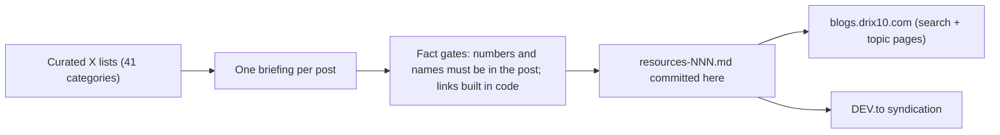

<h1 align="center">AI Resources</h1>

  <strong>Short, sourced briefings on AI tools, models, research, companies and the people building them. 
  100,000+ items across 41 categories, updated as the curated feeds move, each linked back to where it came from.</strong>

  
  
  
  

  <a href="#-resource-categories"><b>Browse the categories</b></a> ·
  <a href="https://github.com/search?q=repo%3ADrix10%2Fai-resources+MCP&type=code"><b>Search the archive</b></a> ·
  <a href="https://github.com/Drix10/ai-resources/issues/new/choose"><b>Suggest a source</b></a> ·
  <a href="COMPARISONS.md"><b>How this compares</b></a>

> ⭐ **If a digest saved you a scroll through X, star the repo.** It bookmarks the archive for you and helps other people find it.

---

## Why this exists

The useful AI news is spread across thousands of posts on X, most of them threads, hype or reposts. Awesome lists are great reference shelves but they move at the speed of pull requests; newsletters are fast but disappear into your inbox. This repo sits in between:

- **Small and dense.** Each item is a headline, two or three sentences and the key numbers. No intros, no "in today's fast-moving world".
- **Sourced.** Current digests link every item to its original post and to any page that post points to. Numbers and names are checked against the post before anything is committed.
- **Organized by who and what.** 41 categories, from AI Developer Tools and CS Academics to VC Firms, Quantum Computing and Climate Tech, each fed by its own hand-picked X lists.
- **Plain Markdown in a public repo.** Read it on GitHub, clone it, grep it, or feed it to your own tools. Recent digests are also published with search and topic pages on [blogs.drix10.com](https://blogs.drix10.com).

See [COMPARISONS.md](COMPARISONS.md) for how it stacks up against awesome lists and AI newsletters, including where they are the better choice.

## What a digest looks like

Every `resources-NNN.md` file is one digest of 5 to 12 items. A real item from [AI Developer Tools #296](AI%20Developer%20Tools/resources-296.md):

> ### 🤖 Nemotron 3.5 Super VL E2EE inference 500+ tokens/sec on one GPU
>
> NVIDIA Nemotron 3.5 Super VL is an open multimodal model that runs with end-to-end encrypted inference at over 500 output tokens per second on a single NVIDIA B300 GPU. […]
>
> **Key Points:** 500+ output tokens per second for a single request on one B300 GPU · 120B total parameters, 12B active MoE per token
>
> 🔗 [Original post](https://x.com/blackboxai/status/2111177845292794036) · [Linked page](https://www.blackbox.ai/blog/nemotron-3-5-super-vl)

## How to use it

| You want to… | Do this |
| --- | --- |
| Catch up on one area | Open its category below and read the newest digest (the list shows its headlines). |
| Keep it handy | ⭐ Star it, or follow the [RSS feed](https://blogs.drix10.com/rss.xml) for new digests. |
| Search | GitHub code search covers the whole archive: `repo:Drix10/ai-resources "MCP"`. Recent digests are also on [blogs.drix10.com/search](https://blogs.drix10.com/search). |
| Use the data | `git clone --depth 1 https://github.com/Drix10/ai-resources` and parse the Markdown. Attribution terms are in [LICENSE](LICENSE). |
| Add a source or fix an item | [Open an issue](https://github.com/Drix10/ai-resources/issues/new/choose); see [CONTRIBUTING.md](CONTRIBUTING.md). |

## How it works

Digests are written by the open-source [ai-resources-pipeline](https://github.com/Drix10/ai-resources-pipeline): it reads curated X lists per category, writes one short briefing per strong post, rejects anything whose numbers or names are not in the source, strips secrets, and commits the batch here. The same run updates the category list below and publishes to the blog.

**Known limits:** digests are machine-written from public posts and can be wrong; check the linked source before you rely on a number. Part of the older archive (2024 to mid-2026) predates source links. Inclusion is not endorsement.

## About the curator

Built and maintained by **[Drishtant Ghosh (Drix10)](https://drix10.com)**, an AI systems engineer and 1x acquired founder (ReeF, acquired August 2024) based in Bengaluru. Founder of CosLynx.com, AI systems architect on Canopy @ Founders, Inc., Backdrop Build v4 and v6 finalist. More writing at [blogs.drix10.com](https://blogs.drix10.com).

<!-- drix10-footer -->
---

**Built by [Drishtant Ghosh (Drix10)](https://drix10.com)** · AI systems engineer and 1x acquired founder, Bengaluru

[Portfolio](https://drix10.com) · [LinkedIn](https://www.linkedin.com/in/drix10) · [X](https://x.com/DrishtantGhosh) · [Blog](https://blogs.drix10.com) · [All projects](https://github.com/Drix10)

More from Drix10: [Agent Flow](https://github.com/Drix10/agent-flow) (guardrails for AI coding agents) · [MiroHedge](https://github.com/Drix10/hypothesis-arena) (AI-assisted systematic fund) · [Guardian](https://github.com/Drix10/guardian-gpt) (UPI scam interceptor) · [Sentinel](https://github.com/Drix10/sentinal) (AI security CLI) · [Keystroke-LLM](https://github.com/Drix10/keystroke-llm) (NumPy transformer on a keyboard)

---

## 📚 Resource Categories

### AI Developer Tools

293 digests · [latest: #296](https://github.com/Drix10/ai-resources/blob/main/AI%20Developer%20Tools/resources-296.md) · [read on the blog](https://blogs.drix10.com/categories/ai-developer-tools)

*   Nemotron 3.5 Super VL E2EE inference 500+ tokens/sec on one GPU
*   GPT-6.1 Sol uses 53% fewer credits than Gemini 4 Argon
*   Risphai web search cheaper and faster, uses 2–6 credits

### AI Leaders and Thinkers

286 digests · [latest: #286](https://github.com/Drix10/ai-resources/blob/main/AI%20Leaders%20and%20Thinkers/resources-286.md) · [read on the blog](https://blogs.drix10.com/categories/ai-leaders-and-thinkers)

*   Claude Code PRs double, revert share down 40%
*   Muxin – one app for all computers launched
*   KITH app home tab Kith Live features Armani x Kith collection

### AI Companies and Ventures

285 digests · [latest: #285](https://github.com/Drix10/ai-resources/blob/main/AI%20Companies%20and%20Ventures/resources-285.md) · [read on the blog](https://blogs.drix10.com/categories/ai-companies-and-ventures)

*   Muse Spark Open release with 816B parameters
*   Span-02 on OpenRouter launches with $0.01/M input tokens
*   Gemini 4 Argon (High) lands #5 in Agent Arena with +13.2% net improvement

### CS Academics

303 digests · [latest: #303](https://github.com/Drix10/ai-resources/blob/main/CS%20Academics/resources-303.md) · [read on the blog](https://blogs.drix10.com/categories/cs-academics)

*   GitHub CSS Modules migration cuts render time 55% and speeds init 25%
*   MGAEnt cuts creative brief time ~60% with Airtable
*   Personal CFO launch with Plaid integration announced

### Tech VIPs

293 digests · [latest: #293](https://github.com/Drix10/ai-resources/blob/main/Tech%20VIPs/resources-293.md) · [read on the blog](https://blogs.drix10.com/categories/tech-vips)

*   Gateway and Workers integration public beta
*   Claude Managed Agents dynamic workflows go public beta

### VC Firms

289 digests · [latest: #289](https://github.com/Drix10/ai-resources/blob/main/VC%20Firms/resources-289.md) · [read on the blog](https://blogs.drix10.com/categories/vc-firms)

*   Maryland Requires Dispensaries to Report Sales Tax
*   FourthPower thermal battery 25 MW, 50-hour demo in Massachusetts
*   Rho launches LLC formation and banking in one flow

### Devs, Designers, DevRel

294 digests · [latest: #294](https://github.com/Drix10/ai-resources/blob/main/Devs%2C%20Designers%2C%20DevRel/resources-294.md) · [read on the blog](https://blogs.drix10.com/categories/devs-designers-devrel)

*   Claude Code and Codex API evaluation reveals leaders
*   Anthropic outgrew git with 25M CI jobs per day
*   JourneyMaker Early Access invites sent out today

### Tech Infrastructure

268 digests · [latest: #268](https://github.com/Drix10/ai-resources/blob/main/Tech%20Infrastructure/resources-268.md) · [read on the blog](https://blogs.drix10.com/categories/tech-infrastructure)

*   Ryan Dahl leaves Deno, Cloudflare acquires his startup
*   Framer Gallery refreshed with expanded categories and vibe filter

### Founders and Entrepreneurs

261 digests · [latest: #261](https://github.com/Drix10/ai-resources/blob/main/Founders%20and%20Entrepreneurs/resources-261.md) · [read on the blog](https://blogs.drix10.com/categories/founders-and-entrepreneurs)

*   Ticket Broker 7,624 tickets $1M markup
*   Solo Angels – Early access to invest in solo-founded companies
*   Nvidia and ChipAgents launch evaluation for AI chip design

### AI Organizations and Media

283 digests · [latest: #283](https://github.com/Drix10/ai-resources/blob/main/AI%20Organizations%20and%20Media/resources-283.md) · [read on the blog](https://blogs.drix10.com/categories/ai-organizations-and-media)

*   BELIEFWEAVER boosts long-horizon agent scores
*   OpenAI models success rate rises to 35% in 16 months
*   Nemotron 3.5 Super VL 120B parameters launch

### AI Powered Film and Media

270 digests · [latest: #270](https://github.com/Drix10/ai-resources/blob/main/AI%20Powered%20Film%20and%20Media/resources-270.md) · [read on the blog](https://blogs.drix10.com/categories/ai-powered-film-and-media)

*   Higgsfield Academy launches AI course for creators
*   GPT-6 Pro upgrade with faster responses and parallel agents

### AI Holodeck and Virtual Worlds

273 digests · [latest: #273](https://github.com/Drix10/ai-resources/blob/main/AI%20Holodeck%20and%20Virtual%20Worlds/resources-273.md) · [read on the blog](https://blogs.drix10.com/categories/ai-holodeck-and-virtual-worlds)

*   Tavus PAL Kiosk mode pilot launch with 134 ms rendering
*   Beam model launch with open weights and partner ecosystem
*   ComfyUI $25K prizes for open-source builds, RTX 5090s offered

### AI Artists and Creators

268 digests · [latest: #268](https://github.com/Drix10/ai-resources/blob/main/AI%20Artists%20and%20Creators/resources-268.md) · [read on the blog](https://blogs.drix10.com/categories/ai-artists-and-creators)

*   Inworld MiMo 2.6 Pro pricing for cached and uncached inference
*   Starlink speed limit 22 m/s, Starshield contracts, Pentagon changes

### AI in Healthcare and Science

275 digests · [latest: #275](https://github.com/Drix10/ai-resources/blob/main/AI%20in%20Healthcare%20and%20Science/resources-275.md) · [read on the blog](https://blogs.drix10.com/categories/ai-in-healthcare-and-science)

*   OpenMed – 2,277 open models and 26 datasets announced
*   GSK showcases pipeline momentum across lung
*   TIME 2026 Best Invention self-driving lab speeds science

### AI Generated Music and Audio

273 digests · [latest: #273](https://github.com/Drix10/ai-resources/blob/main/AI%20Generated%20Music%20and%20Audio/resources-273.md) · [read on the blog](https://blogs.drix10.com/categories/ai-generated-music-and-audio)

*   REKI 2.4B vision-language-action model announced with public-data pretraining
*   Beyond Fixed Targets: One-Shot Speaker Personalization
*   Modeling and Design of a Diaphragm-Integrated Photonic Waveguide Microphone

### AI Consulting and Expertise

265 digests · [latest: #265](https://github.com/Drix10/ai-resources/blob/main/AI%20Consulting%20and%20Expertise/resources-265.md) · [read on the blog](https://blogs.drix10.com/categories/ai-consulting-and-expertise)

*   Glimpse visual thinking model launch announced
*   Glimpse visual thinking model launch with competitive performance vs Astra
*   Frontier AIs debate controversial questions, judged by AI

### AI Professionals and Community

267 digests · [latest: #267](https://github.com/Drix10/ai-resources/blob/main/AI%20Professionals%20and%20Community/resources-267.md) · [read on the blog](https://blogs.drix10.com/categories/ai-professionals-and-community)

*   Gemini-4 Argon hits 81.9% on RoboVista robotics benchmark
*   Contact-UAN – 20% lower torque, 43% lower force error
*   Mirror Rust agent core adds python TUI and HTTP API

### AI Policy and Ethical Considerations

265 digests · [latest: #265](https://github.com/Drix10/ai-resources/blob/main/AI%20Policy%20and%20Ethical%20Considerations/resources-265.md) · [read on the blog](https://blogs.drix10.com/categories/ai-policy-and-ethical-considerations)

*   GLM-5.3 scores 160, beats GPT-5.4 on Cyber ECI
*   Anthropic AI expectations gap – staff predict 80% of model building by 2027
*   Super Intelligence Force inaugural meeting, risk report direction

### AI in Real Estate and Property Tech

256 digests · [latest: #256](https://github.com/Drix10/ai-resources/blob/main/AI%20in%20Real%20Estate%20and%20Property%20Tech/resources-256.md) · [read on the blog](https://blogs.drix10.com/categories/ai-in-real-estate-and-property-tech)

*   Realpage Economy Express – inflation hits, Fed hike likely
*   West Development Index 52.4 September 2026 above expansion line
*   Autotelic Concept Studio – basement concept launch with clear estimate

### AI and Robotics Applications

270 digests · [latest: #270](https://github.com/Drix10/ai-resources/blob/main/AI%20and%20Robotics%20Applications/resources-270.md) · [read on the blog](https://blogs.drix10.com/categories/ai-and-robotics-applications)

*   Phantom of the ADAS paper shows stop sign phantom and GhostBusters fix
*   pplx-decider-v1.2 and pplx-decider-flash-v1.2 release
*   text-to-cad reaches 20,000 stars on GitHub

### AI Driven Vehicles and Transportation

266 digests · [latest: #266](https://github.com/Drix10/ai-resources/blob/main/AI%20Driven%20Vehicles%20and%20Transportation/resources-266.md) · [read on the blog](https://blogs.drix10.com/categories/ai-driven-vehicles-and-transportation)

*   Gemini 4 Argon sets new SoTA on WANDR, now in Perplexity
*   Wayve AI replaces Mobileye in VW driving
*   Autonomy Signals – analysis of robotaxi safety, XPENG strategy, Føtex humanoids

### AI for Content Creation and Marketing

262 digests · [latest: #262](https://github.com/Drix10/ai-resources/blob/main/AI%20for%20Content%20Creation%20and%20Marketing/resources-262.md) · [read on the blog](https://blogs.drix10.com/categories/ai-for-content-creation-and-marketing)

*   PressBot admin username leak fixed in a day
*   Tesla Roadster engagement 4.6x volume, sentiment flat
*   Notion Desktop app virtual tabs improve memory usage

### AR VR Companies and Development

260 digests · [latest: #260](https://github.com/Drix10/ai-resources/blob/main/AR%20VR%20Companies%20and%20Development/resources-260.md) · [read on the blog](https://blogs.drix10.com/categories/ar-vr-companies-and-development)

*   Xreal Aura Prices $1,279, Sony Transfers XR Patents to Meta
*   Fabula Rasa estreia no Meta Quest em novembro
*   Embervault Dungeon of The Three Seals graphics remake

### AR VR Professionals and Community

257 digests · [latest: #257](https://github.com/Drix10/ai-resources/blob/main/AR%20VR%20Professionals%20and%20Community/resources-257.md) · [read on the blog](https://blogs.drix10.com/categories/ar-vr-professionals-and-community)

*   GolfBigCedar Payne's Valley Course Launch
*   Gemini 4 Argon recreates interactive lens lab demo in three.js – 45 minutes
*   Backdrop 2.10 adds per-Space live wallpapers and lock screen support

### Climate and Weather Technology

257 digests · [latest: #257](https://github.com/Drix10/ai-resources/blob/main/Climate%20and%20Weather%20Technology/resources-257.md) · [read on the blog](https://blogs.drix10.com/categories/climate-and-weather-technology)

*   Thwaites Glacier melting more aggressively, impacts could double estimates
*   Operation M&M's drones and weather balloons launch
*   Artemis II lunar data library now available

### Computer Vision and AI Applications

259 digests · [latest: #259](https://github.com/Drix10/ai-resources/blob/main/Computer%20Vision%20and%20AI%20Applications/resources-259.md) · [read on the blog](https://blogs.drix10.com/categories/computer-vision-and-ai-applications)

*   Beam shipping with DFlash2 3× faster decode
*   Dominion Energy adds 100 docked drones, saves hours
*   Glimpse visual reasoning model launch with $55M funding

### Crypto and Web3

252 digests · [latest: #252](https://github.com/Drix10/ai-resources/blob/main/Crypto%20and%20Web3/resources-252.md) · [read on the blog](https://blogs.drix10.com/categories/crypto-and-web3)

*   TRON stablecoin supply $95.3B after $554.9M weekly rise
*   Anthropic quantum gate count vs ecdsa.fail benchmark
*   ASPIRE V1.0 open-sourced with real-robot skill discovery

### Decentralized AI

252 digests · [latest: #252](https://github.com/Drix10/ai-resources/blob/main/Decentralized%20AI/resources-252.md) · [read on the blog](https://blogs.drix10.com/categories/decentralized-ai)

*   Helium Indoor Wi-Fi Coverage – Helium proves Wi-Fi trust
*   Forth – AI gateway launch with 500,000 RENDER incentive program
*   Roblox 3D foundation model texture generator release 4k PBR

### The Exponential Future

254 digests · [latest: #254](https://github.com/Drix10/ai-resources/blob/main/The%20Exponential%20Future/resources-254.md) · [read on the blog](https://blogs.drix10.com/categories/the-exponential-future)

*   Consumer Staples up 9.1% in first 12 trading days
*   TPUv7 first Agentic benchmark 1.42x perf/$ vs GB300
*   Staples up 9.1% in first 12 days, 4th start since 1990

### AI Education

270 digests · [latest: #270](https://github.com/Drix10/ai-resources/blob/main/AI%20Education/resources-270.md) · [read on the blog](https://blogs.drix10.com/categories/ai-education)

*   Muse Spark Open open-sourced, 816B params, 42B active MoE
*   Dynamic graph of primary school concepts open-sourced, 1,590 concepts
*   REA released as MIT-licensed open source tool

### AI in Enterprise Applications

258 digests · [latest: #258](https://github.com/Drix10/ai-resources/blob/main/AI%20in%20Enterprise%20Applications/resources-258.md) · [read on the blog](https://blogs.drix10.com/categories/ai-in-enterprise-applications)

*   NVIDIA Vera Rubin NVL72 throughput per megawatt up to 5.7x
*   AIsa raises $9M+ and reports 250k agents, 100M transactions
*   Aqua Pet: Desktop pet with 41 million combos

### Interesting Finds

252 digests · [latest: #252](https://github.com/Drix10/ai-resources/blob/main/Interesting%20Finds/resources-252.md) · [read on the blog](https://blogs.drix10.com/categories/interesting-finds)

*   Edge Action Fund drops $2.5M each in Kansas and Nebraska Senate races
*   OpenAI 372 problems solved, biggest day in math

### Investors and Venture Capital

249 digests · [latest: #249](https://github.com/Drix10/ai-resources/blob/main/Investors%20and%20Venture%20Capital/resources-249.md) · [read on the blog](https://blogs.drix10.com/categories/investors-and-venture-capital)

*   Set latest stable version adds 64 status effects, 350+ prefixes
*   Metric launch achieves ~20% of Robinhood DEX volume
*   AI companies revenue from other AI firms, 70-80% share, 83% VC funding

### Cybersecurity and Tech

233 digests · [latest: #233](https://github.com/Drix10/ai-resources/blob/main/Cybersecurity%20and%20Tech/resources-233.md) · [read on the blog](https://blogs.drix10.com/categories/cybersecurity-and-tech)

*   Cuban Eight packages PE payload into .wsl installer
*   Firedancer bug bounty platform live, $1M contest
*   AI models may be capable of self-replicating without access to a datacenter

### Neuroscience and AI

238 digests · [latest: #238](https://github.com/Drix10/ai-resources/blob/main/Neuroscience%20and%20AI/resources-238.md) · [read on the blog](https://blogs.drix10.com/categories/neuroscience-and-ai)

*   Neoantigen vaccine + PD-1 blockade phase 1 trial
*   Voyager 1 reaches one light-day from Earth
*   Johnson & Johnson–Bristol Myers Squibb alliance stroke update

### PR and Communications

237 digests · [latest: #237](https://github.com/Drix10/ai-resources/blob/main/PR%20and%20Communications/resources-237.md) · [read on the blog](https://blogs.drix10.com/categories/pr-and-communications)

*   Gen Z is bringing back something the digital age was supposed to replace
*   Surface Laptop Ultra – new flagship with Nvidia RTX Spark N1X superchip
*   You Can See Everything documentary earns $1.75M opening

### Quantum Computing

236 digests · [latest: #236](https://github.com/Drix10/ai-resources/blob/main/Quantum%20Computing/resources-236.md) · [read on the blog](https://blogs.drix10.com/categories/quantum-computing)

*   NEDO Challenge second place QoL category announcement
*   Ketworks launch community site with Ketbook and Ketboard
*   IonQ Superion 256 – integrated electronic qubit control announced

### Spatial Computing

235 digests · [latest: #235](https://github.com/Drix10/ai-resources/blob/main/Spatial%20Computing/resources-235.md) · [read on the blog](https://blogs.drix10.com/categories/spatial-computing)

*   GLM-5.3 beats GPT-5.4 with score 160 on Cyber ECI
*   Frida new iOS personal agent launches on TestFlight

### Tech Companies and News

232 digests · [latest: #232](https://github.com/Drix10/ai-resources/blob/main/Tech%20Companies%20and%20News/resources-232.md) · [read on the blog](https://blogs.drix10.com/categories/tech-companies-and-news)

*   Beam 1.0 release announced by Reflection AI
*   WindHawk dark mode mod for Windows 11 released

### Tech Journalists and VIPs

232 digests · [latest: #232](https://github.com/Drix10/ai-resources/blob/main/Tech%20Journalists%20and%20VIPs/resources-232.md) · [read on the blog](https://blogs.drix10.com/categories/tech-journalists-and-vips)

*   Coinbase Advanced engine 60x faster median response
*   ClinOpsBench Trial Oversight release with 15 AI agents test
*   Asakana automates food distributor sales without ERP change

### World News and Updates

229 digests · [latest: #229](https://github.com/Drix10/ai-resources/blob/main/World%20News%20and%20Updates/resources-229.md) · [read on the blog](https://blogs.drix10.com/categories/world-news-and-updates)

*   Truth Social traffic fell 30% year ending September
*   SK Hynix seeks US approval to export equipment to China

---

**Found something useful?** ⭐ [Star the repo](https://github.com/Drix10/ai-resources) to keep it handy and help others find it, or [suggest a source](https://github.com/Drix10/ai-resources/issues/new/choose).

Summaries © Drishtant Ghosh, licensed [CC BY 4.0](LICENSE). Every digest links to its original post where one exists; the posts and linked pages belong to their authors.

