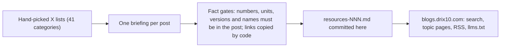

<div align="center">

<a href="https://blogs.drix10.com"></a>

<a href="https://github.com/Drix10/ai-resources/stargazers"></a>
<a href="https://github.com/Drix10/ai-resources/commits/main"></a>
<a href="https://www.npmjs.com/package/ai-resources-mcp"></a>
<a href="https://blogs.drix10.com/rss.xml"></a>
<a href="LICENSE"></a>

<b><a href="https://blogs.drix10.com">Read it</a></b> · <b><a href="#-resource-categories">Browse 41 categories</a></b> · <b><a href="#use-it-from-your-ai-agent">Plug it into your agent</a></b> · <b><a href="https://github.com/search?q=repo%3ADrix10%2Fai-resources+MCP&type=code">Search the archive</a></b>

</div>

<table>
<tr>
<td width="25%" valign="top"><b>Checked against the source</b><br><sub>A number, unit, model version or name that is not in the source post gets the briefing rejected and rewritten.</sub></td>
<td width="25%" valign="top"><b>Every claim has a link</b><br><sub>The original post and the page it points to, copied by code, never written by the model.</sub></td>
<td width="25%" valign="top"><b>41 categories</b><br><sub>Models, dev tools, research and funding, plus robotics, climate, quantum, security and crypto.</sub></td>
<td width="25%" valign="top"><b>Ready for your agent</b><br><sub>MCP server, Agent Skill, JSON API and llms.txt. Plain Markdown under CC BY 4.0.</sub></td>
</tr>
</table>

## Three ways in

<table>
<tr>
<td width="55%"><a href="https://blogs.drix10.com"></a></td>
<td width="45%" valign="top">
<h3><a href="https://blogs.drix10.com">Read it</a></h3>
The newest digests on <a href="https://blogs.drix10.com">blogs.drix10.com</a>, with search, topic pages and an <a href="https://blogs.drix10.com/rss.xml">RSS feed</a>. Or open any category <a href="#-resource-categories">below</a> and read its latest digest here on GitHub.
<br><br>
Star and watch the repo to get new digests as they land.
</td>
</tr>
<tr>
<td width="55%"><a href="USE-WITH-AI.md"></a></td>
<td width="45%" valign="top">
<h3><a href="#use-it-from-your-ai-agent">Ask it from your agent</a></h3>
Claude, Cursor, VS Code or Windsurf answer "what did Anthropic ship this week?" from the briefings, with dates and source links. No key, no account. <a href="#use-it-from-your-ai-agent">Setup for every client ↓</a>
<br><br>
<code>claude mcp add ai-resources -- npx -y ai-resources-mcp</code>
</td>
</tr>
<tr>
<td width="55%"></td>
<td width="45%" valign="top">
<h3>Clone it</h3>
100,000+ dated, sourced briefings in plain Markdown for RAG, evals or an offline index. Every <code>resources-NNN.md</code> holds 5 to 12 of them, like <a href="AI%20Developer%20Tools/resources-296.md">this one</a>.
<br><br>
<code>git clone --depth 1 https://github.com/Drix10/ai-resources</code>
</td>
</tr>
</table>

## What a briefing looks like

<a href="AI%20Developer%20Tools/resources-296.md"></a>
<p align="center"><sub>A real briefing from <a href="AI%20Developer%20Tools/resources-296.md">AI Developer Tools #296</a>. Every digest file holds 5 to 12 of these.</sub></p>


## Signals: what is accelerating in AI

<a href="https://blogs.drix10.com/signals"></a>
<p align="center"><sub><a href="https://blogs.drix10.com/signals">Signals</a>, computed weekly: topics whose coverage climbs three weeks running. Trajectories, not predictions — and nothing on it is written by a model.</sub></p>

Briefings tell you what happened. Signals tells you what it means: which topics are accelerating, with the sample headlines and source links behind every call. Computed from counts only (one briefing = one vote), in the open: [`MOVEMENTS.md`](MOVEMENTS.md) in this repo, [`/api/signals`](https://blogs.drix10.com/api/signals) for code, and the `trending_movements` MCP tool for agents.

## Who it is for

- **Engineers building with AI.** What changed in models, inference, agents, MCP and dev tools, with the benchmark number and the link, in [AI Developer Tools](#ai-developer-tools) and [Tech Infrastructure](#tech-infrastructure).
- **Founders and investors.** Rounds, launches and revenue figures as they are announced, in [AI Companies and Ventures](#ai-companies-and-ventures), [VC Firms](#vc-firms) and [Founders and Entrepreneurs](#founders-and-entrepreneurs).
- **Researchers and students.** What the people in the field are publishing and arguing about, in [CS Academics](#cs-academics) and [Neuroscience and AI](#neuroscience-and-ai).
- **Anyone building RAG, agents or evals.** A 100,000-item corpus of dated, sourced AI news under CC BY 4.0.

Awesome lists are still the better pick for a vetted shortlist, and a newsletter for five editor-picked minutes a day. [COMPARISONS.md](COMPARISONS.md) lays out where this fits.

## Use it from your AI agent

Five ways to plug the briefings into an agent or your own code. None needs a key or an account. Full reference: **[USE-WITH-AI.md](USE-WITH-AI.md)**.

| Path | Best for | Setup |
| --- | --- | --- |
| [MCP server](#mcp-server) | Claude Code, Claude Desktop, Cursor, VS Code, Windsurf | one command or one JSON block |
| [Agent Skill](#agent-skill) | Claude Code and other Skill-aware agents | copy one folder |
| [JSON API](#json-api) | your own code, custom GPT actions, scripts | none, CORS open |
| [llms.txt and RSS](#llmstxt-and-rss) | any LLM that reads a URL, feed readers, bots | none |
| [Raw Markdown](#three-ways-in) | RAG, evals, offline indexes, all 100,000+ briefings | `git clone` |

### MCP server

<a href="https://www.npmjs.com/package/ai-resources-mcp"></a>
<a href="https://registry.modelcontextprotocol.io/v0/servers?search=io.github.Drix10/ai-resources"></a>


Published on npm as [`ai-resources-mcp`](https://www.npmjs.com/package/ai-resources-mcp) (MIT, code in [`mcp/`](mcp/)). `npx` fetches it on first run, so there is nothing to install by hand.

| Tool | What it does |
| --- | --- |
| `search_briefings(query, category?, limit?, since?)` | Keyword search, newest first. All words must match. `since` is `YYYY-MM-DD`. |
| `latest(category?, limit?)` | The newest briefings, overall or for one category. |
| `get_briefing(id)` | Full Markdown of one briefing (URL or slug), with every source link. |
| `list_categories()` | Every category slug with its briefing count. |
| `trending_movements(limit?)` | Topics accelerating week over week (rising) or hot for one week (watch), with sample headlines and source links. |

Every result ends with its source link and `Data: github.com/Drix10/ai-resources (CC BY 4.0)`, so answers stay citable.

**Claude Code**

```bash
claude mcp add ai-resources -- npx -y ai-resources-mcp
```

<details>
<summary><b>Claude Desktop, Cursor, Windsurf</b></summary>

<br>

Add this to `claude_desktop_config.json` (Claude Desktop: Settings → Developer → Edit Config), `~/.cursor/mcp.json` or `.cursor/mcp.json` (Cursor), or `~/.codeium/windsurf/mcp_config.json` (Windsurf):

```json
{
  "mcpServers": {
    "ai-resources": { "command": "npx", "args": ["-y", "ai-resources-mcp"] }
  }
}
```

</details>

<details>
<summary><b>VS Code</b></summary>

<br>

In `.vscode/mcp.json`, or *MCP: Open User Configuration*:

```json
{
  "servers": {
    "ai-resources": { "type": "stdio", "command": "npx", "args": ["-y", "ai-resources-mcp"] }
  }
}
```

Or from a terminal:

```bash
code --add-mcp "{\"name\":\"ai-resources\",\"command\":\"npx\",\"args\":[\"-y\",\"ai-resources-mcp\"]}"
```

</details>

<details>
<summary><b>Windows, and other settings</b></summary>

<br>

If a client cannot start `npx` on Windows, use `"command": "cmd", "args": ["/c", "npx", "-y", "ai-resources-mcp"]`.

`AI_RESOURCES_API_URL` sets the API base URL (default `https://blogs.drix10.com`).

</details>

Then ask, for example:

- *"What did Anthropic announce this week? Cite the sources."*
- *"Latest five briefings in AI Developer Tools."*
- *"Who raised a Series A in AI this month, and how much?"*

### Agent Skill

[`skills/ai-news`](skills/ai-news/SKILL.md) teaches an agent when and how to answer "what's new in AI", "latest on &lt;model or company&gt;" and "who raised" questions from the briefings, with dates and citations. It uses the MCP tools when they are installed and falls back to the JSON API, then llms.txt, then raw Markdown on GitHub when they are not.

```bash
git clone --depth 1 https://github.com/Drix10/ai-resources
mkdir -p ~/.claude/skills
cp -r ai-resources/skills/ai-news ~/.claude/skills/
```

<details>
<summary><b>One project only, Windows, other agents</b></summary>

<br>

- **One project:** copy it to `.claude/skills/ai-news/` inside that project instead.
- **Windows (PowerShell):** `Copy-Item -Recurse ai-resources\skills\ai-news $HOME\.claude\skills\`
- **Other agents** that read `SKILL.md` folders work the same way. For chat apps without Skills, paste the body of `SKILL.md` into the custom instructions.

</details>

### JSON API

Base URL `https://blogs.drix10.com`. JSON, CORS open, no key. It covers the briefings published on the blog; the full archive is in this repository.

| Request | Returns |
| --- | --- |
| `GET /api/articles?q=&category=&since=&limit=&page=` | `{ items, total, page, limit, totalPages, license }`, newest first. All words in `q` must match; every parameter is optional. |
| `GET /api/articles?slug=<slug or URL>` | One item, plus `content` (the full Markdown). |
| `GET /api/categories` | `{ items: [{ name, slug, count, url, llms }] }` |

Each item has `title`, `url`, `slug`, `category`, `categorySlug`, `date`, `description`, `headlines` (every news item in the briefing) and `sources` (`[{ title, url }]`, the original posts).

```bash
curl "https://blogs.drix10.com/api/articles?q=anthropic&since=2026-10-01&limit=5"
curl "https://blogs.drix10.com/api/categories"
```

### llms.txt and RSS

- [`/llms.txt`](https://blogs.drix10.com/llms.txt): the index, linking every category.
- `/llms/<category-slug>.txt`: the 50 newest briefings of one category, for example [`/llms/ai-developer-tools.txt`](https://blogs.drix10.com/llms/ai-developer-tools.txt).
- [`/rss.xml`](https://blogs.drix10.com/rss.xml): for feed readers, Slack or Discord feed bots and email-digest services.

When you show the data anywhere, credit it as `Data: github.com/Drix10/ai-resources (CC BY 4.0)`. The MCP server and the Skill add that line for you.

## By the numbers

Counted from this repository on 29 October 2026. The archive only grows.

| | |
| ---: | --- |
| **100,000+** | briefings: a headline, two or three sentences and the key numbers, one per post |
| **10,800+** | digest files (`resources-NNN.md`) across **41 categories** |
| **10,900+** | commits since November 2024, all made by an automated pipeline |
| **14,000+** | briefings that link both the original post and the page it points to (every briefing since mid-2026) |
| **~2,000** | of them published as articles on [blogs.drix10.com](https://blogs.drix10.com) with search, topic pages, an [RSS feed](https://blogs.drix10.com/rss.xml) and [llms.txt](https://blogs.drix10.com/llms.txt) |

## How it is built

Nobody types these. A pipeline reads the hand-picked X lists for each category, writes one briefing per strong post, runs the fact gates, strips secrets, de-duplicates across categories and commits the batch here. The same run refreshes the category list below and publishes to the blog.



**Known limits:** briefings are machine-written from public posts and can still be wrong; check the linked source before you rely on a number. Part of the older archive (2024 to mid-2026) predates source links. Coverage follows the hand-picked lists, blind spots included. Inclusion is not endorsement.

## Contribute

A pipeline writes the briefings. People pick the sources and fix what it gets wrong. Ways in:

- **Pick up a [good first issue](https://github.com/Drix10/ai-resources/issues?q=is%3Aissue+is%3Aopen+label%3A%22good+first+issue%22)**: MCP server tools, Skill phrasings, guides, examples, translations.
- **[Suggest a source](https://github.com/Drix10/ai-resources/issues/new?template=suggest-source.yml)** (an X account, list or site) or **[report a wrong fact](https://github.com/Drix10/ai-resources/issues/new?template=wrong-fact.yml)** with the briefing link.
- **Ask, share what you built, or float an idea** in [Discussions](https://github.com/Drix10/ai-resources/discussions).

[CONTRIBUTING.md](CONTRIBUTING.md) has the details, including what not to edit by hand. Content is CC BY 4.0; the MCP server code is MIT. If you use the archive in research, [CITATION.cff](CITATION.cff) has the citation.

## Star history

<a href="https://star-history.com/#Drix10/ai-resources&Date"></a>

## About the curator

Built and maintained by **[Drishtant Ghosh (Drix10)](https://drix10.com)**, an AI systems engineer and 1x acquired founder (ReeF, acquired August 2024) based in Bengaluru. Founder of CosLynx.com, AI systems architect on Canopy @ Founders, Inc., Backdrop Build v4 and v6 finalist. More writing at [blogs.drix10.com](https://blogs.drix10.com).

<!-- drix10-footer -->
---

<div align="center">

**Built by [Drishtant Ghosh (Drix10)](https://drix10.com)** · AI systems engineer and 1x acquired founder, Bengaluru

[Portfolio](https://drix10.com) · [LinkedIn](https://www.linkedin.com/in/drix10) · [X](https://x.com/DrishtantGhosh) · [Blog](https://blogs.drix10.com) · [All projects](https://github.com/Drix10)

<sub>More from Drix10: [Agent Flow](https://github.com/Drix10/agent-flow) (guardrails for AI coding agents) · [MiroHedge](https://github.com/Drix10/hypothesis-arena) (AI-assisted systematic fund) · [Guardian](https://github.com/Drix10/guardian-gpt) (UPI scam interceptor) · [Sentinel](https://github.com/Drix10/sentinal) (AI security CLI) · [Keystroke-LLM](https://github.com/Drix10/keystroke-llm) (NumPy transformer on a keyboard)</sub>

</div>

---

## 📚 Resource Categories

**11,297 digests in 41 categories.** Each category shows its newest headlines; jump to one:

<sub>[AI Developer Tools](#ai-developer-tools) · [AI Leaders and Thinkers](#ai-leaders-and-thinkers) · [AI Companies and Ventures](#ai-companies-and-ventures) · [CS Academics](#cs-academics) · [Tech VIPs](#tech-vips) · [VC Firms](#vc-firms) · [Devs, Designers, DevRel](#devs-designers-devrel) · [Tech Infrastructure](#tech-infrastructure) · [Founders and Entrepreneurs](#founders-and-entrepreneurs) · [AI Organizations and Media](#ai-organizations-and-media) · [AI Powered Film and Media](#ai-powered-film-and-media) · [AI Holodeck and Virtual Worlds](#ai-holodeck-and-virtual-worlds) · [AI Artists and Creators](#ai-artists-and-creators) · [AI in Healthcare and Science](#ai-in-healthcare-and-science) · [AI Generated Music and Audio](#ai-generated-music-and-audio) · [AI Consulting and Expertise](#ai-consulting-and-expertise) · [AI Professionals and Community](#ai-professionals-and-community) · [AI Policy and Ethical Considerations](#ai-policy-and-ethical-considerations) · [AI in Real Estate and Property Tech](#ai-in-real-estate-and-property-tech) · [AI and Robotics Applications](#ai-and-robotics-applications) · [AI Driven Vehicles and Transportation](#ai-driven-vehicles-and-transportation) · [AI for Content Creation and Marketing](#ai-for-content-creation-and-marketing) · [AR VR Companies and Development](#ar-vr-companies-and-development) · [AR VR Professionals and Community](#ar-vr-professionals-and-community) · [Climate and Weather Technology](#climate-and-weather-technology) · [Computer Vision and AI Applications](#computer-vision-and-ai-applications) · [Crypto and Web3](#crypto-and-web3) · [Decentralized AI](#decentralized-ai) · [The Exponential Future](#the-exponential-future) · [AI Education](#ai-education) · [AI in Enterprise Applications](#ai-in-enterprise-applications) · [Interesting Finds](#interesting-finds) · [Investors and Venture Capital](#investors-and-venture-capital) · [Cybersecurity and Tech](#cybersecurity-and-tech) · [Neuroscience and AI](#neuroscience-and-ai) · [PR and Communications](#pr-and-communications) · [Quantum Computing](#quantum-computing) · [Spatial Computing](#spatial-computing) · [Tech Companies and News](#tech-companies-and-news) · [Tech Journalists and VIPs](#tech-journalists-and-vips) · [World News and Updates](#world-news-and-updates)</sub>

### AI Developer Tools

<sub>311 digests · [latest: #314](https://github.com/Drix10/ai-resources/blob/main/AI%20Developer%20Tools/resources-314.md) · [read on the blog](https://blogs.drix10.com/categories/ai-developer-tools)</sub>

*   MiniMax H3-Image tops ranking, adds NVIDIA support to vLLM-Omni
*   Qwen4 designs CPU chip from one prompt in 5 hours
*   Code Video next-generation full-stack video workstation announced

### AI Leaders and Thinkers

<sub>304 digests · [latest: #304](https://github.com/Drix10/ai-resources/blob/main/AI%20Leaders%20and%20Thinkers/resources-304.md) · [read on the blog](https://blogs.drix10.com/categories/ai-leaders-and-thinkers)</sub>

*   Gemini 4 Carbon builds 95% of stack in 2 days
*   Qwen4-Max-Preview now in Qoder with 80% discount
*   Multica – multi-person multi-agent scaling vs Orca

### AI Companies and Ventures

<sub>302 digests · [latest: #302](https://github.com/Drix10/ai-resources/blob/main/AI%20Companies%20and%20Ventures/resources-302.md) · [read on the blog](https://blogs.drix10.com/categories/ai-companies-and-ventures)</sub>

*   Raft Artifacts now available to all users
*   AIsa Creator Program – free credits for AI agents
*   Gazebo Sim – open source robotics simulator announced

### CS Academics

<sub>315 digests · [latest: #315](https://github.com/Drix10/ai-resources/blob/main/CS%20Academics/resources-315.md) · [read on the blog](https://blogs.drix10.com/categories/cs-academics)</sub>

*   Gemini Decision 1 pricing and capabilities announced
*   Qwen3.8-27B GGUF release with 5–10% benchmark gain
*   AlphaGenome 2 launch with cell-type specific variant impact

### Tech VIPs

<sub>307 digests · [latest: #307](https://github.com/Drix10/ai-resources/blob/main/Tech%20VIPs/resources-307.md) · [read on the blog](https://blogs.drix10.com/categories/tech-vips)</sub>

*   China 100MW datacenter build cost under $300M
*   Tesla Robotaxi 24-hour service launches in eight cities
*   Grok Bot 1.0 launch – AI teammates for Slack and Teams

### VC Firms

<sub>305 digests · [latest: #305](https://github.com/Drix10/ai-resources/blob/main/VC%20Firms/resources-305.md) · [read on the blog](https://blogs.drix10.com/categories/vc-firms)</sub>

*   AMD Venice SP7 2nm EPYC 9006 server processors ship November 10 2026
*   XNDU Q3 revenue $1.3M and cash $286.5M reported
*   Fractile raises $720M Series C led by Thrive Capital

### Devs, Designers, DevRel

<sub>306 digests · [latest: #306](https://github.com/Drix10/ai-resources/blob/main/Devs%2C%20Designers%2C%20DevRel/resources-306.md) · [read on the blog](https://blogs.drix10.com/categories/devs-designers-devrel)</sub>

*   Remotion transitions – 10 cuts and 510 templates
*   CompositionFilledButtonStyle static factory added for dot-completion
*   CopyPasta private clipboard manager wins MacPip vote

### Tech Infrastructure

<sub>281 digests · [latest: #281](https://github.com/Drix10/ai-resources/blob/main/Tech%20Infrastructure/resources-281.md) · [read on the blog](https://blogs.drix10.com/categories/tech-infrastructure)</sub>

*   SpaceX taxes generate $54 million for Memphis, city $5.6M ahead
*   TPU Sync cuts inference latency up to 90%
*   Appwrite Activity reasons – shows why each change was made

### Founders and Entrepreneurs

<sub>271 digests · [latest: #271](https://github.com/Drix10/ai-resources/blob/main/Founders%20and%20Entrepreneurs/resources-271.md) · [read on the blog](https://blogs.drix10.com/categories/founders-and-entrepreneurs)</sub>

*   Stingray AI laser robots kill lice on salmon, 2,000 units
*   Revenue Per Employee: $237K old median, $655K new
*   Clipping launch – native video clip sharing on X

### AI Organizations and Media

<sub>298 digests · [latest: #298](https://github.com/Drix10/ai-resources/blob/main/AI%20Organizations%20and%20Media/resources-298.md) · [read on the blog](https://blogs.drix10.com/categories/ai-organizations-and-media)</sub>

*   Gemini 4 Hydrogen pricing: $1.50 per 1M tokens
*   Direct GPU Energy Measurements of Batch-Level Sharing saves 12-18% energy per token
*   Horizon 1 50MW AI Cloud deployment completed in 14 months

### AI Powered Film and Media

<sub>278 digests · [latest: #278](https://github.com/Drix10/ai-resources/blob/main/AI%20Powered%20Film%20and%20Media/resources-278.md) · [read on the blog](https://blogs.drix10.com/categories/ai-powered-film-and-media)</sub>

*   Opus 5.5 + Seedance 2.5 used for SEMIR TVC short film
*   SpaceX Starship and Super Heavy first combined catch attempt

### AI Holodeck and Virtual Worlds

<sub>287 digests · [latest: #287](https://github.com/Drix10/ai-resources/blob/main/AI%20Holodeck%20and%20Virtual%20Worlds/resources-287.md) · [read on the blog](https://blogs.drix10.com/categories/ai-holodeck-and-virtual-worlds)</sub>

*   Idol by speridlabs on PixazoAI, 1M Gaussians $0.105 each
*   Seedance 2.5 Flash on Lovart, Pro 5 & Ultimate 20
*   P-Video 2 Pro Avatar launch: 3 min videos, 30 voices

### AI Artists and Creators

<sub>280 digests · [latest: #280](https://github.com/Drix10/ai-resources/blob/main/AI%20Artists%20and%20Creators/resources-280.md) · [read on the blog](https://blogs.drix10.com/categories/ai-artists-and-creators)</sub>

*   MiniMax H3-Image benchmark comparison and 4K claim
*   Drama 3 ComfyUI nodes add v2, speech on 8GB VRAM
*   Carbon /swarm skill makes 3D office model in Three.js

### AI in Healthcare and Science

<sub>290 digests · [latest: #290](https://github.com/Drix10/ai-resources/blob/main/AI%20in%20Healthcare%20and%20Science/resources-290.md) · [read on the blog](https://blogs.drix10.com/categories/ai-in-healthcare-and-science)</sub>

*   INTerpath-001 trial shows 58% risk reduction with personalized vaccine plus pembrolizumab
*   treatment makes hepatitis delta undetectable in 79% of patients
*   ParentApp sexual violence reduction 67% lower in Tanzania

### AI Generated Music and Audio

<sub>287 digests · [latest: #287](https://github.com/Drix10/ai-resources/blob/main/AI%20Generated%20Music%20and%20Audio/resources-287.md) · [read on the blog](https://blogs.drix10.com/categories/ai-generated-music-and-audio)</sub>

*   Scribe v3 and Scribe v3 Live leaderboard rankings and accuracy
*   WVRPS Creators launch free music, sounds, voxel assets with Unreal plugin
*   ElevenAgents new AI assistant for work announced

### AI Consulting and Expertise

<sub>277 digests · [latest: #277](https://github.com/Drix10/ai-resources/blob/main/AI%20Consulting%20and%20Expertise/resources-277.md) · [read on the blog](https://blogs.drix10.com/categories/ai-consulting-and-expertise)</sub>

*   Nanbeige4.3-33B beats Claude Opus 5 on AutomationBench
*   Maxwell optimizes DeepSeek-V4.1-Flash on B200, 3x tokens per GPU
*   Claude Code scaling outreach 10x faster with 20% conversion rate

### AI Professionals and Community

<sub>280 digests · [latest: #280](https://github.com/Drix10/ai-resources/blob/main/AI%20Professionals%20and%20Community/resources-280.md) · [read on the blog](https://blogs.drix10.com/categories/ai-professionals-and-community)</sub>

*   FlashState doubles vLLM throughput on GLM 5.3 Flash
*   Anchor 1 controller launches, lowest tracking errors
*   Alibaba Qwen agent drives 140M first purchases, 4B catalog

### AI Policy and Ethical Considerations

<sub>273 digests · [latest: #273](https://github.com/Drix10/ai-resources/blob/main/AI%20Policy%20and%20Ethical%20Considerations/resources-273.md) · [read on the blog](https://blogs.drix10.com/categories/ai-policy-and-ethical-considerations)</sub>

*   Paris Call for AI Safety commits to model shutdowns
*   Hard Cases for AI Behavioural Design paper released

### AI in Real Estate and Property Tech

<sub>268 digests · [latest: #268](https://github.com/Drix10/ai-resources/blob/main/AI%20in%20Real%20Estate%20and%20Property%20Tech/resources-268.md) · [read on the blog](https://blogs.drix10.com/categories/ai-in-real-estate-and-property-tech)</sub>

*   OpenSC2K – open-source SimCity 2000 remake with 4096-tile cities
*   MiniMax-H3 Prompt Rewriter 27B model launch with 32768-token context
*   GB Studio – drag-and-drop Game Boy editor with CLI exports

### AI and Robotics Applications

<sub>285 digests · [latest: #285](https://github.com/Drix10/ai-resources/blob/main/AI%20and%20Robotics%20Applications/resources-285.md) · [read on the blog](https://blogs.drix10.com/categories/ai-and-robotics-applications)</sub>

*   Agile Robots raises $500M at $8.5B valuation
*   Agile Robots Series F $500M raise at $8.5B valuation
*   RLDX-1.1 released with faster training and 2.28s per parcel

### AI Driven Vehicles and Transportation

<sub>281 digests · [latest: #281](https://github.com/Drix10/ai-resources/blob/main/AI%20Driven%20Vehicles%20and%20Transportation/resources-281.md) · [read on the blog](https://blogs.drix10.com/categories/ai-driven-vehicles-and-transportation)</sub>

*   Syncrolyft world’s largest shiplift 300-meter, 67,000-tonne capacity
*   NVIDIA chip capacity rental by Chinese AI firms amid Huang spy scandal concerns
*   OUXT Polaris competes in Maritime RobotX Challenge 2026

### AI for Content Creation and Marketing

<sub>277 digests · [latest: #277](https://github.com/Drix10/ai-resources/blob/main/AI%20for%20Content%20Creation%20and%20Marketing/resources-277.md) · [read on the blog](https://blogs.drix10.com/categories/ai-for-content-creation-and-marketing)</sub>

*   Wan 3.0 free Thursday video generations 2,000 slots
*   Swarms Marketplace speeds up 4x, adds tipping feature
*   Rox AI hits $1.3B valuation after 12 months, Series B led by General Catalyst and MarchCPs

### AR VR Companies and Development

<sub>273 digests · [latest: #273](https://github.com/Drix10/ai-resources/blob/main/AR%20VR%20Companies%20and%20Development/resources-273.md) · [read on the blog](https://blogs.drix10.com/categories/ar-vr-companies-and-development)</sub>

*   unbound_io mesh generator 4 s per PBR quad mesh
*   A Lightweight Differentiable Method for Real-Time Skin Rendering and Digitization
*   Deformable Texture Maps compile microgeometry into neural textures

### AR VR Professionals and Community

<sub>271 digests · [latest: #271](https://github.com/Drix10/ai-resources/blob/main/AR%20VR%20Professionals%20and%20Community/resources-271.md) · [read on the blog](https://blogs.drix10.com/categories/ar-vr-professionals-and-community)</sub>

*   Meta VR Glasses hand tracking space game adds snap poses
*   Zero Caliber 2 – 100+ ratings, 4.84 score in 3 days
*   Somnium Space returns to Steam next month after purge

### Climate and Weather Technology

<sub>269 digests · [latest: #269](https://github.com/Drix10/ai-resources/blob/main/Climate%20and%20Weather%20Technology/resources-269.md) · [read on the blog](https://blogs.drix10.com/categories/climate-and-weather-technology)</sub>

*   Global Status of Multi-Hazard Early Warning Systems 2026
*   IPCC WGII Co-Chair Winston Chow UNFCCC Side-event Announcement
*   IPCC COP31 Side Event – Join IPCC Chair Jim Skea 12 Nov

### Computer Vision and AI Applications

<sub>274 digests · [latest: #274](https://github.com/Drix10/ai-resources/blob/main/Computer%20Vision%20and%20AI%20Applications/resources-274.md) · [read on the blog](https://blogs.drix10.com/categories/computer-vision-and-ai-applications)</sub>

*   BayesCrop real-time probabilistic multi-crop video reframing announced
*   Active VLM-TTA (ACTOR) improves VLM test-time adaptation
*   Qwen3.5-4B weight-space programming blog drops Friday

### Crypto and Web3

<sub>265 digests · [latest: #265](https://github.com/Drix10/ai-resources/blob/main/Crypto%20and%20Web3/resources-265.md) · [read on the blog](https://blogs.drix10.com/categories/crypto-and-web3)</sub>

*   Arkham identified UAE Bitcoin addresses, Citadel holds $532M BTC
*   Bitcoin ETFs Net Outflows $300M, Ether Funds Lose $145M
*   SEAL 911 freezes 90% of $800K stolen funds in 30 min

### Decentralized AI

<sub>266 digests · [latest: #266](https://github.com/Drix10/ai-resources/blob/main/Decentralized%20AI/resources-266.md) · [read on the blog](https://blogs.drix10.com/categories/decentralized-ai)</sub>

*   Predict TGE scheduled for Nov 18 9 AM UTC
*   CORLA futures market launch on Aspecta 9 AM UTC Nov 12
*   CORLA Futures launch on Aspecta 9 AM UTC Nov 12

### The Exponential Future

<sub>267 digests · [latest: #267](https://github.com/Drix10/ai-resources/blob/main/The%20Exponential%20Future/resources-267.md) · [read on the blog](https://blogs.drix10.com/categories/the-exponential-future)</sub>

*   Burberry shares rise after profit, trench coat demand
*   Nvidia suppliers redraw plans as board weighs Huang

### AI Education

<sub>282 digests · [latest: #282](https://github.com/Drix10/ai-resources/blob/main/AI%20Education/resources-282.md) · [read on the blog](https://blogs.drix10.com/categories/ai-education)</sub>

*   Pivotal Turns - Fable 5.2 39% pass, Aristotle 54%
*   MIT report finds 46% undergrads use LLMs daily, suggests oral exams
*   origin_trail demo enables same-day safety decision

### AI in Enterprise Applications

<sub>272 digests · [latest: #272](https://github.com/Drix10/ai-resources/blob/main/AI%20in%20Enterprise%20Applications/resources-272.md) · [read on the blog](https://blogs.drix10.com/categories/ai-in-enterprise-applications)</sub>

*   Opencontroller launch – unified pane for all agents
*   ApertureDB new episode recorded in Cupertino
*   Anthropic $1M offer to woodworking business for cabinet creation

### Interesting Finds

<sub>261 digests · [latest: #261](https://github.com/Drix10/ai-resources/blob/main/Interesting%20Finds/resources-261.md) · [read on the blog](https://blogs.drix10.com/categories/interesting-finds)</sub>

*   SpaceX Anthropic OpenAI generate $4.2T liquidity
*   Health insurance cost increase 25% next year

### Investors and Venture Capital

<sub>261 digests · [latest: #261](https://github.com/Drix10/ai-resources/blob/main/Investors%20and%20Venture%20Capital/resources-261.md) · [read on the blog](https://blogs.drix10.com/categories/investors-and-venture-capital)</sub>

*   Starshield speed limited to 161 km/h, affecting interceptions
*   OpenEvidence collaboration with ACP announced, licensing content

### Cybersecurity and Tech

<sub>244 digests · [latest: #244](https://github.com/Drix10/ai-resources/blob/main/Cybersecurity%20and%20Tech/resources-244.md) · [read on the blog](https://blogs.drix10.com/categories/cybersecurity-and-tech)</sub>

*   Sparrow Framework tracking by CopperDragon threat actor
*   ScreenConnect worm hits hundreds of hosts downstream
*   Incident Investigation Report Checklist announced

### Neuroscience and AI

<sub>253 digests · [latest: #253](https://github.com/Drix10/ai-resources/blob/main/Neuroscience%20and%20AI/resources-253.md) · [read on the blog](https://blogs.drix10.com/categories/neuroscience-and-ai)</sub>

*   TCellReceptor pipeline speeds TCR discovery 150k
*   PEPPER trial VTE prophylaxis after arthroplasty results
*   Neandertal babies were a lot like ours – newborn size same, faster growth

### PR and Communications

<sub>250 digests · [latest: #250](https://github.com/Drix10/ai-resources/blob/main/PR%20and%20Communications/resources-250.md) · [read on the blog](https://blogs.drix10.com/categories/pr-and-communications)</sub>

*   Evereden $100M sales in 2024 after Gen Alpha focus
*   Research: How Employee Experience Impacts Your Bottom Line - 50% revenue increase
*   Nvidia board meets, possible removal of Jensen Huang, 88% chance

### Quantum Computing

<sub>251 digests · [latest: #251](https://github.com/Drix10/ai-resources/blob/main/Quantum%20Computing/resources-251.md) · [read on the blog](https://blogs.drix10.com/categories/quantum-computing)</sub>

*   IBM Quantum Nighthawk r3 launches 520 qubits, 10k ops
*   IBM Quantum Nighthawk r3 with 10,000 ops on 520 qubits
*   IonQ positioned as Market Shaper in Gartner Quantum Computing Quadrant

### Spatial Computing

<sub>248 digests · [latest: #248](https://github.com/Drix10/ai-resources/blob/main/Spatial%20Computing/resources-248.md) · [read on the blog](https://blogs.drix10.com/categories/spatial-computing)</sub>

*   GTA 6 streams to Xbox Cloud Gaming day one, $79.99
*   ChatGPT voice modes retiring December 11, move to GPT-Live
*   Cybertruck test drive until 5 PM on Thursdays and Fridays

### Tech Companies and News

<sub>243 digests · [latest: #243](https://github.com/Drix10/ai-resources/blob/main/Tech%20Companies%20and%20News/resources-243.md) · [read on the blog](https://blogs.drix10.com/categories/tech-companies-and-news)</sub>

*   Fable 5.2 reaches 41.3% on Remote Labor Index, doubling in 3 months
*   Anthropic Claude chip design and OpenAI Jalapeño chip news
*   Nvidia – board prepares to oust Jensen Huang, stock down 8% after hours

### Tech Journalists and VIPs

<sub>246 digests · [latest: #246](https://github.com/Drix10/ai-resources/blob/main/Tech%20Journalists%20and%20VIPs/resources-246.md) · [read on the blog](https://blogs.drix10.com/categories/tech-journalists-and-vips)</sub>

*   Federal Scholarship Tax Credit 2027 up to $1,700 credit
*   NxtCure Labs launch AI CRO with digital twins, 28% better

### World News and Updates

<sub>238 digests · [latest: #238](https://github.com/Drix10/ai-resources/blob/main/World%20News%20and%20Updates/resources-238.md) · [read on the blog](https://blogs.drix10.com/categories/world-news-and-updates)</sub>

*   FDA orders warning on GLP-1 drugs for eye condition
*   RAF Mildenhall aircraft evacuation nine tankers removed
*   Power Slap sends cease and desist to Power Spank parody

---

<div align="center">

[Star the repo](https://github.com/Drix10/ai-resources) to keep it handy and help others find it, or [suggest a source](https://github.com/Drix10/ai-resources/issues/new/choose).

[Read on the blog](https://blogs.drix10.com) · [RSS feed](https://blogs.drix10.com/rss.xml) · [Use it from your AI agent](https://github.com/Drix10/ai-resources/blob/main/USE-WITH-AI.md)

<sub>Summaries © Drishtant Ghosh, licensed [CC BY 4.0](LICENSE). Every digest links to its original post where one exists; the posts and linked pages belong to their authors.</sub>

</div>
