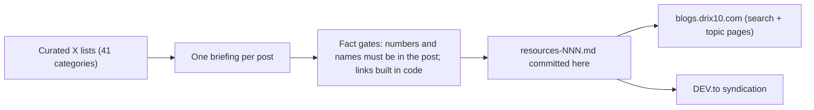

<h1 align="center">AI Resources</h1>

  <strong>Short, sourced briefings on AI tools, models, research, companies and the people building them. 
  100,000+ items across 41 categories, updated as the curated feeds move, each linked back to where it came from.</strong>

  
  
  
  

  <a href="#-resource-categories"><b>Browse the categories</b></a> ·
  <a href="https://github.com/search?q=repo%3ADrix10%2Fai-resources+MCP&type=code"><b>Search the archive</b></a> ·
  <a href="https://github.com/Drix10/ai-resources/issues/new/choose"><b>Suggest a source</b></a> ·
  <a href="COMPARISONS.md"><b>How this compares</b></a>

> ⭐ **If a digest saved you a scroll through X, star the repo.** It bookmarks the archive for you and helps other people find it.

---

## Why this exists

The useful AI news is spread across thousands of posts on X, most of them threads, hype or reposts. Awesome lists are great reference shelves but they move at the speed of pull requests; newsletters are fast but disappear into your inbox. This repo sits in between:

- **Small and dense.** Each item is a headline, two or three sentences and the key numbers. No intros, no "in today's fast-moving world".
- **Sourced.** Current digests link every item to its original post and to any page that post points to. Numbers and names are checked against the post before anything is committed.
- **Organized by who and what.** 41 categories, from AI Developer Tools and CS Academics to VC Firms, Quantum Computing and Climate Tech, each fed by its own hand-picked X lists.
- **Plain Markdown in a public repo.** Read it on GitHub, clone it, grep it, or feed it to your own tools. Recent digests are also published with search and topic pages on [blogs.drix10.com](https://blogs.drix10.com).

See [COMPARISONS.md](COMPARISONS.md) for how it stacks up against awesome lists and AI newsletters, including where they are the better choice.

## What a digest looks like

Every `resources-NNN.md` file is one digest of 5 to 12 items. A real item from [AI Developer Tools #296](AI%20Developer%20Tools/resources-296.md):

> ### 🤖 Nemotron 3.5 Super VL E2EE inference 500+ tokens/sec on one GPU
>
> NVIDIA Nemotron 3.5 Super VL is an open multimodal model that runs with end-to-end encrypted inference at over 500 output tokens per second on a single NVIDIA B300 GPU. […]
>
> **Key Points:** 500+ output tokens per second for a single request on one B300 GPU · 120B total parameters, 12B active MoE per token
>
> 🔗 [Original post](https://x.com/blackboxai/status/2111177845292794036) · [Linked page](https://www.blackbox.ai/blog/nemotron-3-5-super-vl)

## How to use it

| You want to… | Do this |
| --- | --- |
| Catch up on one area | Open its category below and read the newest digest (the list shows its headlines). |
| Keep it handy | ⭐ Star it, or follow the [RSS feed](https://blogs.drix10.com/rss.xml) for new digests. |
| Search | GitHub code search covers the whole archive: `repo:Drix10/ai-resources "MCP"`. Recent digests are also on [blogs.drix10.com/search](https://blogs.drix10.com/search). |
| Use the data | `git clone --depth 1 https://github.com/Drix10/ai-resources` and parse the Markdown. Attribution terms are in [LICENSE](LICENSE). |
| Add a source or fix an item | [Open an issue](https://github.com/Drix10/ai-resources/issues/new/choose); see [CONTRIBUTING.md](CONTRIBUTING.md). |

## How it works

Digests are written by the open-source [ai-resources-pipeline](https://github.com/Drix10/ai-resources-pipeline): it reads curated X lists per category, writes one short briefing per strong post, rejects anything whose numbers or names are not in the source, strips secrets, and commits the batch here. The same run updates the category list below and publishes to the blog.

**Known limits:** digests are machine-written from public posts and can be wrong; check the linked source before you rely on a number. Part of the older archive (2024 to mid-2026) predates source links. Inclusion is not endorsement.

## About the curator

Built and maintained by **[Drishtant Ghosh (Drix10)](https://drix10.com)**, an AI systems engineer and 1x acquired founder (ReeF, acquired August 2024) based in Bengaluru. Founder of CosLynx.com, AI systems architect on Canopy @ Founders, Inc., Backdrop Build v4 and v6 finalist. More writing at [blogs.drix10.com](https://blogs.drix10.com).

<!-- drix10-footer -->
---

**Built by [Drishtant Ghosh (Drix10)](https://drix10.com)** · AI systems engineer and 1x acquired founder, Bengaluru

[Portfolio](https://drix10.com) · [LinkedIn](https://www.linkedin.com/in/drix10) · [X](https://x.com/DrishtantGhosh) · [Blog](https://blogs.drix10.com) · [All projects](https://github.com/Drix10)

More from Drix10: [Agent Flow](https://github.com/Drix10/agent-flow) (guardrails for AI coding agents) · [MiroHedge](https://github.com/Drix10/hypothesis-arena) (AI-assisted systematic fund) · [Guardian](https://github.com/Drix10/guardian-gpt) (UPI scam interceptor) · [Sentinel](https://github.com/Drix10/sentinal) (AI security CLI) · [Keystroke-LLM](https://github.com/Drix10/keystroke-llm) (NumPy transformer on a keyboard)

---

## 📚 Resource Categories

### AI Developer Tools

296 digests · [latest: #299](https://github.com/Drix10/ai-resources/blob/main/AI%20Developer%20Tools/resources-299.md) · [read on the blog](https://blogs.drix10.com/categories/ai-developer-tools)

*   Google live demo at EMNLP2026 mapping user query failures
*   InfluxDB 3 Explorer – live webinar announced
*   Kite Agent Passport launches verifiable identity and payments

### AI Leaders and Thinkers

289 digests · [latest: #289](https://github.com/Drix10/ai-resources/blob/main/AI%20Leaders%20and%20Thinkers/resources-289.md) · [read on the blog](https://blogs.drix10.com/categories/ai-leaders-and-thinkers)

*   Kronos – open-source foundation model for candlestick charts, new model zoo released
*   tryboxi disposable microVMs on Mac, ready in 20-50 ms
*   manga-generator new open-source tool announced

### AI Companies and Ventures

288 digests · [latest: #288](https://github.com/Drix10/ai-resources/blob/main/AI%20Companies%20and%20Ventures/resources-288.md) · [read on the blog](https://blogs.drix10.com/categories/ai-companies-and-ventures)

*   DJI Mavic 4 Pro dynamic range holds lava glow
*   Meta's Muse reaches 10M US downloads in 40 days
*   Home Assistant MCP (Vome) in HOL Guard – 57 tool entries, 56 marked for review

### CS Academics

303 digests · [latest: #303](https://github.com/Drix10/ai-resources/blob/main/CS%20Academics/resources-303.md) · [read on the blog](https://blogs.drix10.com/categories/cs-academics)

*   GitHub CSS Modules migration cuts render time 55% and speeds init 25%
*   MGAEnt cuts creative brief time ~60% with Airtable
*   Personal CFO launch with Plaid integration announced

### Tech VIPs

293 digests · [latest: #293](https://github.com/Drix10/ai-resources/blob/main/Tech%20VIPs/resources-293.md) · [read on the blog](https://blogs.drix10.com/categories/tech-vips)

*   Gateway and Workers integration public beta
*   Claude Managed Agents dynamic workflows go public beta

### VC Firms

291 digests · [latest: #291](https://github.com/Drix10/ai-resources/blob/main/VC%20Firms/resources-291.md) · [read on the blog](https://blogs.drix10.com/categories/vc-firms)

*   Starlink Bolivia – 4,700 antennas for schools nationwide
*   ENGIE nuclear Doel IV Tihange III revised in half a year
*   Top 50 VC Firms – Top 10 by long-term value

### Devs, Designers, DevRel

294 digests · [latest: #294](https://github.com/Drix10/ai-resources/blob/main/Devs%2C%20Designers%2C%20DevRel/resources-294.md) · [read on the blog](https://blogs.drix10.com/categories/devs-designers-devrel)

*   Claude Code and Codex API evaluation reveals leaders
*   Anthropic outgrew git with 25M CI jobs per day
*   JourneyMaker Early Access invites sent out today

### Tech Infrastructure

269 digests · [latest: #269](https://github.com/Drix10/ai-resources/blob/main/Tech%20Infrastructure/resources-269.md) · [read on the blog](https://blogs.drix10.com/categories/tech-infrastructure)

*   Anthropic software factory sensor metrics defined
*   GPU rental prices up 2–3x, resale model mentioned
*   Starlink backup built for Jordan banking system, gateway online

### Founders and Entrepreneurs

261 digests · [latest: #261](https://github.com/Drix10/ai-resources/blob/main/Founders%20and%20Entrepreneurs/resources-261.md) · [read on the blog](https://blogs.drix10.com/categories/founders-and-entrepreneurs)

*   Ticket Broker 7,624 tickets $1M markup
*   Solo Angels – Early access to invest in solo-founded companies
*   Nvidia and ChipAgents launch evaluation for AI chip design

### AI Organizations and Media

285 digests · [latest: #285](https://github.com/Drix10/ai-resources/blob/main/AI%20Organizations%20and%20Media/resources-285.md) · [read on the blog](https://blogs.drix10.com/categories/ai-organizations-and-media)

*   Hy-Nomas video model released with 8-step inference
*   TESSA Custom GPT for SME Guidance shows 90% alignment
*   Primal-Dual Representation Learning for Low-Rank CMDPs

### AI Powered Film and Media

271 digests · [latest: #271](https://github.com/Drix10/ai-resources/blob/main/AI%20Powered%20Film%20and%20Media/resources-271.md) · [read on the blog](https://blogs.drix10.com/categories/ai-powered-film-and-media)

*   Audio Studio open source release with free BGM generation
*   Anthropic Public Benefit Fund commits up to 20% shares
*   Audio Studio MCP Windows release adds unlimited AI music generation

### AI Holodeck and Virtual Worlds

275 digests · [latest: #275](https://github.com/Drix10/ai-resources/blob/main/AI%20Holodeck%20and%20Virtual%20Worlds/resources-275.md) · [read on the blog](https://blogs.drix10.com/categories/ai-holodeck-and-virtual-worlds)

*   Rifts hero brawler PvPvE adds The Blood Well world
*   Pollo Influencer – new cast created, Pollo Recast used for video makeover
*   APOB AI adds Seedance 2.5 30s Video support

### AI Artists and Creators

270 digests · [latest: #270](https://github.com/Drix10/ai-resources/blob/main/AI%20Artists%20and%20Creators/resources-270.md) · [read on the blog](https://blogs.drix10.com/categories/ai-artists-and-creators)

*   ElevenLabsAmbassador black liquid tentacle creature code
*   RTX 4090 Tensor FP16 performance unlock to 331.6 TFLOPS
*   TopazLabs upscaling – loupes occupy 55% of frame height

### AI in Healthcare and Science

277 digests · [latest: #277](https://github.com/Drix10/ai-resources/blob/main/AI%20in%20Healthcare%20and%20Science/resources-277.md) · [read on the blog](https://blogs.drix10.com/categories/ai-in-healthcare-and-science)

*   KRAScendo 1, SAFFRON, CLARITY-Gastric 01, HARMONi-GI1 at ESMO26
*   PERSEE phase III trial reshapes PD-L1 high therapy choices

### AI Generated Music and Audio

275 digests · [latest: #275](https://github.com/Drix10/ai-resources/blob/main/AI%20Generated%20Music%20and%20Audio/resources-275.md) · [read on the blog](https://blogs.drix10.com/categories/ai-generated-music-and-audio)

*   Simplified Matching Distillation for few-step diffusion
*   Soundverse Android launch – live with 1-minute 14-second prompt output

### AI Consulting and Expertise

266 digests · [latest: #266](https://github.com/Drix10/ai-resources/blob/main/AI%20Consulting%20and%20Expertise/resources-266.md) · [read on the blog](https://blogs.drix10.com/categories/ai-consulting-and-expertise)

*   DeepSeek Search and Fetch API pricing, open weights
*   Swarm Alignment Hackathon 6-8 Nov with $8,000 prizes
*   Stream WebRTC generally available – live browser streaming

### AI Professionals and Community

268 digests · [latest: #268](https://github.com/Drix10/ai-resources/blob/main/AI%20Professionals%20and%20Community/resources-268.md) · [read on the blog](https://blogs.drix10.com/categories/ai-professionals-and-community)

*   Discovered Materials secures $9 million seed funding
*   Anthropic Public Benefit Fund launches with 5% of shares

### AI Policy and Ethical Considerations

266 digests · [latest: #266](https://github.com/Drix10/ai-resources/blob/main/AI%20Policy%20and%20Ethical%20Considerations/resources-266.md) · [read on the blog](https://blogs.drix10.com/categories/ai-policy-and-ethical-considerations)

*   GMO Internet Group cloud VPS hacked, trades hit 70 brokerages
*   eMudhra intermediate CAs compromised – Apple Support document released

### AI in Real Estate and Property Tech

257 digests · [latest: #257](https://github.com/Drix10/ai-resources/blob/main/AI%20in%20Real%20Estate%20and%20Property%20Tech/resources-257.md) · [read on the blog](https://blogs.drix10.com/categories/ai-in-real-estate-and-property-tech)

*   TestFit higher-density multi-family under half residential runs
*   Autotelic ADU Feasibility Tool – free lot lookup for Denver backyard homes
*   RealPage Exchange – 15 new RPX Certified AppPartners added

### AI and Robotics Applications

272 digests · [latest: #272](https://github.com/Drix10/ai-resources/blob/main/AI%20and%20Robotics%20Applications/resources-272.md) · [read on the blog](https://blogs.drix10.com/categories/ai-and-robotics-applications)

*   SuperMimic scales humanoid control, 1 GPU → 3 h training
*   High-Precision RCM Motion for Ophthalmic Robotics achieves 0.142 mm residual
*   Unitree G1 single policy for walking, climbing, crawling

### AI Driven Vehicles and Transportation

268 digests · [latest: #268](https://github.com/Drix10/ai-resources/blob/main/AI%20Driven%20Vehicles%20and%20Transportation/resources-268.md) · [read on the blog](https://blogs.drix10.com/categories/ai-driven-vehicles-and-transportation)

*   Hesai Kosmo 3D reconstruction announced with millimeter precision and 5x speed
*   Generative value classifiers new Q-function type
*   HiP3R launches local 3D reconstruction system

### AI for Content Creation and Marketing

264 digests · [latest: #264](https://github.com/Drix10/ai-resources/blob/main/AI%20for%20Content%20Creation%20and%20Marketing/resources-264.md) · [read on the blog](https://blogs.drix10.com/categories/ai-for-content-creation-and-marketing)

*   Swarms v17 launch adds Communication Channels and faster imports
*   Generate a PDF in Python from Code or HTML – library benchmarks
*   Swarms Marketplace 7 New Resources for Builders

### AR VR Companies and Development

262 digests · [latest: #262](https://github.com/Drix10/ai-resources/blob/main/AR%20VR%20Companies%20and%20Development/resources-262.md) · [read on the blog](https://blogs.drix10.com/categories/ar-vr-companies-and-development)

*   Battlefield 2 VR 1.1.0 adds roomscale and manual reload
*   SuperWEIRD Automation Roguelite character design preview
*   Zilliqa engages leading cybersecurity firm to investigate

### AR VR Professionals and Community

259 digests · [latest: #259](https://github.com/Drix10/ai-resources/blob/main/AR%20VR%20Professionals%20and%20Community/resources-259.md) · [read on the blog](https://blogs.drix10.com/categories/ar-vr-professionals-and-community)

*   Creating ILM's Headless Horseman in Tim Burton’s ‘Sleepy Hollow’ – ILM created 220 shots
*   Euro Truck Simulator 2 Iceland DLC release November 10
*   LiDAR Scan to Virtual Studio with Quest Pinning Feature

### Climate and Weather Technology

259 digests · [latest: #259](https://github.com/Drix10/ai-resources/blob/main/Climate%20and%20Weather%20Technology/resources-259.md) · [read on the blog](https://blogs.drix10.com/categories/climate-and-weather-technology)

*   Florida Tides 1-2 ft above average cause flooding
*   Hurricane threat – low chance through Nov. 9, 0.1% FL hurricane risk
*   Winter Wonderland Snowfall - 20 inches reported

### Computer Vision and AI Applications

261 digests · [latest: #261](https://github.com/Drix10/ai-resources/blob/main/Computer%20Vision%20and%20AI%20Applications/resources-261.md) · [read on the blog](https://blogs.drix10.com/categories/computer-vision-and-ai-applications)

*   MorphMimic shares morphology-conditioned world model and policy across three robots
*   Nanbeige4.3-33B launch with ~30B parameters
*   SN44 Score validation mechanism and miner incentive

### Crypto and Web3

253 digests · [latest: #253](https://github.com/Drix10/ai-resources/blob/main/Crypto%20and%20Web3/resources-253.md) · [read on the blog](https://blogs.drix10.com/categories/crypto-and-web3)

*   Zeru zScore and zaps points clarified, 2.17M checks on Etherscan
*   Crypto.com and Novig sue Missouri over sports betting

### Decentralized AI

253 digests · [latest: #253](https://github.com/Drix10/ai-resources/blob/main/Decentralized%20AI/resources-253.md) · [read on the blog](https://blogs.drix10.com/categories/decentralized-ai)

*   BioWater small-scale LLM shows high comprehension fidelity in wastewater treatment
*   0G Private Computer live talk with Michaelh_0g on Oct 20
*   Roam AI cuts selected Claude and GPT model prices by 90%

### The Exponential Future

255 digests · [latest: #255](https://github.com/Drix10/ai-resources/blob/main/The%20Exponential%20Future/resources-255.md) · [read on the blog](https://blogs.drix10.com/categories/the-exponential-future)

*   Librarian Bot audits Grok Bots, 381 kept, 90 forgotten
*   China oil demand cut 5.5 million bpd, exceeds IEA SPR releases
*   Radio Device Boosts Mouse Glymphatic Clearance in 10 min

### AI Education

272 digests · [latest: #272](https://github.com/Drix10/ai-resources/blob/main/AI%20Education/resources-272.md) · [read on the blog](https://blogs.drix10.com/categories/ai-education)

*   Firecrawl Government & Legal Index launch adds 30M+ government pages
*   NVIDIA OpenShell enforces AI agent policy at silicon level
*   3D Game Development with LWJGL 3 added to ChapterPal collection

### AI in Enterprise Applications

260 digests · [latest: #260](https://github.com/Drix10/ai-resources/blob/main/AI%20in%20Enterprise%20Applications/resources-260.md) · [read on the blog](https://blogs.drix10.com/categories/ai-in-enterprise-applications)

*   Microsoft Authenticator token leak via fake Teams app
*   Cisco outlines retail AI network readiness, 90% pilot, 25% scale

### Interesting Finds

254 digests · [latest: #254](https://github.com/Drix10/ai-resources/blob/main/Interesting%20Finds/resources-254.md) · [read on the blog](https://blogs.drix10.com/categories/interesting-finds)

*   psilocybin Parkinson's GDF15 fell 17.4% at 10 mg
*   Revolut founder Nik Storonsky aims to be #1 bank in 100 countries
*   Kornet-E missiles moved by motorcycles in Sudan

### Investors and Venture Capital

249 digests · [latest: #249](https://github.com/Drix10/ai-resources/blob/main/Investors%20and%20Venture%20Capital/resources-249.md) · [read on the blog](https://blogs.drix10.com/categories/investors-and-venture-capital)

*   Set latest stable version adds 64 status effects, 350+ prefixes
*   Metric launch achieves ~20% of Robinhood DEX volume
*   AI companies revenue from other AI firms, 70-80% share, 83% VC funding

### Cybersecurity and Tech

235 digests · [latest: #235](https://github.com/Drix10/ai-resources/blob/main/Cybersecurity%20and%20Tech/resources-235.md) · [read on the blog](https://blogs.drix10.com/categories/cybersecurity-and-tech)

*   EZ Tools 2026.10 release improves speed and memory
*   PHP2Shell RCE first publicly documented validation
*   Microsoft Defender for Endpoint WSL plug-in – visibility

### Neuroscience and AI

240 digests · [latest: #240](https://github.com/Drix10/ai-resources/blob/main/Neuroscience%20and%20AI/resources-240.md) · [read on the blog](https://blogs.drix10.com/categories/neuroscience-and-ai)

*   Prime editing first in vivo DNA edit, Wilson’s disease trial
*   Insular cortex mapping reveals pain and visceral sensation regions

### PR and Communications

239 digests · [latest: #239](https://github.com/Drix10/ai-resources/blob/main/PR%20and%20Communications/resources-239.md) · [read on the blog](https://blogs.drix10.com/categories/pr-and-communications)

*   Glean CEO Arvind Jain on agent memory – word of mouth growth, $300m ARR
*   Google’s AI search changes upended online publishing, traffic drops
*   Scientists Trapped an Antimatter Particle for Months

### Quantum Computing

238 digests · [latest: #238](https://github.com/Drix10/ai-resources/blob/main/Quantum%20Computing/resources-238.md) · [read on the blog](https://blogs.drix10.com/categories/quantum-computing)

*   IonQ wired trapped ion to diamond memory, 1.03 kHz entanglement
*   Silicon Chip for Quantum Computing paper released

### Spatial Computing

237 digests · [latest: #237](https://github.com/Drix10/ai-resources/blob/main/Spatial%20Computing/resources-237.md) · [read on the blog](https://blogs.drix10.com/categories/spatial-computing)

*   Claude Code and Codex follow outdated docs, 79/80 conflict notices
*   How to adapt Dynamic Lights to the size of a Volume – scalable light component added
*   iPhone Duo – SwiftUI toolbars and layouts adapted for fold

### Tech Companies and News

232 digests · [latest: #232](https://github.com/Drix10/ai-resources/blob/main/Tech%20Companies%20and%20News/resources-232.md) · [read on the blog](https://blogs.drix10.com/categories/tech-companies-and-news)

*   Beam 1.0 release announced by Reflection AI
*   WindHawk dark mode mod for Windows 11 released

### Tech Journalists and VIPs

234 digests · [latest: #234](https://github.com/Drix10/ai-resources/blob/main/Tech%20Journalists%20and%20VIPs/resources-234.md) · [read on the blog](https://blogs.drix10.com/categories/tech-journalists-and-vips)

*   Kimi K3.1 Pro launch, Kernel BF16 double, Cerebras 3T model speed
*   Neolab neocloud pivot locks GPU capacity, prices up 2–3x

### World News and Updates

229 digests · [latest: #229](https://github.com/Drix10/ai-resources/blob/main/World%20News%20and%20Updates/resources-229.md) · [read on the blog](https://blogs.drix10.com/categories/world-news-and-updates)

*   Truth Social traffic fell 30% year ending September
*   SK Hynix seeks US approval to export equipment to China

---

**Found something useful?** ⭐ [Star the repo](https://github.com/Drix10/ai-resources) to keep it handy and help others find it, or [suggest a source](https://github.com/Drix10/ai-resources/issues/new/choose).

Summaries © Drishtant Ghosh, licensed [CC BY 4.0](LICENSE). Every digest links to its original post where one exists; the posts and linked pages belong to their authors.

