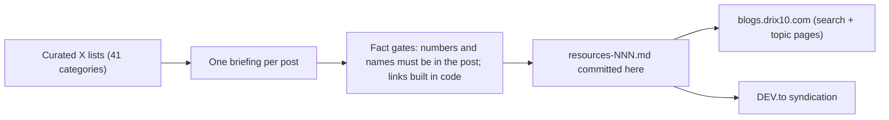

<h1 align="center">AI Resources</h1>

  <strong>Short, sourced briefings on AI tools, models, research, companies and the people building them. 
  100,000+ items across 41 categories, updated as the curated feeds move, each linked back to where it came from.</strong>

  
  
  
  

  <a href="#-resource-categories"><b>Browse the categories</b></a> ·
  <a href="https://github.com/search?q=repo%3ADrix10%2Fai-resources+MCP&type=code"><b>Search the archive</b></a> ·
  <a href="https://github.com/Drix10/ai-resources/issues/new/choose"><b>Suggest a source</b></a> ·
  <a href="COMPARISONS.md"><b>How this compares</b></a>

> ⭐ **If a digest saved you a scroll through X, star the repo.** It bookmarks the archive for you and helps other people find it.

---

## Why this exists

The useful AI news is spread across thousands of posts on X, most of them threads, hype or reposts. Awesome lists are great reference shelves but they move at the speed of pull requests; newsletters are fast but disappear into your inbox. This repo sits in between:

- **Small and dense.** Each item is a headline, two or three sentences and the key numbers. No intros, no "in today's fast-moving world".
- **Sourced.** Current digests link every item to its original post and to any page that post points to. Numbers and names are checked against the post before anything is committed.
- **Organized by who and what.** 41 categories, from AI Developer Tools and CS Academics to VC Firms, Quantum Computing and Climate Tech, each fed by its own hand-picked X lists.
- **Plain Markdown in a public repo.** Read it on GitHub, clone it, grep it, or feed it to your own tools. Recent digests are also published with search and topic pages on [blogs.drix10.com](https://blogs.drix10.com).

See [COMPARISONS.md](COMPARISONS.md) for how it stacks up against awesome lists and AI newsletters, including where they are the better choice.

## What a digest looks like

Every `resources-NNN.md` file is one digest of 5 to 12 items. A real item from [AI Developer Tools #296](AI%20Developer%20Tools/resources-296.md):

> ### 🤖 Nemotron 3.5 Super VL E2EE inference 500+ tokens/sec on one GPU
>
> NVIDIA Nemotron 3.5 Super VL is an open multimodal model that runs with end-to-end encrypted inference at over 500 output tokens per second on a single NVIDIA B300 GPU. […]
>
> **Key Points:** 500+ output tokens per second for a single request on one B300 GPU · 120B total parameters, 12B active MoE per token
>
> 🔗 [Original post](https://x.com/blackboxai/status/2111177845292794036) · [Linked page](https://www.blackbox.ai/blog/nemotron-3-5-super-vl)

## How to use it

| You want to… | Do this |
| --- | --- |
| Catch up on one area | Open its category below and read the newest digest (the list shows its headlines). |
| Keep it handy | ⭐ Star it, or follow the [RSS feed](https://blogs.drix10.com/rss.xml) for new digests. |
| Search | GitHub code search covers the whole archive: `repo:Drix10/ai-resources "MCP"`. Recent digests are also on [blogs.drix10.com/search](https://blogs.drix10.com/search). |
| Use the data | `git clone --depth 1 https://github.com/Drix10/ai-resources` and parse the Markdown. Attribution terms are in [LICENSE](LICENSE). |
| Add a source or fix an item | [Open an issue](https://github.com/Drix10/ai-resources/issues/new/choose); see [CONTRIBUTING.md](CONTRIBUTING.md). |

## How it works

Digests are written by the open-source [ai-resources-pipeline](https://github.com/Drix10/ai-resources-pipeline): it reads curated X lists per category, writes one short briefing per strong post, rejects anything whose numbers or names are not in the source, strips secrets, and commits the batch here. The same run updates the category list below and publishes to the blog.

**Known limits:** digests are machine-written from public posts and can be wrong; check the linked source before you rely on a number. Part of the older archive (2024 to mid-2026) predates source links. Inclusion is not endorsement.

## About the curator

Built and maintained by **[Drishtant Ghosh (Drix10)](https://drix10.com)**, an AI systems engineer and 1x acquired founder (ReeF, acquired August 2024) based in Bengaluru. Founder of CosLynx.com, AI systems architect on Canopy @ Founders, Inc., Backdrop Build v4 and v6 finalist. More writing at [blogs.drix10.com](https://blogs.drix10.com).

<!-- drix10-footer -->
---

**Built by [Drishtant Ghosh (Drix10)](https://drix10.com)** · AI systems engineer and 1x acquired founder, Bengaluru

[Portfolio](https://drix10.com) · [LinkedIn](https://www.linkedin.com/in/drix10) · [X](https://x.com/DrishtantGhosh) · [Blog](https://blogs.drix10.com) · [All projects](https://github.com/Drix10)

More from Drix10: [Agent Flow](https://github.com/Drix10/agent-flow) (guardrails for AI coding agents) · [MiroHedge](https://github.com/Drix10/hypothesis-arena) (AI-assisted systematic fund) · [Guardian](https://github.com/Drix10/guardian-gpt) (UPI scam interceptor) · [Sentinel](https://github.com/Drix10/sentinal) (AI security CLI) · [Keystroke-LLM](https://github.com/Drix10/keystroke-llm) (NumPy transformer on a keyboard)

---

## 📚 Resource Categories

### AI Developer Tools

294 digests · [latest: #297](https://github.com/Drix10/ai-resources/blob/main/AI%20Developer%20Tools/resources-297.md) · [read on the blog](https://blogs.drix10.com/categories/ai-developer-tools)

*   boatdotdev 15 VMs save 3+ hours on large build
*   NVIDIA RTX Spark launch – local AI on Windows PCs
*   Verifiable AI Agent reputation privacy trade-off details

### AI Leaders and Thinkers

287 digests · [latest: #287](https://github.com/Drix10/ai-resources/blob/main/AI%20Leaders%20and%20Thinkers/resources-287.md) · [read on the blog](https://blogs.drix10.com/categories/ai-leaders-and-thinkers)

*   Buildkite and GitHub Actions CI pipeline steps
*   Base64 secret key trailing '=' may break awk split in .env

### AI Companies and Ventures

286 digests · [latest: #286](https://github.com/Drix10/ai-resources/blob/main/AI%20Companies%20and%20Ventures/resources-286.md) · [read on the blog](https://blogs.drix10.com/categories/ai-companies-and-ventures)

*   NFL Big Data Bowl 2027 – $100,000 prize pool announced
*   Kotoba speech APIs now live on fal, real time
*   d1-ultra most Waldos, Jev 1.14 quickest, Decider Flash V1.2 cheapest in Waldo benchmark

### CS Academics

303 digests · [latest: #303](https://github.com/Drix10/ai-resources/blob/main/CS%20Academics/resources-303.md) · [read on the blog](https://blogs.drix10.com/categories/cs-academics)

*   GitHub CSS Modules migration cuts render time 55% and speeds init 25%
*   MGAEnt cuts creative brief time ~60% with Airtable
*   Personal CFO launch with Plaid integration announced

### Tech VIPs

293 digests · [latest: #293](https://github.com/Drix10/ai-resources/blob/main/Tech%20VIPs/resources-293.md) · [read on the blog](https://blogs.drix10.com/categories/tech-vips)

*   Gateway and Workers integration public beta
*   Claude Managed Agents dynamic workflows go public beta

### VC Firms

290 digests · [latest: #290](https://github.com/Drix10/ai-resources/blob/main/VC%20Firms/resources-290.md) · [read on the blog](https://blogs.drix10.com/categories/vc-firms)

*   Ether Fi card reaches $1 billion spend, $100M milestone in a year
*   DeepSeek-V4.1-Flash-1017 launch with stronger benchmarks
*   Spout raises $2m strategic round from investors

### Devs, Designers, DevRel

294 digests · [latest: #294](https://github.com/Drix10/ai-resources/blob/main/Devs%2C%20Designers%2C%20DevRel/resources-294.md) · [read on the blog](https://blogs.drix10.com/categories/devs-designers-devrel)

*   Claude Code and Codex API evaluation reveals leaders
*   Anthropic outgrew git with 25M CI jobs per day
*   JourneyMaker Early Access invites sent out today

### Tech Infrastructure

268 digests · [latest: #268](https://github.com/Drix10/ai-resources/blob/main/Tech%20Infrastructure/resources-268.md) · [read on the blog](https://blogs.drix10.com/categories/tech-infrastructure)

*   Ryan Dahl leaves Deno, Cloudflare acquires his startup
*   Framer Gallery refreshed with expanded categories and vibe filter

### Founders and Entrepreneurs

261 digests · [latest: #261](https://github.com/Drix10/ai-resources/blob/main/Founders%20and%20Entrepreneurs/resources-261.md) · [read on the blog](https://blogs.drix10.com/categories/founders-and-entrepreneurs)

*   Ticket Broker 7,624 tickets $1M markup
*   Solo Angels – Early access to invest in solo-founded companies
*   Nvidia and ChipAgents launch evaluation for AI chip design

### AI Organizations and Media

284 digests · [latest: #284](https://github.com/Drix10/ai-resources/blob/main/AI%20Organizations%20and%20Media/resources-284.md) · [read on the blog](https://blogs.drix10.com/categories/ai-organizations-and-media)

*   Learning Lean Feedback on GPUs reaches 87.8% accuracy
*   MLExpert: 35B model lifts MLE-Bench Lite rate to 72.7%
*   Immune changes could signal inflammatory bowel disease up to 10 years before diagnosis

### AI Powered Film and Media

271 digests · [latest: #271](https://github.com/Drix10/ai-resources/blob/main/AI%20Powered%20Film%20and%20Media/resources-271.md) · [read on the blog](https://blogs.drix10.com/categories/ai-powered-film-and-media)

*   Audio Studio open source release with free BGM generation
*   Anthropic Public Benefit Fund commits up to 20% shares
*   Audio Studio MCP Windows release adds unlimited AI music generation

### AI Holodeck and Virtual Worlds

274 digests · [latest: #274](https://github.com/Drix10/ai-resources/blob/main/AI%20Holodeck%20and%20Virtual%20Worlds/resources-274.md) · [read on the blog](https://blogs.drix10.com/categories/ai-holodeck-and-virtual-worlds)

*   DeepSeek v4.1 Flash 1017 is top open-source model
*   Tesla Roadster Sandbox live with 5 maps and demos
*   Sonilo – First video soundtrack tutorial in 2-minute walkthrough

### AI Artists and Creators

269 digests · [latest: #269](https://github.com/Drix10/ai-resources/blob/main/AI%20Artists%20and%20Creators/resources-269.md) · [read on the blog](https://blogs.drix10.com/categories/ai-artists-and-creators)

*   RunOnFlux milestone 2200 apps and >9k instances
*   Designs.ai Halloween Prompt Kit launch announced
*   Claude creates kinetic typography HUD from 30-sec clip

### AI in Healthcare and Science

276 digests · [latest: #276](https://github.com/Drix10/ai-resources/blob/main/AI%20in%20Healthcare%20and%20Science/resources-276.md) · [read on the blog](https://blogs.drix10.com/categories/ai-in-healthcare-and-science)

*   Ris-Rez first global data shows 61% ORR in ES-SCLC
*   Kidney cancer vein trial 71.4% recurrence-free at one year
*   In-network mental health providers appointment rate 24% in five-state test

### AI Generated Music and Audio

274 digests · [latest: #274](https://github.com/Drix10/ai-resources/blob/main/AI%20Generated%20Music%20and%20Audio/resources-274.md) · [read on the blog](https://blogs.drix10.com/categories/ai-generated-music-and-audio)

*   How Much Physics Can Vision Learn from Audio? Audio embeddings ρ=0.73
*   Frame-Wise Streaming Speech Compression, BD-Rate cuts
*   CF-AVSS ties first on Track 1, second on Track 2 in AVSE Challenge

### AI Consulting and Expertise

266 digests · [latest: #266](https://github.com/Drix10/ai-resources/blob/main/AI%20Consulting%20and%20Expertise/resources-266.md) · [read on the blog](https://blogs.drix10.com/categories/ai-consulting-and-expertise)

*   DeepSeek Search and Fetch API pricing, open weights
*   Swarm Alignment Hackathon 6-8 Nov with $8,000 prizes
*   Stream WebRTC generally available – live browser streaming

### AI Professionals and Community

268 digests · [latest: #268](https://github.com/Drix10/ai-resources/blob/main/AI%20Professionals%20and%20Community/resources-268.md) · [read on the blog](https://blogs.drix10.com/categories/ai-professionals-and-community)

*   Discovered Materials secures $9 million seed funding
*   Anthropic Public Benefit Fund launches with 5% of shares

### AI Policy and Ethical Considerations

265 digests · [latest: #265](https://github.com/Drix10/ai-resources/blob/main/AI%20Policy%20and%20Ethical%20Considerations/resources-265.md) · [read on the blog](https://blogs.drix10.com/categories/ai-policy-and-ethical-considerations)

*   GLM-5.3 scores 160, beats GPT-5.4 on Cyber ECI
*   Anthropic AI expectations gap – staff predict 80% of model building by 2027
*   Super Intelligence Force inaugural meeting, risk report direction

### AI in Real Estate and Property Tech

256 digests · [latest: #256](https://github.com/Drix10/ai-resources/blob/main/AI%20in%20Real%20Estate%20and%20Property%20Tech/resources-256.md) · [read on the blog](https://blogs.drix10.com/categories/ai-in-real-estate-and-property-tech)

*   Realpage Economy Express – inflation hits, Fed hike likely
*   West Development Index 52.4 September 2026 above expansion line
*   Autotelic Concept Studio – basement concept launch with clear estimate

### AI and Robotics Applications

271 digests · [latest: #271](https://github.com/Drix10/ai-resources/blob/main/AI%20and%20Robotics%20Applications/resources-271.md) · [read on the blog](https://blogs.drix10.com/categories/ai-and-robotics-applications)

*   PACT robot hand co-optimizes 17-servo hand – 3.9 mm RMSE, 86% grasp success
*   Anatomy now on paper with printable PDF figures

### AI Driven Vehicles and Transportation

267 digests · [latest: #267](https://github.com/Drix10/ai-resources/blob/main/AI%20Driven%20Vehicles%20and%20Transportation/resources-267.md) · [read on the blog](https://blogs.drix10.com/categories/ai-driven-vehicles-and-transportation)

*   Zeekr 9X unveils 900V SiC drive with 1,030 kW+ peak power
*   AutonomousVehicleControlBeginnersGuide reaches 1.8k GitHub stars

### AI for Content Creation and Marketing

263 digests · [latest: #263](https://github.com/Drix10/ai-resources/blob/main/AI%20for%20Content%20Creation%20and%20Marketing/resources-263.md) · [read on the blog](https://blogs.drix10.com/categories/ai-for-content-creation-and-marketing)

*   Pictory – mobile video creation in browser, desktop edit
*   Orior in Grok Bot – pose recreation feature announced

### AR VR Companies and Development

261 digests · [latest: #261](https://github.com/Drix10/ai-resources/blob/main/AR%20VR%20Companies%20and%20Development/resources-261.md) · [read on the blog](https://blogs.drix10.com/categories/ar-vr-companies-and-development)

*   Loony Laps coming to Quest December 15, $12.99 price
*   Virtuix Omni One bundles with Quest 3/3S, adds $599 or $349
*   Napster Station – announced at Microsoft Ignite booth 1754R

### AR VR Professionals and Community

258 digests · [latest: #258](https://github.com/Drix10/ai-resources/blob/main/AR%20VR%20Professionals%20and%20Community/resources-258.md) · [read on the blog](https://blogs.drix10.com/categories/ar-vr-professionals-and-community)

*   Opus 5.5 milestone: hardware etch and 10-100× faster inference
*   LOW-FI v0.57 – Unity 6 upgrade, Le Circus race
*   LOG AWAY Halloween DLC released, spooky makeover

### Climate and Weather Technology

258 digests · [latest: #258](https://github.com/Drix10/ai-resources/blob/main/Climate%20and%20Weather%20Technology/resources-258.md) · [read on the blog](https://blogs.drix10.com/categories/climate-and-weather-technology)

*   Microsoft Aurora 1.5 weather model release and public access query
*   SpaceX launch 6:30AM ET Monday, jellyfish cloud expected
*   Tucson metro rain showers moving through southern Arizona

### Computer Vision and AI Applications

260 digests · [latest: #260](https://github.com/Drix10/ai-resources/blob/main/Computer%20Vision%20and%20AI%20Applications/resources-260.md) · [read on the blog](https://blogs.drix10.com/categories/computer-vision-and-ai-applications)

*   T2-z world model improves robot slip detection to 73% success
*   AI agent guardrails 6 lines of log text cause 63% fail-open
*   Anthropic Public Benefit Fund – 5% share donation

### Crypto and Web3

253 digests · [latest: #253](https://github.com/Drix10/ai-resources/blob/main/Crypto%20and%20Web3/resources-253.md) · [read on the blog](https://blogs.drix10.com/categories/crypto-and-web3)

*   Zeru zScore and zaps points clarified, 2.17M checks on Etherscan
*   Crypto.com and Novig sue Missouri over sports betting

### Decentralized AI

253 digests · [latest: #253](https://github.com/Drix10/ai-resources/blob/main/Decentralized%20AI/resources-253.md) · [read on the blog](https://blogs.drix10.com/categories/decentralized-ai)

*   BioWater small-scale LLM shows high comprehension fidelity in wastewater treatment
*   0G Private Computer live talk with Michaelh_0g on Oct 20
*   Roam AI cuts selected Claude and GPT model prices by 90%

### The Exponential Future

254 digests · [latest: #254](https://github.com/Drix10/ai-resources/blob/main/The%20Exponential%20Future/resources-254.md) · [read on the blog](https://blogs.drix10.com/categories/the-exponential-future)

*   Consumer Staples up 9.1% in first 12 trading days
*   TPUv7 first Agentic benchmark 1.42x perf/$ vs GB300
*   Staples up 9.1% in first 12 days, 4th start since 1990

### AI Education

271 digests · [latest: #271](https://github.com/Drix10/ai-resources/blob/main/AI%20Education/resources-271.md) · [read on the blog](https://blogs.drix10.com/categories/ai-education)

*   PerkRadar launch – aggregates 879 startup credits
*   Perplexity open-sourced SPACE AI agent security sandbox with test results
*   Spellbook saving Fortune 100 company $21 m with autonomous contracting

### AI in Enterprise Applications

259 digests · [latest: #259](https://github.com/Drix10/ai-resources/blob/main/AI%20in%20Enterprise%20Applications/resources-259.md) · [read on the blog](https://blogs.drix10.com/categories/ai-in-enterprise-applications)

*   Grok bot introduced for flight booking with payment
*   Nscale Loughton data center – Microsoft terminates anchor lease
*   Claude Code staff blocked from bypass permissions mode, client code shows

### Interesting Finds

253 digests · [latest: #253](https://github.com/Drix10/ai-resources/blob/main/Interesting%20Finds/resources-253.md) · [read on the blog](https://blogs.drix10.com/categories/interesting-finds)

*   Britain banking industry case study shows 8% staff cut by AI
*   Anthropic commits 5% of stock to public benefit fund

### Investors and Venture Capital

249 digests · [latest: #249](https://github.com/Drix10/ai-resources/blob/main/Investors%20and%20Venture%20Capital/resources-249.md) · [read on the blog](https://blogs.drix10.com/categories/investors-and-venture-capital)

*   Set latest stable version adds 64 status effects, 350+ prefixes
*   Metric launch achieves ~20% of Robinhood DEX volume
*   AI companies revenue from other AI firms, 70-80% share, 83% VC funding

### Cybersecurity and Tech

234 digests · [latest: #234](https://github.com/Drix10/ai-resources/blob/main/Cybersecurity%20and%20Tech/resources-234.md) · [read on the blog](https://blogs.drix10.com/categories/cybersecurity-and-tech)

*   Entra app permissions in ConnectWise incident hit 173+ tenants
*   REMnux adds Apple Silicon and arm64 support with prebuilt VMs
*   SiteGuard Server Edition OS command injection exploited (CVE-2026-106931)

### Neuroscience and AI

239 digests · [latest: #239](https://github.com/Drix10/ai-resources/blob/main/Neuroscience%20and%20AI/resources-239.md) · [read on the blog](https://blogs.drix10.com/categories/neuroscience-and-ai)

*   Brown fat study links active brown fat to mental health
*   lonvo-z phase 3 trial shows lower attack rate

### PR and Communications

238 digests · [latest: #238](https://github.com/Drix10/ai-resources/blob/main/PR%20and%20Communications/resources-238.md) · [read on the blog](https://blogs.drix10.com/categories/pr-and-communications)

*   Benchmark’s partners on investing in a frenzied market – $2B announced
*   Mabē baby carrier makes $500K in under a minute
*   You Can See Everything $15M doc opening weekend

### Quantum Computing

237 digests · [latest: #237](https://github.com/Drix10/ai-resources/blob/main/Quantum%20Computing/resources-237.md) · [read on the blog](https://blogs.drix10.com/categories/quantum-computing)

*   Abelian post-quantum signatures live today with hash and lattice details
*   Quantum Alliance warns 6.04M BTC exposed to quantum risk

### Spatial Computing

236 digests · [latest: #236](https://github.com/Drix10/ai-resources/blob/main/Spatial%20Computing/resources-236.md) · [read on the blog](https://blogs.drix10.com/categories/spatial-computing)

*   earshot v0.3 adds 201 sounds and improved timing
*   Nietzsche’s typewriter on Vision Pro procedural reconstruction of 1878 Writing Ball
*   Somnium exit screen adds session, day, week, month stats

### Tech Companies and News

232 digests · [latest: #232](https://github.com/Drix10/ai-resources/blob/main/Tech%20Companies%20and%20News/resources-232.md) · [read on the blog](https://blogs.drix10.com/categories/tech-companies-and-news)

*   Beam 1.0 release announced by Reflection AI
*   WindHawk dark mode mod for Windows 11 released

### Tech Journalists and VIPs

233 digests · [latest: #233](https://github.com/Drix10/ai-resources/blob/main/Tech%20Journalists%20and%20VIPs/resources-233.md) · [read on the blog](https://blogs.drix10.com/categories/tech-journalists-and-vips)

*   AsideAI predicted widespread agent use as platforms block AI
*   New York restaurants decline 2,000 YoY in Q1 2026

### World News and Updates

229 digests · [latest: #229](https://github.com/Drix10/ai-resources/blob/main/World%20News%20and%20Updates/resources-229.md) · [read on the blog](https://blogs.drix10.com/categories/world-news-and-updates)

*   Truth Social traffic fell 30% year ending September
*   SK Hynix seeks US approval to export equipment to China

---

**Found something useful?** ⭐ [Star the repo](https://github.com/Drix10/ai-resources) to keep it handy and help others find it, or [suggest a source](https://github.com/Drix10/ai-resources/issues/new/choose).

Summaries © Drishtant Ghosh, licensed [CC BY 4.0](LICENSE). Every digest links to its original post where one exists; the posts and linked pages belong to their authors.

