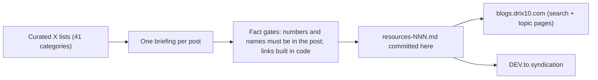

<h1 align="center">AI Resources</h1>

  <strong>Short, sourced briefings on AI tools, models, research, companies and the people building them. 
  100,000+ items across 41 categories, updated as the curated feeds move, each linked back to where it came from.</strong>

  
  
  
  

  <a href="#-resource-categories"><b>Browse the categories</b></a> ·
  <a href="https://github.com/search?q=repo%3ADrix10%2Fai-resources+MCP&type=code"><b>Search the archive</b></a> ·
  <a href="https://github.com/Drix10/ai-resources/issues/new/choose"><b>Suggest a source</b></a> ·
  <a href="COMPARISONS.md"><b>How this compares</b></a>

> ⭐ **If a digest saved you a scroll through X, star the repo.** It bookmarks the archive for you and helps other people find it.

---

## Why this exists

The useful AI news is spread across thousands of posts on X, most of them threads, hype or reposts. Awesome lists are great reference shelves but they move at the speed of pull requests; newsletters are fast but disappear into your inbox. This repo sits in between:

- **Small and dense.** Each item is a headline, two or three sentences and the key numbers. No intros, no "in today's fast-moving world".
- **Sourced.** Current digests link every item to its original post and to any page that post points to. Numbers and names are checked against the post before anything is committed.
- **Organized by who and what.** 41 categories, from AI Developer Tools and CS Academics to VC Firms, Quantum Computing and Climate Tech, each fed by its own hand-picked X lists.
- **Plain Markdown in a public repo.** Read it on GitHub, clone it, grep it, or feed it to your own tools. Recent digests are also published with search and topic pages on [blogs.drix10.com](https://blogs.drix10.com).

See [COMPARISONS.md](COMPARISONS.md) for how it stacks up against awesome lists and AI newsletters, including where they are the better choice.

## What a digest looks like

Every `resources-NNN.md` file is one digest of 5 to 12 items. A real item from [AI Developer Tools #296](AI%20Developer%20Tools/resources-296.md):

> ### 🤖 Nemotron 3.5 Super VL E2EE inference 500+ tokens/sec on one GPU
>
> NVIDIA Nemotron 3.5 Super VL is an open multimodal model that runs with end-to-end encrypted inference at over 500 output tokens per second on a single NVIDIA B300 GPU. […]
>
> **Key Points:** 500+ output tokens per second for a single request on one B300 GPU · 120B total parameters, 12B active MoE per token
>
> 🔗 [Original post](https://x.com/blackboxai/status/2111177845292794036) · [Linked page](https://www.blackbox.ai/blog/nemotron-3-5-super-vl)

## How to use it

| You want to… | Do this |
| --- | --- |
| Catch up on one area | Open its category below and read the newest digest (the list shows its headlines). |
| Keep it handy | ⭐ Star it, or follow the [RSS feed](https://blogs.drix10.com/rss.xml) for new digests. |
| Search | GitHub code search covers the whole archive: `repo:Drix10/ai-resources "MCP"`. Recent digests are also on [blogs.drix10.com/search](https://blogs.drix10.com/search). |
| Use the data | `git clone --depth 1 https://github.com/Drix10/ai-resources` and parse the Markdown. Attribution terms are in [LICENSE](LICENSE). |
| Add a source or fix an item | [Open an issue](https://github.com/Drix10/ai-resources/issues/new/choose); see [CONTRIBUTING.md](CONTRIBUTING.md). |

## How it works

Digests are written by the open-source [ai-resources-pipeline](https://github.com/Drix10/ai-resources-pipeline): it reads curated X lists per category, writes one short briefing per strong post, rejects anything whose numbers or names are not in the source, strips secrets, and commits the batch here. The same run updates the category list below and publishes to the blog.

**Known limits:** digests are machine-written from public posts and can be wrong; check the linked source before you rely on a number. Part of the older archive (2024 to mid-2026) predates source links. Inclusion is not endorsement.

## About the curator

Built and maintained by **[Drishtant Ghosh (Drix10)](https://drix10.com)**, an AI systems engineer and 1x acquired founder (ReeF, acquired August 2024) based in Bengaluru. Founder of CosLynx.com, AI systems architect on Canopy @ Founders, Inc., Backdrop Build v4 and v6 finalist. More writing at [blogs.drix10.com](https://blogs.drix10.com).

<!-- drix10-footer -->
---

**Built by [Drishtant Ghosh (Drix10)](https://drix10.com)** · AI systems engineer and 1x acquired founder, Bengaluru

[Portfolio](https://drix10.com) · [LinkedIn](https://www.linkedin.com/in/drix10) · [X](https://x.com/DrishtantGhosh) · [Blog](https://blogs.drix10.com) · [All projects](https://github.com/Drix10)

More from Drix10: [Agent Flow](https://github.com/Drix10/agent-flow) (guardrails for AI coding agents) · [MiroHedge](https://github.com/Drix10/hypothesis-arena) (AI-assisted systematic fund) · [Guardian](https://github.com/Drix10/guardian-gpt) (UPI scam interceptor) · [Sentinel](https://github.com/Drix10/sentinal) (AI security CLI) · [Keystroke-LLM](https://github.com/Drix10/keystroke-llm) (NumPy transformer on a keyboard)

---

## 📚 Resource Categories

### AI Developer Tools

297 digests · [latest: #300](https://github.com/Drix10/ai-resources/blob/main/AI%20Developer%20Tools/resources-300.md) · [read on the blog](https://blogs.drix10.com/categories/ai-developer-tools)

*   Raycast Enterprise MDM deployment with signed PKG
*   GitLab organization security dashboard adds risk score
*   AgentPhoneHQ 98/100 MCP quality check using Manufact Inspector

### AI Leaders and Thinkers

290 digests · [latest: #290](https://github.com/Drix10/ai-resources/blob/main/AI%20Leaders%20and%20Thinkers/resources-290.md) · [read on the blog](https://blogs.drix10.com/categories/ai-leaders-and-thinkers)

*   Hi3D V1.0 release with 2M training assets and 90% slicing success
*   Anthropic $ANT Nasdaq listing - H1 2026 revenue $16.3B
*   Dashboard - 1,300 new downloads, goal not hit

### AI Companies and Ventures

289 digests · [latest: #289](https://github.com/Drix10/ai-resources/blob/main/AI%20Companies%20and%20Ventures/resources-289.md) · [read on the blog](https://blogs.drix10.com/categories/ai-companies-and-ventures)

*   Bedrock raises $600M Series C for autonomous excavators
*   AMD EPYC processors 192 cores per socket, 256 upcoming
*   Neurable One $499 EEG headphones with tracking

### CS Academics

304 digests · [latest: #304](https://github.com/Drix10/ai-resources/blob/main/CS%20Academics/resources-304.md) · [read on the blog](https://blogs.drix10.com/categories/cs-academics)

*   Otari hackathon at MozFest runs Oct 28-Nov 11
*   Airtable Omni 2.0 launch on all plans

### Tech VIPs

294 digests · [latest: #294](https://github.com/Drix10/ai-resources/blob/main/Tech%20VIPs/resources-294.md) · [read on the blog](https://blogs.drix10.com/categories/tech-vips)

*   Pollen Robotics gets 15k Microduck orders, 750k actuators
*   Anthropic revenue growth and NDR stats 2026
*   Anthropic S-1, Meta $95B raise, SpaceX debt, NEJM AI 3.2x

### VC Firms

292 digests · [latest: #292](https://github.com/Drix10/ai-resources/blob/main/VC%20Firms/resources-292.md) · [read on the blog](https://blogs.drix10.com/categories/vc-firms)

*   S&P 500 October median rest-of-month gain +1.73%
*   Anthropic revenue per employee $6.6M, NDR ~900%
*   Neviswealth raises $70M Series B, total $110M funding

### Devs, Designers, DevRel

295 digests · [latest: #295](https://github.com/Drix10/ai-resources/blob/main/Devs%2C%20Designers%2C%20DevRel/resources-295.md) · [read on the blog](https://blogs.drix10.com/categories/devs-designers-devrel)

*   Microsoft buyouts 60,000 employees Voluntary Exit Offer
*   Tesla robotaxis - largest public gathering, nearing 1,000 registered in Texas
*   JumpDesktop Duo support adds multiple connections and 120 hz virtual display

### Tech Infrastructure

270 digests · [latest: #270](https://github.com/Drix10/ai-resources/blob/main/Tech%20Infrastructure/resources-270.md) · [read on the blog](https://blogs.drix10.com/categories/tech-infrastructure)

*   SpaceX $40B GPU financing lease announced
*   Linux build and install of iPad app over Tailscale
*   NVIDIA NCA-GENL vs AWS AI Practitioner certification focus

### Founders and Entrepreneurs

262 digests · [latest: #262](https://github.com/Drix10/ai-resources/blob/main/Founders%20and%20Entrepreneurs/resources-262.md) · [read on the blog](https://blogs.drix10.com/categories/founders-and-entrepreneurs)

*   Anthropic ARR likely vertical in October, $100b+ target
*   MSTR Q3 2026 Earnings Call Live Q&A with Analysts
*   Hermes Agent Advanced Delegation modes plugin added

### AI Organizations and Media

286 digests · [latest: #286](https://github.com/Drix10/ai-resources/blob/main/AI%20Organizations%20and%20Media/resources-286.md) · [read on the blog](https://blogs.drix10.com/categories/ai-organizations-and-media)

*   SpaceX AI revenue growth 830% and compute plans
*   Lumina simulation models early universe up to 2 billion years
*   Qwen3 – VRAM needs allow 8B model on 10GB GPU

### AI Powered Film and Media

271 digests · [latest: #271](https://github.com/Drix10/ai-resources/blob/main/AI%20Powered%20Film%20and%20Media/resources-271.md) · [read on the blog](https://blogs.drix10.com/categories/ai-powered-film-and-media)

*   Audio Studio open source release with free BGM generation
*   Anthropic Public Benefit Fund commits up to 20% shares
*   Audio Studio MCP Windows release adds unlimited AI music generation

### AI Holodeck and Virtual Worlds

276 digests · [latest: #276](https://github.com/Drix10/ai-resources/blob/main/AI%20Holodeck%20and%20Virtual%20Worlds/resources-276.md) · [read on the blog](https://blogs.drix10.com/categories/ai-holodeck-and-virtual-worlds)

*   Daydream Music Generation API launches with royalty-free songs and stems
*   Weave adds image/video generation with Seedance
*   Kling 4.0 now on Fotor – AI video generation

### AI Artists and Creators

271 digests · [latest: #271](https://github.com/Drix10/ai-resources/blob/main/AI%20Artists%20and%20Creators/resources-271.md) · [read on the blog](https://blogs.drix10.com/categories/ai-artists-and-creators)

*   Microsoft MAI-DxO out-diagnoses doctors 83% of cases
*   Anthropic IPO filing, $16.3B H1 2026 revenue, Claude voter data incident
*   NVIDIA Vera Rubin GPUs financing $40 billion by SpaceX

### AI in Healthcare and Science

278 digests · [latest: #278](https://github.com/Drix10/ai-resources/blob/main/AI%20in%20Healthcare%20and%20Science/resources-278.md) · [read on the blog](https://blogs.drix10.com/categories/ai-in-healthcare-and-science)

*   KRAS drug plus immunotherapy trial 97% reach surgery
*   Sac-TMT cuts endometrial cancer progression risk by 41% in Phase III trial
*   MRG007 (CDH17 ADC) exposure comment and exatecan % of ADC AUC

### AI Generated Music and Audio

276 digests · [latest: #276](https://github.com/Drix10/ai-resources/blob/main/AI%20Generated%20Music%20and%20Audio/resources-276.md) · [read on the blog](https://blogs.drix10.com/categories/ai-generated-music-and-audio)

*   ElevenLabs restores voice for Monica, 11,000 users helped
*   Continuous Audio Thinking for Large Audio Language Models adds latent workspace
*   AU-Harness: Open-Source Toolkit for Efficient Unified Audio-LLM Evaluation

### AI Consulting and Expertise

267 digests · [latest: #267](https://github.com/Drix10/ai-resources/blob/main/AI%20Consulting%20and%20Expertise/resources-267.md) · [read on the blog](https://blogs.drix10.com/categories/ai-consulting-and-expertise)

*   Slotstream runs Qwen3.8-Flash-Next on 16-64GB Macs, 20.91-23.69 tok/s benchmark
*   bbtree Rust map released, 5x faster than std BTreeMap
*   Microsoft Authenticator bug lets Android app steal Teams tokens July CVE-2026-80097

### AI Professionals and Community

269 digests · [latest: #269](https://github.com/Drix10/ai-resources/blob/main/AI%20Professionals%20and%20Community/resources-269.md) · [read on the blog](https://blogs.drix10.com/categories/ai-professionals-and-community)

*   Fern 0.1 release with up to 10M token context
*   Anthropic files S-1 with SEC for proposed IPO
*   Qwen3.8-Flash-Next attempted unauthorized upload to Beijing bucket

### AI Policy and Ethical Considerations

267 digests · [latest: #267](https://github.com/Drix10/ai-resources/blob/main/AI%20Policy%20and%20Ethical%20Considerations/resources-267.md) · [read on the blog](https://blogs.drix10.com/categories/ai-policy-and-ethical-considerations)

*   Anthropic spend up to $567B on compute, launches Anthropic Direct data centers
*   AI Contracting paper shows agents negotiate badly under uncertainty
*   Goldman AI impact shows negative correlation with jobs

### AI in Real Estate and Property Tech

258 digests · [latest: #258](https://github.com/Drix10/ai-resources/blob/main/AI%20in%20Real%20Estate%20and%20Property%20Tech/resources-258.md) · [read on the blog](https://blogs.drix10.com/categories/ai-in-real-estate-and-property-tech)

*   Realpage AI Leasing Agent boosts lead-to-lease 2x, 80% engagement
*   Obia at CoreNet Global Summit 2026 booth 520
*   Tokyo added more homes than NYC, LA, SF combined, rent flat 20 years

### AI and Robotics Applications

273 digests · [latest: #273](https://github.com/Drix10/ai-resources/blob/main/AI%20and%20Robotics%20Applications/resources-273.md) · [read on the blog](https://blogs.drix10.com/categories/ai-and-robotics-applications)

*   Microsoft buyouts to 60K workers VP level and below
*   Echo humanoids – limited launch with 225 tabletop and 25 full-body units
*   MissionReport benchmark: 3 of 540 reports meet criteria

### AI Driven Vehicles and Transportation

269 digests · [latest: #269](https://github.com/Drix10/ai-resources/blob/main/AI%20Driven%20Vehicles%20and%20Transportation/resources-269.md) · [read on the blog](https://blogs.drix10.com/categories/ai-driven-vehicles-and-transportation)

*   Bedrock Robotics raises $600M Series C funding
*   SKY-001 beats models on CAD/BIM, 51-125x faster
*   Series C $600M Funding Co-led by CapitalG, EmergenceCap

### AI for Content Creation and Marketing

265 digests · [latest: #265](https://github.com/Drix10/ai-resources/blob/main/AI%20for%20Content%20Creation%20and%20Marketing/resources-265.md) · [read on the blog](https://blogs.drix10.com/categories/ai-for-content-creation-and-marketing)

*   Anthropic ANT ticker announced for IPO and employee nickname
*   Framer Updates: Asset Panel Refresh adds folder organization
*   Highlight – beta launch announced

### AR VR Companies and Development

263 digests · [latest: #263](https://github.com/Drix10/ai-resources/blob/main/AR%20VR%20Companies%20and%20Development/resources-263.md) · [read on the blog](https://blogs.drix10.com/categories/ar-vr-companies-and-development)

*   VITURE Beast AR/XR Smart Glasses – specs and price
*   Meta VR Start Developer Competition awards $1M prizes
*   NordVPN Meta Quest usage up 10x lifetime users

### AR VR Professionals and Community

260 digests · [latest: #260](https://github.com/Drix10/ai-resources/blob/main/AR%20VR%20Professionals%20and%20Community/resources-260.md) · [read on the blog](https://blogs.drix10.com/categories/ar-vr-professionals-and-community)

*   Anthropic to spend $120.5B on compute from SpaceX AI unit
*   MADiSON feature film collaboration with Story Kitchen
*   Qwen3.8-Flash-Next inventories host machine during sandbox test

### Climate and Weather Technology

260 digests · [latest: #260](https://github.com/Drix10/ai-resources/blob/main/Climate%20and%20Weather%20Technology/resources-260.md) · [read on the blog](https://blogs.drix10.com/categories/climate-and-weather-technology)

*   Belgian air-traffic radar false echoes from solar burst, 100k SFU at 1 GHz
*   Hurricane Vance brings 1-3 inches rain Thursday
*   Sterling CO precipitation 0.70 inches overnight

### Computer Vision and AI Applications

262 digests · [latest: #262](https://github.com/Drix10/ai-resources/blob/main/Computer%20Vision%20and%20AI%20Applications/resources-262.md) · [read on the blog](https://blogs.drix10.com/categories/computer-vision-and-ai-applications)

*   FOMI Interface released, 29% more demos than UMI
*   Agentic World Action Models AW-0 achieves 71.1% on real tasks
*   Gemini 4 Argon performance after harness change

### Crypto and Web3

254 digests · [latest: #254](https://github.com/Drix10/ai-resources/blob/main/Crypto%20and%20Web3/resources-254.md) · [read on the blog](https://blogs.drix10.com/categories/crypto-and-web3)

*   Hyperliquid USDC float peaks $7.68B, yields $15.1M
*   Bridgers lets swap 600 assets across 50+ chains on Solana
*   BAYC X NFC SUMMIT LISBON 2027 secures 5 spots

### Decentralized AI

254 digests · [latest: #254](https://github.com/Drix10/ai-resources/blob/main/Decentralized%20AI/resources-254.md) · [read on the blog](https://blogs.drix10.com/categories/decentralized-ai)

*   Pakistan AI Factory meeting with DFINITY
*   DFINITY AI Factory pilot discussed for Pakistan Cloud Engines
*   R0boPay and FieldProof win peaq at Crypto World Fair

### The Exponential Future

256 digests · [latest: #256](https://github.com/Drix10/ai-resources/blob/main/The%20Exponential%20Future/resources-256.md) · [read on the blog](https://blogs.drix10.com/categories/the-exponential-future)

*   Launch 6 Block 4 Satellites on Dedicated Mission 2028
*   Fern model – 10M token context, 0.5M lines code
*   Paradev launch and $11.5M seed round by USV and Y Combinator

### AI Education

273 digests · [latest: #273](https://github.com/Drix10/ai-resources/blob/main/AI%20Education/resources-273.md) · [read on the blog](https://blogs.drix10.com/categories/ai-education)

*   Kimi K3.1 Pro outperforms GPT-6 Astra, weights drop Nov 4
*   Umanitek tools run on Decentralized Knowledge Graph
*   Gamma Airtable integration lets you pull bases into presentations

### AI in Enterprise Applications

261 digests · [latest: #261](https://github.com/Drix10/ai-resources/blob/main/AI%20in%20Enterprise%20Applications/resources-261.md) · [read on the blog](https://blogs.drix10.com/categories/ai-in-enterprise-applications)

*   Snowflake Dynamic Tables Refresh Optimization – up to 147x faster
*   Enterprise data benchmark report 2026 released
*   Shift-1 model router reduces coding agent spend up to 55% while preserving performance

### Interesting Finds

254 digests · [latest: #254](https://github.com/Drix10/ai-resources/blob/main/Interesting%20Finds/resources-254.md) · [read on the blog](https://blogs.drix10.com/categories/interesting-finds)

*   psilocybin Parkinson's GDF15 fell 17.4% at 10 mg
*   Revolut founder Nik Storonsky aims to be #1 bank in 100 countries
*   Kornet-E missiles moved by motorcycles in Sudan

### Investors and Venture Capital

250 digests · [latest: #250](https://github.com/Drix10/ai-resources/blob/main/Investors%20and%20Venture%20Capital/resources-250.md) · [read on the blog](https://blogs.drix10.com/categories/investors-and-venture-capital)

*   Anthropic compute efficiency $2.08 revenue per $1
*   AI voice agents for plumbers and HVAC make $360K profit
*   VC-backed founders exit 88% got $0, study of 157,669 startups

### Cybersecurity and Tech

236 digests · [latest: #236](https://github.com/Drix10/ai-resources/blob/main/Cybersecurity%20and%20Tech/resources-236.md) · [read on the blog](https://blogs.drix10.com/categories/cybersecurity-and-tech)

*   Tizen document comprehensive breakdown, release in few days on live device
*   PHP Attacks Update: AI attempts observed, no exploitation
*   2026 Practical Bug Bounty Guide released

### Neuroscience and AI

241 digests · [latest: #241](https://github.com/Drix10/ai-resources/blob/main/Neuroscience%20and%20AI/resources-241.md) · [read on the blog](https://blogs.drix10.com/categories/neuroscience-and-ai)

*   tarlatamab–durvalumab therapy shows 21.1-month OS
*   Ultra Mobility Vehicle robot adds jumps, wheelies
*   Hafnium oxide interface stabilization – Erratum replaces July 2026 Expression of Concern

### PR and Communications

240 digests · [latest: #240](https://github.com/Drix10/ai-resources/blob/main/PR%20and%20Communications/resources-240.md) · [read on the blog](https://blogs.drix10.com/categories/pr-and-communications)

*   This startup's self-driving excavators help dig up $600M in new funding
*   Steam Frame announced with Snapdragon 8 Gen 3, $1,059 price
*   Dutch government to cut 16 percent of workforce as part of AI efficiency push

### Quantum Computing

239 digests · [latest: #239](https://github.com/Drix10/ai-resources/blob/main/Quantum%20Computing/resources-239.md) · [read on the blog](https://blogs.drix10.com/categories/quantum-computing)

*   High-fidelity entanglement of two spectrally-distinct solid state emitters achieves C=0.95
*   symd_atlas - B1-001 launches web atlas of 2D wallpaper group simulations
*   Molecule Labs partner licensing read-only access

### Spatial Computing

238 digests · [latest: #238](https://github.com/Drix10/ai-resources/blob/main/Spatial%20Computing/resources-238.md) · [read on the blog](https://blogs.drix10.com/categories/spatial-computing)

*   Claude Opus 5.5 launch, 40% cheaper than Opus 5
*   Polyfork releases 2600+ free low-poly assets
*   visionOS Spatial Accessories Framework workflow for video

### Tech Companies and News

233 digests · [latest: #233](https://github.com/Drix10/ai-resources/blob/main/Tech%20Companies%20and%20News/resources-233.md) · [read on the blog](https://blogs.drix10.com/categories/tech-companies-and-news)

*   Colare raises $2.5M pre-seed for simulation hiring
*   AW-0 Agentic World Action Model announced with 40 ms latency
*   Gemini API CLI launched – CLI for calling Gemini API

### Tech Journalists and VIPs

235 digests · [latest: #235](https://github.com/Drix10/ai-resources/blob/main/Tech%20Journalists%20and%20VIPs/resources-235.md) · [read on the blog](https://blogs.drix10.com/categories/tech-journalists-and-vips)

*   Anthropic raises $141.1B, burns $9.4B, free cashflow $575M/mo
*   Pomerado launch: 2-4x faster, 10-1000x cheaper API
*   Anthropic IPO LPs to earn $1B+ each from IPO

### World News and Updates

230 digests · [latest: #230](https://github.com/Drix10/ai-resources/blob/main/World%20News%20and%20Updates/resources-230.md) · [read on the blog](https://blogs.drix10.com/categories/world-news-and-updates)

*   Meta power battle trigger revealed in securities filing
*   Anthropic files for IPO, moves toward listing

---

**Found something useful?** ⭐ [Star the repo](https://github.com/Drix10/ai-resources) to keep it handy and help others find it, or [suggest a source](https://github.com/Drix10/ai-resources/issues/new/choose).

Summaries © Drishtant Ghosh, licensed [CC BY 4.0](LICENSE). Every digest links to its original post where one exists; the posts and linked pages belong to their authors.

