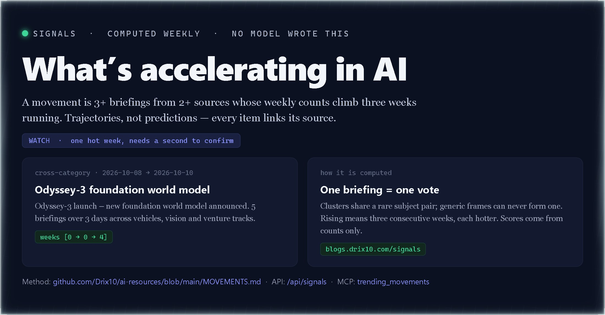
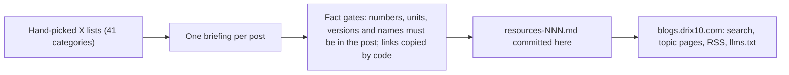

<div align="center">

<a href="https://blogs.drix10.com"></a>

<a href="https://github.com/Drix10/ai-resources/stargazers"></a>
<a href="https://github.com/Drix10/ai-resources/commits/main"></a>
<a href="https://www.npmjs.com/package/ai-resources-mcp"></a>
<a href="https://blogs.drix10.com/rss.xml"></a>
<a href="LICENSE"></a>

<b><a href="https://blogs.drix10.com">Read it</a></b> · <b><a href="#-resource-categories">Browse 41 categories</a></b> · <b><a href="#use-it-from-your-ai-agent">Plug it into your agent</a></b> · <b><a href="https://github.com/search?q=repo%3ADrix10%2Fai-resources+MCP&type=code">Search the archive</a></b>

</div>

<table>
<tr>
<td width="25%" valign="top"><b>Checked against the source</b><br><sub>A number, unit, model version or name that is not in the source post gets the briefing rejected and rewritten.</sub></td>
<td width="25%" valign="top"><b>Every claim has a link</b><br><sub>The original post and the page it points to, copied by code, never written by the model.</sub></td>
<td width="25%" valign="top"><b>41 categories</b><br><sub>Models, dev tools, research and funding, plus robotics, climate, quantum, security and crypto.</sub></td>
<td width="25%" valign="top"><b>Ready for your agent</b><br><sub>MCP server, Agent Skill, JSON API and llms.txt. Plain Markdown under CC BY 4.0.</sub></td>
</tr>
</table>

## Three ways in

<table>
<tr>
<td width="55%"><a href="https://blogs.drix10.com"></a></td>
<td width="45%" valign="top">
<h3><a href="https://blogs.drix10.com">Read it</a></h3>
The newest digests on <a href="https://blogs.drix10.com">blogs.drix10.com</a>, with search, topic pages and an <a href="https://blogs.drix10.com/rss.xml">RSS feed</a>. Or open any category <a href="#-resource-categories">below</a> and read its latest digest here on GitHub.
<br><br>
Star and watch the repo to get new digests as they land.
</td>
</tr>
<tr>
<td width="55%"><a href="USE-WITH-AI.md"></a></td>
<td width="45%" valign="top">
<h3><a href="#use-it-from-your-ai-agent">Ask it from your agent</a></h3>
Claude, Cursor, VS Code or Windsurf answer "what did Anthropic ship this week?" from the briefings, with dates and source links. No key, no account. <a href="#use-it-from-your-ai-agent">Setup for every client ↓</a>
<br><br>
<code>claude mcp add ai-resources -- npx -y ai-resources-mcp</code>
</td>
</tr>
<tr>
<td width="55%"></td>
<td width="45%" valign="top">
<h3>Clone it</h3>
100,000+ dated, sourced briefings in plain Markdown for RAG, evals or an offline index. Every <code>resources-NNN.md</code> holds 5 to 12 of them, like <a href="AI%20Developer%20Tools/resources-296.md">this one</a>.
<br><br>
<code>git clone --depth 1 https://github.com/Drix10/ai-resources</code>
</td>
</tr>
</table>

## What a briefing looks like

<a href="AI%20Developer%20Tools/resources-296.md"></a>
<p align="center"><sub>A real briefing from <a href="AI%20Developer%20Tools/resources-296.md">AI Developer Tools #296</a>. Every digest file holds 5 to 12 of these.</sub></p>


## Signals: what is accelerating in AI

<a href="https://blogs.drix10.com/signals"></a>
<p align="center"><sub><a href="https://blogs.drix10.com/signals">Signals</a>, computed weekly: topics whose coverage climbs three weeks running. Trajectories, not predictions — and nothing on it is written by a model.</sub></p>

Briefings tell you what happened. Signals tells you what it means: which topics are accelerating, with the sample headlines and source links behind every call. Computed from counts only (one briefing = one vote), in the open: [`MOVEMENTS.md`](MOVEMENTS.md) in this repo, [`/api/signals`](https://blogs.drix10.com/api/signals) for code, and the `trending_movements` MCP tool for agents.

## Who it is for

- **Engineers building with AI.** What changed in models, inference, agents, MCP and dev tools, with the benchmark number and the link, in [AI Developer Tools](#ai-developer-tools) and [Tech Infrastructure](#tech-infrastructure).
- **Founders and investors.** Rounds, launches and revenue figures as they are announced, in [AI Companies and Ventures](#ai-companies-and-ventures), [VC Firms](#vc-firms) and [Founders and Entrepreneurs](#founders-and-entrepreneurs).
- **Researchers and students.** What the people in the field are publishing and arguing about, in [CS Academics](#cs-academics) and [Neuroscience and AI](#neuroscience-and-ai).
- **Anyone building RAG, agents or evals.** A 100,000-item corpus of dated, sourced AI news under CC BY 4.0.

Awesome lists are still the better pick for a vetted shortlist, and a newsletter for five editor-picked minutes a day. [COMPARISONS.md](COMPARISONS.md) lays out where this fits.

## Use it from your AI agent

Five ways to plug the briefings into an agent or your own code. None needs a key or an account. Full reference: **[USE-WITH-AI.md](USE-WITH-AI.md)**.

| Path | Best for | Setup |
| --- | --- | --- |
| [MCP server](#mcp-server) | Claude Code, Claude Desktop, Cursor, VS Code, Windsurf | one command or one JSON block |
| [Agent Skill](#agent-skill) | Claude Code and other Skill-aware agents | copy one folder |
| [JSON API](#json-api) | your own code, custom GPT actions, scripts | none, CORS open |
| [llms.txt and RSS](#llmstxt-and-rss) | any LLM that reads a URL, feed readers, bots | none |
| [Raw Markdown](#three-ways-in) | RAG, evals, offline indexes, all 100,000+ briefings | `git clone` |

### MCP server

<a href="https://www.npmjs.com/package/ai-resources-mcp"></a>
<a href="https://registry.modelcontextprotocol.io/v0/servers?search=io.github.Drix10/ai-resources"></a>


Published on npm as [`ai-resources-mcp`](https://www.npmjs.com/package/ai-resources-mcp) (MIT, code in [`mcp/`](mcp/)). `npx` fetches it on first run, so there is nothing to install by hand.

| Tool | What it does |
| --- | --- |
| `search_briefings(query, category?, limit?, since?)` | Keyword search, newest first. All words must match. `since` is `YYYY-MM-DD`. |
| `latest(category?, limit?)` | The newest briefings, overall or for one category. |
| `get_briefing(id)` | Full Markdown of one briefing (URL or slug), with every source link. |
| `list_categories()` | Every category slug with its briefing count. |
| `trending_movements(limit?)` | Topics accelerating week over week (rising) or hot for one week (watch), with sample headlines and source links. |

Every result ends with its source link and `Data: github.com/Drix10/ai-resources (CC BY 4.0)`, so answers stay citable.

**Claude Code**

```bash
claude mcp add ai-resources -- npx -y ai-resources-mcp
```

<details>
<summary><b>Claude Desktop, Cursor, Windsurf</b></summary>

<br>

Add this to `claude_desktop_config.json` (Claude Desktop: Settings → Developer → Edit Config), `~/.cursor/mcp.json` or `.cursor/mcp.json` (Cursor), or `~/.codeium/windsurf/mcp_config.json` (Windsurf):

```json
{
  "mcpServers": {
    "ai-resources": { "command": "npx", "args": ["-y", "ai-resources-mcp"] }
  }
}
```

</details>

<details>
<summary><b>VS Code</b></summary>

<br>

In `.vscode/mcp.json`, or *MCP: Open User Configuration*:

```json
{
  "servers": {
    "ai-resources": { "type": "stdio", "command": "npx", "args": ["-y", "ai-resources-mcp"] }
  }
}
```

Or from a terminal:

```bash
code --add-mcp "{\"name\":\"ai-resources\",\"command\":\"npx\",\"args\":[\"-y\",\"ai-resources-mcp\"]}"
```

</details>

<details>
<summary><b>Windows, and other settings</b></summary>

<br>

If a client cannot start `npx` on Windows, use `"command": "cmd", "args": ["/c", "npx", "-y", "ai-resources-mcp"]`.

`AI_RESOURCES_API_URL` sets the API base URL (default `https://blogs.drix10.com`).

</details>

Then ask, for example:

- *"What did Anthropic announce this week? Cite the sources."*
- *"Latest five briefings in AI Developer Tools."*
- *"Who raised a Series A in AI this month, and how much?"*

### Agent Skill

[`skills/ai-news`](skills/ai-news/SKILL.md) teaches an agent when and how to answer "what's new in AI", "latest on &lt;model or company&gt;" and "who raised" questions from the briefings, with dates and citations. It uses the MCP tools when they are installed and falls back to the JSON API, then llms.txt, then raw Markdown on GitHub when they are not.

```bash
git clone --depth 1 https://github.com/Drix10/ai-resources
mkdir -p ~/.claude/skills
cp -r ai-resources/skills/ai-news ~/.claude/skills/
```

<details>
<summary><b>One project only, Windows, other agents</b></summary>

<br>

- **One project:** copy it to `.claude/skills/ai-news/` inside that project instead.
- **Windows (PowerShell):** `Copy-Item -Recurse ai-resources\skills\ai-news $HOME\.claude\skills\`
- **Other agents** that read `SKILL.md` folders work the same way. For chat apps without Skills, paste the body of `SKILL.md` into the custom instructions.

</details>

### JSON API

Base URL `https://blogs.drix10.com`. JSON, CORS open, no key. It covers the briefings published on the blog; the full archive is in this repository.

| Request | Returns |
| --- | --- |
| `GET /api/articles?q=&category=&since=&limit=&page=` | `{ items, total, page, limit, totalPages, license }`, newest first. All words in `q` must match; every parameter is optional. |
| `GET /api/articles?slug=<slug or URL>` | One item, plus `content` (the full Markdown). |
| `GET /api/categories` | `{ items: [{ name, slug, count, url, llms }] }` |

Each item has `title`, `url`, `slug`, `category`, `categorySlug`, `date`, `description`, `headlines` (every news item in the briefing) and `sources` (`[{ title, url }]`, the original posts).

```bash
curl "https://blogs.drix10.com/api/articles?q=anthropic&since=2026-10-01&limit=5"
curl "https://blogs.drix10.com/api/categories"
```

### llms.txt and RSS

- [`/llms.txt`](https://blogs.drix10.com/llms.txt): the index, linking every category.
- `/llms/<category-slug>.txt`: the 50 newest briefings of one category, for example [`/llms/ai-developer-tools.txt`](https://blogs.drix10.com/llms/ai-developer-tools.txt).
- [`/rss.xml`](https://blogs.drix10.com/rss.xml): for feed readers, Slack or Discord feed bots and email-digest services.

When you show the data anywhere, credit it as `Data: github.com/Drix10/ai-resources (CC BY 4.0)`. The MCP server and the Skill add that line for you.

## By the numbers

Counted from this repository on 29 October 2026. The archive only grows.

| | |
| ---: | --- |
| **100,000+** | briefings: a headline, two or three sentences and the key numbers, one per post |
| **10,800+** | digest files (`resources-NNN.md`) across **41 categories** |
| **10,900+** | commits since November 2024, all made by an automated pipeline |
| **14,000+** | briefings that link both the original post and the page it points to (every briefing since mid-2026) |
| **~2,000** | of them published as articles on [blogs.drix10.com](https://blogs.drix10.com) with search, topic pages, an [RSS feed](https://blogs.drix10.com/rss.xml) and [llms.txt](https://blogs.drix10.com/llms.txt) |

## How it is built

Nobody types these. A pipeline reads the hand-picked X lists for each category, writes one briefing per strong post, runs the fact gates, strips secrets, de-duplicates across categories and commits the batch here. The same run refreshes the category list below and publishes to the blog.



**Known limits:** briefings are machine-written from public posts and can still be wrong; check the linked source before you rely on a number. Part of the older archive (2024 to mid-2026) predates source links. Coverage follows the hand-picked lists, blind spots included. Inclusion is not endorsement.

## Contribute

A pipeline writes the briefings. People pick the sources and fix what it gets wrong. Ways in:

- **Pick up a [good first issue](https://github.com/Drix10/ai-resources/issues?q=is%3Aissue+is%3Aopen+label%3A%22good+first+issue%22)**: MCP server tools, Skill phrasings, guides, examples, translations.
- **[Suggest a source](https://github.com/Drix10/ai-resources/issues/new?template=suggest-source.yml)** (an X account, list or site) or **[report a wrong fact](https://github.com/Drix10/ai-resources/issues/new?template=wrong-fact.yml)** with the briefing link.
- **Ask, share what you built, or float an idea** in [Discussions](https://github.com/Drix10/ai-resources/discussions).

[CONTRIBUTING.md](CONTRIBUTING.md) has the details, including what not to edit by hand. Content is CC BY 4.0; the MCP server code is MIT. If you use the archive in research, [CITATION.cff](CITATION.cff) has the citation.

## Star history

<a href="https://star-history.com/#Drix10/ai-resources&Date"></a>

## About the curator

Built and maintained by **[Drishtant Ghosh (Drix10)](https://drix10.com)**, an AI systems engineer and 1x acquired founder (ReeF, acquired August 2024) based in Bengaluru. Founder of CosLynx.com, AI systems architect on Canopy @ Founders, Inc., Backdrop Build v4 and v6 finalist. More writing at [blogs.drix10.com](https://blogs.drix10.com).

<!-- drix10-footer -->
---

<div align="center">

**Built by [Drishtant Ghosh (Drix10)](https://drix10.com)** · AI systems engineer and 1x acquired founder, Bengaluru

[Portfolio](https://drix10.com) · [LinkedIn](https://www.linkedin.com/in/drix10) · [X](https://x.com/DrishtantGhosh) · [Blog](https://blogs.drix10.com) · [All projects](https://github.com/Drix10)

<sub>More from Drix10: [Agent Flow](https://github.com/Drix10/agent-flow) (guardrails for AI coding agents) · [MiroHedge](https://github.com/Drix10/hypothesis-arena) (AI-assisted systematic fund) · [Guardian](https://github.com/Drix10/guardian-gpt) (UPI scam interceptor) · [Sentinel](https://github.com/Drix10/sentinal) (AI security CLI) · [Keystroke-LLM](https://github.com/Drix10/keystroke-llm) (NumPy transformer on a keyboard)</sub>

</div>

---

## 📚 Resource Categories

**11,577 digests in 41 categories.** Each category shows its newest headlines; jump to one:

<sub>[AI Developer Tools](#ai-developer-tools) · [AI Leaders and Thinkers](#ai-leaders-and-thinkers) · [AI Companies and Ventures](#ai-companies-and-ventures) · [CS Academics](#cs-academics) · [Tech VIPs](#tech-vips) · [VC Firms](#vc-firms) · [Devs, Designers, DevRel](#devs-designers-devrel) · [Tech Infrastructure](#tech-infrastructure) · [Founders and Entrepreneurs](#founders-and-entrepreneurs) · [AI Organizations and Media](#ai-organizations-and-media) · [AI Powered Film and Media](#ai-powered-film-and-media) · [AI Holodeck and Virtual Worlds](#ai-holodeck-and-virtual-worlds) · [AI Artists and Creators](#ai-artists-and-creators) · [AI in Healthcare and Science](#ai-in-healthcare-and-science) · [AI Generated Music and Audio](#ai-generated-music-and-audio) · [AI Consulting and Expertise](#ai-consulting-and-expertise) · [AI Professionals and Community](#ai-professionals-and-community) · [AI Policy and Ethical Considerations](#ai-policy-and-ethical-considerations) · [AI in Real Estate and Property Tech](#ai-in-real-estate-and-property-tech) · [AI and Robotics Applications](#ai-and-robotics-applications) · [AI Driven Vehicles and Transportation](#ai-driven-vehicles-and-transportation) · [AI for Content Creation and Marketing](#ai-for-content-creation-and-marketing) · [AR VR Companies and Development](#ar-vr-companies-and-development) · [AR VR Professionals and Community](#ar-vr-professionals-and-community) · [Climate and Weather Technology](#climate-and-weather-technology) · [Computer Vision and AI Applications](#computer-vision-and-ai-applications) · [Crypto and Web3](#crypto-and-web3) · [Decentralized AI](#decentralized-ai) · [The Exponential Future](#the-exponential-future) · [AI Education](#ai-education) · [AI in Enterprise Applications](#ai-in-enterprise-applications) · [Interesting Finds](#interesting-finds) · [Investors and Venture Capital](#investors-and-venture-capital) · [Cybersecurity and Tech](#cybersecurity-and-tech) · [Neuroscience and AI](#neuroscience-and-ai) · [PR and Communications](#pr-and-communications) · [Quantum Computing](#quantum-computing) · [Spatial Computing](#spatial-computing) · [Tech Companies and News](#tech-companies-and-news) · [Tech Journalists and VIPs](#tech-journalists-and-vips) · [World News and Updates](#world-news-and-updates)</sub>

### AI Developer Tools

<sub>320 digests · [latest: #323](https://github.com/Drix10/ai-resources/blob/main/AI%20Developer%20Tools/resources-323.md) · [read on the blog](https://blogs.drix10.com/categories/ai-developer-tools)</sub>

*   Hy MT3 30B model open-source with 102-language support
*   Orin NX vs Orin Nano 4K vision latency 69.7% lower
*   Hy-MT3 third-generation model launch expands languages to 102

### AI Leaders and Thinkers

<sub>313 digests · [latest: #313](https://github.com/Drix10/ai-resources/blob/main/AI%20Leaders%20and%20Thinkers/resources-313.md) · [read on the blog](https://blogs.drix10.com/categories/ai-leaders-and-thinkers)</sub>

*   ERNIE 5.5 Flash Preview weights released – 280B total, 14B active
*   Recraft top 3 image generation 5.1% on OpenRouter
*   Claude Opus 5.6 testing begins for subset of users

### AI Companies and Ventures

<sub>311 digests · [latest: #311](https://github.com/Drix10/ai-resources/blob/main/AI%20Companies%20and%20Ventures/resources-311.md) · [read on the blog](https://blogs.drix10.com/categories/ai-companies-and-ventures)</sub>

*   TestMu AI runs Selenium tests across 3000+ browsers
*   Antigravity progress checklists live, track steps
*   MeshyAI chains create rigged animated 3D character

### CS Academics

<sub>324 digests · [latest: #324](https://github.com/Drix10/ai-resources/blob/main/CS%20Academics/resources-324.md) · [read on the blog](https://blogs.drix10.com/categories/cs-academics)</sub>

*   GPT-6 Cyber validates 948 Linux kernel bugs and generates patches
*   GPT-6.2 Astra scores 97% on RoboDojo-RC Tier 1
*   GPT-6.2 Astra sits 5x above trend on robot-control benchmarks

### Tech VIPs

<sub>316 digests · [latest: #316](https://github.com/Drix10/ai-resources/blob/main/Tech%20VIPs/resources-316.md) · [read on the blog](https://blogs.drix10.com/categories/tech-vips)</sub>

*   Niron Magnetics announces 1.8B plant 10k tons/year
*   Light Anchor launch hits $10M annualized sales
*   Nuplex research preview logs 100k+ hours and 1M+ conversations

### VC Firms

<sub>314 digests · [latest: #314](https://github.com/Drix10/ai-resources/blob/main/VC%20Firms/resources-314.md) · [read on the blog](https://blogs.drix10.com/categories/vc-firms)</sub>

*   Elenir receives CHF 40,000 from Kick for AI scheduling
*   TEARS receives CHF 40,000 from Venture Kick
*   Reverso Therapeutics receives CHF 40,000 from Venture Kick – Stage II funding

### Devs, Designers, DevRel

<sub>315 digests · [latest: #315](https://github.com/Drix10/ai-resources/blob/main/Devs%2C%20Designers%2C%20DevRel/resources-315.md) · [read on the blog](https://blogs.drix10.com/categories/devs-designers-devrel)</sub>

*   WhatsApp message scheduling launches, texts/images up to 2 weeks
*   Figure Helix zero-shot autonomous demo shows limitation

### Tech Infrastructure

<sub>290 digests · [latest: #290](https://github.com/Drix10/ai-resources/blob/main/Tech%20Infrastructure/resources-290.md) · [read on the blog](https://blogs.drix10.com/categories/tech-infrastructure)</sub>

*   OpenCode Browse Rust rewrite cuts memory 97%
*   Office 365 email recovery limit extended to 30 days
*   FOBO integration with OakAgentKit on Robinhood Chain

### Founders and Entrepreneurs

<sub>279 digests · [latest: #279](https://github.com/Drix10/ai-resources/blob/main/Founders%20and%20Entrepreneurs/resources-279.md) · [read on the blog](https://blogs.drix10.com/categories/founders-and-entrepreneurs)</sub>

*   Shirudo open-source Linux security tool blocks exploit before patch
*   Israeli startup exits 2026 total $92 billion

### AI Organizations and Media

<sub>306 digests · [latest: #306](https://github.com/Drix10/ai-resources/blob/main/AI%20Organizations%20and%20Media/resources-306.md) · [read on the blog](https://blogs.drix10.com/categories/ai-organizations-and-media)</sub>

*   USDC on Injective grows sixfold to $71.5M
*   SAFO tokenized fund becomes world’s largest with $2.38B
*   When Do Rankings Beat Signs? Gradient Recovery

### AI Powered Film and Media

<sub>281 digests · [latest: #281](https://github.com/Drix10/ai-resources/blob/main/AI%20Powered%20Film%20and%20Media/resources-281.md) · [read on the blog](https://blogs.drix10.com/categories/ai-powered-film-and-media)</sub>

*   MiniMax H3 pi-H3 workflow released, 3060 12GB makes 768p 10-sec video in 5 min
*   Muse app 3Billion Wonder tokens for 139usd/month, Grok Bot adds teach-a-Task
*   Neon LLM and Mai Image 2.7 flash for AI film generation

### AI Holodeck and Virtual Worlds

<sub>294 digests · [latest: #294](https://github.com/Drix10/ai-resources/blob/main/AI%20Holodeck%20and%20Virtual%20Worlds/resources-294.md) · [read on the blog](https://blogs.drix10.com/categories/ai-holodeck-and-virtual-worlds)</sub>

*   Sand3D Organic open source 10K organic 3D assets as code
*   export.design Figma to Photoshop layers per frame
*   Blender 5.3 adds native Gaussian splats support

### AI Artists and Creators

<sub>285 digests · [latest: #285](https://github.com/Drix10/ai-resources/blob/main/AI%20Artists%20and%20Creators/resources-285.md) · [read on the blog](https://blogs.drix10.com/categories/ai-artists-and-creators)</sub>

*   GPT-6.2 Astra 5x above past two years' trend on robot-control
*   Claude Canva integration steps and brand kit prompts
*   Google SynthID Detector launches globally in English

### AI in Healthcare and Science

<sub>297 digests · [latest: #297](https://github.com/Drix10/ai-resources/blob/main/AI%20in%20Healthcare%20and%20Science/resources-297.md) · [read on the blog](https://blogs.drix10.com/categories/ai-in-healthcare-and-science)</sub>

*   CellMicroscopyBench launch with 26 tasks, 23.1% top score
*   giredestrant approved as adjuvant, 30% risk reduction
*   Heidi AI care partner raises Series C, $50M ARR

### AI Generated Music and Audio

<sub>294 digests · [latest: #294](https://github.com/Drix10/ai-resources/blob/main/AI%20Generated%20Music%20and%20Audio/resources-294.md) · [read on the blog](https://blogs.drix10.com/categories/ai-generated-music-and-audio)</sub>

*   Phonic-1.1 tops overall preference on DIAL
*   Kling 4 and Seedance 2.5 used in SoundBoost MVG video
*   Freebeat connects to OpenAI ChatGPT for image creation, editing, video generation

### AI Consulting and Expertise

<sub>284 digests · [latest: #284](https://github.com/Drix10/ai-resources/blob/main/AI%20Consulting%20and%20Expertise/resources-284.md) · [read on the blog](https://blogs.drix10.com/categories/ai-consulting-and-expertise)</sub>

*   Inkling 2 Mini looped transformer released 26B parameters
*   Zero data retention Enterprise Frontier Safeguards beta
*   Vira AI agent launch and Genviral homepage repositioning

### AI Professionals and Community

<sub>287 digests · [latest: #287](https://github.com/Drix10/ai-resources/blob/main/AI%20Professionals%20and%20Community/resources-287.md) · [read on the blog](https://blogs.drix10.com/categories/ai-professionals-and-community)</sub>

*   Inkling-2-Mini runs 344k context on RTX 3090
*   DLMST deterministic linear time MST algorithm
*   Text-Based Diffusion World Models – NeurIPS 2026

### AI Policy and Ethical Considerations

<sub>275 digests · [latest: #275](https://github.com/Drix10/ai-resources/blob/main/AI%20Policy%20and%20Ethical%20Considerations/resources-275.md) · [read on the blog](https://blogs.drix10.com/categories/ai-policy-and-ethical-considerations)</sub>

*   DeepSeek founder Liang Wenfeng net worth $55 billion
*   GPT-Rosalind aims for Codex-like tool for scientists
*   Nvidia reinstated as CEO adds $3 trillion market cap

### AI in Real Estate and Property Tech

<sub>275 digests · [latest: #275](https://github.com/Drix10/ai-resources/blob/main/AI%20in%20Real%20Estate%20and%20Property%20Tech/resources-275.md) · [read on the blog](https://blogs.drix10.com/categories/ai-in-real-estate-and-property-tech)</sub>

*   SpriteCast adds 8-direction walk from one illustration
*   SyntaxSplat builds Gaussian splat scenes, adds .ply export
*   Luanti – free open source voxel engine with compilation guides

### AI and Robotics Applications

<sub>292 digests · [latest: #292](https://github.com/Drix10/ai-resources/blob/main/AI%20and%20Robotics%20Applications/resources-292.md) · [read on the blog](https://blogs.drix10.com/categories/ai-and-robotics-applications)</sub>

*   A Face Robot which Imitates Human Musculoskeletal Skin System – 65 muscles, 47 AUs
*   RoboTrack benchmark, fine-tuned tracker 66.0 AJ

### AI Driven Vehicles and Transportation

<sub>288 digests · [latest: #288](https://github.com/Drix10/ai-resources/blob/main/AI%20Driven%20Vehicles%20and%20Transportation/resources-288.md) · [read on the blog](https://blogs.drix10.com/categories/ai-driven-vehicles-and-transportation)</sub>

*   CCAT International 2026 – Ko Miyoshi speaking on autonomous bus initiatives
*   Xpeng brings autonomous driving to Paris, test-drives L03 SUV
*   A2RL Drones 2027 glimpse announced, 130 km/h speed

### AI for Content Creation and Marketing

<sub>284 digests · [latest: #284](https://github.com/Drix10/ai-resources/blob/main/AI%20for%20Content%20Creation%20and%20Marketing/resources-284.md) · [read on the blog](https://blogs.drix10.com/categories/ai-for-content-creation-and-marketing)</sub>

*   Brand Radar adds Explore and Track features, 500M+ prompts
*   Kombucha-1 streaming diarization model launch
*   Dreamina Motion Studio launch, free 1-month trial

### AR VR Companies and Development

<sub>280 digests · [latest: #280](https://github.com/Drix10/ai-resources/blob/main/AR%20VR%20Companies%20and%20Development/resources-280.md) · [read on the blog](https://blogs.drix10.com/categories/ar-vr-companies-and-development)</sub>

*   RTX 2060 & GTX 1650 SUPER P2P hack 20× lower latency
*   Valve stops Steam Machine waitlists, Meta VR Start contest $1M prize pool
*   OpenAI Codex 5x faster IKEA assembly with PICOXR CLI

### AR VR Professionals and Community

<sub>278 digests · [latest: #278](https://github.com/Drix10/ai-resources/blob/main/AR%20VR%20Professionals%20and%20Community/resources-278.md) · [read on the blog](https://blogs.drix10.com/categories/ar-vr-professionals-and-community)</sub>

*   DIGIMON ALYSION official download links provided
*   Muse now available in the UK – cloud agents with Sentinel security
*   Muse daily driver with cloud instance and Sentinel security

### Climate and Weather Technology

<sub>273 digests · [latest: #273](https://github.com/Drix10/ai-resources/blob/main/Climate%20and%20Weather%20Technology/resources-273.md) · [read on the blog](https://blogs.drix10.com/categories/climate-and-weather-technology)</sub>

*   Brevard County rain – 39 inches in three weeks
*   Fall Florida rainfall totals to date, 75% of normal year

### Computer Vision and AI Applications

<sub>281 digests · [latest: #281](https://github.com/Drix10/ai-resources/blob/main/Computer%20Vision%20and%20AI%20Applications/resources-281.md) · [read on the blog](https://blogs.drix10.com/categories/computer-vision-and-ai-applications)</sub>

*   Autoregressive View Model streams virtual camera views, demo released
*   Shirudo runtime launches dynamic eBPF shields
*   Gemini 4 Neon adds native video and audio function calling

### Crypto and Web3

<sub>271 digests · [latest: #271](https://github.com/Drix10/ai-resources/blob/main/Crypto%20and%20Web3/resources-271.md) · [read on the blog](https://blogs.drix10.com/categories/crypto-and-web3)</sub>

*   BTCS sells over half ETH holdings for $43.8M
*   H100 Group CEO buys 130,474 shares, holds 5,529,938
*   Grayscale says crypto oversold, valuations attractive for investors

### Decentralized AI

<sub>273 digests · [latest: #273](https://github.com/Drix10/ai-resources/blob/main/Decentralized%20AI/resources-273.md) · [read on the blog](https://blogs.drix10.com/categories/decentralized-ai)</sub>

*   Stablecoin supply shrinking 17B in 30 days
*   Aethir Mesh runs 40 open-weight models on one endpoint
*   CoreWeave backlog $132.5B, AWS sold out through 2027

### The Exponential Future

<sub>273 digests · [latest: #273](https://github.com/Drix10/ai-resources/blob/main/The%20Exponential%20Future/resources-273.md) · [read on the blog](https://blogs.drix10.com/categories/the-exponential-future)</sub>

*   International Campaign to Ban Landmines 6,929 death 2025
*   Nvidia CEO returns, US equities jump 4.7%
*   Anthropic shares dip below $83 IPO price to $82.59

### AI Education

<sub>289 digests · [latest: #289](https://github.com/Drix10/ai-resources/blob/main/AI%20Education/resources-289.md) · [read on the blog](https://blogs.drix10.com/categories/ai-education)</sub>

*   Claude plugins now on Free, Pro, Max, Ultra plans
*   OriginTrail Graph Computer announced as new DKG execution layer
*   Lean used to finetune LLMs and validate 250k-page Riemann proof

### AI in Enterprise Applications

<sub>278 digests · [latest: #278](https://github.com/Drix10/ai-resources/blob/main/AI%20in%20Enterprise%20Applications/resources-278.md) · [read on the blog](https://blogs.drix10.com/categories/ai-in-enterprise-applications)</sub>

*   n8n Public API rate limits added in 2.47.0
*   Octolens AI filters – describe posts and get alerts
*   Inkbox hosted agent receives any service webhooks

### Interesting Finds

<sub>263 digests · [latest: #263](https://github.com/Drix10/ai-resources/blob/main/Interesting%20Finds/resources-263.md) · [read on the blog](https://blogs.drix10.com/categories/interesting-finds)</sub>

*   AI usage by knowledge workers – 1% current, 80% target
*   Waddle-1 solves Stand Up Bottles with 99% score

### Investors and Venture Capital

<sub>268 digests · [latest: #268](https://github.com/Drix10/ai-resources/blob/main/Investors%20and%20Venture%20Capital/resources-268.md) · [read on the blog](https://blogs.drix10.com/categories/investors-and-venture-capital)</sub>

*   Praxis Practical Witness Encryption for NP announced with 7.88 GiB ciphertext
*   a16z partnership with PromptingCo runs 10,000 agents
*   Qatar lifts Ebola travel restrictions, resumes all visa types

### Cybersecurity and Tech

<sub>251 digests · [latest: #251](https://github.com/Drix10/ai-resources/blob/main/Cybersecurity%20and%20Tech/resources-251.md) · [read on the blog](https://blogs.drix10.com/categories/cybersecurity-and-tech)</sub>

*   Offensive Frameworks: 128 AI Attacks, 130+ ARTEX forks
*   Microsoft Sentinel MCP – save KQL query as tool
*   Idunno.AntiCsrf Remote Code Execution observed in the wild

### Neuroscience and AI

<sub>259 digests · [latest: #259](https://github.com/Drix10/ai-resources/blob/main/Neuroscience%20and%20AI/resources-259.md) · [read on the blog](https://blogs.drix10.com/categories/neuroscience-and-ai)</sub>

*   AR1001 phase III trial shows 31% symptom slowdown in subgroup
*   Echidna integrates genomic and transcriptomic data to reveal CNA impact on tumor evolution
*   tTIS modulates reward learning circuits and relieves subclinical depression

### PR and Communications

<sub>256 digests · [latest: #256](https://github.com/Drix10/ai-resources/blob/main/PR%20and%20Communications/resources-256.md) · [read on the blog](https://blogs.drix10.com/categories/pr-and-communications)</sub>

*   Chinese City Where Furniture Dupes Are Made – Foshan showroom size and buyer costs
*   How to optimize for AI search results in 2026 – AI Overviews 16%
*   Tesla FSD v15 Reality View adds live AI video, 25x safety

### Quantum Computing

<sub>257 digests · [latest: #257](https://github.com/Drix10/ai-resources/blob/main/Quantum%20Computing/resources-257.md) · [read on the blog](https://blogs.drix10.com/categories/quantum-computing)</sub>

*   Nonmagnetic Impurity Effects on Majorana Braiding Quantum Gates – near-unit 0.9985 success
*   Structure-Guided Synthesis reduces error up to 38.6%
*   Dynex Paragon Program snapshot taken at block 1,099,783

### Spatial Computing

<sub>255 digests · [latest: #255](https://github.com/Drix10/ai-resources/blob/main/Spatial%20Computing/resources-255.md) · [read on the blog](https://blogs.drix10.com/categories/spatial-computing)</sub>

*   Google Ads iPhone app campaign 957 clicks 39 downloads
*   VR Forever Awards Returns with Steam Festival, 220+ Game Demos
*   XREAL AURA image tracking added to sample project

### Tech Companies and News

<sub>250 digests · [latest: #250](https://github.com/Drix10/ai-resources/blob/main/Tech%20Companies%20and%20News/resources-250.md) · [read on the blog](https://blogs.drix10.com/categories/tech-companies-and-news)</sub>

*   Multiplayer patch - adds rooms, invite links, quick match
*   VITURE Liquid open beta launch – free for Luma Ultra
*   Igor desktop factory robot adds force guidance to assembly

### Tech Journalists and VIPs

<sub>253 digests · [latest: #253](https://github.com/Drix10/ai-resources/blob/main/Tech%20Journalists%20and%20VIPs/resources-253.md) · [read on the blog](https://blogs.drix10.com/categories/tech-journalists-and-vips)</sub>

*   GPT-6.2 Astra on Codex scores 97% on RoboDojo-RC Tier 1
*   Horizon supercomputer online with 4,000 GPUs, 80 exaflops
*   Alabama Power cuts rates $160M, cites data centers 2027

### World News and Updates

<sub>245 digests · [latest: #245](https://github.com/Drix10/ai-resources/blob/main/World%20News%20and%20Updates/resources-245.md) · [read on the blog](https://blogs.drix10.com/categories/world-news-and-updates)</sub>

*   most distant quasar yet discovered, record oldest
*   Saguaro cactus deaths rise to 7% in Phoenix 2023
*   Frequent short walks improve blood sugar regulation study

---

<div align="center">

[Star the repo](https://github.com/Drix10/ai-resources) to keep it handy and help others find it, or [suggest a source](https://github.com/Drix10/ai-resources/issues/new/choose).

[Read on the blog](https://blogs.drix10.com) · [RSS feed](https://blogs.drix10.com/rss.xml) · [Use it from your AI agent](https://github.com/Drix10/ai-resources/blob/main/USE-WITH-AI.md)

<sub>Summaries © Drishtant Ghosh, licensed [CC BY 4.0](LICENSE). Every digest links to its original post where one exists; the posts and linked pages belong to their authors.</sub>

</div>
