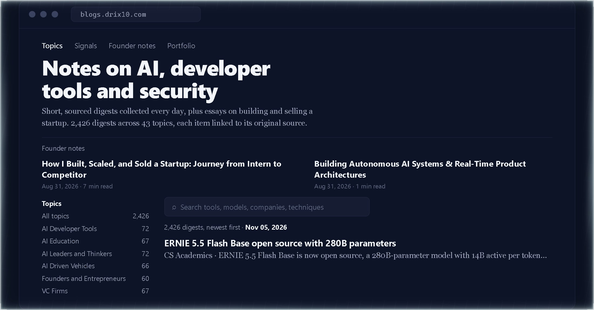
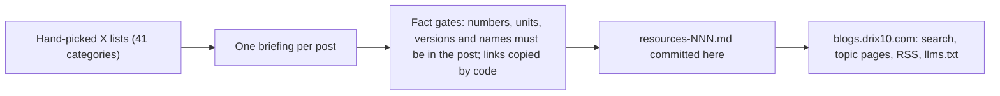

<div align="center">

<a href="https://blogs.drix10.com"></a>

<a href="https://github.com/Drix10/ai-resources/stargazers"></a>
<a href="https://github.com/Drix10/ai-resources/commits/main"></a>
<a href="https://www.npmjs.com/package/ai-resources-mcp"></a>
<a href="https://blogs.drix10.com/rss.xml"></a>
<a href="LICENSE"></a>

<b><a href="https://blogs.drix10.com">Read it</a></b> · <b><a href="#-resource-categories">Browse 41 categories</a></b> · <b><a href="#use-it-from-your-ai-agent">Plug it into your agent</a></b> · <b><a href="https://github.com/search?q=repo%3ADrix10%2Fai-resources+MCP&type=code">Search the archive</a></b>

</div>

<table>
<tr>
<td width="25%" valign="top"><b>Checked against the source</b><br><sub>A number, unit, model version or name that is not in the source post gets the briefing rejected and rewritten.</sub></td>
<td width="25%" valign="top"><b>Every claim has a link</b><br><sub>The original post and the page it points to, copied by code, never written by the model.</sub></td>
<td width="25%" valign="top"><b>41 categories</b><br><sub>Models, dev tools, research and funding, plus robotics, climate, quantum, security and crypto.</sub></td>
<td width="25%" valign="top"><b>Ready for your agent</b><br><sub>MCP server, Agent Skill, JSON API and llms.txt. Plain Markdown under CC BY 4.0.</sub></td>
</tr>
</table>

## Three ways in

<table>
<tr>
<td width="55%"><a href="https://blogs.drix10.com"></a></td>
<td width="45%" valign="top">
<h3><a href="https://blogs.drix10.com">Read it</a></h3>
The newest digests on <a href="https://blogs.drix10.com">blogs.drix10.com</a>, with search, topic pages and an <a href="https://blogs.drix10.com/rss.xml">RSS feed</a>. Or open any category <a href="#-resource-categories">below</a> and read its latest digest here on GitHub.
<br><br>
Star and watch the repo to get new digests as they land.
</td>
</tr>
<tr>
<td width="55%"><a href="USE-WITH-AI.md"></a></td>
<td width="45%" valign="top">
<h3><a href="#use-it-from-your-ai-agent">Ask it from your agent</a></h3>
Claude, Cursor, VS Code or Windsurf answer "what did Anthropic ship this week?" from the briefings, with dates and source links. No key, no account. <a href="#use-it-from-your-ai-agent">Setup for every client ↓</a>
<br><br>
<code>claude mcp add ai-resources -- npx -y ai-resources-mcp</code>
</td>
</tr>
<tr>
<td width="55%"></td>
<td width="45%" valign="top">
<h3>Clone it</h3>
100,000+ dated, sourced briefings in plain Markdown for RAG, evals or an offline index. Every <code>resources-NNN.md</code> holds 5 to 12 of them, like <a href="AI%20Developer%20Tools/resources-296.md">this one</a>.
<br><br>
<code>git clone --depth 1 https://github.com/Drix10/ai-resources</code>
</td>
</tr>
</table>

## What a briefing looks like

<a href="AI%20Developer%20Tools/resources-296.md"></a>
<p align="center"><sub>A real briefing from <a href="AI%20Developer%20Tools/resources-296.md">AI Developer Tools #296</a>. Every digest file holds 5 to 12 of these.</sub></p>


## Signals: what is accelerating in AI

<a href="https://blogs.drix10.com/signals"></a>
<p align="center"><sub><a href="https://blogs.drix10.com/signals">Signals</a>, computed weekly: topics whose coverage climbs three weeks running. Trajectories, not predictions — and nothing on it is written by a model.</sub></p>

Briefings tell you what happened. Signals tells you what it means: which topics are accelerating, with the sample headlines and source links behind every call. Computed from counts only (one briefing = one vote), in the open: [`MOVEMENTS.md`](MOVEMENTS.md) in this repo, [`/api/signals`](https://blogs.drix10.com/api/signals) for code, and the `trending_movements` MCP tool for agents.

## Who it is for

- **Engineers building with AI.** What changed in models, inference, agents, MCP and dev tools, with the benchmark number and the link, in [AI Developer Tools](#ai-developer-tools) and [Tech Infrastructure](#tech-infrastructure).
- **Founders and investors.** Rounds, launches and revenue figures as they are announced, in [AI Companies and Ventures](#ai-companies-and-ventures), [VC Firms](#vc-firms) and [Founders and Entrepreneurs](#founders-and-entrepreneurs).
- **Researchers and students.** What the people in the field are publishing and arguing about, in [CS Academics](#cs-academics) and [Neuroscience and AI](#neuroscience-and-ai).
- **Anyone building RAG, agents or evals.** A 100,000-item corpus of dated, sourced AI news under CC BY 4.0.

Awesome lists are still the better pick for a vetted shortlist, and a newsletter for five editor-picked minutes a day. [COMPARISONS.md](COMPARISONS.md) lays out where this fits.

## Use it from your AI agent

Five ways to plug the briefings into an agent or your own code. None needs a key or an account. Full reference: **[USE-WITH-AI.md](USE-WITH-AI.md)**.

| Path | Best for | Setup |
| --- | --- | --- |
| [MCP server](#mcp-server) | Claude Code, Claude Desktop, Cursor, VS Code, Windsurf | one command or one JSON block |
| [Agent Skill](#agent-skill) | Claude Code and other Skill-aware agents | copy one folder |
| [JSON API](#json-api) | your own code, custom GPT actions, scripts | none, CORS open |
| [llms.txt and RSS](#llmstxt-and-rss) | any LLM that reads a URL, feed readers, bots | none |
| [Raw Markdown](#three-ways-in) | RAG, evals, offline indexes, all 100,000+ briefings | `git clone` |

### MCP server

<a href="https://www.npmjs.com/package/ai-resources-mcp"></a>
<a href="https://registry.modelcontextprotocol.io/v0/servers?search=io.github.Drix10/ai-resources"></a>


Published on npm as [`ai-resources-mcp`](https://www.npmjs.com/package/ai-resources-mcp) (MIT, code in [`mcp/`](mcp/)). `npx` fetches it on first run, so there is nothing to install by hand.

| Tool | What it does |
| --- | --- |
| `search_briefings(query, category?, limit?, since?)` | Keyword search, newest first. All words must match. `since` is `YYYY-MM-DD`. |
| `latest(category?, limit?)` | The newest briefings, overall or for one category. |
| `get_briefing(id)` | Full Markdown of one briefing (URL or slug), with every source link. |
| `list_categories()` | Every category slug with its briefing count. |
| `trending_movements(limit?)` | Topics accelerating week over week (rising) or hot for one week (watch), with sample headlines and source links. |

Every result ends with its source link and `Data: github.com/Drix10/ai-resources (CC BY 4.0)`, so answers stay citable.

**Claude Code**

```bash
claude mcp add ai-resources -- npx -y ai-resources-mcp
```

<details>
<summary><b>Claude Desktop, Cursor, Windsurf</b></summary>

<br>

Add this to `claude_desktop_config.json` (Claude Desktop: Settings → Developer → Edit Config), `~/.cursor/mcp.json` or `.cursor/mcp.json` (Cursor), or `~/.codeium/windsurf/mcp_config.json` (Windsurf):

```json
{
  "mcpServers": {
    "ai-resources": { "command": "npx", "args": ["-y", "ai-resources-mcp"] }
  }
}
```

</details>

<details>
<summary><b>VS Code</b></summary>

<br>

In `.vscode/mcp.json`, or *MCP: Open User Configuration*:

```json
{
  "servers": {
    "ai-resources": { "type": "stdio", "command": "npx", "args": ["-y", "ai-resources-mcp"] }
  }
}
```

Or from a terminal:

```bash
code --add-mcp "{\"name\":\"ai-resources\",\"command\":\"npx\",\"args\":[\"-y\",\"ai-resources-mcp\"]}"
```

</details>

<details>
<summary><b>Windows, and other settings</b></summary>

<br>

If a client cannot start `npx` on Windows, use `"command": "cmd", "args": ["/c", "npx", "-y", "ai-resources-mcp"]`.

`AI_RESOURCES_API_URL` sets the API base URL (default `https://blogs.drix10.com`).

</details>

Then ask, for example:

- *"What did Anthropic announce this week? Cite the sources."*
- *"Latest five briefings in AI Developer Tools."*
- *"Who raised a Series A in AI this month, and how much?"*

### Agent Skill

[`skills/ai-news`](skills/ai-news/SKILL.md) teaches an agent when and how to answer "what's new in AI", "latest on &lt;model or company&gt;" and "who raised" questions from the briefings, with dates and citations. It uses the MCP tools when they are installed and falls back to the JSON API, then llms.txt, then raw Markdown on GitHub when they are not.

```bash
git clone --depth 1 https://github.com/Drix10/ai-resources
mkdir -p ~/.claude/skills
cp -r ai-resources/skills/ai-news ~/.claude/skills/
```

<details>
<summary><b>One project only, Windows, other agents</b></summary>

<br>

- **One project:** copy it to `.claude/skills/ai-news/` inside that project instead.
- **Windows (PowerShell):** `Copy-Item -Recurse ai-resources\skills\ai-news $HOME\.claude\skills\`
- **Other agents** that read `SKILL.md` folders work the same way. For chat apps without Skills, paste the body of `SKILL.md` into the custom instructions.

</details>

### JSON API

Base URL `https://blogs.drix10.com`. JSON, CORS open, no key. It covers the briefings published on the blog; the full archive is in this repository.

| Request | Returns |
| --- | --- |
| `GET /api/articles?q=&category=&since=&limit=&page=` | `{ items, total, page, limit, totalPages, license }`, newest first. All words in `q` must match; every parameter is optional. |
| `GET /api/articles?slug=<slug or URL>` | One item, plus `content` (the full Markdown). |
| `GET /api/categories` | `{ items: [{ name, slug, count, url, llms }] }` |

Each item has `title`, `url`, `slug`, `category`, `categorySlug`, `date`, `description`, `headlines` (every news item in the briefing) and `sources` (`[{ title, url }]`, the original posts).

```bash
curl "https://blogs.drix10.com/api/articles?q=anthropic&since=2026-10-01&limit=5"
curl "https://blogs.drix10.com/api/categories"
```

### llms.txt and RSS

- [`/llms.txt`](https://blogs.drix10.com/llms.txt): the index, linking every category.
- `/llms/<category-slug>.txt`: the 50 newest briefings of one category, for example [`/llms/ai-developer-tools.txt`](https://blogs.drix10.com/llms/ai-developer-tools.txt).
- [`/rss.xml`](https://blogs.drix10.com/rss.xml): for feed readers, Slack or Discord feed bots and email-digest services.

When you show the data anywhere, credit it as `Data: github.com/Drix10/ai-resources (CC BY 4.0)`. The MCP server and the Skill add that line for you.

## By the numbers

Counted from this repository on 29 October 2026. The archive only grows.

| | |
| ---: | --- |
| **100,000+** | briefings: a headline, two or three sentences and the key numbers, one per post |
| **10,800+** | digest files (`resources-NNN.md`) across **41 categories** |
| **10,900+** | commits since November 2024, all made by an automated pipeline |
| **14,000+** | briefings that link both the original post and the page it points to (every briefing since mid-2026) |
| **~2,000** | of them published as articles on [blogs.drix10.com](https://blogs.drix10.com) with search, topic pages, an [RSS feed](https://blogs.drix10.com/rss.xml) and [llms.txt](https://blogs.drix10.com/llms.txt) |

## How it is built

Nobody types these. A pipeline reads the hand-picked X lists for each category, writes one briefing per strong post, runs the fact gates, strips secrets, de-duplicates across categories and commits the batch here. The same run refreshes the category list below and publishes to the blog.



**Known limits:** briefings are machine-written from public posts and can still be wrong; check the linked source before you rely on a number. Part of the older archive (2024 to mid-2026) predates source links. Coverage follows the hand-picked lists, blind spots included. Inclusion is not endorsement.

## Contribute

A pipeline writes the briefings. People pick the sources and fix what it gets wrong. Ways in:

- **Pick up a [good first issue](https://github.com/Drix10/ai-resources/issues?q=is%3Aissue+is%3Aopen+label%3A%22good+first+issue%22)**: MCP server tools, Skill phrasings, guides, examples, translations.
- **[Suggest a source](https://github.com/Drix10/ai-resources/issues/new?template=suggest-source.yml)** (an X account, list or site) or **[report a wrong fact](https://github.com/Drix10/ai-resources/issues/new?template=wrong-fact.yml)** with the briefing link.
- **Ask, share what you built, or float an idea** in [Discussions](https://github.com/Drix10/ai-resources/discussions).

[CONTRIBUTING.md](CONTRIBUTING.md) has the details, including what not to edit by hand. Content is CC BY 4.0; the MCP server code is MIT. If you use the archive in research, [CITATION.cff](CITATION.cff) has the citation.

## Star history

<a href="https://star-history.com/#Drix10/ai-resources&Date"></a>

## About the curator

Built and maintained by **[Drishtant Ghosh (Drix10)](https://drix10.com)**, an AI systems engineer and 1x acquired founder (ReeF, acquired August 2024) based in Bengaluru. Founder of CosLynx.com, AI systems architect on Canopy @ Founders, Inc., Backdrop Build v4 and v6 finalist. More writing at [blogs.drix10.com](https://blogs.drix10.com).

<!-- drix10-footer -->
---

<div align="center">

**Built by [Drishtant Ghosh (Drix10)](https://drix10.com)** · AI systems engineer and 1x acquired founder, Bengaluru

[Portfolio](https://drix10.com) · [LinkedIn](https://www.linkedin.com/in/drix10) · [X](https://x.com/DrishtantGhosh) · [Blog](https://blogs.drix10.com) · [All projects](https://github.com/Drix10)

<sub>More from Drix10: [Agent Flow](https://github.com/Drix10/agent-flow) (guardrails for AI coding agents) · [MiroHedge](https://github.com/Drix10/hypothesis-arena) (AI-assisted systematic fund) · [Guardian](https://github.com/Drix10/guardian-gpt) (UPI scam interceptor) · [Sentinel](https://github.com/Drix10/sentinal) (AI security CLI) · [Keystroke-LLM](https://github.com/Drix10/keystroke-llm) (NumPy transformer on a keyboard)</sub>

</div>

---

## 📚 Resource Categories

**11,616 digests in 41 categories.** Each category shows its newest headlines; jump to one:

<sub>[AI Developer Tools](#ai-developer-tools) · [AI Leaders and Thinkers](#ai-leaders-and-thinkers) · [AI Companies and Ventures](#ai-companies-and-ventures) · [CS Academics](#cs-academics) · [Tech VIPs](#tech-vips) · [VC Firms](#vc-firms) · [Devs, Designers, DevRel](#devs-designers-devrel) · [Tech Infrastructure](#tech-infrastructure) · [Founders and Entrepreneurs](#founders-and-entrepreneurs) · [AI Organizations and Media](#ai-organizations-and-media) · [AI Powered Film and Media](#ai-powered-film-and-media) · [AI Holodeck and Virtual Worlds](#ai-holodeck-and-virtual-worlds) · [AI Artists and Creators](#ai-artists-and-creators) · [AI in Healthcare and Science](#ai-in-healthcare-and-science) · [AI Generated Music and Audio](#ai-generated-music-and-audio) · [AI Consulting and Expertise](#ai-consulting-and-expertise) · [AI Professionals and Community](#ai-professionals-and-community) · [AI Policy and Ethical Considerations](#ai-policy-and-ethical-considerations) · [AI in Real Estate and Property Tech](#ai-in-real-estate-and-property-tech) · [AI and Robotics Applications](#ai-and-robotics-applications) · [AI Driven Vehicles and Transportation](#ai-driven-vehicles-and-transportation) · [AI for Content Creation and Marketing](#ai-for-content-creation-and-marketing) · [AR VR Companies and Development](#ar-vr-companies-and-development) · [AR VR Professionals and Community](#ar-vr-professionals-and-community) · [Climate and Weather Technology](#climate-and-weather-technology) · [Computer Vision and AI Applications](#computer-vision-and-ai-applications) · [Crypto and Web3](#crypto-and-web3) · [Decentralized AI](#decentralized-ai) · [The Exponential Future](#the-exponential-future) · [AI Education](#ai-education) · [AI in Enterprise Applications](#ai-in-enterprise-applications) · [Interesting Finds](#interesting-finds) · [Investors and Venture Capital](#investors-and-venture-capital) · [Cybersecurity and Tech](#cybersecurity-and-tech) · [Neuroscience and AI](#neuroscience-and-ai) · [PR and Communications](#pr-and-communications) · [Quantum Computing](#quantum-computing) · [Spatial Computing](#spatial-computing) · [Tech Companies and News](#tech-companies-and-news) · [Tech Journalists and VIPs](#tech-journalists-and-vips) · [World News and Updates](#world-news-and-updates)</sub>

### AI Developer Tools

<sub>321 digests · [latest: #324](https://github.com/Drix10/ai-resources/blob/main/AI%20Developer%20Tools/resources-324.md) · [read on the blog](https://blogs.drix10.com/categories/ai-developer-tools)</sub>

*   Steel MCP launch – hosted cloud browser with 31% fewer tokens
*   Tornado Cash recipients split ETH via fresh wallets, $27.7M traced
*   Pirate Face adds 999 new model torrents to Community torrents

### AI Leaders and Thinkers

<sub>314 digests · [latest: #314](https://github.com/Drix10/ai-resources/blob/main/AI%20Leaders%20and%20Thinkers/resources-314.md) · [read on the blog](https://blogs.drix10.com/categories/ai-leaders-and-thinkers)</sub>

*   Claude Opus 5.5 populates US map for game with 31 data sources
*   TimeTravelContainer live-forks sandbox, 84.1× clone speedup
*   ARTEX attack timeline 1.3 seconds admin hijack, 20 minutes full control

### AI Companies and Ventures

<sub>312 digests · [latest: #312](https://github.com/Drix10/ai-resources/blob/main/AI%20Companies%20and%20Ventures/resources-312.md) · [read on the blog](https://blogs.drix10.com/categories/ai-companies-and-ventures)</sub>

*   SenseNova U1.6 self-correction launch with 10% aesthetic gain
*   US stock market $2.1 trillion added in 150 minutes
*   Solar Mini 4.5 Preview launch on OpenRouter with pricing

### CS Academics

<sub>325 digests · [latest: #325](https://github.com/Drix10/ai-resources/blob/main/CS%20Academics/resources-325.md) · [read on the blog](https://blogs.drix10.com/categories/cs-academics)</sub>

*   Claude cuts Lean Riemann Hypothesis formalization 99.56%
*   ReadyNeuro dataset released, 16TB of fMRI shards
*   ReadyNeuro release – largest open fMRI dataset

### Tech VIPs

<sub>317 digests · [latest: #317](https://github.com/Drix10/ai-resources/blob/main/Tech%20VIPs/resources-317.md) · [read on the blog](https://blogs.drix10.com/categories/tech-vips)</sub>

*   1Password hacked via employee GitHub breach, copy of records
*   Rex adds program resume via OSC 7577 terminal protocol
*   herdr auto resume support added via OSC 7577

### VC Firms

<sub>315 digests · [latest: #315](https://github.com/Drix10/ai-resources/blob/main/VC%20Firms/resources-315.md) · [read on the blog](https://blogs.drix10.com/categories/vc-firms)</sub>

*   Erebor bank built, chartered, $1B deposits in 2025
*   Erebor bank built May 2025, $1B deposits in 7 weeks
*   DIA erased 2%+ decline to finish positive since 2/24/22

### Devs, Designers, DevRel

<sub>316 digests · [latest: #316](https://github.com/Drix10/ai-resources/blob/main/Devs%2C%20Designers%2C%20DevRel/resources-316.md) · [read on the blog](https://blogs.drix10.com/categories/devs-designers-devrel)</sub>

*   Claude model reduces GRH Lean proof lines to &lt;300K
*   Polymarket launches pricing for Nvidia H100 to 2028
*   Inkling 2 Mini – local availability announced with partner support

### Tech Infrastructure

<sub>291 digests · [latest: #291](https://github.com/Drix10/ai-resources/blob/main/Tech%20Infrastructure/resources-291.md) · [read on the blog](https://blogs.drix10.com/categories/tech-infrastructure)</sub>

*   Neon Antigravity cache hit up 4.5%, usage +75% in 5 days
*   Azure SQL Hyperscale automatic index compaction with ALTER DATABASE command
*   Amazon SageMaker HyperPod adds NCCL profiling support

### Founders and Entrepreneurs

<sub>280 digests · [latest: #280](https://github.com/Drix10/ai-resources/blob/main/Founders%20and%20Entrepreneurs/resources-280.md) · [read on the blog](https://blogs.drix10.com/categories/founders-and-entrepreneurs)</sub>

*   Uber could acquire Atoms, valued like Tesla, $56B value gain
*   Situational Awareness down 65% Q3, up 88.5% through Sept

### AI Organizations and Media

<sub>307 digests · [latest: #307](https://github.com/Drix10/ai-resources/blob/main/AI%20Organizations%20and%20Media/resources-307.md) · [read on the blog](https://blogs.drix10.com/categories/ai-organizations-and-media)</sub>

*   Delegent cuts coding cost 67% with 27B FP8 model
*   ComputeWise measuring and fixing GPU waste, benchmark released
*   NeoWorld-10K v0.1 adds 1,324 articulated objects

### AI Powered Film and Media

<sub>282 digests · [latest: #282](https://github.com/Drix10/ai-resources/blob/main/AI%20Powered%20Film%20and%20Media/resources-282.md) · [read on the blog](https://blogs.drix10.com/categories/ai-powered-film-and-media)</sub>

*   Gemini 4 Carbon – Kyoto moss garden built in Godot 4.7.2 with code only
*   Higgsfield MAGI-2 1080p AI video made for $2.70

### AI Holodeck and Virtual Worlds

<sub>295 digests · [latest: #295](https://github.com/Drix10/ai-resources/blob/main/AI%20Holodeck%20and%20Virtual%20Worlds/resources-295.md) · [read on the blog](https://blogs.drix10.com/categories/ai-holodeck-and-virtual-worlds)</sub>

*   airHQ sleep campaign with Eight Sleep 2M impressions
*   Contextflo reduces time to minutes, 6k queries/month
*   RadTV building superfans model 5,000 fans $50K/month

### AI Artists and Creators

<sub>286 digests · [latest: #286](https://github.com/Drix10/ai-resources/blob/main/AI%20Artists%20and%20Creators/resources-286.md) · [read on the blog](https://blogs.drix10.com/categories/ai-artists-and-creators)</sub>

*   MAGI-2 workflow tutorial 30-second video $2.40 cost
*   Apple secret autonomous car leak, $10 billion project details

### AI in Healthcare and Science

<sub>298 digests · [latest: #298](https://github.com/Drix10/ai-resources/blob/main/AI%20in%20Healthcare%20and%20Science/resources-298.md) · [read on the blog](https://blogs.drix10.com/categories/ai-in-healthcare-and-science)</sub>

*   GPT-6.2 Astra tops GDPx leaderboard with 19.3% score
*   Giredestrant cuts invasive breast cancer recurrence risk 30%
*   IPS and SMART Health Links: Kill the Clipboard standards

### AI Generated Music and Audio

<sub>295 digests · [latest: #295](https://github.com/Drix10/ai-resources/blob/main/AI%20Generated%20Music%20and%20Audio/resources-295.md) · [read on the blog](https://blogs.drix10.com/categories/ai-generated-music-and-audio)</sub>

*   Phonic 1.1 takes 2nd place on MIVAS Bench, 8.4-point jump
*   Qwen3-Omni Talker labels reproduced – encoder identified
*   MOZAIC: Audio-Video Deepfake Benchmark released

### AI Consulting and Expertise

<sub>285 digests · [latest: #285](https://github.com/Drix10/ai-resources/blob/main/AI%20Consulting%20and%20Expertise/resources-285.md) · [read on the blog](https://blogs.drix10.com/categories/ai-consulting-and-expertise)</sub>

*   Qwen 4 Max builds voxel Hyrule Castle in 30 minutes
*   SciPy India 2026 brings to Chennai December

### AI Professionals and Community

<sub>288 digests · [latest: #288](https://github.com/Drix10/ai-resources/blob/main/AI%20Professionals%20and%20Community/resources-288.md) · [read on the blog](https://blogs.drix10.com/categories/ai-professionals-and-community)</sub>

*   GPT-6.2 usage limit reaches 40% faster after billing fix
*   Openworks launch – funding local AI experts for small businesses
*   Psychoscript runtime extracted as standalone package

### AI Policy and Ethical Considerations

<sub>275 digests · [latest: #275](https://github.com/Drix10/ai-resources/blob/main/AI%20Policy%20and%20Ethical%20Considerations/resources-275.md) · [read on the blog](https://blogs.drix10.com/categories/ai-policy-and-ethical-considerations)</sub>

*   DeepSeek founder Liang Wenfeng net worth $55 billion
*   GPT-Rosalind aims for Codex-like tool for scientists
*   Nvidia reinstated as CEO adds $3 trillion market cap

### AI in Real Estate and Property Tech

<sub>276 digests · [latest: #276](https://github.com/Drix10/ai-resources/blob/main/AI%20in%20Real%20Estate%20and%20Property%20Tech/resources-276.md) · [read on the blog](https://blogs.drix10.com/categories/ai-in-real-estate-and-property-tech)</sub>

*   Spine Animation AI – Claude skill creates rigged Spine animations
*   SAM 3D Objects – single-image 3D reconstruction release
*   Pixel Plays – small isometric browser games

### AI and Robotics Applications

<sub>293 digests · [latest: #293](https://github.com/Drix10/ai-resources/blob/main/AI%20and%20Robotics%20Applications/resources-293.md) · [read on the blog](https://blogs.drix10.com/categories/ai-and-robotics-applications)</sub>

*   Prima 1 and Flex 2 teleoperated at Web Summit 2026
*   Six Easy Tasks benchmark humans 100% models 0% claim
*   Obsidian official connectors for every agent announced

### AI Driven Vehicles and Transportation

<sub>289 digests · [latest: #289](https://github.com/Drix10/ai-resources/blob/main/AI%20Driven%20Vehicles%20and%20Transportation/resources-289.md) · [read on the blog](https://blogs.drix10.com/categories/ai-driven-vehicles-and-transportation)</sub>

*   Lean Riemann Hypothesis proof compile 35 minutes on 192 cores
*   Guardian Insights Report 2025-26 – new global direction, five findings
*   OpenAI publishes proof reducing FFT complexity

### AI for Content Creation and Marketing

<sub>285 digests · [latest: #285](https://github.com/Drix10/ai-resources/blob/main/AI%20for%20Content%20Creation%20and%20Marketing/resources-285.md) · [read on the blog](https://blogs.drix10.com/categories/ai-for-content-creation-and-marketing)</sub>

*   Black Friday playbook 7 steps 11,307 tests
*   Obsidian official connectors for every agent
*   Onlook new version open-source launch with local-first desktop app

### AR VR Companies and Development

<sub>281 digests · [latest: #281](https://github.com/Drix10/ai-resources/blob/main/AR%20VR%20Companies%20and%20Development/resources-281.md) · [read on the blog](https://blogs.drix10.com/categories/ar-vr-companies-and-development)</sub>

*   Praxis-1 runs 1.7x faster on ExecuTorch with TensorRT
*   Arcturus Vision Camera vertical FOV now 140°
*   DiffSimp adds differentiable mesh simplification layer with 1.00-1.25× runtime overhead

### AR VR Professionals and Community

<sub>279 digests · [latest: #279](https://github.com/Drix10/ai-resources/blob/main/AR%20VR%20Professionals%20and%20Community/resources-279.md) · [read on the blog](https://blogs.drix10.com/categories/ar-vr-professionals-and-community)</sub>

*   Inkling-mini-2 runs 1,504.3 tok/s on 128 slots
*   Claude Fable 5.2 leads FrontierPhysics leaderboard at 32%
*   Gemini 4 Neon Antigravity video created in 17 minutes using 1% weekly usage

### Climate and Weather Technology

<sub>274 digests · [latest: #274](https://github.com/Drix10/ai-resources/blob/main/Climate%20and%20Weather%20Technology/resources-274.md) · [read on the blog](https://blogs.drix10.com/categories/climate-and-weather-technology)</sub>

*   High flood, power outage risk as warnings cover B.C. coast
*   Powerful Thanksgiving System to Impact the East Coast – parade postponed to Saturday
*   Highest wind gusts observed across central NC, up to 47 mph

### Computer Vision and AI Applications

<sub>282 digests · [latest: #282](https://github.com/Drix10/ai-resources/blob/main/Computer%20Vision%20and%20AI%20Applications/resources-282.md) · [read on the blog](https://blogs.drix10.com/categories/computer-vision-and-ai-applications)</sub>

*   SAM3 in Labelme v7.11 runs on GPU, 7x faster masks
*   PhysiclAI 6.5K 3D scenes released for perception
*   ICML2027 CfP dropped – new peer-review policies announced

### Crypto and Web3

<sub>272 digests · [latest: #272](https://github.com/Drix10/ai-resources/blob/main/Crypto%20and%20Web3/resources-272.md) · [read on the blog](https://blogs.drix10.com/categories/crypto-and-web3)</sub>

*   1Password breach – hackers accessed GitHub, stole data
*   P≠NP Contributor rewards – 100M PNP set aside for proof contributors
*   StrateFai Alpha Call launches 7 quant strategies, $100 entry

### Decentralized AI

<sub>274 digests · [latest: #274](https://github.com/Drix10/ai-resources/blob/main/Decentralized%20AI/resources-274.md) · [read on the blog](https://blogs.drix10.com/categories/decentralized-ai)</sub>

*   Bittensor subnet limit increased to 160 slots
*   Hippius cloud storage benchmark faster than R2 and B2
*   iota SN9 price rose 13% in 5 minutes to 0.02423 TAO

### The Exponential Future

<sub>274 digests · [latest: #274](https://github.com/Drix10/ai-resources/blob/main/The%20Exponential%20Future/resources-274.md) · [read on the blog](https://blogs.drix10.com/categories/the-exponential-future)</sub>

*   KK Mart launches 462 million ringgit IPO share sale
*   SoftBank credit risk tops 500 bps for first time in four years
*   Grok Bot saved the day, found $200,000 in lost payments

### AI Education

<sub>290 digests · [latest: #290](https://github.com/Drix10/ai-resources/blob/main/AI%20Education/resources-290.md) · [read on the blog](https://blogs.drix10.com/categories/ai-education)</sub>

*   Clinical AI copilots revenue $550M, 5.5x growth
*   Anthropic interview shows two-thirds cut hiring, training budgets should rise
*   Software Foundations trilogy now on ChapterPal

### AI in Enterprise Applications

<sub>279 digests · [latest: #279](https://github.com/Drix10/ai-resources/blob/main/AI%20in%20Enterprise%20Applications/resources-279.md) · [read on the blog](https://blogs.drix10.com/categories/ai-in-enterprise-applications)</sub>

*   Drex Max v1.2 launch – #1 Decision Index, $0.04 per million tokens
*   Outbound campaign 33,394 cold emails yields 265 replies
*   Channel webhook adds HTTPS endpoint, signed POST retries

### Interesting Finds

<sub>264 digests · [latest: #264](https://github.com/Drix10/ai-resources/blob/main/Interesting%20Finds/resources-264.md) · [read on the blog](https://blogs.drix10.com/categories/interesting-finds)</sub>

*   Flight Tracker – live split-flap board announced
*   Giving Pledge 2.0 launches $10 billion direct-giving platform

### Investors and Venture Capital

<sub>269 digests · [latest: #269](https://github.com/Drix10/ai-resources/blob/main/Investors%20and%20Venture%20Capital/resources-269.md) · [read on the blog](https://blogs.drix10.com/categories/investors-and-venture-capital)</sub>

*   Moving Sofa Problem 3D new record 1.8893629 volume
*   SpaceX to donate one share per active Trump Account, Elon Musk to match
*   Open source AI coding GUIs privacy audit: 1 of 25 honors DO_NOT_TRAC

### Cybersecurity and Tech

<sub>252 digests · [latest: #252](https://github.com/Drix10/ai-resources/blob/main/Cybersecurity%20and%20Tech/resources-252.md) · [read on the blog](https://blogs.drix10.com/categories/cybersecurity-and-tech)</sub>

*   Qwen3-0.6B 24KB x86-64 Assembly OS runs 54% faster than Linux llama.cpp
*   Palo Alto Networks flags Fragnesia flaw in PAN-OS
*   Vote to List Token pages fabricate votes, wallet drainer

### Neuroscience and AI

<sub>259 digests · [latest: #259](https://github.com/Drix10/ai-resources/blob/main/Neuroscience%20and%20AI/resources-259.md) · [read on the blog](https://blogs.drix10.com/categories/neuroscience-and-ai)</sub>

*   AR1001 phase III trial shows 31% symptom slowdown in subgroup
*   Echidna integrates genomic and transcriptomic data to reveal CNA impact on tumor evolution
*   tTIS modulates reward learning circuits and relieves subclinical depression

### PR and Communications

<sub>257 digests · [latest: #257](https://github.com/Drix10/ai-resources/blob/main/PR%20and%20Communications/resources-257.md) · [read on the blog](https://blogs.drix10.com/categories/pr-and-communications)</sub>

*   Amazon loses latest attempt to avoid recall handling
*   TransPerfect grew to $1.32B revenue after 34 years
*   Taco Bell AI in 900 Drive-Thrus lifts sales 1.5%

### Quantum Computing

<sub>258 digests · [latest: #258](https://github.com/Drix10/ai-resources/blob/main/Quantum%20Computing/resources-258.md) · [read on the blog](https://blogs.drix10.com/categories/quantum-computing)</sub>

*   Bosonic codes from compact phase spaces – no normalizable low-energy states
*   Voyager Golden Record launched 1977 with heartbeat and 115 images
*   Diraq silicon spin quantum computer in Sydney center

### Spatial Computing

<sub>256 digests · [latest: #256](https://github.com/Drix10/ai-resources/blob/main/Spatial%20Computing/resources-256.md) · [read on the blog](https://blogs.drix10.com/categories/spatial-computing)</sub>

*   NVIDIA DGX Spark runs excavator with 1M particles
*   TopOpt 3D 3.0 optimizes 3D model with over a million parts on iPhone 15
*   WorldLatent 4D model unifies video understanding and generation

### Tech Companies and News

<sub>251 digests · [latest: #251](https://github.com/Drix10/ai-resources/blob/main/Tech%20Companies%20and%20News/resources-251.md) · [read on the blog](https://blogs.drix10.com/categories/tech-companies-and-news)</sub>

*   Grand Theft Auto VI most refunded, 20M uninstalls
*   Data-center capacity queue – Texas and Mountain West 67% share, Wyoming 27.6 GW
*   LINK FDA approval for first US pivotal BCI trial

### Tech Journalists and VIPs

<sub>254 digests · [latest: #254](https://github.com/Drix10/ai-resources/blob/main/Tech%20Journalists%20and%20VIPs/resources-254.md) · [read on the blog](https://blogs.drix10.com/categories/tech-journalists-and-vips)</sub>

*   Matrix multiplication exponent tight at 9/4
*   Anthropic retail demand accelerates, $100M bought, 2nd-most purchased stock
*   Exa live flight data now serves 37M+ flights per year

### World News and Updates

<sub>246 digests · [latest: #246](https://github.com/Drix10/ai-resources/blob/main/World%20News%20and%20Updates/resources-246.md) · [read on the blog](https://blogs.drix10.com/categories/world-news-and-updates)</sub>

*   Fuel tanker crash ignites a massive fire on a highway surrounding Cairo
*   FAA ground stop at Miami Airport after FedEx jet overshoot

---

<div align="center">

[Star the repo](https://github.com/Drix10/ai-resources) to keep it handy and help others find it, or [suggest a source](https://github.com/Drix10/ai-resources/issues/new/choose).

[Read on the blog](https://blogs.drix10.com) · [RSS feed](https://blogs.drix10.com/rss.xml) · [Use it from your AI agent](https://github.com/Drix10/ai-resources/blob/main/USE-WITH-AI.md)

<sub>Summaries © Drishtant Ghosh, licensed [CC BY 4.0](LICENSE). Every digest links to its original post where one exists; the posts and linked pages belong to their authors.</sub>

</div>
