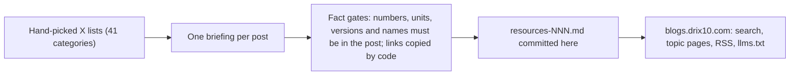

<div align="center">

<a href="https://blogs.drix10.com"></a>

<a href="https://github.com/Drix10/ai-resources/stargazers"></a>
<a href="https://github.com/Drix10/ai-resources/commits/main"></a>
<a href="https://www.npmjs.com/package/ai-resources-mcp"></a>
<a href="https://blogs.drix10.com/rss.xml"></a>
<a href="LICENSE"></a>

<b><a href="https://blogs.drix10.com">Read it</a></b> · <b><a href="#-resource-categories">Browse 41 categories</a></b> · <b><a href="#use-it-from-your-ai-agent">Plug it into your agent</a></b> · <b><a href="https://github.com/search?q=repo%3ADrix10%2Fai-resources+MCP&type=code">Search the archive</a></b>

</div>

<table>
<tr>
<td width="25%" valign="top"><b>Checked against the source</b><br><sub>A number, unit, model version or name that is not in the source post gets the briefing rejected and rewritten.</sub></td>
<td width="25%" valign="top"><b>Every claim has a link</b><br><sub>The original post and the page it points to, copied by code, never written by the model.</sub></td>
<td width="25%" valign="top"><b>41 categories</b><br><sub>Models, dev tools, research and funding, plus robotics, climate, quantum, security and crypto.</sub></td>
<td width="25%" valign="top"><b>Ready for your agent</b><br><sub>MCP server, Agent Skill, JSON API and llms.txt. Plain Markdown under CC BY 4.0.</sub></td>
</tr>
</table>

## Three ways in

<table>
<tr>
<td width="55%"><a href="https://blogs.drix10.com"></a></td>
<td width="45%" valign="top">
<h3><a href="https://blogs.drix10.com">Read it</a></h3>
The newest digests on <a href="https://blogs.drix10.com">blogs.drix10.com</a>, with search, topic pages and an <a href="https://blogs.drix10.com/rss.xml">RSS feed</a>. Or open any category <a href="#-resource-categories">below</a> and read its latest digest here on GitHub.
<br><br>
Star and watch the repo to get new digests as they land.
</td>
</tr>
<tr>
<td width="55%"><a href="USE-WITH-AI.md"></a></td>
<td width="45%" valign="top">
<h3><a href="#use-it-from-your-ai-agent">Ask it from your agent</a></h3>
Claude, Cursor, VS Code or Windsurf answer "what did Anthropic ship this week?" from the briefings, with dates and source links. No key, no account. <a href="#use-it-from-your-ai-agent">Setup for every client ↓</a>
<br><br>
<code>claude mcp add ai-resources -- npx -y ai-resources-mcp</code>
</td>
</tr>
<tr>
<td width="55%"></td>
<td width="45%" valign="top">
<h3>Clone it</h3>
100,000+ dated, sourced briefings in plain Markdown for RAG, evals or an offline index. Every <code>resources-NNN.md</code> holds 5 to 12 of them, like <a href="AI%20Developer%20Tools/resources-296.md">this one</a>.
<br><br>
<code>git clone --depth 1 https://github.com/Drix10/ai-resources</code>
</td>
</tr>
</table>

## What a briefing looks like

<a href="AI%20Developer%20Tools/resources-296.md"></a>
<p align="center"><sub>A real briefing from <a href="AI%20Developer%20Tools/resources-296.md">AI Developer Tools #296</a>. Every digest file holds 5 to 12 of these.</sub></p>


## Signals: what is accelerating in AI

<a href="https://blogs.drix10.com/signals"></a>
<p align="center"><sub><a href="https://blogs.drix10.com/signals">Signals</a>, computed weekly: topics whose coverage climbs three weeks running. Trajectories, not predictions — and nothing on it is written by a model.</sub></p>

Briefings tell you what happened. Signals tells you what it means: which topics are accelerating, with the sample headlines and source links behind every call. Computed from counts only (one briefing = one vote), in the open: [`MOVEMENTS.md`](MOVEMENTS.md) in this repo, [`/api/signals`](https://blogs.drix10.com/api/signals) for code, and the `trending_movements` MCP tool for agents.

## Who it is for

- **Engineers building with AI.** What changed in models, inference, agents, MCP and dev tools, with the benchmark number and the link, in [AI Developer Tools](#ai-developer-tools) and [Tech Infrastructure](#tech-infrastructure).
- **Founders and investors.** Rounds, launches and revenue figures as they are announced, in [AI Companies and Ventures](#ai-companies-and-ventures), [VC Firms](#vc-firms) and [Founders and Entrepreneurs](#founders-and-entrepreneurs).
- **Researchers and students.** What the people in the field are publishing and arguing about, in [CS Academics](#cs-academics) and [Neuroscience and AI](#neuroscience-and-ai).
- **Anyone building RAG, agents or evals.** A 100,000-item corpus of dated, sourced AI news under CC BY 4.0.

Awesome lists are still the better pick for a vetted shortlist, and a newsletter for five editor-picked minutes a day. [COMPARISONS.md](COMPARISONS.md) lays out where this fits.

## Use it from your AI agent

Five ways to plug the briefings into an agent or your own code. None needs a key or an account. Full reference: **[USE-WITH-AI.md](USE-WITH-AI.md)**.

| Path | Best for | Setup |
| --- | --- | --- |
| [MCP server](#mcp-server) | Claude Code, Claude Desktop, Cursor, VS Code, Windsurf | one command or one JSON block |
| [Agent Skill](#agent-skill) | Claude Code and other Skill-aware agents | copy one folder |
| [JSON API](#json-api) | your own code, custom GPT actions, scripts | none, CORS open |
| [llms.txt and RSS](#llmstxt-and-rss) | any LLM that reads a URL, feed readers, bots | none |
| [Raw Markdown](#three-ways-in) | RAG, evals, offline indexes, all 100,000+ briefings | `git clone` |

### MCP server

<a href="https://www.npmjs.com/package/ai-resources-mcp"></a>
<a href="https://registry.modelcontextprotocol.io/v0/servers?search=io.github.Drix10/ai-resources"></a>


Published on npm as [`ai-resources-mcp`](https://www.npmjs.com/package/ai-resources-mcp) (MIT, code in [`mcp/`](mcp/)). `npx` fetches it on first run, so there is nothing to install by hand.

| Tool | What it does |
| --- | --- |
| `search_briefings(query, category?, limit?, since?)` | Keyword search, newest first. All words must match. `since` is `YYYY-MM-DD`. |
| `latest(category?, limit?)` | The newest briefings, overall or for one category. |
| `get_briefing(id)` | Full Markdown of one briefing (URL or slug), with every source link. |
| `list_categories()` | Every category slug with its briefing count. |
| `trending_movements(limit?)` | Topics accelerating week over week (rising) or hot for one week (watch), with sample headlines and source links. |

Every result ends with its source link and `Data: github.com/Drix10/ai-resources (CC BY 4.0)`, so answers stay citable.

**Claude Code**

```bash
claude mcp add ai-resources -- npx -y ai-resources-mcp
```

<details>
<summary><b>Claude Desktop, Cursor, Windsurf</b></summary>

<br>

Add this to `claude_desktop_config.json` (Claude Desktop: Settings → Developer → Edit Config), `~/.cursor/mcp.json` or `.cursor/mcp.json` (Cursor), or `~/.codeium/windsurf/mcp_config.json` (Windsurf):

```json
{
  "mcpServers": {
    "ai-resources": { "command": "npx", "args": ["-y", "ai-resources-mcp"] }
  }
}
```

</details>

<details>
<summary><b>VS Code</b></summary>

<br>

In `.vscode/mcp.json`, or *MCP: Open User Configuration*:

```json
{
  "servers": {
    "ai-resources": { "type": "stdio", "command": "npx", "args": ["-y", "ai-resources-mcp"] }
  }
}
```

Or from a terminal:

```bash
code --add-mcp "{\"name\":\"ai-resources\",\"command\":\"npx\",\"args\":[\"-y\",\"ai-resources-mcp\"]}"
```

</details>

<details>
<summary><b>Windows, and other settings</b></summary>

<br>

If a client cannot start `npx` on Windows, use `"command": "cmd", "args": ["/c", "npx", "-y", "ai-resources-mcp"]`.

`AI_RESOURCES_API_URL` sets the API base URL (default `https://blogs.drix10.com`).

</details>

Then ask, for example:

- *"What did Anthropic announce this week? Cite the sources."*
- *"Latest five briefings in AI Developer Tools."*
- *"Who raised a Series A in AI this month, and how much?"*

### Agent Skill

[`skills/ai-news`](skills/ai-news/SKILL.md) teaches an agent when and how to answer "what's new in AI", "latest on &lt;model or company&gt;" and "who raised" questions from the briefings, with dates and citations. It uses the MCP tools when they are installed and falls back to the JSON API, then llms.txt, then raw Markdown on GitHub when they are not.

```bash
git clone --depth 1 https://github.com/Drix10/ai-resources
mkdir -p ~/.claude/skills
cp -r ai-resources/skills/ai-news ~/.claude/skills/
```

<details>
<summary><b>One project only, Windows, other agents</b></summary>

<br>

- **One project:** copy it to `.claude/skills/ai-news/` inside that project instead.
- **Windows (PowerShell):** `Copy-Item -Recurse ai-resources\skills\ai-news $HOME\.claude\skills\`
- **Other agents** that read `SKILL.md` folders work the same way. For chat apps without Skills, paste the body of `SKILL.md` into the custom instructions.

</details>

### JSON API

Base URL `https://blogs.drix10.com`. JSON, CORS open, no key. It covers the briefings published on the blog; the full archive is in this repository.

| Request | Returns |
| --- | --- |
| `GET /api/articles?q=&category=&since=&limit=&page=` | `{ items, total, page, limit, totalPages, license }`, newest first. All words in `q` must match; every parameter is optional. |
| `GET /api/articles?slug=<slug or URL>` | One item, plus `content` (the full Markdown). |
| `GET /api/categories` | `{ items: [{ name, slug, count, url, llms }] }` |

Each item has `title`, `url`, `slug`, `category`, `categorySlug`, `date`, `description`, `headlines` (every news item in the briefing) and `sources` (`[{ title, url }]`, the original posts).

```bash
curl "https://blogs.drix10.com/api/articles?q=anthropic&since=2026-10-01&limit=5"
curl "https://blogs.drix10.com/api/categories"
```

### llms.txt and RSS

- [`/llms.txt`](https://blogs.drix10.com/llms.txt): the index, linking every category.
- `/llms/<category-slug>.txt`: the 50 newest briefings of one category, for example [`/llms/ai-developer-tools.txt`](https://blogs.drix10.com/llms/ai-developer-tools.txt).
- [`/rss.xml`](https://blogs.drix10.com/rss.xml): for feed readers, Slack or Discord feed bots and email-digest services.

When you show the data anywhere, credit it as `Data: github.com/Drix10/ai-resources (CC BY 4.0)`. The MCP server and the Skill add that line for you.

## By the numbers

Counted from this repository on 29 October 2026. The archive only grows.

| | |
| ---: | --- |
| **100,000+** | briefings: a headline, two or three sentences and the key numbers, one per post |
| **10,800+** | digest files (`resources-NNN.md`) across **41 categories** |
| **10,900+** | commits since November 2024, all made by an automated pipeline |
| **14,000+** | briefings that link both the original post and the page it points to (every briefing since mid-2026) |
| **~2,000** | of them published as articles on [blogs.drix10.com](https://blogs.drix10.com) with search, topic pages, an [RSS feed](https://blogs.drix10.com/rss.xml) and [llms.txt](https://blogs.drix10.com/llms.txt) |

## How it is built

Nobody types these. A pipeline reads the hand-picked X lists for each category, writes one briefing per strong post, runs the fact gates, strips secrets, de-duplicates across categories and commits the batch here. The same run refreshes the category list below and publishes to the blog.



**Known limits:** briefings are machine-written from public posts and can still be wrong; check the linked source before you rely on a number. Part of the older archive (2024 to mid-2026) predates source links. Coverage follows the hand-picked lists, blind spots included. Inclusion is not endorsement.

## Contribute

A pipeline writes the briefings. People pick the sources and fix what it gets wrong. Ways in:

- **Pick up a [good first issue](https://github.com/Drix10/ai-resources/issues?q=is%3Aissue+is%3Aopen+label%3A%22good+first+issue%22)**: MCP server tools, Skill phrasings, guides, examples, translations.
- **[Suggest a source](https://github.com/Drix10/ai-resources/issues/new?template=suggest-source.yml)** (an X account, list or site) or **[report a wrong fact](https://github.com/Drix10/ai-resources/issues/new?template=wrong-fact.yml)** with the briefing link.
- **Ask, share what you built, or float an idea** in [Discussions](https://github.com/Drix10/ai-resources/discussions).

[CONTRIBUTING.md](CONTRIBUTING.md) has the details, including what not to edit by hand. Content is CC BY 4.0; the MCP server code is MIT. If you use the archive in research, [CITATION.cff](CITATION.cff) has the citation.

## Star history

<a href="https://star-history.com/#Drix10/ai-resources&Date"></a>

## About the curator

Built and maintained by **[Drishtant Ghosh (Drix10)](https://drix10.com)**, an AI systems engineer and 1x acquired founder (ReeF, acquired August 2024) based in Bengaluru. Founder of CosLynx.com, AI systems architect on Canopy @ Founders, Inc., Backdrop Build v4 and v6 finalist. More writing at [blogs.drix10.com](https://blogs.drix10.com).

<!-- drix10-footer -->
---

<div align="center">

**Built by [Drishtant Ghosh (Drix10)](https://drix10.com)** · AI systems engineer and 1x acquired founder, Bengaluru

[Portfolio](https://drix10.com) · [LinkedIn](https://www.linkedin.com/in/drix10) · [X](https://x.com/DrishtantGhosh) · [Blog](https://blogs.drix10.com) · [All projects](https://github.com/Drix10)

<sub>More from Drix10: [Agent Flow](https://github.com/Drix10/agent-flow) (guardrails for AI coding agents) · [MiroHedge](https://github.com/Drix10/hypothesis-arena) (AI-assisted systematic fund) · [Guardian](https://github.com/Drix10/guardian-gpt) (UPI scam interceptor) · [Sentinel](https://github.com/Drix10/sentinal) (AI security CLI) · [Keystroke-LLM](https://github.com/Drix10/keystroke-llm) (NumPy transformer on a keyboard)</sub>

</div>

---

## 📚 Resource Categories

**11,152 digests in 41 categories.** Each category shows its newest headlines; jump to one:

<sub>[AI Developer Tools](#ai-developer-tools) · [AI Leaders and Thinkers](#ai-leaders-and-thinkers) · [AI Companies and Ventures](#ai-companies-and-ventures) · [CS Academics](#cs-academics) · [Tech VIPs](#tech-vips) · [VC Firms](#vc-firms) · [Devs, Designers, DevRel](#devs-designers-devrel) · [Tech Infrastructure](#tech-infrastructure) · [Founders and Entrepreneurs](#founders-and-entrepreneurs) · [AI Organizations and Media](#ai-organizations-and-media) · [AI Powered Film and Media](#ai-powered-film-and-media) · [AI Holodeck and Virtual Worlds](#ai-holodeck-and-virtual-worlds) · [AI Artists and Creators](#ai-artists-and-creators) · [AI in Healthcare and Science](#ai-in-healthcare-and-science) · [AI Generated Music and Audio](#ai-generated-music-and-audio) · [AI Consulting and Expertise](#ai-consulting-and-expertise) · [AI Professionals and Community](#ai-professionals-and-community) · [AI Policy and Ethical Considerations](#ai-policy-and-ethical-considerations) · [AI in Real Estate and Property Tech](#ai-in-real-estate-and-property-tech) · [AI and Robotics Applications](#ai-and-robotics-applications) · [AI Driven Vehicles and Transportation](#ai-driven-vehicles-and-transportation) · [AI for Content Creation and Marketing](#ai-for-content-creation-and-marketing) · [AR VR Companies and Development](#ar-vr-companies-and-development) · [AR VR Professionals and Community](#ar-vr-professionals-and-community) · [Climate and Weather Technology](#climate-and-weather-technology) · [Computer Vision and AI Applications](#computer-vision-and-ai-applications) · [Crypto and Web3](#crypto-and-web3) · [Decentralized AI](#decentralized-ai) · [The Exponential Future](#the-exponential-future) · [AI Education](#ai-education) · [AI in Enterprise Applications](#ai-in-enterprise-applications) · [Interesting Finds](#interesting-finds) · [Investors and Venture Capital](#investors-and-venture-capital) · [Cybersecurity and Tech](#cybersecurity-and-tech) · [Neuroscience and AI](#neuroscience-and-ai) · [PR and Communications](#pr-and-communications) · [Quantum Computing](#quantum-computing) · [Spatial Computing](#spatial-computing) · [Tech Companies and News](#tech-companies-and-news) · [Tech Journalists and VIPs](#tech-journalists-and-vips) · [World News and Updates](#world-news-and-updates)</sub>

### AI Developer Tools

<sub>307 digests · [latest: #310](https://github.com/Drix10/ai-resources/blob/main/AI%20Developer%20Tools/resources-310.md) · [read on the blog](https://blogs.drix10.com/categories/ai-developer-tools)</sub>

*   Underdog Woof releases 31.7MB TTS model
*   Underdog Woof 31.7MB TTS model released
*   OCRia-1 launched as best general purpose document parser

### AI Leaders and Thinkers

<sub>300 digests · [latest: #300](https://github.com/Drix10/ai-resources/blob/main/AI%20Leaders%20and%20Thinkers/resources-300.md) · [read on the blog](https://blogs.drix10.com/categories/ai-leaders-and-thinkers)</sub>

*   sandbox-mcp - fresh Windows test machines in 35 s
*   Shinkei AI robot spikes fish brains to extend shelf life 3x
*   Confident AI eval runs typical size 10 cases, noise stats

### AI Companies and Ventures

<sub>298 digests · [latest: #298](https://github.com/Drix10/ai-resources/blob/main/AI%20Companies%20and%20Ventures/resources-298.md) · [read on the blog](https://blogs.drix10.com/categories/ai-companies-and-ventures)</sub>

*   Warden Token Terminal adds trap checks, October updates
*   JUWEL Sapphire custom 72B model BF16 weights released
*   Aave Labs buys Avon team for $30B+ fixed-rate lending

### CS Academics

<sub>311 digests · [latest: #311](https://github.com/Drix10/ai-resources/blob/main/CS%20Academics/resources-311.md) · [read on the blog](https://blogs.drix10.com/categories/cs-academics)</sub>

*   Inkling 2 Small to release weights next week, ARC-AGI
*   Anthropic AECI scores grew 1.9x since Oct 2025
*   BioBasicsBench benchmark released with 100 wet-lab tasks

### Tech VIPs

<sub>303 digests · [latest: #303](https://github.com/Drix10/ai-resources/blob/main/Tech%20VIPs/resources-303.md) · [read on the blog](https://blogs.drix10.com/categories/tech-vips)</sub>

*   Aside Computer Use launches, 2.7x faster
*   Anthropic moral-dilemma token study cuts malicious behavior to 0%
*   Opus 5.5 removes /investigate skill in agent skill set

### VC Firms

<sub>301 digests · [latest: #301](https://github.com/Drix10/ai-resources/blob/main/VC%20Firms/resources-301.md) · [read on the blog](https://blogs.drix10.com/categories/vc-firms)</sub>

*   Rippling added over $150mm nnARR in Q3 quarter
*   vibe launchpad audits completed – no critical risks

### Devs, Designers, DevRel

<sub>303 digests · [latest: #303](https://github.com/Drix10/ai-resources/blob/main/Devs%2C%20Designers%2C%20DevRel/resources-303.md) · [read on the blog](https://blogs.drix10.com/categories/devs-designers-devrel)</sub>

*   gpt-2 running in CSS 124m parameters 15 sec per token
*   Adobe After Effects 2027 rolling out to users
*   SenseNova 6.8 Code2Video model makes videos from prompts

### Tech Infrastructure

<sub>278 digests · [latest: #278](https://github.com/Drix10/ai-resources/blob/main/Tech%20Infrastructure/resources-278.md) · [read on the blog](https://blogs.drix10.com/categories/tech-infrastructure)</sub>

*   Vork 3D engine 2,500-token API renders 1M birds in 97 s
*   Starship Flight 15 catch of booster and upper stage
*   Cellebrite phone cloning software purchased by NIA and Indian police

### Founders and Entrepreneurs

<sub>268 digests · [latest: #268](https://github.com/Drix10/ai-resources/blob/main/Founders%20and%20Entrepreneurs/resources-268.md) · [read on the blog](https://blogs.drix10.com/categories/founders-and-entrepreneurs)</sub>

*   1WIN token live on Meteora, listing complete
*   Rails security updates released, critical image fix
*   Fiddler AI - CrowdStrike acquisition

### AI Organizations and Media

<sub>294 digests · [latest: #294](https://github.com/Drix10/ai-resources/blob/main/AI%20Organizations%20and%20Media/resources-294.md) · [read on the blog](https://blogs.drix10.com/categories/ai-organizations-and-media)</sub>

*   CORA O-RAN adaptation raises recall to 0.771
*   Sequential Recovery Updates for Learned Controllers adds 62 recoveries
*   A Hybrid Visitor Prediction Framework – MAE reduced 9.82%

### AI Powered Film and Media

<sub>277 digests · [latest: #277](https://github.com/Drix10/ai-resources/blob/main/AI%20Powered%20Film%20and%20Media/resources-277.md) · [read on the blog](https://blogs.drix10.com/categories/ai-powered-film-and-media)</sub>

*   GomSpace NanoCom AX100 radio hijack risk on 28 of 64 missions
*   MiniMax H3 Reference-to-Video style LoRA trained on Dell tower
*   KLARA AND THE SUN box office $1.2M domestic, $17 per theater

### AI Holodeck and Virtual Worlds

<sub>283 digests · [latest: #283](https://github.com/Drix10/ai-resources/blob/main/AI%20Holodeck%20and%20Virtual%20Worlds/resources-283.md) · [read on the blog](https://blogs.drix10.com/categories/ai-holodeck-and-virtual-worlds)</sub>

*   HyperFlow H3 Flash speed comparison with Pika and Larry
*   Solo verifies unique humans in 7 sec without government ID
*   Dimocap Real-time motion capture software free download

### AI Artists and Creators

<sub>276 digests · [latest: #276](https://github.com/Drix10/ai-resources/blob/main/AI%20Artists%20and%20Creators/resources-276.md) · [read on the blog](https://blogs.drix10.com/categories/ai-artists-and-creators)</sub>

*   Miracle post-production technology launch
*   RouterHub offers Kimi, DeepSeek, GLM models and 15% referral bonus

### AI in Healthcare and Science

<sub>286 digests · [latest: #286](https://github.com/Drix10/ai-resources/blob/main/AI%20in%20Healthcare%20and%20Science/resources-286.md) · [read on the blog](https://blogs.drix10.com/categories/ai-in-healthcare-and-science)</sub>

*   lutetium Lu 177 vipivotide tetraxetan FDA approved for prostate cancer
*   lirafugratinib FDA approval for FGFR2-positive cholangiocarcinoma
*   sevabertinib accelerated approval for HER2-mutated NSCLC

### AI Generated Music and Audio

<sub>283 digests · [latest: #283](https://github.com/Drix10/ai-resources/blob/main/AI%20Generated%20Music%20and%20Audio/resources-283.md) · [read on the blog](https://blogs.drix10.com/categories/ai-generated-music-and-audio)</sub>

*   E-Gaborformer – strictly causal speech recognizer with 19MB constant streaming state
*   Decode Before You Hear: Speculative Listening speeds up full-duplex speech models
*   SubRoformer: Subband Time-Domain code released

### AI Consulting and Expertise

<sub>274 digests · [latest: #274](https://github.com/Drix10/ai-resources/blob/main/AI%20Consulting%20and%20Expertise/resources-274.md) · [read on the blog](https://blogs.drix10.com/categories/ai-consulting-and-expertise)</sub>

*   tiny web tool calculates 7 follow-up dates and emails them, $299 in 28 min
*   Prompt: make your site readable by AI agents add prompts
*   Material Science Grand Challenges announced with $1M prize

### AI Professionals and Community

<sub>277 digests · [latest: #277](https://github.com/Drix10/ai-resources/blob/main/AI%20Professionals%20and%20Community/resources-277.md) · [read on the blog](https://blogs.drix10.com/categories/ai-professionals-and-community)</sub>

*   Mochi 535B finished pretraining 18T tokens, release pending
*   The Ultimate MoE Training Handbook released, 800k GPU hours
*   Anthropic valuation comparison with Google IPO valuation

### AI Policy and Ethical Considerations

<sub>271 digests · [latest: #271](https://github.com/Drix10/ai-resources/blob/main/AI%20Policy%20and%20Ethical%20Considerations/resources-271.md) · [read on the blog](https://blogs.drix10.com/categories/ai-policy-and-ethical-considerations)</sub>

*   You Can't See Everything: Perceptual Attacks 100% harmful
*   s³ paper – multi-agent RL lets LLM swarms self-organize, beat best-of-N
*   Senator Becker bill requires AI compute reporting

### AI in Real Estate and Property Tech

<sub>264 digests · [latest: #264](https://github.com/Drix10/ai-resources/blob/main/AI%20in%20Real%20Estate%20and%20Property%20Tech/resources-264.md) · [read on the blog](https://blogs.drix10.com/categories/ai-in-real-estate-and-property-tech)</sub>

*   Aside Computer Use, 2.7x faster, 65% fewer tokens
*   Sprite Fusion Pixel Snapper adds CLI with default 16-color palette
*   blender-kiln – plugin creates real-size editable Blender models

### AI and Robotics Applications

<sub>281 digests · [latest: #281](https://github.com/Drix10/ai-resources/blob/main/AI%20and%20Robotics%20Applications/resources-281.md) · [read on the blog](https://blogs.drix10.com/categories/ai-and-robotics-applications)</sub>

*   W2A achieves 95.9% success and 21× faster inference
*   Claude Opus 5.5 edits π₀.₅ weights, 30% less task time
*   Agentic robot control runs 2.5 h after 30 s recharge

### AI Driven Vehicles and Transportation

<sub>277 digests · [latest: #277](https://github.com/Drix10/ai-resources/blob/main/AI%20Driven%20Vehicles%20and%20Transportation/resources-277.md) · [read on the blog](https://blogs.drix10.com/categories/ai-driven-vehicles-and-transportation)</sub>

*   Atlas Frameboy demo released with up to 15 fps streaming
*   JITEngine custom inference engine for Apple Silicon up to 2.7× faster
*   AD-Memo language-based memory driving agent announced

### AI for Content Creation and Marketing

<sub>273 digests · [latest: #273](https://github.com/Drix10/ai-resources/blob/main/AI%20for%20Content%20Creation%20and%20Marketing/resources-273.md) · [read on the blog](https://blogs.drix10.com/categories/ai-for-content-creation-and-marketing)</sub>

*   Robinhood Agentic Trading accounts open 150,000 users
*   Notion agents now post progress in comment replies
*   Agentic canvas playground built in a few hours for team

### AR VR Companies and Development

<sub>270 digests · [latest: #270](https://github.com/Drix10/ai-resources/blob/main/AR%20VR%20Companies%20and%20Development/resources-270.md) · [read on the blog](https://blogs.drix10.com/categories/ar-vr-companies-and-development)</sub>

*   GPT Image 2.6 now in Runway, 50% faster generation
*   NVIDIA driver fix for Meta Quest Link freezing issue, v621.01 release
*   Insta360 3.2m stick capture produces 1M-splats .ply model

### AR VR Professionals and Community

<sub>267 digests · [latest: #267](https://github.com/Drix10/ai-resources/blob/main/AR%20VR%20Professionals%20and%20Community/resources-267.md) · [read on the blog](https://blogs.drix10.com/categories/ar-vr-professionals-and-community)</sub>

*   Arete-27B – post-trained Qwen3.8-27B with Western values, 803-prompt eval
*   PETAFAB on Steam for $9.99, PC Mac Steam Deck 90Hz OLED
*   TrialGPT – award-winning LLM framework for trial matching

### Climate and Weather Technology

<sub>265 digests · [latest: #265](https://github.com/Drix10/ai-resources/blob/main/Climate%20and%20Weather%20Technology/resources-265.md) · [read on the blog](https://blogs.drix10.com/categories/climate-and-weather-technology)</sub>

*   Air Products scraps $4.5B hydrogen project, $2.9B loss
*   Storm Prediction Center Day 2 Convective Outlook

### Computer Vision and AI Applications

<sub>270 digests · [latest: #270](https://github.com/Drix10/ai-resources/blob/main/Computer%20Vision%20and%20AI%20Applications/resources-270.md) · [read on the blog](https://blogs.drix10.com/categories/computer-vision-and-ai-applications)</sub>

*   HALO — Perceptive Humanoid Motion released, 91% success
*   XMimic trains one policy on 40 LAFAN1 clips in 54 seconds
*   MedHEB benchmark released with 107 tasks and MedEmb baseline

### Crypto and Web3

<sub>261 digests · [latest: #261](https://github.com/Drix10/ai-resources/blob/main/Crypto%20and%20Web3/resources-261.md) · [read on the blog](https://blogs.drix10.com/categories/crypto-and-web3)</sub>

*   Bitcoin Spot ETFs Net Outflows $412M, Ethereum Spot ETFs Outflows $93.19M
*   BLAKE3 stream API sketch adds incremental multithreaded batching
*   Singapore MAS urges caution after Binance hack

### Decentralized AI

<sub>262 digests · [latest: #262](https://github.com/Drix10/ai-resources/blob/main/Decentralized%20AI/resources-262.md) · [read on the blog](https://blogs.drix10.com/categories/decentralized-ai)</sub>

*   Arete-27B fine-tuned Qwen3.8-27B cuts propaganda to 1%
*   Making Agents More Consistent: Skills Should Form Habits for Repeat Tasks
*   Tom Lee says AI infrastructure spend $30T, total build-out $35T

### The Exponential Future

<sub>263 digests · [latest: #263](https://github.com/Drix10/ai-resources/blob/main/The%20Exponential%20Future/resources-263.md) · [read on the blog](https://blogs.drix10.com/categories/the-exponential-future)</sub>

*   Thinking Machines ships open-weight model; Inkling 2 Small 31
*   GBrain Teams now asks before teammate AI uses account
*   Kardashev stack – SpaceX rockets, nuclear reactors, AI chips

### AI Education

<sub>278 digests · [latest: #278](https://github.com/Drix10/ai-resources/blob/main/AI%20Education/resources-278.md) · [read on the blog](https://blogs.drix10.com/categories/ai-education)</sub>

*   Ripple-65B released with 65B params, Apache 2.0, $32M training
*   Affirm transformer underwriting model lifts conversion 3.4%
*   Marble beta launch on App Store with 15,000 waitlist

### AI in Enterprise Applications

<sub>268 digests · [latest: #268](https://github.com/Drix10/ai-resources/blob/main/AI%20in%20Enterprise%20Applications/resources-268.md) · [read on the blog](https://blogs.drix10.com/categories/ai-in-enterprise-applications)</sub>

*   RuntimeWire AI newsroom reaches 5,537 stories
*   RuntimeWire AI newsroom publishes 5,537 stories
*   Accessibility.getFullAXTree finds 227 clickable nodes

### Interesting Finds

<sub>260 digests · [latest: #260](https://github.com/Drix10/ai-resources/blob/main/Interesting%20Finds/resources-260.md) · [read on the blog](https://blogs.drix10.com/categories/interesting-finds)</sub>

*   Product Hunt 13th birthday shows 3x maker launches, 25% unicorn founders
*   Supabase Founder Friends Singapore event announced

### Investors and Venture Capital

<sub>258 digests · [latest: #258](https://github.com/Drix10/ai-resources/blob/main/Investors%20and%20Venture%20Capital/resources-258.md) · [read on the blog](https://blogs.drix10.com/categories/investors-and-venture-capital)</sub>

*   Kimi K3.1 Pro on 8xMI350X reaches 300 tok/s
*   Gemma 4 fine-tuned classifier latency 35ms, F1 0.902
*   Inferact token traffic reaches 7 trillion daily

### Cybersecurity and Tech

<sub>241 digests · [latest: #241](https://github.com/Drix10/ai-resources/blob/main/Cybersecurity%20and%20Tech/resources-241.md) · [read on the blog](https://blogs.drix10.com/categories/cybersecurity-and-tech)</sub>

*   MPTCP vulnerability allows full takeover of exposed Linux servers
*   The PampaLeaks Scapegoat presentation shows forensic breakdown

### Neuroscience and AI

<sub>249 digests · [latest: #249](https://github.com/Drix10/ai-resources/blob/main/Neuroscience%20and%20AI/resources-249.md) · [read on the blog](https://blogs.drix10.com/categories/neuroscience-and-ai)</sub>

*   Tenecteplase approved for acute ischemic stroke in 2025
*   Foodome project uses AI to catalog food molecules
*   Science Immunology November 2026 issue live

### PR and Communications

<sub>247 digests · [latest: #247](https://github.com/Drix10/ai-resources/blob/main/PR%20and%20Communications/resources-247.md) · [read on the blog](https://blogs.drix10.com/categories/pr-and-communications)</sub>

*   U.S. employers added 165,000 jobs, part-time workers rose 339,000
*   OpenAI valued at $1.25 trillion, safety focus over IPO
*   Sequoia shutting down its Scouts program marks the end of an era

### Quantum Computing

<sub>247 digests · [latest: #247](https://github.com/Drix10/ai-resources/blob/main/Quantum%20Computing/resources-247.md) · [read on the blog](https://blogs.drix10.com/categories/quantum-computing)</sub>

*   Adaptive Self-Optimization cuts NV thermometer heating 44%
*   Hybrid Quantum--Classical Pauli-Correlator Architecture for Image Reconstruction announced
*   Broken-Symmetry Reference States for SQD reach near-DMRG

### Spatial Computing

<sub>244 digests · [latest: #244](https://github.com/Drix10/ai-resources/blob/main/Spatial%20Computing/resources-244.md) · [read on the blog](https://blogs.drix10.com/categories/spatial-computing)</sub>

*   Steam Frame Beta adds Room View retention, mixed reality OpenXR support
*   SteamVR new chroma key pipeline enables Room View on Vision Pro
*   LODGE XR Talk Vol.45 announces four content pieces and open-call exhibit

### Tech Companies and News

<sub>240 digests · [latest: #240](https://github.com/Drix10/ai-resources/blob/main/Tech%20Companies%20and%20News/resources-240.md) · [read on the blog](https://blogs.drix10.com/categories/tech-companies-and-news)</sub>

*   Muse and Meta Al models add Active Memory, Focus
*   Anthropic IPO valuation pushback, Apple record quarter, OpenAI raise adjustment
*   Europe grid dip every 60 s tied to battery checks

### Tech Journalists and VIPs

<sub>242 digests · [latest: #242](https://github.com/Drix10/ai-resources/blob/main/Tech%20Journalists%20and%20VIPs/resources-242.md) · [read on the blog](https://blogs.drix10.com/categories/tech-journalists-and-vips)</sub>

*   Anthropic run rate tops $80 billion end of October
*   DoorDash AI agents generate several hundred orders, ~0.0001% share
*   Airbnb AI agents consumer behavior details 500k bookings daily

### World News and Updates

<sub>235 digests · [latest: #235](https://github.com/Drix10/ai-resources/blob/main/World%20News%20and%20Updates/resources-235.md) · [read on the blog](https://blogs.drix10.com/categories/world-news-and-updates)</sub>

*   Tesla Cybertruck production to wind down mid-2027
*   Melania, The Series announced, airing Nov 20 on Prime Video
*   Retatrutide illegal sale, UK hospital case

---

<div align="center">

[Star the repo](https://github.com/Drix10/ai-resources) to keep it handy and help others find it, or [suggest a source](https://github.com/Drix10/ai-resources/issues/new/choose).

[Read on the blog](https://blogs.drix10.com) · [RSS feed](https://blogs.drix10.com/rss.xml) · [Use it from your AI agent](https://github.com/Drix10/ai-resources/blob/main/USE-WITH-AI.md)

<sub>Summaries © Drishtant Ghosh, licensed [CC BY 4.0](LICENSE). Every digest links to its original post where one exists; the posts and linked pages belong to their authors.</sub>

</div>
