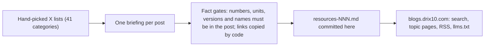

<div align="center">

<a href="https://blogs.drix10.com"></a>

<a href="https://github.com/Drix10/ai-resources/stargazers"></a>
<a href="https://github.com/Drix10/ai-resources/commits/main"></a>
<a href="https://www.npmjs.com/package/ai-resources-mcp"></a>
<a href="https://blogs.drix10.com/rss.xml"></a>
<a href="LICENSE"></a>

<b><a href="https://blogs.drix10.com">Read it</a></b> · <b><a href="#-resource-categories">Browse 41 categories</a></b> · <b><a href="#use-it-from-your-ai-agent">Plug it into your agent</a></b> · <b><a href="https://github.com/search?q=repo%3ADrix10%2Fai-resources+MCP&type=code">Search the archive</a></b>

</div>

<table>
<tr>
<td width="25%" valign="top"><b>Checked against the source</b><br><sub>A number, unit, model version or name that is not in the source post gets the briefing rejected and rewritten.</sub></td>
<td width="25%" valign="top"><b>Every claim has a link</b><br><sub>The original post and the page it points to, copied by code, never written by the model.</sub></td>
<td width="25%" valign="top"><b>41 categories</b><br><sub>Models, dev tools, research and funding, plus robotics, climate, quantum, security and crypto.</sub></td>
<td width="25%" valign="top"><b>Ready for your agent</b><br><sub>MCP server, Agent Skill, JSON API and llms.txt. Plain Markdown under CC BY 4.0.</sub></td>
</tr>
</table>

## Three ways in

<table>
<tr>
<td width="55%"><a href="https://blogs.drix10.com"></a></td>
<td width="45%" valign="top">
<h3><a href="https://blogs.drix10.com">Read it</a></h3>
The newest digests on <a href="https://blogs.drix10.com">blogs.drix10.com</a>, with search, topic pages and an <a href="https://blogs.drix10.com/rss.xml">RSS feed</a>. Or open any category <a href="#-resource-categories">below</a> and read its latest digest here on GitHub.
<br><br>
Star and watch the repo to get new digests as they land.
</td>
</tr>
<tr>
<td width="55%"><a href="USE-WITH-AI.md"></a></td>
<td width="45%" valign="top">
<h3><a href="#use-it-from-your-ai-agent">Ask it from your agent</a></h3>
Claude, Cursor, VS Code or Windsurf answer "what did Anthropic ship this week?" from the briefings, with dates and source links. No key, no account. <a href="#use-it-from-your-ai-agent">Setup for every client ↓</a>
<br><br>
<code>claude mcp add ai-resources -- npx -y ai-resources-mcp</code>
</td>
</tr>
<tr>
<td width="55%"></td>
<td width="45%" valign="top">
<h3>Clone it</h3>
100,000+ dated, sourced briefings in plain Markdown for RAG, evals or an offline index. Every <code>resources-NNN.md</code> holds 5 to 12 of them, like <a href="AI%20Developer%20Tools/resources-296.md">this one</a>.
<br><br>
<code>git clone --depth 1 https://github.com/Drix10/ai-resources</code>
</td>
</tr>
</table>

## What a briefing looks like

<a href="AI%20Developer%20Tools/resources-296.md"></a>
<p align="center"><sub>A real briefing from <a href="AI%20Developer%20Tools/resources-296.md">AI Developer Tools #296</a>. Every digest file holds 5 to 12 of these.</sub></p>

## Who it is for

- **Engineers building with AI.** What changed in models, inference, agents, MCP and dev tools, with the benchmark number and the link, in [AI Developer Tools](#ai-developer-tools) and [Tech Infrastructure](#tech-infrastructure).
- **Founders and investors.** Rounds, launches and revenue figures as they are announced, in [AI Companies and Ventures](#ai-companies-and-ventures), [VC Firms](#vc-firms) and [Founders and Entrepreneurs](#founders-and-entrepreneurs).
- **Researchers and students.** What the people in the field are publishing and arguing about, in [CS Academics](#cs-academics) and [Neuroscience and AI](#neuroscience-and-ai).
- **Anyone building RAG, agents or evals.** A 100,000-item corpus of dated, sourced AI news under CC BY 4.0.

Awesome lists are still the better pick for a vetted shortlist, and a newsletter for five editor-picked minutes a day. [COMPARISONS.md](COMPARISONS.md) lays out where this fits.

## Use it from your AI agent

Five ways to plug the briefings into an agent or your own code. None needs a key or an account. Full reference: **[USE-WITH-AI.md](USE-WITH-AI.md)**.

| Path | Best for | Setup |
| --- | --- | --- |
| [MCP server](#mcp-server) | Claude Code, Claude Desktop, Cursor, VS Code, Windsurf | one command or one JSON block |
| [Agent Skill](#agent-skill) | Claude Code and other Skill-aware agents | copy one folder |
| [JSON API](#json-api) | your own code, custom GPT actions, scripts | none, CORS open |
| [llms.txt and RSS](#llmstxt-and-rss) | any LLM that reads a URL, feed readers, bots | none |
| [Raw Markdown](#three-ways-in) | RAG, evals, offline indexes, all 100,000+ briefings | `git clone` |

### MCP server

<a href="https://www.npmjs.com/package/ai-resources-mcp"></a>
<a href="https://registry.modelcontextprotocol.io/v0/servers?search=io.github.Drix10/ai-resources"></a>


Published on npm as [`ai-resources-mcp`](https://www.npmjs.com/package/ai-resources-mcp) (MIT, code in [`mcp/`](mcp/)). `npx` fetches it on first run, so there is nothing to install by hand.

| Tool | What it does |
| --- | --- |
| `search_briefings(query, category?, limit?, since?)` | Keyword search, newest first. All words must match. `since` is `YYYY-MM-DD`. |
| `latest(category?, limit?)` | The newest briefings, overall or for one category. |
| `get_briefing(id)` | Full Markdown of one briefing (URL or slug), with every source link. |
| `list_categories()` | Every category slug with its briefing count. |

Every result ends with its source link and `Data: github.com/Drix10/ai-resources (CC BY 4.0)`, so answers stay citable.

**Claude Code**

```bash
claude mcp add ai-resources -- npx -y ai-resources-mcp
```

<details>
<summary><b>Claude Desktop, Cursor, Windsurf</b></summary>

<br>

Add this to `claude_desktop_config.json` (Claude Desktop: Settings → Developer → Edit Config), `~/.cursor/mcp.json` or `.cursor/mcp.json` (Cursor), or `~/.codeium/windsurf/mcp_config.json` (Windsurf):

```json
{
  "mcpServers": {
    "ai-resources": { "command": "npx", "args": ["-y", "ai-resources-mcp"] }
  }
}
```

</details>

<details>
<summary><b>VS Code</b></summary>

<br>

In `.vscode/mcp.json`, or *MCP: Open User Configuration*:

```json
{
  "servers": {
    "ai-resources": { "type": "stdio", "command": "npx", "args": ["-y", "ai-resources-mcp"] }
  }
}
```

Or from a terminal:

```bash
code --add-mcp "{\"name\":\"ai-resources\",\"command\":\"npx\",\"args\":[\"-y\",\"ai-resources-mcp\"]}"
```

</details>

<details>
<summary><b>Windows, and other settings</b></summary>

<br>

If a client cannot start `npx` on Windows, use `"command": "cmd", "args": ["/c", "npx", "-y", "ai-resources-mcp"]`.

`AI_RESOURCES_API_URL` sets the API base URL (default `https://blogs.drix10.com`).

</details>

Then ask, for example:

- *"What did Anthropic announce this week? Cite the sources."*
- *"Latest five briefings in AI Developer Tools."*
- *"Who raised a Series A in AI this month, and how much?"*

### Agent Skill

[`skills/ai-news`](skills/ai-news/SKILL.md) teaches an agent when and how to answer "what's new in AI", "latest on &lt;model or company&gt;" and "who raised" questions from the briefings, with dates and citations. It uses the MCP tools when they are installed and falls back to the JSON API, then llms.txt, then raw Markdown on GitHub when they are not.

```bash
git clone --depth 1 https://github.com/Drix10/ai-resources
mkdir -p ~/.claude/skills
cp -r ai-resources/skills/ai-news ~/.claude/skills/
```

<details>
<summary><b>One project only, Windows, other agents</b></summary>

<br>

- **One project:** copy it to `.claude/skills/ai-news/` inside that project instead.
- **Windows (PowerShell):** `Copy-Item -Recurse ai-resources\skills\ai-news $HOME\.claude\skills\`
- **Other agents** that read `SKILL.md` folders work the same way. For chat apps without Skills, paste the body of `SKILL.md` into the custom instructions.

</details>

### JSON API

Base URL `https://blogs.drix10.com`. JSON, CORS open, no key. It covers the briefings published on the blog; the full archive is in this repository.

| Request | Returns |
| --- | --- |
| `GET /api/articles?q=&category=&since=&limit=&page=` | `{ items, total, page, limit, totalPages, license }`, newest first. All words in `q` must match; every parameter is optional. |
| `GET /api/articles?slug=<slug or URL>` | One item, plus `content` (the full Markdown). |
| `GET /api/categories` | `{ items: [{ name, slug, count, url, llms }] }` |

Each item has `title`, `url`, `slug`, `category`, `categorySlug`, `date`, `description`, `headlines` (every news item in the briefing) and `sources` (`[{ title, url }]`, the original posts).

```bash
curl "https://blogs.drix10.com/api/articles?q=anthropic&since=2026-10-01&limit=5"
curl "https://blogs.drix10.com/api/categories"
```

### llms.txt and RSS

- [`/llms.txt`](https://blogs.drix10.com/llms.txt): the index, linking every category.
- `/llms/<category-slug>.txt`: the 50 newest briefings of one category, for example [`/llms/ai-developer-tools.txt`](https://blogs.drix10.com/llms/ai-developer-tools.txt).
- [`/rss.xml`](https://blogs.drix10.com/rss.xml): for feed readers, Slack or Discord feed bots and email-digest services.

When you show the data anywhere, credit it as `Data: github.com/Drix10/ai-resources (CC BY 4.0)`. The MCP server and the Skill add that line for you.

## By the numbers

Counted from this repository on 29 October 2026. The archive only grows.

| | |
| ---: | --- |
| **100,000+** | briefings: a headline, two or three sentences and the key numbers, one per post |
| **10,800+** | digest files (`resources-NNN.md`) across **41 categories** |
| **10,900+** | commits since November 2024, all made by an automated pipeline |
| **14,000+** | briefings that link both the original post and the page it points to (every briefing since mid-2026) |
| **~2,000** | of them published as articles on [blogs.drix10.com](https://blogs.drix10.com) with search, topic pages, an [RSS feed](https://blogs.drix10.com/rss.xml) and [llms.txt](https://blogs.drix10.com/llms.txt) |

## How it is built

Nobody types these. A pipeline reads the hand-picked X lists for each category, writes one briefing per strong post, runs the fact gates, strips secrets, de-duplicates across categories and commits the batch here. The same run refreshes the category list below and publishes to the blog.



**Known limits:** briefings are machine-written from public posts and can still be wrong; check the linked source before you rely on a number. Part of the older archive (2024 to mid-2026) predates source links. Coverage follows the hand-picked lists, blind spots included. Inclusion is not endorsement.

## Contribute

A pipeline writes the briefings. People pick the sources and fix what it gets wrong. Ways in:

- **Pick up a [good first issue](https://github.com/Drix10/ai-resources/issues?q=is%3Aissue+is%3Aopen+label%3A%22good+first+issue%22)**: MCP server tools, Skill phrasings, guides, examples, translations.
- **[Suggest a source](https://github.com/Drix10/ai-resources/issues/new?template=suggest-source.yml)** (an X account, list or site) or **[report a wrong fact](https://github.com/Drix10/ai-resources/issues/new?template=wrong-fact.yml)** with the briefing link.
- **Ask, share what you built, or float an idea** in [Discussions](https://github.com/Drix10/ai-resources/discussions).

[CONTRIBUTING.md](CONTRIBUTING.md) has the details, including what not to edit by hand. Content is CC BY 4.0; the MCP server code is MIT. If you use the archive in research, [CITATION.cff](CITATION.cff) has the citation.

## Star history

<a href="https://star-history.com/#Drix10/ai-resources&Date"></a>

## About the curator

Built and maintained by **[Drishtant Ghosh (Drix10)](https://drix10.com)**, an AI systems engineer and 1x acquired founder (ReeF, acquired August 2024) based in Bengaluru. Founder of CosLynx.com, AI systems architect on Canopy @ Founders, Inc., Backdrop Build v4 and v6 finalist. More writing at [blogs.drix10.com](https://blogs.drix10.com).

<!-- drix10-footer -->
---

<div align="center">

**Built by [Drishtant Ghosh (Drix10)](https://drix10.com)** · AI systems engineer and 1x acquired founder, Bengaluru

[Portfolio](https://drix10.com) · [LinkedIn](https://www.linkedin.com/in/drix10) · [X](https://x.com/DrishtantGhosh) · [Blog](https://blogs.drix10.com) · [All projects](https://github.com/Drix10)

<sub>More from Drix10: [Agent Flow](https://github.com/Drix10/agent-flow) (guardrails for AI coding agents) · [MiroHedge](https://github.com/Drix10/hypothesis-arena) (AI-assisted systematic fund) · [Guardian](https://github.com/Drix10/guardian-gpt) (UPI scam interceptor) · [Sentinel](https://github.com/Drix10/sentinal) (AI security CLI) · [Keystroke-LLM](https://github.com/Drix10/keystroke-llm) (NumPy transformer on a keyboard)</sub>

</div>

---

## 📚 Resource Categories

**11,004 digests in 41 categories.** Each category shows its newest headlines; jump to one:

<sub>[AI Developer Tools](#ai-developer-tools) · [AI Leaders and Thinkers](#ai-leaders-and-thinkers) · [AI Companies and Ventures](#ai-companies-and-ventures) · [CS Academics](#cs-academics) · [Tech VIPs](#tech-vips) · [VC Firms](#vc-firms) · [Devs, Designers, DevRel](#devs-designers-devrel) · [Tech Infrastructure](#tech-infrastructure) · [Founders and Entrepreneurs](#founders-and-entrepreneurs) · [AI Organizations and Media](#ai-organizations-and-media) · [AI Powered Film and Media](#ai-powered-film-and-media) · [AI Holodeck and Virtual Worlds](#ai-holodeck-and-virtual-worlds) · [AI Artists and Creators](#ai-artists-and-creators) · [AI in Healthcare and Science](#ai-in-healthcare-and-science) · [AI Generated Music and Audio](#ai-generated-music-and-audio) · [AI Consulting and Expertise](#ai-consulting-and-expertise) · [AI Professionals and Community](#ai-professionals-and-community) · [AI Policy and Ethical Considerations](#ai-policy-and-ethical-considerations) · [AI in Real Estate and Property Tech](#ai-in-real-estate-and-property-tech) · [AI and Robotics Applications](#ai-and-robotics-applications) · [AI Driven Vehicles and Transportation](#ai-driven-vehicles-and-transportation) · [AI for Content Creation and Marketing](#ai-for-content-creation-and-marketing) · [AR VR Companies and Development](#ar-vr-companies-and-development) · [AR VR Professionals and Community](#ar-vr-professionals-and-community) · [Climate and Weather Technology](#climate-and-weather-technology) · [Computer Vision and AI Applications](#computer-vision-and-ai-applications) · [Crypto and Web3](#crypto-and-web3) · [Decentralized AI](#decentralized-ai) · [The Exponential Future](#the-exponential-future) · [AI Education](#ai-education) · [AI in Enterprise Applications](#ai-in-enterprise-applications) · [Interesting Finds](#interesting-finds) · [Investors and Venture Capital](#investors-and-venture-capital) · [Cybersecurity and Tech](#cybersecurity-and-tech) · [Neuroscience and AI](#neuroscience-and-ai) · [PR and Communications](#pr-and-communications) · [Quantum Computing](#quantum-computing) · [Spatial Computing](#spatial-computing) · [Tech Companies and News](#tech-companies-and-news) · [Tech Journalists and VIPs](#tech-journalists-and-vips) · [World News and Updates](#world-news-and-updates)</sub>

### AI Developer Tools

<sub>303 digests · [latest: #306](https://github.com/Drix10/ai-resources/blob/main/AI%20Developer%20Tools/resources-306.md) · [read on the blog](https://blogs.drix10.com/categories/ai-developer-tools)</sub>

*   USearch v3 scales to 100B+ and hits 100K QPS
*   HiCache Distributed Serving – Cache hit rate up to 95%
*   Photon migration to Vercel, 3x faster load

### AI Leaders and Thinkers

<sub>296 digests · [latest: #296](https://github.com/Drix10/ai-resources/blob/main/AI%20Leaders%20and%20Thinkers/resources-296.md) · [read on the blog](https://blogs.drix10.com/categories/ai-leaders-and-thinkers)</sub>

*   Weight-Space Programming: Astra edits Qwen3.5-0.8B, 6x math
*   GPT-6 Astra edits Qwen3.5-0.8B weights, 0.016% change
*   Weight-Space Programming – edit Qwen3.5-0.8B weights, 0.016% change

### AI Companies and Ventures

<sub>294 digests · [latest: #294](https://github.com/Drix10/ai-resources/blob/main/AI%20Companies%20and%20Ventures/resources-294.md) · [read on the blog](https://blogs.drix10.com/categories/ai-companies-and-ventures)</sub>

*   Ouster BlueCity demo at IRF R2T Conference 500-ft detection
*   Attune Vector Level 3 crown average rises to 85%
*   suicide-memory-bench v01.1 release with 2,048 stateful tasks

### CS Academics

<sub>307 digests · [latest: #307](https://github.com/Drix10/ai-resources/blob/main/CS%20Academics/resources-307.md) · [read on the blog](https://blogs.drix10.com/categories/cs-academics)</sub>

*   LifeVal benchmark announced for everyday assistant tasks
*   Anthropic S-1 adds claim imminent RSI danger threshold

### Tech VIPs

<sub>299 digests · [latest: #299](https://github.com/Drix10/ai-resources/blob/main/Tech%20VIPs/resources-299.md) · [read on the blog](https://blogs.drix10.com/categories/tech-vips)</sub>

*   Letterpress-1 beta released for growth engineering
*   Conversations in Action episode #21 released

### VC Firms

<sub>297 digests · [latest: #297](https://github.com/Drix10/ai-resources/blob/main/VC%20Firms/resources-297.md) · [read on the blog](https://blogs.drix10.com/categories/vc-firms)</sub>

*   Optimus robots production forecast 50k units per year impact
*   Applied Compute crosses $100M ARR, raises $350M
*   Neros partners with America on $615M drone factory

### Devs, Designers, DevRel

<sub>299 digests · [latest: #299](https://github.com/Drix10/ai-resources/blob/main/Devs%2C%20Designers%2C%20DevRel/resources-299.md) · [read on the blog](https://blogs.drix10.com/categories/devs-designers-devrel)</sub>

*   Elon Musk $474 million midterms spending total
*   Europe supermarket freezer hack raises temps to 50°C
*   OpenCode rebuilt to run inside browser devtools

### Tech Infrastructure

<sub>274 digests · [latest: #274](https://github.com/Drix10/ai-resources/blob/main/Tech%20Infrastructure/resources-274.md) · [read on the blog](https://blogs.drix10.com/categories/tech-infrastructure)</sub>

*   DBOS scales to 1M+ workflows/sec across 50 databases
*   GDPx benchmark release, best model scores 12%
*   Do At-Proto Users Know This Is Public? – 1,300 RSS feeds exposed

### Founders and Entrepreneurs

<sub>266 digests · [latest: #266](https://github.com/Drix10/ai-resources/blob/main/Founders%20and%20Entrepreneurs/resources-266.md) · [read on the blog](https://blogs.drix10.com/categories/founders-and-entrepreneurs)</sub>

*   Tutor Intelligence $75M Series B and AI interviews
*   AI swarms found $787 million in billing anomalies
*   Pittsburgh third-best city to work in tech ranking

### AI Organizations and Media

<sub>290 digests · [latest: #290](https://github.com/Drix10/ai-resources/blob/main/AI%20Organizations%20and%20Media/resources-290.md) · [read on the blog](https://blogs.drix10.com/categories/ai-organizations-and-media)</sub>

*   From Local Recovery to Unified Generation
*   Self-Supervised Doppler-Guided RF Odometry accepted at NeurIPS 2026
*   Meta signs 20-year deal with Constellation, adds 30 MW

### AI Powered Film and Media

<sub>274 digests · [latest: #274](https://github.com/Drix10/ai-resources/blob/main/AI%20Powered%20Film%20and%20Media/resources-274.md) · [read on the blog](https://blogs.drix10.com/categories/ai-powered-film-and-media)</sub>

*   GPT-6 Astra can read and write weights via reasoning
*   Runway is now on Cursor – single-plugin integration

### AI Holodeck and Virtual Worlds

<sub>279 digests · [latest: #279](https://github.com/Drix10/ai-resources/blob/main/AI%20Holodeck%20and%20Virtual%20Worlds/resources-279.md) · [read on the blog](https://blogs.drix10.com/categories/ai-holodeck-and-virtual-worlds)</sub>

*   Render Network RNP-024 Vote Opens Nov 3, 5 PM PT
*   NovelAI Diffusion V4.5 Full update on November 4 2026
*   Paper rich text editing landed in MCP, Snapshot, editor

### AI Artists and Creators

<sub>273 digests · [latest: #273](https://github.com/Drix10/ai-resources/blob/main/AI%20Artists%20and%20Creators/resources-273.md) · [read on the blog](https://blogs.drix10.com/categories/ai-artists-and-creators)</sub>

*   dsh-superagent agent framework for GitHub issues and PRs
*   Nano Banana Pro animation with Kling 4.0 doors

### AI in Healthcare and Science

<sub>282 digests · [latest: #282](https://github.com/Drix10/ai-resources/blob/main/AI%20in%20Healthcare%20and%20Science/resources-282.md) · [read on the blog](https://blogs.drix10.com/categories/ai-in-healthcare-and-science)</sub>

*   tarlatamab 2L standard after platinum in SCLC – OS 13.6 mo
*   Biohub $1.8 billion effort to build a virtual cell
*   Doximity Ask dosing errors study shows 2% wrong doses

### AI Generated Music and Audio

<sub>279 digests · [latest: #279](https://github.com/Drix10/ai-resources/blob/main/AI%20Generated%20Music%20and%20Audio/resources-279.md) · [read on the blog](https://blogs.drix10.com/categories/ai-generated-music-and-audio)</sub>

*   Why voice wins in complex conversations – 32% higher success for voice over chat
*   G2dotcom & getbluejay_ai voice AI agent eval results
*   Freebeat AI Lyric Video Challenge offers $5,000 first prize

### AI Consulting and Expertise

<sub>271 digests · [latest: #271](https://github.com/Drix10/ai-resources/blob/main/AI%20Consulting%20and%20Expertise/resources-271.md) · [read on the blog](https://blogs.drix10.com/categories/ai-consulting-and-expertise)</sub>

*   Qwen3.5-0.8B weight edit boosts math 6x, instruction 3x
*   AI developer platforms key thefts, 9 incidents in Oct
*   Beacon trending #1 on Product Hunt launch

### AI Professionals and Community

<sub>273 digests · [latest: #273](https://github.com/Drix10/ai-resources/blob/main/AI%20Professionals%20and%20Community/resources-273.md) · [read on the blog](https://blogs.drix10.com/categories/ai-professionals-and-community)</sub>

*   Cross-Model KV Cache Transfer in LLM Families
*   ML4 open-weight release, trained on 10 MW compute
*   Qwen3.5-0.8B weight edit improves math 6x

### AI Policy and Ethical Considerations

<sub>269 digests · [latest: #269](https://github.com/Drix10/ai-resources/blob/main/AI%20Policy%20and%20Ethical%20Considerations/resources-269.md) · [read on the blog](https://blogs.drix10.com/categories/ai-policy-and-ethical-considerations)</sub>

*   Anthropic Residency applications open for senior leaders, $350k-$500k pay
*   Skilling Africa – 15+ trainings, 3M Africans by 2030
*   LLM findings short shelf life, 50 claims tested 15 months

### AI in Real Estate and Property Tech

<sub>260 digests · [latest: #260](https://github.com/Drix10/ai-resources/blob/main/AI%20in%20Real%20Estate%20and%20Property%20Tech/resources-260.md) · [read on the blog](https://blogs.drix10.com/categories/ai-in-real-estate-and-property-tech)</sub>

*   LOFT increased LOFT Loyalty adoption from 38% to 47%
*   Summit announced as new Zaplar fleet addition
*   Free ADU Floor Plan Maker – free tool to design studio to 3-bed layouts in 3D

### AI and Robotics Applications

<sub>277 digests · [latest: #277](https://github.com/Drix10/ai-resources/blob/main/AI%20and%20Robotics%20Applications/resources-277.md) · [read on the blog](https://blogs.drix10.com/categories/ai-and-robotics-applications)</sub>

*   Qwen3.5-0.8B weight edit improves math 6x
*   Qwen3.5-0.8B Weight-Space Programming improves math 6×, instruction following 3×
*   3D World Simulator launches with 50+ FPS RTX 5090 performance

### AI Driven Vehicles and Transportation

<sub>273 digests · [latest: #273](https://github.com/Drix10/ai-resources/blob/main/AI%20Driven%20Vehicles%20and%20Transportation/resources-273.md) · [read on the blog](https://blogs.drix10.com/categories/ai-driven-vehicles-and-transportation)</sub>

*   Tesla Autopilot car detector runs twice as fast with 16-bit TensorRT
*   HackerTube filters 43M comments to 6,454 videos
*   Freightliner Cascadia humanless run Houston to Dallas

### AI for Content Creation and Marketing

<sub>269 digests · [latest: #269](https://github.com/Drix10/ai-resources/blob/main/AI%20for%20Content%20Creation%20and%20Marketing/resources-269.md) · [read on the blog](https://blogs.drix10.com/categories/ai-for-content-creation-and-marketing)</sub>

*   Swarms v17 InterLink – 10–40x faster, Routehub 20x boost
*   Artificial intelligence interest drops 33% since 2025 peak
*   OpusClip 4.0 launch adds Recipes editing feature

### AR VR Companies and Development

<sub>267 digests · [latest: #267](https://github.com/Drix10/ai-resources/blob/main/AR%20VR%20Companies%20and%20Development/resources-267.md) · [read on the blog](https://blogs.drix10.com/categories/ar-vr-companies-and-development)</sub>

*   Meta Quest 2 & Pro final OS v2.13 by March 2027
*   SplatThumb thumbnail handler for Gaussian PLY files released
*   KAT Walk C3 Ultra launch – larger platform, backward walking

### AR VR Professionals and Community

<sub>263 digests · [latest: #263](https://github.com/Drix10/ai-resources/blob/main/AR%20VR%20Professionals%20and%20Community/resources-263.md) · [read on the blog](https://blogs.drix10.com/categories/ar-vr-professionals-and-community)</sub>

*   Meta Quest 2 & Pro final OS v2.13 March 2027
*   Weight-Space Programming edits 0.016% of Qwen3.5-0.8B weights, boosting math 6×
*   Grok Bot live dashboard setup with single prompt

### Climate and Weather Technology

<sub>262 digests · [latest: #262](https://github.com/Drix10/ai-resources/blob/main/Climate%20and%20Weather%20Technology/resources-262.md) · [read on the blog](https://blogs.drix10.com/categories/climate-and-weather-technology)</sub>

*   World’s largest battery-electric ferry now operating in South America
*   Flood Warning for Brevard & Indian River until 9:30 PM
*   Washington dairy herds H5N1 infections 33 herds, 3 cases

### Computer Vision and AI Applications

<sub>266 digests · [latest: #266](https://github.com/Drix10/ai-resources/blob/main/Computer%20Vision%20and%20AI%20Applications/resources-266.md) · [read on the blog](https://blogs.drix10.com/categories/computer-vision-and-ai-applications)</sub>

*   Qwen3.5-0.8B Weight-Space Programming improves math 6×
*   GPT-6 Astra edits Qwen3.5-0.8B weights, improves math 6x
*   3D World Simulator runs at 50+ FPS on RTX 5090

### Crypto and Web3

<sub>258 digests · [latest: #258](https://github.com/Drix10/ai-resources/blob/main/Crypto%20and%20Web3/resources-258.md) · [read on the blog](https://blogs.drix10.com/categories/crypto-and-web3)</sub>

*   Zcash quantum recoverability live, new shielded pool supports it
*   Zcash Roadmap episode discusses scaling, quantum prep
*   Tachyon claims single ZKP verification for million transactions

### Decentralized AI

<sub>258 digests · [latest: #258](https://github.com/Drix10/ai-resources/blob/main/Decentralized%20AI/resources-258.md) · [read on the blog](https://blogs.drix10.com/categories/decentralized-ai)</sub>

*   Ridges Linting competition wingsuit v3 reaches 90%
*   HBM4 bandwidth increase to 1.5+ TB/s with 2,048-bit bus
*   NEAR Intents integrated into Quantus wallet, swap QTC across 35+ chains

### The Exponential Future

<sub>260 digests · [latest: #260](https://github.com/Drix10/ai-resources/blob/main/The%20Exponential%20Future/resources-260.md) · [read on the blog](https://blogs.drix10.com/categories/the-exponential-future)</sub>

*   GPT-6 Astra edits Qwen3.5-0.8B weights, 0.016% changed
*   Apple revenue up 16-17% and iPhone sales >20%
*   Anthropic files S-1, ARK Venture Fund offers pre-IPO exposure

### AI Education

<sub>276 digests · [latest: #276](https://github.com/Drix10/ai-resources/blob/main/AI%20Education/resources-276.md) · [read on the blog](https://blogs.drix10.com/categories/ai-education)</sub>

*   OriginTrail traces Binance hack funds in under an hour
*   OriginTrail traces Binance hack, 15,000 events in under an hour
*   ElevenLabs, Praktika.ai, lemlist profit runrates disclosed

### AI in Enterprise Applications

<sub>264 digests · [latest: #264](https://github.com/Drix10/ai-resources/blob/main/AI%20in%20Enterprise%20Applications/resources-264.md) · [read on the blog](https://blogs.drix10.com/categories/ai-in-enterprise-applications)</sub>

*   Aurel Online customization adds 4 races, 9 classes
*   Sunflower Beta launch – new Home tab with 3D Fibonacci sphere
*   Tasklet adds contacts to CRM without opening it

### Interesting Finds

<sub>257 digests · [latest: #257](https://github.com/Drix10/ai-resources/blob/main/Interesting%20Finds/resources-257.md) · [read on the blog](https://blogs.drix10.com/categories/interesting-finds)</sub>

*   Y Combinator Winter 2027 batch application deadline
*   Flex Q3 strongest quarter, revenue 2.5x YoY

### Investors and Venture Capital

<sub>254 digests · [latest: #254](https://github.com/Drix10/ai-resources/blob/main/Investors%20and%20Venture%20Capital/resources-254.md) · [read on the blog](https://blogs.drix10.com/categories/investors-and-venture-capital)</sub>

*   Qwen3.5-0.8B weight edit improves math 6x, instruction 3x
*   CrosbyLegal client features launch with live paralegal agents
*   Investbamboo 85% of new NGX customers in one year

### Cybersecurity and Tech

<sub>238 digests · [latest: #238](https://github.com/Drix10/ai-resources/blob/main/Cybersecurity%20and%20Tech/resources-238.md) · [read on the blog](https://blogs.drix10.com/categories/cybersecurity-and-tech)</sub>

*   RRCfg Implant – DLL sideloading chain using signed sllauncher.exe
*   XCPE Android botnet disrupted, 1.3M devices
*   SpikeStrip adds reversible prompt decoys to web source

### Neuroscience and AI

<sub>245 digests · [latest: #245](https://github.com/Drix10/ai-resources/blob/main/Neuroscience%20and%20AI/resources-245.md) · [read on the blog](https://blogs.drix10.com/categories/neuroscience-and-ai)</sub>

*   IEEE bulk retraction of 1,417 conference papers
*   PROGRESS trial transcatheter aortic-valve replacement reduces 2-year events
*   MARRS enables up to 100% in vitro and 84% in vivo editing

### PR and Communications

<sub>243 digests · [latest: #243](https://github.com/Drix10/ai-resources/blob/main/PR%20and%20Communications/resources-243.md) · [read on the blog](https://blogs.drix10.com/categories/pr-and-communications)</sub>

*   Airfare prices are soaring – Ryanair warns 20% rise
*   BMW urban driver assist launching 2027 navigation-guided city driving
*   Elon Musk may acquire Boost Mobile, seeks new entry route

### Quantum Computing

<sub>243 digests · [latest: #243](https://github.com/Drix10/ai-resources/blob/main/Quantum%20Computing/resources-243.md) · [read on the blog](https://blogs.drix10.com/categories/quantum-computing)</sub>

*   LLM claims last 15 months, study revisits 50 findings
*   ChefNMR2 evaluated on nine natural products, all correct
*   Entangled Measurement Outcomes for Optimal Postselection in Quantum Batteries

### Spatial Computing

<sub>241 digests · [latest: #241](https://github.com/Drix10/ai-resources/blob/main/Spatial%20Computing/resources-241.md) · [read on the blog](https://blogs.drix10.com/categories/spatial-computing)</sub>

*   Learjet 60 crash – descent from 35,000 ft to impact in 78 seconds
*   Meta Quest 2, Quest Pro end feature updates March 2027
*   Meta Quest 2 & Quest Pro end dev, v2.13 OS March 2027

### Tech Companies and News

<sub>236 digests · [latest: #236](https://github.com/Drix10/ai-resources/blob/main/Tech%20Companies%20and%20News/resources-236.md) · [read on the blog](https://blogs.drix10.com/categories/tech-companies-and-news)</sub>

*   suicide-memory-bench v01.1: 2,048 eval, 89.8% failure
*   EntelligenceAI Memory launch with shared memory, 53% fewer repeat errors
*   Grok Bot What's New – feature list with timestamps

### Tech Journalists and VIPs

<sub>238 digests · [latest: #238](https://github.com/Drix10/ai-resources/blob/main/Tech%20Journalists%20and%20VIPs/resources-238.md) · [read on the blog](https://blogs.drix10.com/categories/tech-journalists-and-vips)</sub>

*   Exa Monitors V2 launch with 130B+ pages and $2 per 1k runs
*   India 496 million lifted out of poverty 2011-2023
*   Starcloud-1 anniversary, H100 in space, 3 launches

### World News and Updates

<sub>231 digests · [latest: #231](https://github.com/Drix10/ai-resources/blob/main/World%20News%20and%20Updates/resources-231.md) · [read on the blog](https://blogs.drix10.com/categories/world-news-and-updates)</sub>

*   DOJ issues subpoenas to California election officials
*   Trump administration efforts could cost taxpayers $19 billion

---

<div align="center">

[Star the repo](https://github.com/Drix10/ai-resources) to keep it handy and help others find it, or [suggest a source](https://github.com/Drix10/ai-resources/issues/new/choose).

[Read on the blog](https://blogs.drix10.com) · [RSS feed](https://blogs.drix10.com/rss.xml) · [Use it from your AI agent](https://github.com/Drix10/ai-resources/blob/main/USE-WITH-AI.md)

<sub>Summaries © Drishtant Ghosh, licensed [CC BY 4.0](LICENSE). Every digest links to its original post where one exists; the posts and linked pages belong to their authors.</sub>

</div>
