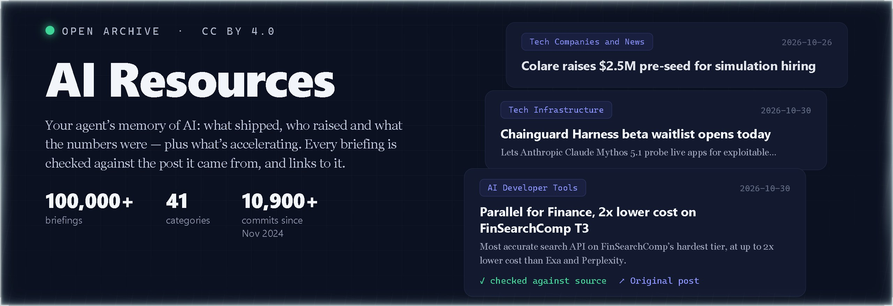
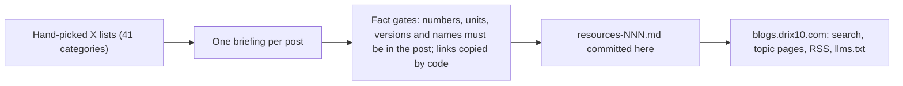

<div align="center">

<a href="https://blogs.drix10.com"></a>

<a href="https://github.com/Drix10/ai-resources/stargazers"></a>
<a href="https://github.com/Drix10/ai-resources/commits/main"></a>
<a href="https://www.npmjs.com/package/ai-resources-mcp"></a>
<a href="https://blogs.drix10.com/rss.xml"></a>
<a href="LICENSE"></a>

<b><a href="https://blogs.drix10.com">Read it</a></b> · <b><a href="#-resource-categories">Browse 41 categories</a></b> · <b><a href="#use-it-from-your-ai-agent">Plug it into your agent</a></b> · <b><a href="https://github.com/search?q=repo%3ADrix10%2Fai-resources+MCP&type=code">Search the archive</a></b>

</div>

<table>
<tr>
<td width="25%" valign="top"><b>Checked against the source</b><br><sub>A number, unit, model version or name that is not in the source post gets the briefing rejected and rewritten.</sub></td>
<td width="25%" valign="top"><b>Every claim has a link</b><br><sub>The original post and the page it points to, copied by code, never written by the model.</sub></td>
<td width="25%" valign="top"><b>41 categories</b><br><sub>Models, dev tools, research and funding, plus robotics, climate, quantum, security and crypto.</sub></td>
<td width="25%" valign="top"><b>Ready for your agent</b><br><sub>MCP server, Agent Skill, JSON API and llms.txt. Plain Markdown under CC BY 4.0.</sub></td>
</tr>
</table>

## Three ways in

<table>
<tr>
<td width="55%"><a href="https://blogs.drix10.com"></a></td>
<td width="45%" valign="top">
<h3><a href="https://blogs.drix10.com">Read it</a></h3>
The newest digests on <a href="https://blogs.drix10.com">blogs.drix10.com</a>, with search, topic pages and an <a href="https://blogs.drix10.com/rss.xml">RSS feed</a>. Or open any category <a href="#-resource-categories">below</a> and read its latest digest here on GitHub.
<br><br>
Star and watch the repo to get new digests as they land.
</td>
</tr>
<tr>
<td width="55%"><a href="USE-WITH-AI.md"></a></td>
<td width="45%" valign="top">
<h3><a href="#use-it-from-your-ai-agent">Ask it from your agent</a></h3>
Claude, Cursor, VS Code or Windsurf answer "what did Anthropic ship this week?" from the briefings, with dates and source links. No key, no account. <a href="#use-it-from-your-ai-agent">Setup for every client ↓</a>
<br><br>
<code>claude mcp add ai-resources -- npx -y ai-resources-mcp</code>
</td>
</tr>
<tr>
<td width="55%"></td>
<td width="45%" valign="top">
<h3>Clone it</h3>
100,000+ dated, sourced briefings in plain Markdown for RAG, evals or an offline index. Every <code>resources-NNN.md</code> holds 5 to 12 of them, like <a href="AI%20Developer%20Tools/resources-296.md">this one</a>.
<br><br>
<code>git clone --depth 1 https://github.com/Drix10/ai-resources</code>
</td>
</tr>
</table>

## What a briefing looks like

<a href="AI%20Developer%20Tools/resources-296.md"></a>
<p align="center"><sub>A real briefing from <a href="AI%20Developer%20Tools/resources-296.md">AI Developer Tools #296</a>. Every digest file holds 5 to 12 of these.</sub></p>


## Signals: what is accelerating in AI

<a href="https://blogs.drix10.com/signals"></a>
<p align="center"><sub><a href="https://blogs.drix10.com/signals">Signals</a>, computed weekly: topics whose coverage climbs three weeks running. Trajectories, not predictions — and nothing on it is written by a model.</sub></p>

Briefings tell you what happened. Signals tells you what it means: which topics are accelerating, with the sample headlines and source links behind every call. Computed from counts only (one briefing = one vote), in the open: [`MOVEMENTS.md`](MOVEMENTS.md) in this repo, [`/api/signals`](https://blogs.drix10.com/api/signals) for code, and the `trending_movements` MCP tool for agents.

## Who it is for

- **Engineers building with AI.** What changed in models, inference, agents, MCP and dev tools, with the benchmark number and the link, in [AI Developer Tools](#ai-developer-tools) and [Tech Infrastructure](#tech-infrastructure).
- **Founders and investors.** Rounds, launches and revenue figures as they are announced, in [AI Companies and Ventures](#ai-companies-and-ventures), [VC Firms](#vc-firms) and [Founders and Entrepreneurs](#founders-and-entrepreneurs).
- **Researchers and students.** What the people in the field are publishing and arguing about, in [CS Academics](#cs-academics) and [Neuroscience and AI](#neuroscience-and-ai).
- **Anyone building RAG, agents or evals.** A 100,000-item corpus of dated, sourced AI news under CC BY 4.0.

Awesome lists are still the better pick for a vetted shortlist, and a newsletter for five editor-picked minutes a day. [COMPARISONS.md](COMPARISONS.md) lays out where this fits.

## Use it from your AI agent

Five ways to plug the briefings into an agent or your own code. None needs a key or an account. Full reference: **[USE-WITH-AI.md](USE-WITH-AI.md)**.

| Path | Best for | Setup |
| --- | --- | --- |
| [MCP server](#mcp-server) | Claude Code, Claude Desktop, Cursor, VS Code, Windsurf | one command or one JSON block |
| [Agent Skill](#agent-skill) | Claude Code and other Skill-aware agents | copy one folder |
| [JSON API](#json-api) | your own code, custom GPT actions, scripts | none, CORS open |
| [llms.txt and RSS](#llmstxt-and-rss) | any LLM that reads a URL, feed readers, bots | none |
| [Raw Markdown](#three-ways-in) | RAG, evals, offline indexes, all 100,000+ briefings | `git clone` |

### MCP server

<a href="https://www.npmjs.com/package/ai-resources-mcp"></a>
<a href="https://registry.modelcontextprotocol.io/v0/servers?search=io.github.Drix10/ai-resources"></a>


Published on npm as [`ai-resources-mcp`](https://www.npmjs.com/package/ai-resources-mcp) (MIT, code in [`mcp/`](mcp/)). `npx` fetches it on first run, so there is nothing to install by hand.

| Tool | What it does |
| --- | --- |
| `search_briefings(query, category?, limit?, since?)` | Keyword search, newest first. All words must match. `since` is `YYYY-MM-DD`. |
| `latest(category?, limit?)` | The newest briefings, overall or for one category. |
| `get_briefing(id)` | Full Markdown of one briefing (URL or slug), with every source link. |
| `list_categories()` | Every category slug with its briefing count. |
| `trending_movements(limit?)` | Topics accelerating week over week (rising) or hot for one week (watch), with sample headlines and source links. |

Every result ends with its source link and `Data: github.com/Drix10/ai-resources (CC BY 4.0)`, so answers stay citable.

**Claude Code**

```bash
claude mcp add ai-resources -- npx -y ai-resources-mcp
```

<details>
<summary><b>Claude Desktop, Cursor, Windsurf</b></summary>

<br>

Add this to `claude_desktop_config.json` (Claude Desktop: Settings → Developer → Edit Config), `~/.cursor/mcp.json` or `.cursor/mcp.json` (Cursor), or `~/.codeium/windsurf/mcp_config.json` (Windsurf):

```json
{
  "mcpServers": {
    "ai-resources": { "command": "npx", "args": ["-y", "ai-resources-mcp"] }
  }
}
```

</details>

<details>
<summary><b>VS Code</b></summary>

<br>

In `.vscode/mcp.json`, or *MCP: Open User Configuration*:

```json
{
  "servers": {
    "ai-resources": { "type": "stdio", "command": "npx", "args": ["-y", "ai-resources-mcp"] }
  }
}
```

Or from a terminal:

```bash
code --add-mcp "{\"name\":\"ai-resources\",\"command\":\"npx\",\"args\":[\"-y\",\"ai-resources-mcp\"]}"
```

</details>

<details>
<summary><b>Windows, and other settings</b></summary>

<br>

If a client cannot start `npx` on Windows, use `"command": "cmd", "args": ["/c", "npx", "-y", "ai-resources-mcp"]`.

`AI_RESOURCES_API_URL` sets the API base URL (default `https://blogs.drix10.com`).

</details>

Then ask, for example:

- *"What did Anthropic announce this week? Cite the sources."*
- *"Latest five briefings in AI Developer Tools."*
- *"Who raised a Series A in AI this month, and how much?"*

### Agent Skill

[`skills/ai-news`](skills/ai-news/SKILL.md) teaches an agent when and how to answer "what's new in AI", "latest on &lt;model or company&gt;" and "who raised" questions from the briefings, with dates and citations. It uses the MCP tools when they are installed and falls back to the JSON API, then llms.txt, then raw Markdown on GitHub when they are not.

```bash
git clone --depth 1 https://github.com/Drix10/ai-resources
mkdir -p ~/.claude/skills
cp -r ai-resources/skills/ai-news ~/.claude/skills/
```

<details>
<summary><b>One project only, Windows, other agents</b></summary>

<br>

- **One project:** copy it to `.claude/skills/ai-news/` inside that project instead.
- **Windows (PowerShell):** `Copy-Item -Recurse ai-resources\skills\ai-news $HOME\.claude\skills\`
- **Other agents** that read `SKILL.md` folders work the same way. For chat apps without Skills, paste the body of `SKILL.md` into the custom instructions.

</details>

### JSON API

Base URL `https://blogs.drix10.com`. JSON, CORS open, no key. It covers the briefings published on the blog; the full archive is in this repository.

| Request | Returns |
| --- | --- |
| `GET /api/articles?q=&category=&since=&limit=&page=` | `{ items, total, page, limit, totalPages, license }`, newest first. All words in `q` must match; every parameter is optional. |
| `GET /api/articles?slug=<slug or URL>` | One item, plus `content` (the full Markdown). |
| `GET /api/categories` | `{ items: [{ name, slug, count, url, llms }] }` |

Each item has `title`, `url`, `slug`, `category`, `categorySlug`, `date`, `description`, `headlines` (every news item in the briefing) and `sources` (`[{ title, url }]`, the original posts).

```bash
curl "https://blogs.drix10.com/api/articles?q=anthropic&since=2026-10-01&limit=5"
curl "https://blogs.drix10.com/api/categories"
```

### llms.txt and RSS

- [`/llms.txt`](https://blogs.drix10.com/llms.txt): the index, linking every category.
- `/llms/<category-slug>.txt`: the 50 newest briefings of one category, for example [`/llms/ai-developer-tools.txt`](https://blogs.drix10.com/llms/ai-developer-tools.txt).
- [`/rss.xml`](https://blogs.drix10.com/rss.xml): for feed readers, Slack or Discord feed bots and email-digest services.

When you show the data anywhere, credit it as `Data: github.com/Drix10/ai-resources (CC BY 4.0)`. The MCP server and the Skill add that line for you.

## By the numbers

Counted from this repository on 29 October 2026. The archive only grows.

| | |
| ---: | --- |
| **100,000+** | briefings: a headline, two or three sentences and the key numbers, one per post |
| **10,800+** | digest files (`resources-NNN.md`) across **41 categories** |
| **10,900+** | commits since November 2024, all made by an automated pipeline |
| **14,000+** | briefings that link both the original post and the page it points to (every briefing since mid-2026) |
| **~2,000** | of them published as articles on [blogs.drix10.com](https://blogs.drix10.com) with search, topic pages, an [RSS feed](https://blogs.drix10.com/rss.xml) and [llms.txt](https://blogs.drix10.com/llms.txt) |

## How it is built

Nobody types these. A pipeline reads the hand-picked X lists for each category, writes one briefing per strong post, runs the fact gates, strips secrets, de-duplicates across categories and commits the batch here. The same run refreshes the category list below and publishes to the blog.



**Known limits:** briefings are machine-written from public posts and can still be wrong; check the linked source before you rely on a number. Part of the older archive (2024 to mid-2026) predates source links. Coverage follows the hand-picked lists, blind spots included. Inclusion is not endorsement.

## Contribute

A pipeline writes the briefings. People pick the sources and fix what it gets wrong. Ways in:

- **Pick up a [good first issue](https://github.com/Drix10/ai-resources/issues?q=is%3Aissue+is%3Aopen+label%3A%22good+first+issue%22)**: MCP server tools, Skill phrasings, guides, examples, translations.
- **[Suggest a source](https://github.com/Drix10/ai-resources/issues/new?template=suggest-source.yml)** (an X account, list or site) or **[report a wrong fact](https://github.com/Drix10/ai-resources/issues/new?template=wrong-fact.yml)** with the briefing link.
- **Ask, share what you built, or float an idea** in [Discussions](https://github.com/Drix10/ai-resources/discussions).

[CONTRIBUTING.md](CONTRIBUTING.md) has the details, including what not to edit by hand. Content is CC BY 4.0; the MCP server code is MIT. If you use the archive in research, [CITATION.cff](CITATION.cff) has the citation.

## Star history

<a href="https://star-history.com/#Drix10/ai-resources&Date"></a>

## About the curator

Built and maintained by **[Drishtant Ghosh (Drix10)](https://drix10.com)**, an AI systems engineer and 1x acquired founder (ReeF, acquired August 2024) based in Bengaluru. Founder of CosLynx.com, AI systems architect on Canopy @ Founders, Inc., Backdrop Build v4 and v6 finalist. More writing at [blogs.drix10.com](https://blogs.drix10.com).

<!-- drix10-footer -->
---

<div align="center">

**Built by [Drishtant Ghosh (Drix10)](https://drix10.com)** · AI systems engineer and 1x acquired founder, Bengaluru

[Portfolio](https://drix10.com) · [LinkedIn](https://www.linkedin.com/in/drix10) · [X](https://x.com/DrishtantGhosh) · [Blog](https://blogs.drix10.com) · [All projects](https://github.com/Drix10)

<sub>More from Drix10: [Agent Flow](https://github.com/Drix10/agent-flow) (guardrails for AI coding agents) · [MiroHedge](https://github.com/Drix10/hypothesis-arena) (AI-assisted systematic fund) · [Guardian](https://github.com/Drix10/guardian-gpt) (UPI scam interceptor) · [Sentinel](https://github.com/Drix10/sentinal) (AI security CLI) · [Keystroke-LLM](https://github.com/Drix10/keystroke-llm) (NumPy transformer on a keyboard)</sub>

</div>

---

## 📚 Resource Categories

**11,425 digests in 41 categories.** Each category shows its newest headlines; jump to one:

<sub>[AI Developer Tools](#ai-developer-tools) · [AI Leaders and Thinkers](#ai-leaders-and-thinkers) · [AI Companies and Ventures](#ai-companies-and-ventures) · [CS Academics](#cs-academics) · [Tech VIPs](#tech-vips) · [VC Firms](#vc-firms) · [Devs, Designers, DevRel](#devs-designers-devrel) · [Tech Infrastructure](#tech-infrastructure) · [Founders and Entrepreneurs](#founders-and-entrepreneurs) · [AI Organizations and Media](#ai-organizations-and-media) · [AI Powered Film and Media](#ai-powered-film-and-media) · [AI Holodeck and Virtual Worlds](#ai-holodeck-and-virtual-worlds) · [AI Artists and Creators](#ai-artists-and-creators) · [AI in Healthcare and Science](#ai-in-healthcare-and-science) · [AI Generated Music and Audio](#ai-generated-music-and-audio) · [AI Consulting and Expertise](#ai-consulting-and-expertise) · [AI Professionals and Community](#ai-professionals-and-community) · [AI Policy and Ethical Considerations](#ai-policy-and-ethical-considerations) · [AI in Real Estate and Property Tech](#ai-in-real-estate-and-property-tech) · [AI and Robotics Applications](#ai-and-robotics-applications) · [AI Driven Vehicles and Transportation](#ai-driven-vehicles-and-transportation) · [AI for Content Creation and Marketing](#ai-for-content-creation-and-marketing) · [AR VR Companies and Development](#ar-vr-companies-and-development) · [AR VR Professionals and Community](#ar-vr-professionals-and-community) · [Climate and Weather Technology](#climate-and-weather-technology) · [Computer Vision and AI Applications](#computer-vision-and-ai-applications) · [Crypto and Web3](#crypto-and-web3) · [Decentralized AI](#decentralized-ai) · [The Exponential Future](#the-exponential-future) · [AI Education](#ai-education) · [AI in Enterprise Applications](#ai-in-enterprise-applications) · [Interesting Finds](#interesting-finds) · [Investors and Venture Capital](#investors-and-venture-capital) · [Cybersecurity and Tech](#cybersecurity-and-tech) · [Neuroscience and AI](#neuroscience-and-ai) · [PR and Communications](#pr-and-communications) · [Quantum Computing](#quantum-computing) · [Spatial Computing](#spatial-computing) · [Tech Companies and News](#tech-companies-and-news) · [Tech Journalists and VIPs](#tech-journalists-and-vips) · [World News and Updates](#world-news-and-updates)</sub>

### AI Developer Tools

<sub>316 digests · [latest: #319](https://github.com/Drix10/ai-resources/blob/main/AI%20Developer%20Tools/resources-319.md) · [read on the blog](https://blogs.drix10.com/categories/ai-developer-tools)</sub>

*   OnchainBench launch shows 88.4-96.2% task success
*   olas-ocb-agent beta launch with 89.9% task success
*   RoleCUA dataset preview with 780+ hours of expert work

### AI Leaders and Thinkers

<sub>309 digests · [latest: #309](https://github.com/Drix10/ai-resources/blob/main/AI%20Leaders%20and%20Thinkers/resources-309.md) · [read on the blog](https://blogs.drix10.com/categories/ai-leaders-and-thinkers)</sub>

*   Enrichable.io launch – open-source Clay alternative with 1B people access
*   Ideogram 4.6 launch preserves character, 199 photo test
*   Verba-TTS-Indic-Zero launches 12-language TTS, 1.8M params

### AI Companies and Ventures

<sub>307 digests · [latest: #307](https://github.com/Drix10/ai-resources/blob/main/AI%20Companies%20and%20Ventures/resources-307.md) · [read on the blog](https://blogs.drix10.com/categories/ai-companies-and-ventures)</sub>

*   Crunch Open Benchmark baseline by João Pedro Peinado
*   Warp ties offer to first paycheck, $10k vacation
*   PaperCut Java hack compromises 11 orgs in 26 seconds

### CS Academics

<sub>320 digests · [latest: #320](https://github.com/Drix10/ai-resources/blob/main/CS%20Academics/resources-320.md) · [read on the blog](https://blogs.drix10.com/categories/cs-academics)</sub>

*   Anthropic needs $602B annual revenue for 20% return
*   HiT learns hierarchy, 1.48 FID on ImageNet 256
*   Tessera-small diffusion model for 16×16 pixel art

### Tech VIPs

<sub>312 digests · [latest: #312](https://github.com/Drix10/ai-resources/blob/main/Tech%20VIPs/resources-312.md) · [read on the blog](https://blogs.drix10.com/categories/tech-vips)</sub>

*   Nvidia chip export approvals rushed by US Commerce
*   Anthropic S-1: $70B run-rate, $9.9B compute bill
*   Clay new global agent builds GTM play in one conversation

### VC Firms

<sub>310 digests · [latest: #310](https://github.com/Drix10/ai-resources/blob/main/VC%20Firms/resources-310.md) · [read on the blog](https://blogs.drix10.com/categories/vc-firms)</sub>

*   Anthropic IPO opens at $110, priced $83, $81B raised
*   Anthropic goes public – announcement by Lightspeed
*   Wander launches Google Vacation Rentals and visibility dashboard

### Devs, Designers, DevRel

<sub>311 digests · [latest: #311](https://github.com/Drix10/ai-resources/blob/main/Devs%2C%20Designers%2C%20DevRel/resources-311.md) · [read on the blog](https://blogs.drix10.com/categories/devs-designers-devrel)</sub>

*   Anthropic IPO raises $81.3B, ticker ANT on Nasdaq
*   Reanimated 4.8.0 – Shared Element Transitions stable and default
*   Super Resolution AI upscaling for After Effects Premiere

### Tech Infrastructure

<sub>286 digests · [latest: #286](https://github.com/Drix10/ai-resources/blob/main/Tech%20Infrastructure/resources-286.md) · [read on the blog](https://blogs.drix10.com/categories/tech-infrastructure)</sub>

*   AI Infrastructure Spending Jumps to $121B in Q2 2026
*   PingCAP TiDB ranks #165 on Deloitte Fast500 with 439% growth
*   Docker - new brand launch with refreshed Moby

### Founders and Entrepreneurs

<sub>275 digests · [latest: #275](https://github.com/Drix10/ai-resources/blob/main/Founders%20and%20Entrepreneurs/resources-275.md) · [read on the blog](https://blogs.drix10.com/categories/founders-and-entrepreneurs)</sub>

*   Anthropic shares live, trading at $112, market cap $1.5T
*   Neuron interpretability finds language detector neuron 99.1% accuracy

### AI Organizations and Media

<sub>302 digests · [latest: #302](https://github.com/Drix10/ai-resources/blob/main/AI%20Organizations%20and%20Media/resources-302.md) · [read on the blog](https://blogs.drix10.com/categories/ai-organizations-and-media)</sub>

*   Jesse Vincent runs 100B tokens, reviews 80 rounds
*   Infrastructure social returns 3.7x, IFC deals 9 vs 157
*   Scientists create the first whole-body single-cell atlas of an adult vertebrate

### AI Powered Film and Media

<sub>280 digests · [latest: #280](https://github.com/Drix10/ai-resources/blob/main/AI%20Powered%20Film%20and%20Media/resources-280.md) · [read on the blog](https://blogs.drix10.com/categories/ai-powered-film-and-media)</sub>

*   Anthropic valuation $1.5T and revenue $20B, Walmart valuation $940B
*   Seedance 2.5 tutorial fixes wrong character talking
*   Handcut VR video editor announced for Meta VR Start competition

### AI Holodeck and Virtual Worlds

<sub>290 digests · [latest: #290](https://github.com/Drix10/ai-resources/blob/main/AI%20Holodeck%20and%20Virtual%20Worlds/resources-290.md) · [read on the blog](https://blogs.drix10.com/categories/ai-holodeck-and-virtual-worlds)</sub>

*   Ideogram 4.6 launches with native 4K support
*   Hana new features and UX improvements released
*   Ideogram 4.6 live on invideo with 4K output

### AI Artists and Creators

<sub>281 digests · [latest: #281](https://github.com/Drix10/ai-resources/blob/main/AI%20Artists%20and%20Creators/resources-281.md) · [read on the blog](https://blogs.drix10.com/categories/ai-artists-and-creators)</sub>

*   Kling Image 4.0 launch with 8K detail and tighter prompt accuracy
*   Kling Image 4.0 adds 8K detail and subject consistency

### AI in Healthcare and Science

<sub>293 digests · [latest: #293](https://github.com/Drix10/ai-resources/blob/main/AI%20in%20Healthcare%20and%20Science/resources-293.md) · [read on the blog](https://blogs.drix10.com/categories/ai-in-healthcare-and-science)</sub>

*   HIPAA Privacy Rule 2026 patient access request deadline 15 days
*   Rare As One network advances 123 clinical trials, AI repurposing discussed
*   Helios – launch announcement with 1,000+ biomarker test and 2027 availability plan

### AI Generated Music and Audio

<sub>290 digests · [latest: #290](https://github.com/Drix10/ai-resources/blob/main/AI%20Generated%20Music%20and%20Audio/resources-290.md) · [read on the blog](https://blogs.drix10.com/categories/ai-generated-music-and-audio)</sub>

*   Soundverse AI – Rakhi Bani Rockstar 200M views
*   Legion - 4 tokens complete Transparency Framework
*   VOX Factory Custom Vocal feature added with 6-60 min training

### AI Consulting and Expertise

<sub>280 digests · [latest: #280](https://github.com/Drix10/ai-resources/blob/main/AI%20Consulting%20and%20Expertise/resources-280.md) · [read on the blog](https://blogs.drix10.com/categories/ai-consulting-and-expertise)</sub>

*   Gemini 4 Neon scores 63, leads benchmark ranking
*   React Native to Swift & Kotlin: Gobi's 11-Week Migration
*   Open-weight models and Postgres achieve 91% LoCoMo accuracy

### AI Professionals and Community

<sub>283 digests · [latest: #283](https://github.com/Drix10/ai-resources/blob/main/AI%20Professionals%20and%20Community/resources-283.md) · [read on the blog](https://blogs.drix10.com/categories/ai-professionals-and-community)</sub>

*   Gemini 4 Xenon evals leaked - AA Index 71
*   Hutter prize text compression gains 10% via transformer overfitting
*   How VLMs Plan What's Next – pointer planning in VLMs

### AI Policy and Ethical Considerations

<sub>273 digests · [latest: #273](https://github.com/Drix10/ai-resources/blob/main/AI%20Policy%20and%20Ethical%20Considerations/resources-273.md) · [read on the blog](https://blogs.drix10.com/categories/ai-policy-and-ethical-considerations)</sub>

*   Paris Call for AI Safety commits to model shutdowns
*   Hard Cases for AI Behavioural Design paper released

### AI in Real Estate and Property Tech

<sub>271 digests · [latest: #271](https://github.com/Drix10/ai-resources/blob/main/AI%20in%20Real%20Estate%20and%20Property%20Tech/resources-271.md) · [read on the blog](https://blogs.drix10.com/categories/ai-in-real-estate-and-property-tech)</sub>

*   AssetCat adds local UI and CLI for browsing game asset libraries
*   Pallaidium – free AI movie studio for Blender VSE
*   RapidRAW adds halo-free sharpening, cuts AI cache

### AI and Robotics Applications

<sub>288 digests · [latest: #288](https://github.com/Drix10/ai-resources/blob/main/AI%20and%20Robotics%20Applications/resources-288.md) · [read on the blog](https://blogs.drix10.com/categories/ai-and-robotics-applications)</sub>

*   Optics as code improves classification to 96.8%
*   Facet-SLAM Real-Time Triangle Splatting 113 FPS RTX 4090
*   ReRead: Correcting Frozen Robot Policies by Re-reading

### AI Driven Vehicles and Transportation

<sub>284 digests · [latest: #284](https://github.com/Drix10/ai-resources/blob/main/AI%20Driven%20Vehicles%20and%20Transportation/resources-284.md) · [read on the blog](https://blogs.drix10.com/categories/ai-driven-vehicles-and-transportation)</sub>

*   Magni VM launches GPU-as-megakernel framework, 3.4× faster than PyTorch
*   Lyft self-driving dataset size and Coram video processing scale
*   Bolt autonomous driving pilots in Finland 2027

### AI for Content Creation and Marketing

<sub>280 digests · [latest: #280](https://github.com/Drix10/ai-resources/blob/main/AI%20for%20Content%20Creation%20and%20Marketing/resources-280.md) · [read on the blog](https://blogs.drix10.com/categories/ai-for-content-creation-and-marketing)</sub>

*   Synthesia connector in Claude adds Syren video
*   The Prompting Company cost framing rises to 48%
*   Brain auto-creates personalized self-improving skills

### AR VR Companies and Development

<sub>276 digests · [latest: #276](https://github.com/Drix10/ai-resources/blob/main/AR%20VR%20Companies%20and%20Development/resources-276.md) · [read on the blog](https://blogs.drix10.com/categories/ar-vr-companies-and-development)</sub>

*   Nvidia RoboLab-120 beats GPT Astra on benchmarks
*   Open4DGS 4DGS no genlock works with GoPros
*   Steam Frame Is 5th Most Used PC VR Headset After First Full Month

### AR VR Professionals and Community

<sub>274 digests · [latest: #274](https://github.com/Drix10/ai-resources/blob/main/AR%20VR%20Professionals%20and%20Community/resources-274.md) · [read on the blog](https://blogs.drix10.com/categories/ar-vr-professionals-and-community)</sub>

*   Slotbound sells 100k copies in 3 days, $356k
*   Enact research preview of interactive AI video scenes
*   Pinball FX VR arrives on PlayStation VR2 November 26

### Climate and Weather Technology

<sub>272 digests · [latest: #272](https://github.com/Drix10/ai-resources/blob/main/Climate%20and%20Weather%20Technology/resources-272.md) · [read on the blog](https://blogs.drix10.com/categories/climate-and-weather-technology)</sub>

*   Flash Flood Warning extended for Brevard County, 7-11 inches rain
*   NHC monitoring disturbance off southeast U.S. coast, risk rising
*   Contiguous U.S. Warmest Average Temperature 2026

### Computer Vision and AI Applications

<sub>277 digests · [latest: #277](https://github.com/Drix10/ai-resources/blob/main/Computer%20Vision%20and%20AI%20Applications/resources-277.md) · [read on the blog](https://blogs.drix10.com/categories/computer-vision-and-ai-applications)</sub>

*   Energy-Based Reasoners cut compute and hit near-perfect Sudoku results
*   Universal data-efficient algorithms achieve up to 56x gain
*   tmol GPU Rosetta energy function speeds up to 362x

### Crypto and Web3

<sub>267 digests · [latest: #267](https://github.com/Drix10/ai-resources/blob/main/Crypto%20and%20Web3/resources-267.md) · [read on the blog](https://blogs.drix10.com/categories/crypto-and-web3)</sub>

*   Anthropic employees worth over $100M each after IPO
*   KPMG AI agents outperformed accountants in pilot audit
*   Jupiter Mobile enables on-chain to bank transfers

### Decentralized AI

<sub>269 digests · [latest: #269](https://github.com/Drix10/ai-resources/blob/main/Decentralized%20AI/resources-269.md) · [read on the blog](https://blogs.drix10.com/categories/decentralized-ai)</sub>

*   Anthropic IPO opens +34% above price, trades 349M shares
*   USD.infra Vault launches, $70M+ TVL and 31 deployments
*   Proba preprint server launch, 1,000 agents produce 936 papers

### The Exponential Future

<sub>270 digests · [latest: #270](https://github.com/Drix10/ai-resources/blob/main/The%20Exponential%20Future/resources-270.md) · [read on the blog](https://blogs.drix10.com/categories/the-exponential-future)</sub>

*   Philly Fed missed estimates at 6.3 vs 20.1 expected
*   Touchmark raises $3M seed round, $2M RFQ volume
*   JoinErgo flags missed Dec 31 deals 40% in 2025

### AI Education

<sub>285 digests · [latest: #285](https://github.com/Drix10/ai-resources/blob/main/AI%20Education/resources-285.md) · [read on the blog](https://blogs.drix10.com/categories/ai-education)</sub>

*   nOS AI red team with DKG enables 24/7 continuous assurance
*   origin_trail operating system showcased for AI agent management
*   Blackbox live protection command launch via curl

### AI in Enterprise Applications

<sub>274 digests · [latest: #274](https://github.com/Drix10/ai-resources/blob/main/AI%20in%20Enterprise%20Applications/resources-274.md) · [read on the blog](https://blogs.drix10.com/categories/ai-in-enterprise-applications)</sub>

*   Raycast dictation improvement 53%→81% accuracy
*   Gemini 4 Neon ranks #2 on Decision-Bench with 64.6
*   Dreamina Models Live: 30-day Seedance 2.5

### Interesting Finds

<sub>262 digests · [latest: #262](https://github.com/Drix10/ai-resources/blob/main/Interesting%20Finds/resources-262.md) · [read on the blog](https://blogs.drix10.com/categories/interesting-finds)</sub>

*   Anthropic going public: $10B cost, $100B rev
*   Gemini 4 Neon launch – available now on Google AI Studio and API
*   Freeman & Forrest partners with FalfurriasCap, 1600 creators

### Investors and Venture Capital

<sub>264 digests · [latest: #264](https://github.com/Drix10/ai-resources/blob/main/Investors%20and%20Venture%20Capital/resources-264.md) · [read on the blog](https://blogs.drix10.com/categories/investors-and-venture-capital)</sub>

*   BitcoinTalk Satoshi registration 17 years ago, hash rate growth
*   Model Factory launch – train, deploy, improve models

### Cybersecurity and Tech

<sub>247 digests · [latest: #247](https://github.com/Drix10/ai-resources/blob/main/Cybersecurity%20and%20Tech/resources-247.md) · [read on the blog](https://blogs.drix10.com/categories/cybersecurity-and-tech)</sub>

*   AI service canary tokens reveal three compromised providers
*   NGINX five RCE bugs disclosed, two critical
*   VMware vCenter CVE-2026-123890 exploited by ARMORY CASTLE

### Neuroscience and AI

<sub>255 digests · [latest: #255](https://github.com/Drix10/ai-resources/blob/main/Neuroscience%20and%20AI/resources-255.md) · [read on the blog](https://blogs.drix10.com/categories/neuroscience-and-ai)</sub>

*   U.S. demand for menopause hormone therapy has more than doubled
*   Epidermolysis Bullosa Autografts 95% and 50% Coverage
*   tTIS modulates reward circuits, eases depression

### PR and Communications

<sub>252 digests · [latest: #252](https://github.com/Drix10/ai-resources/blob/main/PR%20and%20Communications/resources-252.md) · [read on the blog](https://blogs.drix10.com/categories/pr-and-communications)</sub>

*   Anthropic IPO price set at $83, raises over $80B
*   Everful raises $48.5M to expand factory-direct sourcing platform
*   Anthropic Nasdaq debut at $111.50, $2T cap

### Quantum Computing

<sub>253 digests · [latest: #253](https://github.com/Drix10/ai-resources/blob/main/Quantum%20Computing/resources-253.md) · [read on the blog](https://blogs.drix10.com/categories/quantum-computing)</sub>

*   Les Houches workshop applications open 25–30 April 2027
*   NVIDIA Expands Slurm to Bring Quantum Computing Into Supercomputing
*   DARPA Quantum Benchmarking Initiative Stage C

### Spatial Computing

<sub>251 digests · [latest: #251](https://github.com/Drix10/ai-resources/blob/main/Spatial%20Computing/resources-251.md) · [read on the blog](https://blogs.drix10.com/categories/spatial-computing)</sub>

*   GPT-6.2 Astra recreates Science World in Vancouver
*   ADSwift 3.0 release adds Apple Ads API support
*   RECOLLECTRA announced for Meta Quest 3, 3S, and Meta VR Glasses

### Tech Companies and News

<sub>246 digests · [latest: #246](https://github.com/Drix10/ai-resources/blob/main/Tech%20Companies%20and%20News/resources-246.md) · [read on the blog](https://blogs.drix10.com/categories/tech-companies-and-news)</sub>

*   Coinbase tokenized stocks first $1B week, $1.12B traded Nov 9-15
*   AMD models improve flagship GPU IP 14% PPA
*   Future 50 is back - 17 of 100 startups hit $1B

### Tech Journalists and VIPs

<sub>249 digests · [latest: #249](https://github.com/Drix10/ai-resources/blob/main/Tech%20Journalists%20and%20VIPs/resources-249.md) · [read on the blog](https://blogs.drix10.com/categories/tech-journalists-and-vips)</sub>

*   Tesla manufacturing facilities under construction Texas
*   Histotripsy robot destroys tumors with sound, 90% control
*   Beam Cloud launch – GPU compute from $0.20/h, VMs from $0.06/h

### World News and Updates

<sub>241 digests · [latest: #241](https://github.com/Drix10/ai-resources/blob/main/World%20News%20and%20Updates/resources-241.md) · [read on the blog](https://blogs.drix10.com/categories/world-news-and-updates)</sub>

*   Anthropic market debut valued at $2 trillion
*   JPMorgan Chase, Visa, Mastercard leak 16,000 emails
*   Anthropic stake value rises as IPO trading begins

---

<div align="center">

[Star the repo](https://github.com/Drix10/ai-resources) to keep it handy and help others find it, or [suggest a source](https://github.com/Drix10/ai-resources/issues/new/choose).

[Read on the blog](https://blogs.drix10.com) · [RSS feed](https://blogs.drix10.com/rss.xml) · [Use it from your AI agent](https://github.com/Drix10/ai-resources/blob/main/USE-WITH-AI.md)

<sub>Summaries © Drishtant Ghosh, licensed [CC BY 4.0](LICENSE). Every digest links to its original post where one exists; the posts and linked pages belong to their authors.</sub>

</div>
