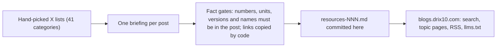

<div align="center">

<a href="https://blogs.drix10.com"></a>

<a href="https://github.com/Drix10/ai-resources/stargazers"></a>
<a href="https://github.com/Drix10/ai-resources/commits/main"></a>
<a href="https://www.npmjs.com/package/ai-resources-mcp"></a>
<a href="https://blogs.drix10.com/rss.xml"></a>
<a href="LICENSE"></a>

<b><a href="https://blogs.drix10.com">Read it</a></b> · <b><a href="#-resource-categories">Browse 41 categories</a></b> · <b><a href="#use-it-from-your-ai-agent">Plug it into your agent</a></b> · <b><a href="https://github.com/search?q=repo%3ADrix10%2Fai-resources+MCP&type=code">Search the archive</a></b>

</div>

<table>
<tr>
<td width="25%" valign="top"><b>Checked against the source</b><br><sub>A number, unit, model version or name that is not in the source post gets the briefing rejected and rewritten.</sub></td>
<td width="25%" valign="top"><b>Every claim has a link</b><br><sub>The original post and the page it points to, copied by code, never written by the model.</sub></td>
<td width="25%" valign="top"><b>41 categories</b><br><sub>Models, dev tools, research and funding, plus robotics, climate, quantum, security and crypto.</sub></td>
<td width="25%" valign="top"><b>Ready for your agent</b><br><sub>MCP server, Agent Skill, JSON API and llms.txt. Plain Markdown under CC BY 4.0.</sub></td>
</tr>
</table>

## Three ways in

<table>
<tr>
<td width="55%"><a href="https://blogs.drix10.com"></a></td>
<td width="45%" valign="top">
<h3><a href="https://blogs.drix10.com">Read it</a></h3>
The newest digests on <a href="https://blogs.drix10.com">blogs.drix10.com</a>, with search, topic pages and an <a href="https://blogs.drix10.com/rss.xml">RSS feed</a>. Or open any category <a href="#-resource-categories">below</a> and read its latest digest here on GitHub.
<br><br>
Star and watch the repo to get new digests as they land.
</td>
</tr>
<tr>
<td width="55%"><a href="USE-WITH-AI.md"></a></td>
<td width="45%" valign="top">
<h3><a href="#use-it-from-your-ai-agent">Ask it from your agent</a></h3>
Claude, Cursor, VS Code or Windsurf answer "what did Anthropic ship this week?" from the briefings, with dates and source links. No key, no account. <a href="#use-it-from-your-ai-agent">Setup for every client ↓</a>
<br><br>
<code>claude mcp add ai-resources -- npx -y ai-resources-mcp</code>
</td>
</tr>
<tr>
<td width="55%"></td>
<td width="45%" valign="top">
<h3>Clone it</h3>
100,000+ dated, sourced briefings in plain Markdown for RAG, evals or an offline index. Every <code>resources-NNN.md</code> holds 5 to 12 of them, like <a href="AI%20Developer%20Tools/resources-296.md">this one</a>.
<br><br>
<code>git clone --depth 1 https://github.com/Drix10/ai-resources</code>
</td>
</tr>
</table>

## What a briefing looks like

<a href="AI%20Developer%20Tools/resources-296.md"></a>
<p align="center"><sub>A real briefing from <a href="AI%20Developer%20Tools/resources-296.md">AI Developer Tools #296</a>. Every digest file holds 5 to 12 of these.</sub></p>


## Signals: what is accelerating in AI

<a href="https://blogs.drix10.com/signals"></a>
<p align="center"><sub><a href="https://blogs.drix10.com/signals">Signals</a>, computed weekly: topics whose coverage climbs three weeks running. Trajectories, not predictions — and nothing on it is written by a model.</sub></p>

Briefings tell you what happened. Signals tells you what it means: which topics are accelerating, with the sample headlines and source links behind every call. Computed from counts only (one briefing = one vote), in the open: [`MOVEMENTS.md`](MOVEMENTS.md) in this repo, [`/api/signals`](https://blogs.drix10.com/api/signals) for code, and the `trending_movements` MCP tool for agents.

## Who it is for

- **Engineers building with AI.** What changed in models, inference, agents, MCP and dev tools, with the benchmark number and the link, in [AI Developer Tools](#ai-developer-tools) and [Tech Infrastructure](#tech-infrastructure).
- **Founders and investors.** Rounds, launches and revenue figures as they are announced, in [AI Companies and Ventures](#ai-companies-and-ventures), [VC Firms](#vc-firms) and [Founders and Entrepreneurs](#founders-and-entrepreneurs).
- **Researchers and students.** What the people in the field are publishing and arguing about, in [CS Academics](#cs-academics) and [Neuroscience and AI](#neuroscience-and-ai).
- **Anyone building RAG, agents or evals.** A 100,000-item corpus of dated, sourced AI news under CC BY 4.0.

Awesome lists are still the better pick for a vetted shortlist, and a newsletter for five editor-picked minutes a day. [COMPARISONS.md](COMPARISONS.md) lays out where this fits.

## Use it from your AI agent

Five ways to plug the briefings into an agent or your own code. None needs a key or an account. Full reference: **[USE-WITH-AI.md](USE-WITH-AI.md)**.

| Path | Best for | Setup |
| --- | --- | --- |
| [MCP server](#mcp-server) | Claude Code, Claude Desktop, Cursor, VS Code, Windsurf | one command or one JSON block |
| [Agent Skill](#agent-skill) | Claude Code and other Skill-aware agents | copy one folder |
| [JSON API](#json-api) | your own code, custom GPT actions, scripts | none, CORS open |
| [llms.txt and RSS](#llmstxt-and-rss) | any LLM that reads a URL, feed readers, bots | none |
| [Raw Markdown](#three-ways-in) | RAG, evals, offline indexes, all 100,000+ briefings | `git clone` |

### MCP server

<a href="https://www.npmjs.com/package/ai-resources-mcp"></a>
<a href="https://registry.modelcontextprotocol.io/v0/servers?search=io.github.Drix10/ai-resources"></a>


Published on npm as [`ai-resources-mcp`](https://www.npmjs.com/package/ai-resources-mcp) (MIT, code in [`mcp/`](mcp/)). `npx` fetches it on first run, so there is nothing to install by hand.

| Tool | What it does |
| --- | --- |
| `search_briefings(query, category?, limit?, since?)` | Keyword search, newest first. All words must match. `since` is `YYYY-MM-DD`. |
| `latest(category?, limit?)` | The newest briefings, overall or for one category. |
| `get_briefing(id)` | Full Markdown of one briefing (URL or slug), with every source link. |
| `list_categories()` | Every category slug with its briefing count. |
| `trending_movements(limit?)` | Topics accelerating week over week (rising) or hot for one week (watch), with sample headlines and source links. |

Every result ends with its source link and `Data: github.com/Drix10/ai-resources (CC BY 4.0)`, so answers stay citable.

**Claude Code**

```bash
claude mcp add ai-resources -- npx -y ai-resources-mcp
```

<details>
<summary><b>Claude Desktop, Cursor, Windsurf</b></summary>

<br>

Add this to `claude_desktop_config.json` (Claude Desktop: Settings → Developer → Edit Config), `~/.cursor/mcp.json` or `.cursor/mcp.json` (Cursor), or `~/.codeium/windsurf/mcp_config.json` (Windsurf):

```json
{
  "mcpServers": {
    "ai-resources": { "command": "npx", "args": ["-y", "ai-resources-mcp"] }
  }
}
```

</details>

<details>
<summary><b>VS Code</b></summary>

<br>

In `.vscode/mcp.json`, or *MCP: Open User Configuration*:

```json
{
  "servers": {
    "ai-resources": { "type": "stdio", "command": "npx", "args": ["-y", "ai-resources-mcp"] }
  }
}
```

Or from a terminal:

```bash
code --add-mcp "{\"name\":\"ai-resources\",\"command\":\"npx\",\"args\":[\"-y\",\"ai-resources-mcp\"]}"
```

</details>

<details>
<summary><b>Windows, and other settings</b></summary>

<br>

If a client cannot start `npx` on Windows, use `"command": "cmd", "args": ["/c", "npx", "-y", "ai-resources-mcp"]`.

`AI_RESOURCES_API_URL` sets the API base URL (default `https://blogs.drix10.com`).

</details>

Then ask, for example:

- *"What did Anthropic announce this week? Cite the sources."*
- *"Latest five briefings in AI Developer Tools."*
- *"Who raised a Series A in AI this month, and how much?"*

### Agent Skill

[`skills/ai-news`](skills/ai-news/SKILL.md) teaches an agent when and how to answer "what's new in AI", "latest on &lt;model or company&gt;" and "who raised" questions from the briefings, with dates and citations. It uses the MCP tools when they are installed and falls back to the JSON API, then llms.txt, then raw Markdown on GitHub when they are not.

```bash
git clone --depth 1 https://github.com/Drix10/ai-resources
mkdir -p ~/.claude/skills
cp -r ai-resources/skills/ai-news ~/.claude/skills/
```

<details>
<summary><b>One project only, Windows, other agents</b></summary>

<br>

- **One project:** copy it to `.claude/skills/ai-news/` inside that project instead.
- **Windows (PowerShell):** `Copy-Item -Recurse ai-resources\skills\ai-news $HOME\.claude\skills\`
- **Other agents** that read `SKILL.md` folders work the same way. For chat apps without Skills, paste the body of `SKILL.md` into the custom instructions.

</details>

### JSON API

Base URL `https://blogs.drix10.com`. JSON, CORS open, no key. It covers the briefings published on the blog; the full archive is in this repository.

| Request | Returns |
| --- | --- |
| `GET /api/articles?q=&category=&since=&limit=&page=` | `{ items, total, page, limit, totalPages, license }`, newest first. All words in `q` must match; every parameter is optional. |
| `GET /api/articles?slug=<slug or URL>` | One item, plus `content` (the full Markdown). |
| `GET /api/categories` | `{ items: [{ name, slug, count, url, llms }] }` |

Each item has `title`, `url`, `slug`, `category`, `categorySlug`, `date`, `description`, `headlines` (every news item in the briefing) and `sources` (`[{ title, url }]`, the original posts).

```bash
curl "https://blogs.drix10.com/api/articles?q=anthropic&since=2026-10-01&limit=5"
curl "https://blogs.drix10.com/api/categories"
```

### llms.txt and RSS

- [`/llms.txt`](https://blogs.drix10.com/llms.txt): the index, linking every category.
- `/llms/<category-slug>.txt`: the 50 newest briefings of one category, for example [`/llms/ai-developer-tools.txt`](https://blogs.drix10.com/llms/ai-developer-tools.txt).
- [`/rss.xml`](https://blogs.drix10.com/rss.xml): for feed readers, Slack or Discord feed bots and email-digest services.

When you show the data anywhere, credit it as `Data: github.com/Drix10/ai-resources (CC BY 4.0)`. The MCP server and the Skill add that line for you.

## By the numbers

Counted from this repository on 29 October 2026. The archive only grows.

| | |
| ---: | --- |
| **100,000+** | briefings: a headline, two or three sentences and the key numbers, one per post |
| **10,800+** | digest files (`resources-NNN.md`) across **41 categories** |
| **10,900+** | commits since November 2024, all made by an automated pipeline |
| **14,000+** | briefings that link both the original post and the page it points to (every briefing since mid-2026) |
| **~2,000** | of them published as articles on [blogs.drix10.com](https://blogs.drix10.com) with search, topic pages, an [RSS feed](https://blogs.drix10.com/rss.xml) and [llms.txt](https://blogs.drix10.com/llms.txt) |

## How it is built

Nobody types these. A pipeline reads the hand-picked X lists for each category, writes one briefing per strong post, runs the fact gates, strips secrets, de-duplicates across categories and commits the batch here. The same run refreshes the category list below and publishes to the blog.



**Known limits:** briefings are machine-written from public posts and can still be wrong; check the linked source before you rely on a number. Part of the older archive (2024 to mid-2026) predates source links. Coverage follows the hand-picked lists, blind spots included. Inclusion is not endorsement.

## Contribute

A pipeline writes the briefings. People pick the sources and fix what it gets wrong. Ways in:

- **Pick up a [good first issue](https://github.com/Drix10/ai-resources/issues?q=is%3Aissue+is%3Aopen+label%3A%22good+first+issue%22)**: MCP server tools, Skill phrasings, guides, examples, translations.
- **[Suggest a source](https://github.com/Drix10/ai-resources/issues/new?template=suggest-source.yml)** (an X account, list or site) or **[report a wrong fact](https://github.com/Drix10/ai-resources/issues/new?template=wrong-fact.yml)** with the briefing link.
- **Ask, share what you built, or float an idea** in [Discussions](https://github.com/Drix10/ai-resources/discussions).

[CONTRIBUTING.md](CONTRIBUTING.md) has the details, including what not to edit by hand. Content is CC BY 4.0; the MCP server code is MIT. If you use the archive in research, [CITATION.cff](CITATION.cff) has the citation.

## Star history

<a href="https://star-history.com/#Drix10/ai-resources&Date"></a>

## About the curator

Built and maintained by **[Drishtant Ghosh (Drix10)](https://drix10.com)**, an AI systems engineer and 1x acquired founder (ReeF, acquired August 2024) based in Bengaluru. Founder of CosLynx.com, AI systems architect on Canopy @ Founders, Inc., Backdrop Build v4 and v6 finalist. More writing at [blogs.drix10.com](https://blogs.drix10.com).

<!-- drix10-footer -->
---

<div align="center">

**Built by [Drishtant Ghosh (Drix10)](https://drix10.com)** · AI systems engineer and 1x acquired founder, Bengaluru

[Portfolio](https://drix10.com) · [LinkedIn](https://www.linkedin.com/in/drix10) · [X](https://x.com/DrishtantGhosh) · [Blog](https://blogs.drix10.com) · [All projects](https://github.com/Drix10)

<sub>More from Drix10: [Agent Flow](https://github.com/Drix10/agent-flow) (guardrails for AI coding agents) · [MiroHedge](https://github.com/Drix10/hypothesis-arena) (AI-assisted systematic fund) · [Guardian](https://github.com/Drix10/guardian-gpt) (UPI scam interceptor) · [Sentinel](https://github.com/Drix10/sentinal) (AI security CLI) · [Keystroke-LLM](https://github.com/Drix10/keystroke-llm) (NumPy transformer on a keyboard)</sub>

</div>

---

## 📚 Resource Categories

**11,188 digests in 41 categories.** Each category shows its newest headlines; jump to one:

<sub>[AI Developer Tools](#ai-developer-tools) · [AI Leaders and Thinkers](#ai-leaders-and-thinkers) · [AI Companies and Ventures](#ai-companies-and-ventures) · [CS Academics](#cs-academics) · [Tech VIPs](#tech-vips) · [VC Firms](#vc-firms) · [Devs, Designers, DevRel](#devs-designers-devrel) · [Tech Infrastructure](#tech-infrastructure) · [Founders and Entrepreneurs](#founders-and-entrepreneurs) · [AI Organizations and Media](#ai-organizations-and-media) · [AI Powered Film and Media](#ai-powered-film-and-media) · [AI Holodeck and Virtual Worlds](#ai-holodeck-and-virtual-worlds) · [AI Artists and Creators](#ai-artists-and-creators) · [AI in Healthcare and Science](#ai-in-healthcare-and-science) · [AI Generated Music and Audio](#ai-generated-music-and-audio) · [AI Consulting and Expertise](#ai-consulting-and-expertise) · [AI Professionals and Community](#ai-professionals-and-community) · [AI Policy and Ethical Considerations](#ai-policy-and-ethical-considerations) · [AI in Real Estate and Property Tech](#ai-in-real-estate-and-property-tech) · [AI and Robotics Applications](#ai-and-robotics-applications) · [AI Driven Vehicles and Transportation](#ai-driven-vehicles-and-transportation) · [AI for Content Creation and Marketing](#ai-for-content-creation-and-marketing) · [AR VR Companies and Development](#ar-vr-companies-and-development) · [AR VR Professionals and Community](#ar-vr-professionals-and-community) · [Climate and Weather Technology](#climate-and-weather-technology) · [Computer Vision and AI Applications](#computer-vision-and-ai-applications) · [Crypto and Web3](#crypto-and-web3) · [Decentralized AI](#decentralized-ai) · [The Exponential Future](#the-exponential-future) · [AI Education](#ai-education) · [AI in Enterprise Applications](#ai-in-enterprise-applications) · [Interesting Finds](#interesting-finds) · [Investors and Venture Capital](#investors-and-venture-capital) · [Cybersecurity and Tech](#cybersecurity-and-tech) · [Neuroscience and AI](#neuroscience-and-ai) · [PR and Communications](#pr-and-communications) · [Quantum Computing](#quantum-computing) · [Spatial Computing](#spatial-computing) · [Tech Companies and News](#tech-companies-and-news) · [Tech Journalists and VIPs](#tech-journalists-and-vips) · [World News and Updates](#world-news-and-updates)</sub>

### AI Developer Tools

<sub>308 digests · [latest: #311](https://github.com/Drix10/ai-resources/blob/main/AI%20Developer%20Tools/resources-311.md) · [read on the blog](https://blogs.drix10.com/categories/ai-developer-tools)</sub>

*   Inco Splash inference engine: up to 3× faster
*   Community plugins – surpassed 1000 today in marketplace
*   Orca build workflow creates 9 PRs in morning

### AI Leaders and Thinkers

<sub>301 digests · [latest: #301](https://github.com/Drix10/ai-resources/blob/main/AI%20Leaders%20and%20Thinkers/resources-301.md) · [read on the blog](https://blogs.drix10.com/categories/ai-leaders-and-thinkers)</sub>

*   Shruti by udgamlabs supports 22 languages under 30MB
*   GOG Galaxy overhaul adds faster client and Linux plan
*   3D/VFX engine - AI agents can write shaders

### AI Companies and Ventures

<sub>299 digests · [latest: #299](https://github.com/Drix10/ai-resources/blob/main/AI%20Companies%20and%20Ventures/resources-299.md) · [read on the blog](https://blogs.drix10.com/categories/ai-companies-and-ventures)</sub>

*   Claude Dreaming boosts wiki accuracy to 48%
*   Claude Code Settings Leak 1,122 repos with secrets
*   Geyser – bridge lets Bedrock join Java servers

### CS Academics

<sub>312 digests · [latest: #312](https://github.com/Drix10/ai-resources/blob/main/CS%20Academics/resources-312.md) · [read on the blog](https://blogs.drix10.com/categories/cs-academics)</sub>

*   TwIL-8B open-source release, 8.8B params, 93% coding frontier
*   Orbit Wars winner Isaiah Pressman top spot with 15B steps
*   MaxxBench 89 DeepSWE tasks with small instruction changes

### Tech VIPs

<sub>304 digests · [latest: #304](https://github.com/Drix10/ai-resources/blob/main/Tech%20VIPs/resources-304.md) · [read on the blog](https://blogs.drix10.com/categories/tech-vips)</sub>

*   Megascans assets free again – 23,000 assets, AI training allowed
*   Higgsfield Miracle – new video vectorization tech announced
*   Starlink connects rural clinics in La Serena, Chile

### VC Firms

<sub>302 digests · [latest: #302](https://github.com/Drix10/ai-resources/blob/main/VC%20Firms/resources-302.md) · [read on the blog](https://blogs.drix10.com/categories/vc-firms)</sub>

*   Vibe Vibers Battlegrounds bans 1000+ accounts and 70 aimbot users
*   TSM clarifies no DRAM entry, reaffirms foundry focus

### Devs, Designers, DevRel

<sub>304 digests · [latest: #304](https://github.com/Drix10/ai-resources/blob/main/Devs%2C%20Designers%2C%20DevRel/resources-304.md) · [read on the blog](https://blogs.drix10.com/categories/devs-designers-devrel)</sub>

*   TikTok Ads US targeting unavailable for non-US accounts
*   Ælen – Astro & Tailwind physiotherapy theme launch

### Tech Infrastructure

<sub>278 digests · [latest: #278](https://github.com/Drix10/ai-resources/blob/main/Tech%20Infrastructure/resources-278.md) · [read on the blog](https://blogs.drix10.com/categories/tech-infrastructure)</sub>

*   Vork 3D engine 2,500-token API renders 1M birds in 97 s
*   Starship Flight 15 catch of booster and upper stage
*   Cellebrite phone cloning software purchased by NIA and Indian police

### Founders and Entrepreneurs

<sub>269 digests · [latest: #269](https://github.com/Drix10/ai-resources/blob/main/Founders%20and%20Entrepreneurs/resources-269.md) · [read on the blog](https://blogs.drix10.com/categories/founders-and-entrepreneurs)</sub>

*   Harbor 1st birthday – 200T tokens/week, 1B rollouts
*   Moneta — Your work is the content launches for $20 one-time
*   dreamDEXSomnia on Somnia Network 3ms onchain execution

### AI Organizations and Media

<sub>295 digests · [latest: #295](https://github.com/Drix10/ai-resources/blob/main/AI%20Organizations%20and%20Media/resources-295.md) · [read on the blog](https://blogs.drix10.com/categories/ai-organizations-and-media)</sub>

*   Short-Term Forecasting of Heterogeneous Wind Power Fleets
*   Dull, Dirty, Dangerous? Working Conditions and Occupational AI Exposure study released
*   Learning When to Think Aloud in Latent Reasoning shows 9.6% accuracy gain on GPT-2

### AI Powered Film and Media

<sub>277 digests · [latest: #277](https://github.com/Drix10/ai-resources/blob/main/AI%20Powered%20Film%20and%20Media/resources-277.md) · [read on the blog](https://blogs.drix10.com/categories/ai-powered-film-and-media)</sub>

*   GomSpace NanoCom AX100 radio hijack risk on 28 of 64 missions
*   MiniMax H3 Reference-to-Video style LoRA trained on Dell tower
*   KLARA AND THE SUN box office $1.2M domestic, $17 per theater

### AI Holodeck and Virtual Worlds

<sub>284 digests · [latest: #284](https://github.com/Drix10/ai-resources/blob/main/AI%20Holodeck%20and%20Virtual%20Worlds/resources-284.md) · [read on the blog](https://blogs.drix10.com/categories/ai-holodeck-and-virtual-worlds)</sub>

*   MiniMax H3 2K video generator announced with 4-15 s render
*   Dyson V11 modeled in Mint Modeler with 30+ parts
*   Skywake new update adds level, UI, story, animations

### AI Artists and Creators

<sub>277 digests · [latest: #277](https://github.com/Drix10/ai-resources/blob/main/AI%20Artists%20and%20Creators/resources-277.md) · [read on the blog](https://blogs.drix10.com/categories/ai-artists-and-creators)</sub>

*   AgenC video – 26 hours 51 minutes, 10.1 billion tokens
*   MiniMax H3 using RGBMoCap and Character-Swap-LoRA
*   Midjourney New Style Reference Unlock sref 2219508089

### AI in Healthcare and Science

<sub>287 digests · [latest: #287](https://github.com/Drix10/ai-resources/blob/main/AI%20in%20Healthcare%20and%20Science/resources-287.md) · [read on the blog](https://blogs.drix10.com/categories/ai-in-healthcare-and-science)</sub>

*   10-protein panel distinguishes ALS with 98% accuracy
*   OpenMed 3.1 split_overlap prevents scoring held-out pairs
*   SWE-rebench V2.1 RL release – 13,337 free RL environments

### AI Generated Music and Audio

<sub>284 digests · [latest: #284](https://github.com/Drix10/ai-resources/blob/main/AI%20Generated%20Music%20and%20Audio/resources-284.md) · [read on the blog](https://blogs.drix10.com/categories/ai-generated-music-and-audio)</sub>

*   Instagram Edits MCP – sound design lacking, use SFX 2.0 model
*   Soundverse AI Studio launches full music studio in browser
*   Soundverse v9 Custom mode creates Lost My Keys track

### AI Consulting and Expertise

<sub>275 digests · [latest: #275](https://github.com/Drix10/ai-resources/blob/main/AI%20Consulting%20and%20Expertise/resources-275.md) · [read on the blog](https://blogs.drix10.com/categories/ai-consulting-and-expertise)</sub>

*   Inkling 2 Small launch with AA Intelligence Index score 31
*   OpenSandbox AI agent environment launches, 64 ms setup

### AI Professionals and Community

<sub>278 digests · [latest: #278](https://github.com/Drix10/ai-resources/blob/main/AI%20Professionals%20and%20Community/resources-278.md) · [read on the blog](https://blogs.drix10.com/categories/ai-professionals-and-community)</sub>

*   Agents Are Going Async adds async subagents for background tasks
*   GitHub rebuilding for agents, led by Jay Parikh
*   SimReady assets reach 1 million downloads on HuggingFace

### AI Policy and Ethical Considerations

<sub>271 digests · [latest: #271](https://github.com/Drix10/ai-resources/blob/main/AI%20Policy%20and%20Ethical%20Considerations/resources-271.md) · [read on the blog](https://blogs.drix10.com/categories/ai-policy-and-ethical-considerations)</sub>

*   You Can't See Everything: Perceptual Attacks 100% harmful
*   s³ paper – multi-agent RL lets LLM swarms self-organize, beat best-of-N
*   Senator Becker bill requires AI compute reporting

### AI in Real Estate and Property Tech

<sub>265 digests · [latest: #265](https://github.com/Drix10/ai-resources/blob/main/AI%20in%20Real%20Estate%20and%20Property%20Tech/resources-265.md) · [read on the blog](https://blogs.drix10.com/categories/ai-in-real-estate-and-property-tech)</sub>

*   Pokemon Auto Chess – open-source fan game with bot support and deployment guide
*   HaxeFlixel – free engine with native platform targeting and 80+ demos
*   Arcade library – 2D Python game library announced

### AI and Robotics Applications

<sub>282 digests · [latest: #282](https://github.com/Drix10/ai-resources/blob/main/AI%20and%20Robotics%20Applications/resources-282.md) · [read on the blog](https://blogs.drix10.com/categories/ai-and-robotics-applications)</sub>

*   MaxxBench – 89 DeepSWE tasks with small changes, models 23 pp apart
*   DefFlow – goal-conditioned 3D world action modelling announced
*   Agensi – Skill Marketplace for AI Agents Launches with 18,000+ Skills

### AI Driven Vehicles and Transportation

<sub>278 digests · [latest: #278](https://github.com/Drix10/ai-resources/blob/main/AI%20Driven%20Vehicles%20and%20Transportation/resources-278.md) · [read on the blog](https://blogs.drix10.com/categories/ai-driven-vehicles-and-transportation)</sub>

*   Energy-Based Policy Orchestration announced with 7× fewer policy switches
*   Gaussian Splats on Vision Pro generated in 20 seconds
*   GPU without Linux enables GUI under a second startup

### AI for Content Creation and Marketing

<sub>274 digests · [latest: #274](https://github.com/Drix10/ai-resources/blob/main/AI%20for%20Content%20Creation%20and%20Marketing/resources-274.md) · [read on the blog](https://blogs.drix10.com/categories/ai-for-content-creation-and-marketing)</sub>

*   Roblox AI tools usage spikes in top games, 80%
*   Obsidian 1.15 adds lock-screen dictation for notes
*   GPT Image 2.6 live on Lovart, 31 days unlimited

### AR VR Companies and Development

<sub>271 digests · [latest: #271](https://github.com/Drix10/ai-resources/blob/main/AR%20VR%20Companies%20and%20Development/resources-271.md) · [read on the blog](https://blogs.drix10.com/categories/ar-vr-companies-and-development)</sub>

*   Team Group CEO warns crisis, 'money can't buy goods'
*   Quest Horizon OS 2.10 PTC adds Theater environment and Simplified Navigator
*   AI Slop Posters List Syncs with Ryan Vogel, 780 Accounts

### AR VR Professionals and Community

<sub>268 digests · [latest: #268](https://github.com/Drix10/ai-resources/blob/main/AR%20VR%20Professionals%20and%20Community/resources-268.md) · [read on the blog](https://blogs.drix10.com/categories/ar-vr-professionals-and-community)</sub>

*   Spotify AI remix feature launches Q1 2027 with $4-5 extra fee
*   3d-tiles-renderer-3tz adds .3tz support to renderer
*   3D fish model giveaway with animation and creation guide

### Climate and Weather Technology

<sub>266 digests · [latest: #266](https://github.com/Drix10/ai-resources/blob/main/Climate%20and%20Weather%20Technology/resources-266.md) · [read on the blog](https://blogs.drix10.com/categories/climate-and-weather-technology)</sub>

*   1003 mb low near 27°N 59°W produces NE–E winds 30–40 kt
*   Copernicus Climate reports warmest October

### Computer Vision and AI Applications

<sub>271 digests · [latest: #271](https://github.com/Drix10/ai-resources/blob/main/Computer%20Vision%20and%20AI%20Applications/resources-271.md) · [read on the blog](https://blogs.drix10.com/categories/computer-vision-and-ai-applications)</sub>

*   Inkling-2: 48-layer decoder-only transformer 594B
*   Heuristic Learning shows rule-based policies reaching RL scores
*   LaMARia spatial AI system outperforms Meta on benchmarks

### Crypto and Web3

<sub>262 digests · [latest: #262](https://github.com/Drix10/ai-resources/blob/main/Crypto%20and%20Web3/resources-262.md) · [read on the blog](https://blogs.drix10.com/categories/crypto-and-web3)</sub>

*   Holograph employee sentenced for $14M token mint
*   Angel Investing Portfolio Results After 10 Years
*   Keplr Google/Apple login hack rescued $5.7M in two addresses

### Decentralized AI

<sub>263 digests · [latest: #263](https://github.com/Drix10/ai-resources/blob/main/Decentralized%20AI/resources-263.md) · [read on the blog](https://blogs.drix10.com/categories/decentralized-ai)</sub>

*   Firelight cover live on LidoFinance, KrakenFX, SentoraHQ
*   CoreWeave CEO letter to Texas governor-elect on data centers
*   AI trade pause, valuation risk from capital constraints

### The Exponential Future

<sub>264 digests · [latest: #264](https://github.com/Drix10/ai-resources/blob/main/The%20Exponential%20Future/resources-264.md) · [read on the blog](https://blogs.drix10.com/categories/the-exponential-future)</sub>

*   Qwen3.8-27B fine-tuned to Arete-27B with 50M tokens rewrite
*   Momentum – pre-release AI agent workspace with cross-provider memory
*   Texas migration: 77k people, 110 firms, 57 Fortune 500

### AI Education

<sub>279 digests · [latest: #279](https://github.com/Drix10/ai-resources/blob/main/AI%20Education/resources-279.md) · [read on the blog](https://blogs.drix10.com/categories/ai-education)</sub>

*   J for C Programmers – added to ChapterPal free collection
*   A Little R Survival Kit added to ChapterPal open textbooks collection
*   Agent memory released by seven firms in one month

### AI in Enterprise Applications

<sub>269 digests · [latest: #269](https://github.com/Drix10/ai-resources/blob/main/AI%20in%20Enterprise%20Applications/resources-269.md) · [read on the blog](https://blogs.drix10.com/categories/ai-in-enterprise-applications)</sub>

*   Claude memory dreaming helps organize experience, improves CL-Bench results
*   CREAO – access Claude models and Fable 5.1 without login
*   Schizocyte Cellule Labs – Live interactive neural simulation with 140 cells

### Interesting Finds

<sub>260 digests · [latest: #260](https://github.com/Drix10/ai-resources/blob/main/Interesting%20Finds/resources-260.md) · [read on the blog](https://blogs.drix10.com/categories/interesting-finds)</sub>

*   Product Hunt 13th birthday shows 3x maker launches, 25% unicorn founders
*   Supabase Founder Friends Singapore event announced

### Investors and Venture Capital

<sub>259 digests · [latest: #259](https://github.com/Drix10/ai-resources/blob/main/Investors%20and%20Venture%20Capital/resources-259.md) · [read on the blog](https://blogs.drix10.com/categories/investors-and-venture-capital)</sub>

*   SpaceX price moves to $134, target $3,000 by 2035
*   NVIDIA plans investments in four German AI firms

### Cybersecurity and Tech

<sub>242 digests · [latest: #242](https://github.com/Drix10/ai-resources/blob/main/Cybersecurity%20and%20Tech/resources-242.md) · [read on the blog](https://blogs.drix10.com/categories/cybersecurity-and-tech)</sub>

*   Emotet botnet taken down 2021 after 12 years operation
*   Cairn – solved 54/54 problems, placed 3rd at Tencent Cloud Hackathon
*   Mythic v4 adds direct RDP and VNC via Guacamole

### Neuroscience and AI

<sub>250 digests · [latest: #250](https://github.com/Drix10/ai-resources/blob/main/Neuroscience%20and%20AI/resources-250.md) · [read on the blog](https://blogs.drix10.com/categories/neuroscience-and-ai)</sub>

*   OnScene study survival with prehospital extracorporeal
*   Pelacarsen trial fails to reduce cardiovascular events
*   PROMISE rover launch to moon in 2028 announced

### PR and Communications

<sub>247 digests · [latest: #247](https://github.com/Drix10/ai-resources/blob/main/PR%20and%20Communications/resources-247.md) · [read on the blog](https://blogs.drix10.com/categories/pr-and-communications)</sub>

*   U.S. employers added 165,000 jobs, part-time workers rose 339,000
*   OpenAI valued at $1.25 trillion, safety focus over IPO
*   Sequoia shutting down its Scouts program marks the end of an era

### Quantum Computing

<sub>248 digests · [latest: #248](https://github.com/Drix10/ai-resources/blob/main/Quantum%20Computing/resources-248.md) · [read on the blog](https://blogs.drix10.com/categories/quantum-computing)</sub>

*   Algorithmic Wave-Particle Duality: Pathfinding in Welded Trees is Hard
*   Sample-based Diagonalization via DMRG, sub-kcal/mol
*   Superradiant laser achieves Θ(μ^{8/3}) coherence scaling

### Spatial Computing

<sub>245 digests · [latest: #245](https://github.com/Drix10/ai-resources/blob/main/Spatial%20Computing/resources-245.md) · [read on the blog](https://blogs.drix10.com/categories/spatial-computing)</sub>

*   Isometric Vancouver 100% city live, next North Vancouver
*   YOLO11-Pose detects and tracks shoplifting behavior
*   Ancient Future Underwater VR exhibit at IMMENSIVA EXPO 2026 Barcelona

### Tech Companies and News

<sub>241 digests · [latest: #241](https://github.com/Drix10/ai-resources/blob/main/Tech%20Companies%20and%20News/resources-241.md) · [read on the blog](https://blogs.drix10.com/categories/tech-companies-and-news)</sub>

*   Theseus Robotics restocks shelves, picks orders by day
*   PUDU Robotics robots deployed for food, hotel, cleaning, factory and coffee
*   Parallel Domain PD Forma makes 4D sims from real footage

### Tech Journalists and VIPs

<sub>243 digests · [latest: #243](https://github.com/Drix10/ai-resources/blob/main/Tech%20Journalists%20and%20VIPs/resources-243.md) · [read on the blog](https://blogs.drix10.com/categories/tech-journalists-and-vips)</sub>

*   MaxxBench introduces 89 DeepSWE tasks with small changes
*   AI 3D cartoon model shape similarity 94/100 score
*   Claude GTM research method reduces 4 weeks to 3 hours

### World News and Updates

<sub>236 digests · [latest: #236](https://github.com/Drix10/ai-resources/blob/main/World%20News%20and%20Updates/resources-236.md) · [read on the blog](https://blogs.drix10.com/categories/world-news-and-updates)</sub>

*   DNA testing confirms 'serial killer' in Pennsylvania in 1970s
*   Hybrid autos export cap 350,000 set by Brussels persuasion

---

<div align="center">

[Star the repo](https://github.com/Drix10/ai-resources) to keep it handy and help others find it, or [suggest a source](https://github.com/Drix10/ai-resources/issues/new/choose).

[Read on the blog](https://blogs.drix10.com) · [RSS feed](https://blogs.drix10.com/rss.xml) · [Use it from your AI agent](https://github.com/Drix10/ai-resources/blob/main/USE-WITH-AI.md)

<sub>Summaries © Drishtant Ghosh, licensed [CC BY 4.0](LICENSE). Every digest links to its original post where one exists; the posts and linked pages belong to their authors.</sub>

</div>
