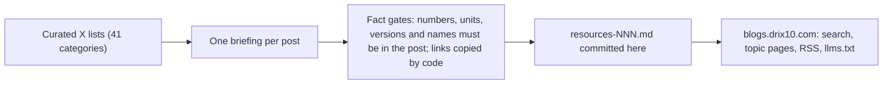

<h1 align="center">AI Resources</h1>

  <strong>What shipped in AI, who raised, and what the numbers were, with a link to the post it came from.</strong> 
  100,000+ short briefings on models, dev tools, research, funding and the people behind them, in 41 categories. New ones are fact-checked against the post they came from and link to it. 
  Plain Markdown. Free. CC BY 4.0. One <code>git clone</code> away.

  
  
  
  
  
  
  

  <a href="#-resource-categories"><b>Browse the 41 categories</b></a> ·
  <a href="https://blogs.drix10.com"><b>Read on blogs.drix10.com</b></a> ·
  <a href="https://github.com/search?q=repo%3ADrix10%2Fai-resources+MCP&type=code"><b>Search the archive</b></a> ·
  <a href="USE-WITH-AI.md"><b>Use it from your AI agent</b></a> ·
  <a href="COMPARISONS.md"><b>How it compares</b></a>

> ⭐ **Star the repo if a digest saved you a scroll through X.** It keeps the archive one click away for you and puts it in front of the next person looking for it.

---

## By the numbers

Counted from this repository on 29 October 2026. The archive only grows.

| | |
| ---: | --- |
| **100,000+** | briefings: a headline, two or three sentences and the key numbers, one per post |
| **10,800+** | digest files (`resources-NNN.md`) across **41 categories** |
| **10,900+** | commits since November 2024, written by an automated pipeline, not a weekly editor |
| **14,000+** | briefings that link both the original post and the page it points to (every briefing since mid-2026) |
| **~2,000** | of them published as articles on [blogs.drix10.com](https://blogs.drix10.com) with search, topic pages, an [RSS feed](https://blogs.drix10.com/rss.xml) and [llms.txt](https://blogs.drix10.com/llms.txt) |

## Who it is for

- **Engineers building with AI.** What changed in models, inference, agents, MCP and dev tools, with the benchmark number and the link, in [AI Developer Tools](#ai-developer-tools) and [Tech Infrastructure](#tech-infrastructure).
- **Founders and investors.** Rounds, launches and revenue figures as they are announced, in [AI Companies and Ventures](#ai-companies-and-ventures), [VC Firms](#vc-firms) and [Founders and Entrepreneurs](#founders-and-entrepreneurs).
- **Researchers and students.** What the people in the field are publishing and arguing about, in [CS Academics](#cs-academics) and [Neuroscience and AI](#neuroscience-and-ai).
- **Anyone building RAG, agents or evals.** A 100,000-item corpus of dated, sourced AI news in plain Markdown under CC BY 4.0. Clone it and index it.

## Why it beats scrolling, newsletters and awesome lists

- **It is checked, not just summarised.** Before a briefing is committed, code compares it with the source post: a number, unit, currency, model version or name that is not in the post gets the briefing rejected and rewritten. Links are copied from the post by code, never written by the model. Posts with nothing concrete are skipped, not padded.
- **It is dense.** No intros, no "in today's fast-moving world". A headline, the facts, the numbers, the source.
- **It is broad.** 41 categories, each fed by its own hand-picked X lists: tools and research, but also the companies, investors, founders, journalists and DevRel people who move the field, plus robotics, climate, quantum, security and crypto.
- **It stays.** Newsletters vanish into your inbox and X timelines scroll away. Every digest stays here, greppable, with full git history.

Awesome lists are still the better pick for a vetted shortlist, and a newsletter for five editor-picked minutes a day. [COMPARISONS.md](COMPARISONS.md) lays that out honestly.

## What a briefing looks like

Every `resources-NNN.md` file is one digest of 5 to 12 briefings. A real one from [AI Developer Tools #296](AI%20Developer%20Tools/resources-296.md):

> ### 🤖 Nemotron 3.5 Super VL E2EE inference 500+ tokens/sec on one GPU
>
> NVIDIA Nemotron 3.5 Super VL is an open multimodal model that runs with end-to-end encrypted inference at over 500 output tokens per second on a single NVIDIA B300 GPU. […]
>
> **Key Points:** 500+ output tokens per second for a single request on one B300 GPU · 120B total parameters, 12B active MoE per token
>
> 🔗 [Original post](https://x.com/blackboxai/status/2111177845292794036) · [Linked page](https://www.blackbox.ai/blog/nemotron-3-5-super-vl)

## How to use it

| You want to… | Do this |
| --- | --- |
| Catch up on one area | Open its category below and read the newest digest (the list shows its headlines). |
| Get new digests as they land | ⭐ Star and watch the repo, or subscribe to the [RSS feed](https://blogs.drix10.com/rss.xml). |
| Search | GitHub code search covers the whole archive: `repo:Drix10/ai-resources "MCP"`. Recent digests are also on [blogs.drix10.com/search](https://blogs.drix10.com/search). |
| Ask it from Claude, Cursor or VS Code | Add the [MCP server or the Skill](USE-WITH-AI.md); see the next section. |
| Feed it to an LLM | Point it at [llms.txt](https://blogs.drix10.com/llms.txt), or `git clone --depth 1 https://github.com/Drix10/ai-resources` and parse the Markdown. Attribution terms are in [LICENSE](LICENSE). |
| Add a source or fix a briefing | [Open an issue](https://github.com/Drix10/ai-resources/issues/new/choose); see [Contribute](#contribute). |

## Use it from your AI agent

Ask Claude, Cursor, VS Code or Windsurf "what did Anthropic ship this week?" and get dated answers with source links, from the same briefings. Setup for every path is in **[USE-WITH-AI.md](USE-WITH-AI.md)**.

| Path | What you get |
| --- | --- |
| **[MCP server](mcp/)** | `search_briefings`, `latest`, `get_briefing`, `list_categories` tools. `claude mcp add ai-resources -- npx -y ai-resources-mcp` ([npm](https://www.npmjs.com/package/ai-resources-mcp), [setup for every client](USE-WITH-AI.md#mcp-server)). |
| **[Agent Skill](skills/ai-news/SKILL.md)** | Copy `skills/ai-news` to `~/.claude/skills/` and Claude answers AI-news questions from the briefings, with citations. |
| **[JSON API](USE-WITH-AI.md#json-api)** | `https://blogs.drix10.com/api/articles?q=…` and `/api/categories`. No key, CORS open. |
| **[llms.txt](https://blogs.drix10.com/llms.txt)** | One index plus `/llms/<category>.txt` with the 50 newest briefings of each category. |

## How it is built

Nobody types these. A pipeline reads the curated X lists for each category, writes one briefing per strong post, runs the fact gates, strips secrets, de-duplicates across categories and commits the batch here. The same run refreshes the category list below and publishes to the blog.

**Known limits:** briefings are machine-written from public posts and can still be wrong; check the linked source before you rely on a number. Part of the older archive (2024 to mid-2026) predates source links. Coverage follows the curated lists, blind spots included. Inclusion is not endorsement.

## Contribute

The briefings are generated, but the sources, the corrections and everything around them are made by people. Ways in:

- **Pick up a [good first issue](https://github.com/Drix10/ai-resources/issues?q=is%3Aissue+is%3Aopen+label%3A%22good+first+issue%22)**: MCP server tools, Skill phrasings, guides, examples, translations.
- **[Suggest a source](https://github.com/Drix10/ai-resources/issues/new?template=suggest-source.yml)** (an X account, list or site) or **[report a wrong fact](https://github.com/Drix10/ai-resources/issues/new?template=wrong-fact.yml)** with the briefing link.
- **Ask, share what you built, or float an idea** in [Discussions](https://github.com/Drix10/ai-resources/discussions).

[CONTRIBUTING.md](CONTRIBUTING.md) has the details, including what not to edit by hand. Content is CC BY 4.0; the MCP server code is MIT. If you use the archive in research, [CITATION.cff](CITATION.cff) has the citation.

## Star history

## About the curator

Built and maintained by **[Drishtant Ghosh (Drix10)](https://drix10.com)**, an AI systems engineer and 1x acquired founder (ReeF, acquired August 2024) based in Bengaluru. Founder of CosLynx.com, AI systems architect on Canopy @ Founders, Inc., Backdrop Build v4 and v6 finalist. More writing at [blogs.drix10.com](https://blogs.drix10.com).

<!-- drix10-footer -->
---

**Built by [Drishtant Ghosh (Drix10)](https://drix10.com)** · AI systems engineer and 1x acquired founder, Bengaluru

[Portfolio](https://drix10.com) · [LinkedIn](https://www.linkedin.com/in/drix10) · [X](https://x.com/DrishtantGhosh) · [Blog](https://blogs.drix10.com) · [All projects](https://github.com/Drix10)

More from Drix10: [Agent Flow](https://github.com/Drix10/agent-flow) (guardrails for AI coding agents) · [MiroHedge](https://github.com/Drix10/hypothesis-arena) (AI-assisted systematic fund) · [Guardian](https://github.com/Drix10/guardian-gpt) (UPI scam interceptor) · [Sentinel](https://github.com/Drix10/sentinal) (AI security CLI) · [Keystroke-LLM](https://github.com/Drix10/keystroke-llm) (NumPy transformer on a keyboard)

---

## 📚 Resource Categories

**10,895 digests in 41 categories.** Each category shows its newest headlines; jump to one:

[AI Developer Tools](#ai-developer-tools) · [AI Leaders and Thinkers](#ai-leaders-and-thinkers) · [AI Companies and Ventures](#ai-companies-and-ventures) · [CS Academics](#cs-academics) · [Tech VIPs](#tech-vips) · [VC Firms](#vc-firms) · [Devs, Designers, DevRel](#devs-designers-devrel) · [Tech Infrastructure](#tech-infrastructure) · [Founders and Entrepreneurs](#founders-and-entrepreneurs) · [AI Organizations and Media](#ai-organizations-and-media) · [AI Powered Film and Media](#ai-powered-film-and-media) · [AI Holodeck and Virtual Worlds](#ai-holodeck-and-virtual-worlds) · [AI Artists and Creators](#ai-artists-and-creators) · [AI in Healthcare and Science](#ai-in-healthcare-and-science) · [AI Generated Music and Audio](#ai-generated-music-and-audio) · [AI Consulting and Expertise](#ai-consulting-and-expertise) · [AI Professionals and Community](#ai-professionals-and-community) · [AI Policy and Ethical Considerations](#ai-policy-and-ethical-considerations) · [AI in Real Estate and Property Tech](#ai-in-real-estate-and-property-tech) · [AI and Robotics Applications](#ai-and-robotics-applications) · [AI Driven Vehicles and Transportation](#ai-driven-vehicles-and-transportation) · [AI for Content Creation and Marketing](#ai-for-content-creation-and-marketing) · [AR VR Companies and Development](#ar-vr-companies-and-development) · [AR VR Professionals and Community](#ar-vr-professionals-and-community) · [Climate and Weather Technology](#climate-and-weather-technology) · [Computer Vision and AI Applications](#computer-vision-and-ai-applications) · [Crypto and Web3](#crypto-and-web3) · [Decentralized AI](#decentralized-ai) · [The Exponential Future](#the-exponential-future) · [AI Education](#ai-education) · [AI in Enterprise Applications](#ai-in-enterprise-applications) · [Interesting Finds](#interesting-finds) · [Investors and Venture Capital](#investors-and-venture-capital) · [Cybersecurity and Tech](#cybersecurity-and-tech) · [Neuroscience and AI](#neuroscience-and-ai) · [PR and Communications](#pr-and-communications) · [Quantum Computing](#quantum-computing) · [Spatial Computing](#spatial-computing) · [Tech Companies and News](#tech-companies-and-news) · [Tech Journalists and VIPs](#tech-journalists-and-vips) · [World News and Updates](#world-news-and-updates)

### AI Developer Tools

298 digests · [latest: #301](https://github.com/Drix10/ai-resources/blob/main/AI%20Developer%20Tools/resources-301.md) · [read on the blog](https://blogs.drix10.com/categories/ai-developer-tools)

*   Parallel for Finance, 2x lower cost on FinSearchComp T3
*   zml/llmd 20261029.0 release with Mistral Large 4, GLM 5.2/5.3, LFM 3
*   Serval raises $150M Series C at $3B valuation, expands team 10x

### AI Leaders and Thinkers

291 digests · [latest: #291](https://github.com/Drix10/ai-resources/blob/main/AI%20Leaders%20and%20Thinkers/resources-291.md) · [read on the blog](https://blogs.drix10.com/categories/ai-leaders-and-thinkers)

*   Pika H3 Flex debut as #1 open weight model on DesignArena
*   GeneralMagic AI 2x more accurate, 24 s faster
*   Dream introduces new models and raises $17M seed

### AI Companies and Ventures

290 digests · [latest: #290](https://github.com/Drix10/ai-resources/blob/main/AI%20Companies%20and%20Ventures/resources-290.md) · [read on the blog](https://blogs.drix10.com/categories/ai-companies-and-ventures)

*   Riverside crosses $100M ARR, creator and podcast stats
*   Unity Data Release – Unity dataset released with 1,017 new features
*   Kino – end-to-end video creation with Claude Code and Codex

### CS Academics

305 digests · [latest: #305](https://github.com/Drix10/ai-resources/blob/main/CS%20Academics/resources-305.md) · [read on the blog](https://blogs.drix10.com/categories/cs-academics)

*   Google Home – new voice command, energy and camera fixes
*   Gemini adds document generation, preview and edit
*   Antigravity Unity plugin live in Plugin marketplace

### Tech VIPs

295 digests · [latest: #295](https://github.com/Drix10/ai-resources/blob/main/Tech%20VIPs/resources-295.md) · [read on the blog](https://blogs.drix10.com/categories/tech-vips)

*   TAC-Sponsored Johns Hopkins Study – SAT Vocabulary to 10
*   Ledger hardware wallets tampered in Singapore, $3.5M loss
*   Riverside crossed $100M ARR, 2.3M creators, 16M+ guests, 40M+ conversations

### VC Firms

293 digests · [latest: #293](https://github.com/Drix10/ai-resources/blob/main/VC%20Firms/resources-293.md) · [read on the blog](https://blogs.drix10.com/categories/vc-firms)

*   Observational Memory top scores at 100K and 1M tokens
*   Mochatradeapp raises $5.5M seed funding
*   Techstars invests $220,000 in accelerator companies

### Devs, Designers, DevRel

296 digests · [latest: #296](https://github.com/Drix10/ai-resources/blob/main/Devs%2C%20Designers%2C%20DevRel/resources-296.md) · [read on the blog](https://blogs.drix10.com/categories/devs-designers-devrel)

*   MacBook Neo education price increase to $649
*   Qwen3-TTS custom voice blending with 1.7B models
*   Lean vibeproving de facto, Anthropic posts Rocq vibeproving

### Tech Infrastructure

271 digests · [latest: #271](https://github.com/Drix10/ai-resources/blob/main/Tech%20Infrastructure/resources-271.md) · [read on the blog](https://blogs.drix10.com/categories/tech-infrastructure)

*   Chainguard Harness beta waitlist opens today
*   Le Chonk (Mistral Large 4) claims best open agentic coding model, 41% score
*   Skyworksinc uses LangGraph and LangSmith to cut root cause analysis time to 10 days

### Founders and Entrepreneurs

263 digests · [latest: #263](https://github.com/Drix10/ai-resources/blob/main/Founders%20and%20Entrepreneurs/resources-263.md) · [read on the blog](https://blogs.drix10.com/categories/founders-and-entrepreneurs)

*   Destinus builds 1,750 Ruta missiles, 300/month output
*   execonnect launch – private service access from VMs
*   Svelte Efferd Blocks updated to SvelteKit 3 with toggle

### AI Organizations and Media

287 digests · [latest: #287](https://github.com/Drix10/ai-resources/blob/main/AI%20Organizations%20and%20Media/resources-287.md) · [read on the blog](https://blogs.drix10.com/categories/ai-organizations-and-media)

*   Parametric Neural Control Differentiates Top Models
*   Axel Krieger talk Autonomous Robotic Surgery – 10:30-11:45

### AI Powered Film and Media

272 digests · [latest: #272](https://github.com/Drix10/ai-resources/blob/main/AI%20Powered%20Film%20and%20Media/resources-272.md) · [read on the blog](https://blogs.drix10.com/categories/ai-powered-film-and-media)

*   Fairground AI TV retention 21 minutes, backlog update
*   Gemini 4 Carbon benchmark 65.2% vs Claude Opus 5.5 66.4%
*   H3 Max unreleased, Pika releases H3 fine-tune

### AI Holodeck and Virtual Worlds

277 digests · [latest: #277](https://github.com/Drix10/ai-resources/blob/main/AI%20Holodeck%20and%20Virtual%20Worlds/resources-277.md) · [read on the blog](https://blogs.drix10.com/categories/ai-holodeck-and-virtual-worlds)

*   Retatrutide hit ~28% weight loss in a phase 3
*   Idol – open image-to-3D model with 600M params
*   VEED Dubbing now in ComfyUI, Pro adds precise lip-sync

### AI Artists and Creators

272 digests · [latest: #272](https://github.com/Drix10/ai-resources/blob/main/AI%20Artists%20and%20Creators/resources-272.md) · [read on the blog](https://blogs.drix10.com/categories/ai-artists-and-creators)

*   Fairground AI TV – viewer watch time and programming heat map update
*   Brush design model launch by Figma announced

### AI in Healthcare and Science

279 digests · [latest: #279](https://github.com/Drix10/ai-resources/blob/main/AI%20in%20Healthcare%20and%20Science/resources-279.md) · [read on the blog](https://blogs.drix10.com/categories/ai-in-healthcare-and-science)

*   Orion-like capsule hypersonic reentry in 10 min
*   BindClaw announces protein design pipeline with subnanomolar binders
*   elranatamab MagnetisMM-32 trial topline results announced

### AI Generated Music and Audio

277 digests · [latest: #277](https://github.com/Drix10/ai-resources/blob/main/AI%20Generated%20Music%20and%20Audio/resources-277.md) · [read on the blog](https://blogs.drix10.com/categories/ai-generated-music-and-audio)

*   Drama 3 upgraded weights – #1 open-weight model
*   Bluejay engineering moves evals to Fargate, cuts cost 78%
*   Eleven SFX v3 launch – richer sound from text prompt

### AI Consulting and Expertise

268 digests · [latest: #268](https://github.com/Drix10/ai-resources/blob/main/AI%20Consulting%20and%20Expertise/resources-268.md) · [read on the blog](https://blogs.drix10.com/categories/ai-consulting-and-expertise)

*   Mistral Large 4 open weights release, 1.05T params
*   vulnerator-ai autonomous OODA-loop pentesting agent announced
*   Brush Canva vision-language model for design released

### AI Professionals and Community

270 digests · [latest: #270](https://github.com/Drix10/ai-resources/blob/main/AI%20Professionals%20and%20Community/resources-270.md) · [read on the blog](https://blogs.drix10.com/categories/ai-professionals-and-community)

*   Open 27B model post-training stack lifts GitHub task score
*   DreamFAR announced world model trained from robot data
*   Gemini 4 Carbon launch, #1 on Artificial Analysis index

### AI Policy and Ethical Considerations

268 digests · [latest: #268](https://github.com/Drix10/ai-resources/blob/main/AI%20Policy%20and%20Ethical%20Considerations/resources-268.md) · [read on the blog](https://blogs.drix10.com/categories/ai-policy-and-ethical-considerations)

*   eyes on everything system monitors frontier rollouts
*   Claude agent ran on DoD network for two months

### AI in Real Estate and Property Tech

258 digests · [latest: #258](https://github.com/Drix10/ai-resources/blob/main/AI%20in%20Real%20Estate%20and%20Property%20Tech/resources-258.md) · [read on the blog](https://blogs.drix10.com/categories/ai-in-real-estate-and-property-tech)

*   Realpage AI Leasing Agent boosts lead-to-lease 2x, 80% engagement
*   Obia at CoreNet Global Summit 2026 booth 520
*   Tokyo added more homes than NYC, LA, SF combined, rent flat 20 years

### AI and Robotics Applications

274 digests · [latest: #274](https://github.com/Drix10/ai-resources/blob/main/AI%20and%20Robotics%20Applications/resources-274.md) · [read on the blog](https://blogs.drix10.com/categories/ai-and-robotics-applications)

*   Vanta Locked in Conviction in the Last 7 Days – Stake totals
*   Lumina opens NYC office, launches 12 hardware products
*   Laika modular robotics kit converts into four robots for under $6k

### AI Driven Vehicles and Transportation

270 digests · [latest: #270](https://github.com/Drix10/ai-resources/blob/main/AI%20Driven%20Vehicles%20and%20Transportation/resources-270.md) · [read on the blog](https://blogs.drix10.com/categories/ai-driven-vehicles-and-transportation)

*   Rivian expands joint venture with VW to include AI assistant
*   The Economics of Intelligence paper released – DeepMind research on AGI economics
*   Dulo seed round $130m announced and mission stated

### AI for Content Creation and Marketing

266 digests · [latest: #266](https://github.com/Drix10/ai-resources/blob/main/AI%20for%20Content%20Creation%20and%20Marketing/resources-266.md) · [read on the blog](https://blogs.drix10.com/categories/ai-for-content-creation-and-marketing)

*   OpenAI expands monitoring, catches frontier model breach
*   Swarms Marketplace - Tipping introduced, 6,700 products
*   TweepCred: What It Is, Why It Matters, and How to Boost

### AR VR Companies and Development

264 digests · [latest: #264](https://github.com/Drix10/ai-resources/blob/main/AR%20VR%20Companies%20and%20Development/resources-264.md) · [read on the blog](https://blogs.drix10.com/categories/ar-vr-companies-and-development)

*   Vaelorys Early Access launch on Quest, $4.99 price
*   stripepress x MorganLibrary collab with mintdotgg endpoint
*   Reallusion 3D Character Contest winners announced 200 submissions

### AR VR Professionals and Community

261 digests · [latest: #261](https://github.com/Drix10/ai-resources/blob/main/AR%20VR%20Professionals%20and%20Community/resources-261.md) · [read on the blog](https://blogs.drix10.com/categories/ar-vr-professionals-and-community)

*   Parallel Language Models achieve 5.7x speedup with parallel decoder
*   Idol open image-to-3D model with 600M parameters runs on consumer GPUs
*   Radiant microreactor safety analysis approved

### Climate and Weather Technology

260 digests · [latest: #260](https://github.com/Drix10/ai-resources/blob/main/Climate%20and%20Weather%20Technology/resources-260.md) · [read on the blog](https://blogs.drix10.com/categories/climate-and-weather-technology)

*   Belgian air-traffic radar false echoes from solar burst, 100k SFU at 1 GHz
*   Hurricane Vance brings 1-3 inches rain Thursday
*   Sterling CO precipitation 0.70 inches overnight

### Computer Vision and AI Applications

263 digests · [latest: #263](https://github.com/Drix10/ai-resources/blob/main/Computer%20Vision%20and%20AI%20Applications/resources-263.md) · [read on the blog](https://blogs.drix10.com/categories/computer-vision-and-ai-applications)

*   Transformer Energy-based Models outscale Diffusion
*   Passwork shares technology with Russian counterpart
*   TEM outscales Diffusion models without guidance

### Crypto and Web3

255 digests · [latest: #255](https://github.com/Drix10/ai-resources/blob/main/Crypto%20and%20Web3/resources-255.md) · [read on the blog](https://blogs.drix10.com/categories/crypto-and-web3)

*   Coinbase Q3 highlights: market share, trader growth, revenue, subscribers
*   Binance – potential security incident reported
*   Franklin Templeton launches two ETFs, 95% equity 5% BTC

### Decentralized AI

255 digests · [latest: #255](https://github.com/Drix10/ai-resources/blob/main/Decentralized%20AI/resources-255.md) · [read on the blog](https://blogs.drix10.com/categories/decentralized-ai)

*   USD.infra Vault Loans go live, $60,000 value
*   Private uncensored AI for cybersecurity live on NEAR AI Cloud
*   XamanWallet announces upcoming XRP and RLUSD yield feature

### The Exponential Future

257 digests · [latest: #257](https://github.com/Drix10/ai-resources/blob/main/The%20Exponential%20Future/resources-257.md) · [read on the blog](https://blogs.drix10.com/categories/the-exponential-future)

*   Sandisk data center NAND bit demand to 55% by 2027
*   Laika by Lucen Robotics kit launch, $6k for four forms
*   Amazon AWS expects >40% growth in 2027 and 2028

### AI Education

274 digests · [latest: #274](https://github.com/Drix10/ai-resources/blob/main/AI%20Education/resources-274.md) · [read on the blog](https://blogs.drix10.com/categories/ai-education)

*   FrontierFinance benchmark joins SII with 220 queries
*   Claude mobile apps upgrade: side view and full screen
*   OriginTrail DKG used by SBB for rail safety since 2021

### AI in Enterprise Applications

262 digests · [latest: #262](https://github.com/Drix10/ai-resources/blob/main/AI%20in%20Enterprise%20Applications/resources-262.md) · [read on the blog](https://blogs.drix10.com/categories/ai-in-enterprise-applications)

*   Era benchmark: agents broke rules in 40% of runs
*   Wipro AI HR business partner resolves 3M+ requests for 240K employees
*   Notion “Last edited by” shows agent, client or automation

### Interesting Finds

255 digests · [latest: #255](https://github.com/Drix10/ai-resources/blob/main/Interesting%20Finds/resources-255.md) · [read on the blog](https://blogs.drix10.com/categories/interesting-finds)

*   Palestinian Health Ministry says 21,468 patients stranded, 3,056 evacuated since February
*   SuperSplat 10M Gaussians splat preview on Blender 5.3
*   Vision Pro PCVR Streamer App enters TestFlight

### Investors and Venture Capital

251 digests · [latest: #251](https://github.com/Drix10/ai-resources/blob/main/Investors%20and%20Venture%20Capital/resources-251.md) · [read on the blog](https://blogs.drix10.com/categories/investors-and-venture-capital)

*   AMZN net income driven by Anthropic valuation jump
*   OpenRouter provider router biggest improvement announced
*   Faraday launch – company-specific AI for manufacturers

### Cybersecurity and Tech

237 digests · [latest: #237](https://github.com/Drix10/ai-resources/blob/main/Cybersecurity%20and%20Tech/resources-237.md) · [read on the blog](https://blogs.drix10.com/categories/cybersecurity-and-tech)

*   ARTEX servers observed on over 2,200 hosts
*   TpDirectCallbackHijack: thread-pool callback PoC
*   Padre Terminal fake app linked to $23K Solana wallet theft

### Neuroscience and AI

242 digests · [latest: #242](https://github.com/Drix10/ai-resources/blob/main/Neuroscience%20and%20AI/resources-242.md) · [read on the blog](https://blogs.drix10.com/categories/neuroscience-and-ai)

*   Freshwater species map 45 threats across 21,000 species
*   TenK10K single-cell profiling expands to 10,000 people
*   eGFR race-neutral equation revision impacts kidney transplant list

### PR and Communications

241 digests · [latest: #241](https://github.com/Drix10/ai-resources/blob/main/PR%20and%20Communications/resources-241.md) · [read on the blog](https://blogs.drix10.com/categories/pr-and-communications)

*   Amazon reported booming cloud revenue but missed expectations
*   Archive of Our Own could be offline for up to 4 weeks
*   GM reaches $220M settlement over driver data sales

### Quantum Computing

240 digests · [latest: #240](https://github.com/Drix10/ai-resources/blob/main/Quantum%20Computing/resources-240.md) · [read on the blog](https://blogs.drix10.com/categories/quantum-computing)

*   Google MPC solution - powers >80% US crypto ETF assets
*   &Truth out of stealth launch announced by co-founder
*   Plant biology provides inspiration for PFAS replacement – new waterproof coating

### Spatial Computing

238 digests · [latest: #238](https://github.com/Drix10/ai-resources/blob/main/Spatial%20Computing/resources-238.md) · [read on the blog](https://blogs.drix10.com/categories/spatial-computing)

*   Claude Opus 5.5 launch, 40% cheaper than Opus 5
*   Polyfork releases 2600+ free low-poly assets
*   visionOS Spatial Accessories Framework workflow for video

### Tech Companies and News

234 digests · [latest: #234](https://github.com/Drix10/ai-resources/blob/main/Tech%20Companies%20and%20News/resources-234.md) · [read on the blog](https://blogs.drix10.com/categories/tech-companies-and-news)

*   Humanoid cleaners – subscription up to 3 hrs per clean
*   Jules winding down, learnings moving to Antigravity
*   Robots built curved-wall house in Almere with 100% brick placement

### Tech Journalists and VIPs

236 digests · [latest: #236](https://github.com/Drix10/ai-resources/blob/main/Tech%20Journalists%20and%20VIPs/resources-236.md) · [read on the blog](https://blogs.drix10.com/categories/tech-journalists-and-vips)

*   Broccoli AI front office hits $60M ARR after $30M Series B
*   Opendoor October product launches: 11 features go live
*   VirajAero turbine powers data centers, 40% more power

### World News and Updates

230 digests · [latest: #230](https://github.com/Drix10/ai-resources/blob/main/World%20News%20and%20Updates/resources-230.md) · [read on the blog](https://blogs.drix10.com/categories/world-news-and-updates)

*   Meta power battle trigger revealed in securities filing
*   Anthropic files for IPO, moves toward listing

---

**Found something useful?** ⭐ [Star the repo](https://github.com/Drix10/ai-resources) to keep it handy and help others find it, or [suggest a source](https://github.com/Drix10/ai-resources/issues/new/choose).

[Read on the blog](https://blogs.drix10.com) · [RSS feed](https://blogs.drix10.com/rss.xml) · [Use it from your AI agent](https://github.com/Drix10/ai-resources/blob/main/USE-WITH-AI.md)

Summaries © Drishtant Ghosh, licensed [CC BY 4.0](LICENSE). Every digest links to its original post where one exists; the posts and linked pages belong to their authors.

