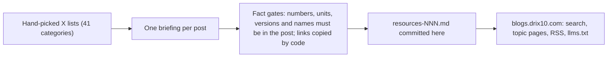

<div align="center">

<a href="https://blogs.drix10.com"></a>

<a href="https://github.com/Drix10/ai-resources/stargazers"></a>
<a href="https://github.com/Drix10/ai-resources/commits/main"></a>
<a href="https://www.npmjs.com/package/ai-resources-mcp"></a>
<a href="https://blogs.drix10.com/rss.xml"></a>
<a href="LICENSE"></a>

<b><a href="https://blogs.drix10.com">Read it</a></b> · <b><a href="#-resource-categories">Browse 41 categories</a></b> · <b><a href="#use-it-from-your-ai-agent">Plug it into your agent</a></b> · <b><a href="https://github.com/search?q=repo%3ADrix10%2Fai-resources+MCP&type=code">Search the archive</a></b>

</div>

<table>
<tr>
<td width="25%" valign="top"><b>Checked against the source</b><br><sub>A number, unit, model version or name that is not in the source post gets the briefing rejected and rewritten.</sub></td>
<td width="25%" valign="top"><b>Every claim has a link</b><br><sub>The original post and the page it points to, copied by code, never written by the model.</sub></td>
<td width="25%" valign="top"><b>41 categories</b><br><sub>Models, dev tools, research and funding, plus robotics, climate, quantum, security and crypto.</sub></td>
<td width="25%" valign="top"><b>Ready for your agent</b><br><sub>MCP server, Agent Skill, JSON API and llms.txt. Plain Markdown under CC BY 4.0.</sub></td>
</tr>
</table>

## Three ways in

<table>
<tr>
<td width="55%"><a href="https://blogs.drix10.com"></a></td>
<td width="45%" valign="top">
<h3><a href="https://blogs.drix10.com">Read it</a></h3>
The newest digests on <a href="https://blogs.drix10.com">blogs.drix10.com</a>, with search, topic pages and an <a href="https://blogs.drix10.com/rss.xml">RSS feed</a>. Or open any category <a href="#-resource-categories">below</a> and read its latest digest here on GitHub.
<br><br>
Star and watch the repo to get new digests as they land.
</td>
</tr>
<tr>
<td width="55%"><a href="USE-WITH-AI.md"></a></td>
<td width="45%" valign="top">
<h3><a href="#use-it-from-your-ai-agent">Ask it from your agent</a></h3>
Claude, Cursor, VS Code or Windsurf answer "what did Anthropic ship this week?" from the briefings, with dates and source links. No key, no account. <a href="#use-it-from-your-ai-agent">Setup for every client ↓</a>
<br><br>
<code>claude mcp add ai-resources -- npx -y ai-resources-mcp</code>
</td>
</tr>
<tr>
<td width="55%"></td>
<td width="45%" valign="top">
<h3>Clone it</h3>
100,000+ dated, sourced briefings in plain Markdown for RAG, evals or an offline index. Every <code>resources-NNN.md</code> holds 5 to 12 of them, like <a href="AI%20Developer%20Tools/resources-296.md">this one</a>.
<br><br>
<code>git clone --depth 1 https://github.com/Drix10/ai-resources</code>
</td>
</tr>
</table>

## What a briefing looks like

<a href="AI%20Developer%20Tools/resources-296.md"></a>
<p align="center"><sub>A real briefing from <a href="AI%20Developer%20Tools/resources-296.md">AI Developer Tools #296</a>. Every digest file holds 5 to 12 of these.</sub></p>

## Who it is for

- **Engineers building with AI.** What changed in models, inference, agents, MCP and dev tools, with the benchmark number and the link, in [AI Developer Tools](#ai-developer-tools) and [Tech Infrastructure](#tech-infrastructure).
- **Founders and investors.** Rounds, launches and revenue figures as they are announced, in [AI Companies and Ventures](#ai-companies-and-ventures), [VC Firms](#vc-firms) and [Founders and Entrepreneurs](#founders-and-entrepreneurs).
- **Researchers and students.** What the people in the field are publishing and arguing about, in [CS Academics](#cs-academics) and [Neuroscience and AI](#neuroscience-and-ai).
- **Anyone building RAG, agents or evals.** A 100,000-item corpus of dated, sourced AI news under CC BY 4.0.

Awesome lists are still the better pick for a vetted shortlist, and a newsletter for five editor-picked minutes a day. [COMPARISONS.md](COMPARISONS.md) lays out where this fits.

## Use it from your AI agent

Five ways to plug the briefings into an agent or your own code. None needs a key or an account. Full reference: **[USE-WITH-AI.md](USE-WITH-AI.md)**.

| Path | Best for | Setup |
| --- | --- | --- |
| [MCP server](#mcp-server) | Claude Code, Claude Desktop, Cursor, VS Code, Windsurf | one command or one JSON block |
| [Agent Skill](#agent-skill) | Claude Code and other Skill-aware agents | copy one folder |
| [JSON API](#json-api) | your own code, custom GPT actions, scripts | none, CORS open |
| [llms.txt and RSS](#llmstxt-and-rss) | any LLM that reads a URL, feed readers, bots | none |
| [Raw Markdown](#three-ways-in) | RAG, evals, offline indexes, all 100,000+ briefings | `git clone` |

### MCP server

<a href="https://www.npmjs.com/package/ai-resources-mcp"></a>
<a href="https://registry.modelcontextprotocol.io/v0/servers?search=io.github.Drix10/ai-resources"></a>


Published on npm as [`ai-resources-mcp`](https://www.npmjs.com/package/ai-resources-mcp) (MIT, code in [`mcp/`](mcp/)). `npx` fetches it on first run, so there is nothing to install by hand.

| Tool | What it does |
| --- | --- |
| `search_briefings(query, category?, limit?, since?)` | Keyword search, newest first. All words must match. `since` is `YYYY-MM-DD`. |
| `latest(category?, limit?)` | The newest briefings, overall or for one category. |
| `get_briefing(id)` | Full Markdown of one briefing (URL or slug), with every source link. |
| `list_categories()` | Every category slug with its briefing count. |

Every result ends with its source link and `Data: github.com/Drix10/ai-resources (CC BY 4.0)`, so answers stay citable.

**Claude Code**

```bash
claude mcp add ai-resources -- npx -y ai-resources-mcp
```

<details>
<summary><b>Claude Desktop, Cursor, Windsurf</b></summary>

<br>

Add this to `claude_desktop_config.json` (Claude Desktop: Settings → Developer → Edit Config), `~/.cursor/mcp.json` or `.cursor/mcp.json` (Cursor), or `~/.codeium/windsurf/mcp_config.json` (Windsurf):

```json
{
  "mcpServers": {
    "ai-resources": { "command": "npx", "args": ["-y", "ai-resources-mcp"] }
  }
}
```

</details>

<details>
<summary><b>VS Code</b></summary>

<br>

In `.vscode/mcp.json`, or *MCP: Open User Configuration*:

```json
{
  "servers": {
    "ai-resources": { "type": "stdio", "command": "npx", "args": ["-y", "ai-resources-mcp"] }
  }
}
```

Or from a terminal:

```bash
code --add-mcp "{\"name\":\"ai-resources\",\"command\":\"npx\",\"args\":[\"-y\",\"ai-resources-mcp\"]}"
```

</details>

<details>
<summary><b>Windows, and other settings</b></summary>

<br>

If a client cannot start `npx` on Windows, use `"command": "cmd", "args": ["/c", "npx", "-y", "ai-resources-mcp"]`.

`AI_RESOURCES_API_URL` sets the API base URL (default `https://blogs.drix10.com`).

</details>

Then ask, for example:

- *"What did Anthropic announce this week? Cite the sources."*
- *"Latest five briefings in AI Developer Tools."*
- *"Who raised a Series A in AI this month, and how much?"*

### Agent Skill

[`skills/ai-news`](skills/ai-news/SKILL.md) teaches an agent when and how to answer "what's new in AI", "latest on &lt;model or company&gt;" and "who raised" questions from the briefings, with dates and citations. It uses the MCP tools when they are installed and falls back to the JSON API, then llms.txt, then raw Markdown on GitHub when they are not.

```bash
git clone --depth 1 https://github.com/Drix10/ai-resources
mkdir -p ~/.claude/skills
cp -r ai-resources/skills/ai-news ~/.claude/skills/
```

<details>
<summary><b>One project only, Windows, other agents</b></summary>

<br>

- **One project:** copy it to `.claude/skills/ai-news/` inside that project instead.
- **Windows (PowerShell):** `Copy-Item -Recurse ai-resources\skills\ai-news $HOME\.claude\skills\`
- **Other agents** that read `SKILL.md` folders work the same way. For chat apps without Skills, paste the body of `SKILL.md` into the custom instructions.

</details>

### JSON API

Base URL `https://blogs.drix10.com`. JSON, CORS open, no key. It covers the briefings published on the blog; the full archive is in this repository.

| Request | Returns |
| --- | --- |
| `GET /api/articles?q=&category=&since=&limit=&page=` | `{ items, total, page, limit, totalPages, license }`, newest first. All words in `q` must match; every parameter is optional. |
| `GET /api/articles?slug=<slug or URL>` | One item, plus `content` (the full Markdown). |
| `GET /api/categories` | `{ items: [{ name, slug, count, url, llms }] }` |

Each item has `title`, `url`, `slug`, `category`, `categorySlug`, `date`, `description`, `headlines` (every news item in the briefing) and `sources` (`[{ title, url }]`, the original posts).

```bash
curl "https://blogs.drix10.com/api/articles?q=anthropic&since=2026-10-01&limit=5"
curl "https://blogs.drix10.com/api/categories"
```

### llms.txt and RSS

- [`/llms.txt`](https://blogs.drix10.com/llms.txt): the index, linking every category.
- `/llms/<category-slug>.txt`: the 50 newest briefings of one category, for example [`/llms/ai-developer-tools.txt`](https://blogs.drix10.com/llms/ai-developer-tools.txt).
- [`/rss.xml`](https://blogs.drix10.com/rss.xml): for feed readers, Slack or Discord feed bots and email-digest services.

When you show the data anywhere, credit it as `Data: github.com/Drix10/ai-resources (CC BY 4.0)`. The MCP server and the Skill add that line for you.

## By the numbers

Counted from this repository on 29 October 2026. The archive only grows.

| | |
| ---: | --- |
| **100,000+** | briefings: a headline, two or three sentences and the key numbers, one per post |
| **10,800+** | digest files (`resources-NNN.md`) across **41 categories** |
| **10,900+** | commits since November 2024, all made by an automated pipeline |
| **14,000+** | briefings that link both the original post and the page it points to (every briefing since mid-2026) |
| **~2,000** | of them published as articles on [blogs.drix10.com](https://blogs.drix10.com) with search, topic pages, an [RSS feed](https://blogs.drix10.com/rss.xml) and [llms.txt](https://blogs.drix10.com/llms.txt) |

## How it is built

Nobody types these. A pipeline reads the hand-picked X lists for each category, writes one briefing per strong post, runs the fact gates, strips secrets, de-duplicates across categories and commits the batch here. The same run refreshes the category list below and publishes to the blog.



**Known limits:** briefings are machine-written from public posts and can still be wrong; check the linked source before you rely on a number. Part of the older archive (2024 to mid-2026) predates source links. Coverage follows the hand-picked lists, blind spots included. Inclusion is not endorsement.

## Contribute

A pipeline writes the briefings. People pick the sources and fix what it gets wrong. Ways in:

- **Pick up a [good first issue](https://github.com/Drix10/ai-resources/issues?q=is%3Aissue+is%3Aopen+label%3A%22good+first+issue%22)**: MCP server tools, Skill phrasings, guides, examples, translations.
- **[Suggest a source](https://github.com/Drix10/ai-resources/issues/new?template=suggest-source.yml)** (an X account, list or site) or **[report a wrong fact](https://github.com/Drix10/ai-resources/issues/new?template=wrong-fact.yml)** with the briefing link.
- **Ask, share what you built, or float an idea** in [Discussions](https://github.com/Drix10/ai-resources/discussions).

[CONTRIBUTING.md](CONTRIBUTING.md) has the details, including what not to edit by hand. Content is CC BY 4.0; the MCP server code is MIT. If you use the archive in research, [CITATION.cff](CITATION.cff) has the citation.

## Star history

<a href="https://star-history.com/#Drix10/ai-resources&Date"></a>

## About the curator

Built and maintained by **[Drishtant Ghosh (Drix10)](https://drix10.com)**, an AI systems engineer and 1x acquired founder (ReeF, acquired August 2024) based in Bengaluru. Founder of CosLynx.com, AI systems architect on Canopy @ Founders, Inc., Backdrop Build v4 and v6 finalist. More writing at [blogs.drix10.com](https://blogs.drix10.com).

<!-- drix10-footer -->
---

<div align="center">

**Built by [Drishtant Ghosh (Drix10)](https://drix10.com)** · AI systems engineer and 1x acquired founder, Bengaluru

[Portfolio](https://drix10.com) · [LinkedIn](https://www.linkedin.com/in/drix10) · [X](https://x.com/DrishtantGhosh) · [Blog](https://blogs.drix10.com) · [All projects](https://github.com/Drix10)

<sub>More from Drix10: [Agent Flow](https://github.com/Drix10/agent-flow) (guardrails for AI coding agents) · [MiroHedge](https://github.com/Drix10/hypothesis-arena) (AI-assisted systematic fund) · [Guardian](https://github.com/Drix10/guardian-gpt) (UPI scam interceptor) · [Sentinel](https://github.com/Drix10/sentinal) (AI security CLI) · [Keystroke-LLM](https://github.com/Drix10/keystroke-llm) (NumPy transformer on a keyboard)</sub>

</div>

---

## 📚 Resource Categories

**11,114 digests in 41 categories.** Each category shows its newest headlines; jump to one:

<sub>[AI Developer Tools](#ai-developer-tools) · [AI Leaders and Thinkers](#ai-leaders-and-thinkers) · [AI Companies and Ventures](#ai-companies-and-ventures) · [CS Academics](#cs-academics) · [Tech VIPs](#tech-vips) · [VC Firms](#vc-firms) · [Devs, Designers, DevRel](#devs-designers-devrel) · [Tech Infrastructure](#tech-infrastructure) · [Founders and Entrepreneurs](#founders-and-entrepreneurs) · [AI Organizations and Media](#ai-organizations-and-media) · [AI Powered Film and Media](#ai-powered-film-and-media) · [AI Holodeck and Virtual Worlds](#ai-holodeck-and-virtual-worlds) · [AI Artists and Creators](#ai-artists-and-creators) · [AI in Healthcare and Science](#ai-in-healthcare-and-science) · [AI Generated Music and Audio](#ai-generated-music-and-audio) · [AI Consulting and Expertise](#ai-consulting-and-expertise) · [AI Professionals and Community](#ai-professionals-and-community) · [AI Policy and Ethical Considerations](#ai-policy-and-ethical-considerations) · [AI in Real Estate and Property Tech](#ai-in-real-estate-and-property-tech) · [AI and Robotics Applications](#ai-and-robotics-applications) · [AI Driven Vehicles and Transportation](#ai-driven-vehicles-and-transportation) · [AI for Content Creation and Marketing](#ai-for-content-creation-and-marketing) · [AR VR Companies and Development](#ar-vr-companies-and-development) · [AR VR Professionals and Community](#ar-vr-professionals-and-community) · [Climate and Weather Technology](#climate-and-weather-technology) · [Computer Vision and AI Applications](#computer-vision-and-ai-applications) · [Crypto and Web3](#crypto-and-web3) · [Decentralized AI](#decentralized-ai) · [The Exponential Future](#the-exponential-future) · [AI Education](#ai-education) · [AI in Enterprise Applications](#ai-in-enterprise-applications) · [Interesting Finds](#interesting-finds) · [Investors and Venture Capital](#investors-and-venture-capital) · [Cybersecurity and Tech](#cybersecurity-and-tech) · [Neuroscience and AI](#neuroscience-and-ai) · [PR and Communications](#pr-and-communications) · [Quantum Computing](#quantum-computing) · [Spatial Computing](#spatial-computing) · [Tech Companies and News](#tech-companies-and-news) · [Tech Journalists and VIPs](#tech-journalists-and-vips) · [World News and Updates](#world-news-and-updates)</sub>

### AI Developer Tools

<sub>306 digests · [latest: #309](https://github.com/Drix10/ai-resources/blob/main/AI%20Developer%20Tools/resources-309.md) · [read on the blog](https://blogs.drix10.com/categories/ai-developer-tools)</sub>

*   Meridian Air CivoE launches, 12B scores 85.5
*   HyperBEAM v0.11 releases fixes and speed improvements
*   AIsa creator search adds 329 creators, shortlists 12 US blanket sellers

### AI Leaders and Thinkers

<sub>299 digests · [latest: #299](https://github.com/Drix10/ai-resources/blob/main/AI%20Leaders%20and%20Thinkers/resources-299.md) · [read on the blog](https://blogs.drix10.com/categories/ai-leaders-and-thinkers)</sub>

*   Lightning AI CEO steps down, $2.5B merger, 25k H200 fleet launch
*   t3mp3st AI war machine scores 90.1% on xbow suite
*   XGBoost-metal on M5 Pro Mac mini speeds training 2.56x

### AI Companies and Ventures

<sub>297 digests · [latest: #297](https://github.com/Drix10/ai-resources/blob/main/AI%20Companies%20and%20Ventures/resources-297.md) · [read on the blog](https://blogs.drix10.com/categories/ai-companies-and-ventures)</sub>

*   Autonomous vulnerability pipeline validates 948 LPE bugs
*   Grand Challenges – five challenges with $1M prize
*   Stacks Project 16M-line formalization released

### CS Academics

<sub>310 digests · [latest: #310](https://github.com/Drix10/ai-resources/blob/main/CS%20Academics/resources-310.md) · [read on the blog](https://blogs.drix10.com/categories/cs-academics)</sub>

*   ERNIE 5.5 Flash Base open source with 280B parameters
*   JITEngine custom Apple Silicon engine up to 2.7× faster
*   frax.ik high-performance humanoid retargeting library announced, >100k FPS

### Tech VIPs

<sub>302 digests · [latest: #302](https://github.com/Drix10/ai-resources/blob/main/Tech%20VIPs/resources-302.md) · [read on the blog](https://blogs.drix10.com/categories/tech-vips)</sub>

*   Zipline raises $1.5B, signs Walmart contract for 300 supercenters
*   VFlash delivers 12x faster decoding, 5.1x robot speedup
*   slashapp crosses $500m revenue with under 100 staff

### VC Firms

<sub>300 digests · [latest: #300](https://github.com/Drix10/ai-resources/blob/main/VC%20Firms/resources-300.md) · [read on the blog](https://blogs.drix10.com/categories/vc-firms)</sub>

*   Tractian raises $130M Series D at $1.4B valuation
*   Agility begins trading on Nasdaq under ticker AGLT
*   GPT Image 2.6 now available on fal – new features listed

### Devs, Designers, DevRel

<sub>302 digests · [latest: #302](https://github.com/Drix10/ai-resources/blob/main/Devs%2C%20Designers%2C%20DevRel/resources-302.md) · [read on the blog](https://blogs.drix10.com/categories/devs-designers-devrel)</sub>

*   Phonon key-up latency 65 ms on M4 Max vs 520 ms Wispr Flow
*   REA for Growth – reverse-engineer any company's growth, $0.58 teardown
*   Isometric SF map released covering 1,300+ square miles

### Tech Infrastructure

<sub>277 digests · [latest: #277](https://github.com/Drix10/ai-resources/blob/main/Tech%20Infrastructure/resources-277.md) · [read on the blog](https://blogs.drix10.com/categories/tech-infrastructure)</sub>

*   Linux kernel local privilege escalation pipeline validates 948 bugs
*   Vertical Pod Autoscaler – team debugged critical incident
*   Airspace London 2026 event video release

### Founders and Entrepreneurs

<sub>268 digests · [latest: #268](https://github.com/Drix10/ai-resources/blob/main/Founders%20and%20Entrepreneurs/resources-268.md) · [read on the blog](https://blogs.drix10.com/categories/founders-and-entrepreneurs)</sub>

*   1WIN token live on Meteora, listing complete
*   Rails security updates released, critical image fix
*   Fiddler AI - CrowdStrike acquisition

### AI Organizations and Media

<sub>293 digests · [latest: #293](https://github.com/Drix10/ai-resources/blob/main/AI%20Organizations%20and%20Media/resources-293.md) · [read on the blog](https://blogs.drix10.com/categories/ai-organizations-and-media)</sub>

*   MoPort view-aware 2D interface achieves R@1 0.5674 on HumanML3D
*   Google $40 free API credits per month for Gemini
*   CSA astronaut Joshua Kutryk spacewalk installs roll-out solar array

### AI Powered Film and Media

<sub>276 digests · [latest: #276](https://github.com/Drix10/ai-resources/blob/main/AI%20Powered%20Film%20and%20Media/resources-276.md) · [read on the blog](https://blogs.drix10.com/categories/ai-powered-film-and-media)</sub>

*   4DAnyone creates 4D humans from single video, Turbo checkpoint 27 s per 121-frame
*   Incremental path to a software factory, levels 0-8

### AI Holodeck and Virtual Worlds

<sub>282 digests · [latest: #282](https://github.com/Drix10/ai-resources/blob/main/AI%20Holodeck%20and%20Virtual%20Worlds/resources-282.md) · [read on the blog](https://blogs.drix10.com/categories/ai-holodeck-and-virtual-worlds)</sub>

*   Claude add four hit effects with timing and displacement
*   GPT Image 2.6 on Pixazo API with Flare and Sunburst
*   YouMind Skill Paper Cutout Video Explainer – New Skill Launch

### AI Artists and Creators

<sub>275 digests · [latest: #275](https://github.com/Drix10/ai-resources/blob/main/AI%20Artists%20and%20Creators/resources-275.md) · [read on the blog](https://blogs.drix10.com/categories/ai-artists-and-creators)</sub>

*   Tesla Optimus and MicroDuck size contrast demo
*   Dreamina Seedance 2.5 used for AI music video creation
*   Grok Imagine song creation and Grok Bot video 2:58

### AI in Healthcare and Science

<sub>285 digests · [latest: #285](https://github.com/Drix10/ai-resources/blob/main/AI%20in%20Healthcare%20and%20Science/resources-285.md) · [read on the blog](https://blogs.drix10.com/categories/ai-in-healthcare-and-science)</sub>

*   Heart artery plaque shrinkage 21.1% vs 13.6% statin
*   tarlatamab in SCLC real-world data shows rw-PFS 2.3 mo
*   GSK showcases progress in liver portfolio at AASLD 2026

### AI Generated Music and Audio

<sub>282 digests · [latest: #282](https://github.com/Drix10/ai-resources/blob/main/AI%20Generated%20Music%20and%20Audio/resources-282.md) · [read on the blog](https://blogs.drix10.com/categories/ai-generated-music-and-audio)</sub>

*   Kimi K3.1 Pro on AMD Instinct MI355X – 2.8T params
*   GPT-Live 1 (Terra, low) ranks high overall despite low audio score
*   ElevenLabs uses Silencio for consent-cleared voice data

### AI Consulting and Expertise

<sub>274 digests · [latest: #274](https://github.com/Drix10/ai-resources/blob/main/AI%20Consulting%20and%20Expertise/resources-274.md) · [read on the blog](https://blogs.drix10.com/categories/ai-consulting-and-expertise)</sub>

*   tiny web tool calculates 7 follow-up dates and emails them, $299 in 28 min
*   Prompt: make your site readable by AI agents add prompts
*   Material Science Grand Challenges announced with $1M prize

### AI Professionals and Community

<sub>276 digests · [latest: #276](https://github.com/Drix10/ai-resources/blob/main/AI%20Professionals%20and%20Community/resources-276.md) · [read on the blog](https://blogs.drix10.com/categories/ai-professionals-and-community)</sub>

*   Flatiron Research Fellowship – 10 days left, 2-3 yr
*   Visual Token Routing up to 5.8x fewer visual tokens
*   Perplexity Teammates launch personal agents for work

### AI Policy and Ethical Considerations

<sub>270 digests · [latest: #270](https://github.com/Drix10/ai-resources/blob/main/AI%20Policy%20and%20Ethical%20Considerations/resources-270.md) · [read on the blog](https://blogs.drix10.com/categories/ai-policy-and-ethical-considerations)</sub>

*   NSF X-labs From Sequence to Function funding opportunity announced
*   Astra 10 billion tokens builds 3D embassy models

### AI in Real Estate and Property Tech

<sub>263 digests · [latest: #263](https://github.com/Drix10/ai-resources/blob/main/AI%20in%20Real%20Estate%20and%20Property%20Tech/resources-263.md) · [read on the blog](https://blogs.drix10.com/categories/ai-in-real-estate-and-property-tech)</sub>

*   TurboFieldfare runs Gemma 4 26B on 8GB Mac with ~2GB RAM
*   Strata 0.2.11 adds auto split engine, decode 186.8 tps
*   Jeff Studio Scene adds 24-hour cycle and nine building styles

### AI and Robotics Applications

<sub>280 digests · [latest: #280](https://github.com/Drix10/ai-resources/blob/main/AI%20and%20Robotics%20Applications/resources-280.md) · [read on the blog](https://blogs.drix10.com/categories/ai-and-robotics-applications)</sub>

*   Anchor 1 Precise and Stable Humanoid Control – 30–80% error reduction
*   VerneRobotics V0.5 released, leads LIBERO benchmark
*   OpenAI AI Model Discovers 948 Linux Kernel Vulnerabilities

### AI Driven Vehicles and Transportation

<sub>276 digests · [latest: #276](https://github.com/Drix10/ai-resources/blob/main/AI%20Driven%20Vehicles%20and%20Transportation/resources-276.md) · [read on the blog](https://blogs.drix10.com/categories/ai-driven-vehicles-and-transportation)</sub>

*   Shield to acquire Echodyne in a $5.3B transaction
*   Shield AI valuation $28.8B and Echodyne acquisition $5.3B
*   Moonshot seeks Nvidia Blackwell access in Europe, 8,000+ GPUs

### AI for Content Creation and Marketing

<sub>272 digests · [latest: #272](https://github.com/Drix10/ai-resources/blob/main/AI%20for%20Content%20Creation%20and%20Marketing/resources-272.md) · [read on the blog](https://blogs.drix10.com/categories/ai-for-content-creation-and-marketing)</sub>

*   Qlero 8.5× Google impressions with Okara
*   Bustle Digital Group AI Search playbook results
*   Teammates available now for Max subscribers on the web

### AR VR Companies and Development

<sub>269 digests · [latest: #269](https://github.com/Drix10/ai-resources/blob/main/AR%20VR%20Companies%20and%20Development/resources-269.md) · [read on the blog](https://blogs.drix10.com/categories/ar-vr-companies-and-development)</sub>

*   Meta Quest Link driver freeze fixed in NVIDIA v621.01
*   Claude maps first 3D structure of bacterial vault particle
*   Omarchy 4.5 adds full compatibility for M1 M2 M3 Neo

### AR VR Professionals and Community

<sub>266 digests · [latest: #266](https://github.com/Drix10/ai-resources/blob/main/AR%20VR%20Professionals%20and%20Community/resources-266.md) · [read on the blog](https://blogs.drix10.com/categories/ar-vr-professionals-and-community)</sub>

*   Higgsfield AI – 34 lighting styles guide released
*   CROPS Guide live on ETHBEAT adds Uniswap, safe, TornadoCash
*   ArcBrush node-based image editor with painting and 3D preview

### Climate and Weather Technology

<sub>265 digests · [latest: #265](https://github.com/Drix10/ai-resources/blob/main/Climate%20and%20Weather%20Technology/resources-265.md) · [read on the blog](https://blogs.drix10.com/categories/climate-and-weather-technology)</sub>

*   Air Products scraps $4.5B hydrogen project, $2.9B loss
*   Storm Prediction Center Day 2 Convective Outlook

### Computer Vision and AI Applications

<sub>269 digests · [latest: #269](https://github.com/Drix10/ai-resources/blob/main/Computer%20Vision%20and%20AI%20Applications/resources-269.md) · [read on the blog](https://blogs.drix10.com/categories/computer-vision-and-ai-applications)</sub>

*   Blinkit Ambulance charges non-emergency transfers ₹2,500
*   Gemini Omni 1.2 Flash adds 15-second video, $0.07/s
*   You don't need long context – compaction cuts context to 8K tokens

### Crypto and Web3

<sub>260 digests · [latest: #260](https://github.com/Drix10/ai-resources/blob/main/Crypto%20and%20Web3/resources-260.md) · [read on the blog](https://blogs.drix10.com/categories/crypto-and-web3)</sub>

*   Robinhood tokenized stocks on Morpho see 2x weekend price
*   Offline Protocol joins Zebra PartnerConnect
*   Leap mobile trading app launches early access today

### Decentralized AI

<sub>261 digests · [latest: #261](https://github.com/Drix10/ai-resources/blob/main/Decentralized%20AI/resources-261.md) · [read on the blog](https://blogs.drix10.com/categories/decentralized-ai)</sub>

*   Qubic science team releases 155,192 evolved AI brains
*   GEODNET network enables cm-level RTK for parking spaces
*   Firelight first layer of protection on LidoFinance EarnETH vaults 5.7% $12.1M

### The Exponential Future

<sub>262 digests · [latest: #262](https://github.com/Drix10/ai-resources/blob/main/The%20Exponential%20Future/resources-262.md) · [read on the blog](https://blogs.drix10.com/categories/the-exponential-future)</sub>

*   Inovio Pharmaceuticals long trade returns 118%
*   US midterms market ended close to start after sharp swings
*   Nasdaq 100 extends losses to -5.5%, near bear market

### AI Education

<sub>277 digests · [latest: #277](https://github.com/Drix10/ai-resources/blob/main/AI%20Education/resources-277.md) · [read on the blog](https://blogs.drix10.com/categories/ai-education)</sub>

*   Clemson launches Great Books department 120 scholarships
*   Free K–12 Curriculum for Digital Fluency – new activity drop 11/16
*   Descript Updates: Animate Text, Layouts, Search, and Skills

### AI in Enterprise Applications

<sub>267 digests · [latest: #267](https://github.com/Drix10/ai-resources/blob/main/AI%20in%20Enterprise%20Applications/resources-267.md) · [read on the blog](https://blogs.drix10.com/categories/ai-in-enterprise-applications)</sub>

*   Agentic Extraction 27 invoices to 494 rows in 73 s
*   GPT-6 Cyber launch scores 48.5% on ExploitGym
*   DeepSeek v4.1 Flash 3D retro TV built in 3h20m for under $1

### Interesting Finds

<sub>259 digests · [latest: #259](https://github.com/Drix10/ai-resources/blob/main/Interesting%20Finds/resources-259.md) · [read on the blog](https://blogs.drix10.com/categories/interesting-finds)</sub>

*   Zipline raised $1.5 billion, building nationwide drone delivery network
*   Regent Viceroy prototype high-cadence flight testing expands envelope

### Investors and Venture Capital

<sub>257 digests · [latest: #257](https://github.com/Drix10/ai-resources/blob/main/Investors%20and%20Venture%20Capital/resources-257.md) · [read on the blog](https://blogs.drix10.com/categories/investors-and-venture-capital)</sub>

*   Venture funds 10,000 new 2019-2022, most won’t raise second
*   Astra $500 tokens chip-level logic FPGA Satellite TV receiver

### Cybersecurity and Tech

<sub>240 digests · [latest: #240](https://github.com/Drix10/ai-resources/blob/main/Cybersecurity%20and%20Tech/resources-240.md) · [read on the blog](https://blogs.drix10.com/categories/cybersecurity-and-tech)</sub>

*   InsecureNature to speak on Stolen API Keys Fuel Model Distillation at NahamCon November 20
*   ARTEX testing round 2 with MDE on W11 and caching gateway
*   OffSec Learn Enterprise moves beyond one-and-done training

### Neuroscience and AI

<sub>248 digests · [latest: #248](https://github.com/Drix10/ai-resources/blob/main/Neuroscience%20and%20AI/resources-248.md) · [read on the blog](https://blogs.drix10.com/categories/neuroscience-and-ai)</sub>

*   Castration extends male mouse lifespan by >30%
*   Imaging exoplanets below the telescope stability limit – 2–15× sensitivity gain
*   MayoClinic study finds crafting cuts risk 42% of mild cognitive impairment

### PR and Communications

<sub>246 digests · [latest: #246](https://github.com/Drix10/ai-resources/blob/main/PR%20and%20Communications/resources-246.md) · [read on the blog](https://blogs.drix10.com/categories/pr-and-communications)</sub>

*   Axiom Math formally verified Stacks Project, 16 million lines
*   Lele Sadoughi brand launches 38-piece Ulta line
*   Camp Snap CS-8 Mini launch with 2.7K video and $149.99 price

### Quantum Computing

<sub>246 digests · [latest: #246](https://github.com/Drix10/ai-resources/blob/main/Quantum%20Computing/resources-246.md) · [read on the blog](https://blogs.drix10.com/categories/quantum-computing)</sub>

*   Xanadu QROM dense encoding cuts compute 4x
*   Quantum teleportation 1,200 km Earth-satellite link (2017)
*   Quantinuum Nexus roadmap unveiled for fault-tolerant era

### Spatial Computing

<sub>243 digests · [latest: #243](https://github.com/Drix10/ai-resources/blob/main/Spatial%20Computing/resources-243.md) · [read on the blog](https://blogs.drix10.com/categories/spatial-computing)</sub>

*   Cubiques now free on Meta Store with 70 puzzles
*   Gracia Plugin for Unreal Engine adds 4D Gaussian Splatting
*   Opus 5.5 build on PICO new device in hours

### Tech Companies and News

<sub>239 digests · [latest: #239](https://github.com/Drix10/ai-resources/blob/main/Tech%20Companies%20and%20News/resources-239.md) · [read on the blog](https://blogs.drix10.com/categories/tech-companies-and-news)</sub>

*   Eon Yukon launch: serverless engine at 1M events/sec
*   RAMBO air-gapped PC data exfiltration 1000 bits per second
*   Drip acquisition announcement – Drip acquired by unknown buyer, also Sleeknote acquired

### Tech Journalists and VIPs

<sub>241 digests · [latest: #241](https://github.com/Drix10/ai-resources/blob/main/Tech%20Journalists%20and%20VIPs/resources-241.md) · [read on the blog](https://blogs.drix10.com/categories/tech-journalists-and-vips)</sub>

*   Daytonaio hits $100M run rate, raises $60M at $1B
*   Grand Challenges in Material Science announced, $1M prize
*   Polemos launch – AI-guided networked precision strike system

### World News and Updates

<sub>234 digests · [latest: #234](https://github.com/Drix10/ai-resources/blob/main/World%20News%20and%20Updates/resources-234.md) · [read on the blog](https://blogs.drix10.com/categories/world-news-and-updates)</sub>

*   LIV Golf shutdown pending bankruptcy as rescue fails
*   LIV Golf to liquidate after investor pulls funding

---

<div align="center">

[Star the repo](https://github.com/Drix10/ai-resources) to keep it handy and help others find it, or [suggest a source](https://github.com/Drix10/ai-resources/issues/new/choose).

[Read on the blog](https://blogs.drix10.com) · [RSS feed](https://blogs.drix10.com/rss.xml) · [Use it from your AI agent](https://github.com/Drix10/ai-resources/blob/main/USE-WITH-AI.md)

<sub>Summaries © Drishtant Ghosh, licensed [CC BY 4.0](LICENSE). Every digest links to its original post where one exists; the posts and linked pages belong to their authors.</sub>

</div>
