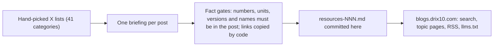

<div align="center">

<a href="https://blogs.drix10.com"></a>

<a href="https://github.com/Drix10/ai-resources/stargazers"></a>
<a href="https://github.com/Drix10/ai-resources/commits/main"></a>
<a href="https://www.npmjs.com/package/ai-resources-mcp"></a>
<a href="https://blogs.drix10.com/rss.xml"></a>
<a href="LICENSE"></a>

<b><a href="https://blogs.drix10.com">Read it</a></b> · <b><a href="#-resource-categories">Browse 41 categories</a></b> · <b><a href="#use-it-from-your-ai-agent">Plug it into your agent</a></b> · <b><a href="https://github.com/search?q=repo%3ADrix10%2Fai-resources+MCP&type=code">Search the archive</a></b>

</div>

<table>
<tr>
<td width="25%" valign="top"><b>Checked against the source</b><br><sub>A number, unit, model version or name that is not in the source post gets the briefing rejected and rewritten.</sub></td>
<td width="25%" valign="top"><b>Every claim has a link</b><br><sub>The original post and the page it points to, copied by code, never written by the model.</sub></td>
<td width="25%" valign="top"><b>41 categories</b><br><sub>Models, dev tools, research and funding, plus robotics, climate, quantum, security and crypto.</sub></td>
<td width="25%" valign="top"><b>Ready for your agent</b><br><sub>MCP server, Agent Skill, JSON API and llms.txt. Plain Markdown under CC BY 4.0.</sub></td>
</tr>
</table>

## Three ways in

<table>
<tr>
<td width="55%"><a href="https://blogs.drix10.com"></a></td>
<td width="45%" valign="top">
<h3><a href="https://blogs.drix10.com">Read it</a></h3>
The newest digests on <a href="https://blogs.drix10.com">blogs.drix10.com</a>, with search, topic pages and an <a href="https://blogs.drix10.com/rss.xml">RSS feed</a>. Or open any category <a href="#-resource-categories">below</a> and read its latest digest here on GitHub.
<br><br>
Star and watch the repo to get new digests as they land.
</td>
</tr>
<tr>
<td width="55%"><a href="USE-WITH-AI.md"></a></td>
<td width="45%" valign="top">
<h3><a href="#use-it-from-your-ai-agent">Ask it from your agent</a></h3>
Claude, Cursor, VS Code or Windsurf answer "what did Anthropic ship this week?" from the briefings, with dates and source links. No key, no account. <a href="#use-it-from-your-ai-agent">Setup for every client ↓</a>
<br><br>
<code>claude mcp add ai-resources -- npx -y ai-resources-mcp</code>
</td>
</tr>
<tr>
<td width="55%"></td>
<td width="45%" valign="top">
<h3>Clone it</h3>
100,000+ dated, sourced briefings in plain Markdown for RAG, evals or an offline index. Every <code>resources-NNN.md</code> holds 5 to 12 of them, like <a href="AI%20Developer%20Tools/resources-296.md">this one</a>.
<br><br>
<code>git clone --depth 1 https://github.com/Drix10/ai-resources</code>
</td>
</tr>
</table>

## What a briefing looks like

<a href="AI%20Developer%20Tools/resources-296.md"></a>
<p align="center"><sub>A real briefing from <a href="AI%20Developer%20Tools/resources-296.md">AI Developer Tools #296</a>. Every digest file holds 5 to 12 of these.</sub></p>

## Who it is for

- **Engineers building with AI.** What changed in models, inference, agents, MCP and dev tools, with the benchmark number and the link, in [AI Developer Tools](#ai-developer-tools) and [Tech Infrastructure](#tech-infrastructure).
- **Founders and investors.** Rounds, launches and revenue figures as they are announced, in [AI Companies and Ventures](#ai-companies-and-ventures), [VC Firms](#vc-firms) and [Founders and Entrepreneurs](#founders-and-entrepreneurs).
- **Researchers and students.** What the people in the field are publishing and arguing about, in [CS Academics](#cs-academics) and [Neuroscience and AI](#neuroscience-and-ai).
- **Anyone building RAG, agents or evals.** A 100,000-item corpus of dated, sourced AI news under CC BY 4.0.

Awesome lists are still the better pick for a vetted shortlist, and a newsletter for five editor-picked minutes a day. [COMPARISONS.md](COMPARISONS.md) lays out where this fits.

## Use it from your AI agent

Five ways to plug the briefings into an agent or your own code. None needs a key or an account. Full reference: **[USE-WITH-AI.md](USE-WITH-AI.md)**.

| Path | Best for | Setup |
| --- | --- | --- |
| [MCP server](#mcp-server) | Claude Code, Claude Desktop, Cursor, VS Code, Windsurf | one command or one JSON block |
| [Agent Skill](#agent-skill) | Claude Code and other Skill-aware agents | copy one folder |
| [JSON API](#json-api) | your own code, custom GPT actions, scripts | none, CORS open |
| [llms.txt and RSS](#llmstxt-and-rss) | any LLM that reads a URL, feed readers, bots | none |
| [Raw Markdown](#three-ways-in) | RAG, evals, offline indexes, all 100,000+ briefings | `git clone` |

### MCP server

<a href="https://www.npmjs.com/package/ai-resources-mcp"></a>
<a href="https://registry.modelcontextprotocol.io/v0/servers?search=io.github.Drix10/ai-resources"></a>


Published on npm as [`ai-resources-mcp`](https://www.npmjs.com/package/ai-resources-mcp) (MIT, code in [`mcp/`](mcp/)). `npx` fetches it on first run, so there is nothing to install by hand.

| Tool | What it does |
| --- | --- |
| `search_briefings(query, category?, limit?, since?)` | Keyword search, newest first. All words must match. `since` is `YYYY-MM-DD`. |
| `latest(category?, limit?)` | The newest briefings, overall or for one category. |
| `get_briefing(id)` | Full Markdown of one briefing (URL or slug), with every source link. |
| `list_categories()` | Every category slug with its briefing count. |

Every result ends with its source link and `Data: github.com/Drix10/ai-resources (CC BY 4.0)`, so answers stay citable.

**Claude Code**

```bash
claude mcp add ai-resources -- npx -y ai-resources-mcp
```

<details>
<summary><b>Claude Desktop, Cursor, Windsurf</b></summary>

<br>

Add this to `claude_desktop_config.json` (Claude Desktop: Settings → Developer → Edit Config), `~/.cursor/mcp.json` or `.cursor/mcp.json` (Cursor), or `~/.codeium/windsurf/mcp_config.json` (Windsurf):

```json
{
  "mcpServers": {
    "ai-resources": { "command": "npx", "args": ["-y", "ai-resources-mcp"] }
  }
}
```

</details>

<details>
<summary><b>VS Code</b></summary>

<br>

In `.vscode/mcp.json`, or *MCP: Open User Configuration*:

```json
{
  "servers": {
    "ai-resources": { "type": "stdio", "command": "npx", "args": ["-y", "ai-resources-mcp"] }
  }
}
```

Or from a terminal:

```bash
code --add-mcp "{\"name\":\"ai-resources\",\"command\":\"npx\",\"args\":[\"-y\",\"ai-resources-mcp\"]}"
```

</details>

<details>
<summary><b>Windows, and other settings</b></summary>

<br>

If a client cannot start `npx` on Windows, use `"command": "cmd", "args": ["/c", "npx", "-y", "ai-resources-mcp"]`.

`AI_RESOURCES_API_URL` sets the API base URL (default `https://blogs.drix10.com`).

</details>

Then ask, for example:

- *"What did Anthropic announce this week? Cite the sources."*
- *"Latest five briefings in AI Developer Tools."*
- *"Who raised a Series A in AI this month, and how much?"*

### Agent Skill

[`skills/ai-news`](skills/ai-news/SKILL.md) teaches an agent when and how to answer "what's new in AI", "latest on &lt;model or company&gt;" and "who raised" questions from the briefings, with dates and citations. It uses the MCP tools when they are installed and falls back to the JSON API, then llms.txt, then raw Markdown on GitHub when they are not.

```bash
git clone --depth 1 https://github.com/Drix10/ai-resources
mkdir -p ~/.claude/skills
cp -r ai-resources/skills/ai-news ~/.claude/skills/
```

<details>
<summary><b>One project only, Windows, other agents</b></summary>

<br>

- **One project:** copy it to `.claude/skills/ai-news/` inside that project instead.
- **Windows (PowerShell):** `Copy-Item -Recurse ai-resources\skills\ai-news $HOME\.claude\skills\`
- **Other agents** that read `SKILL.md` folders work the same way. For chat apps without Skills, paste the body of `SKILL.md` into the custom instructions.

</details>

### JSON API

Base URL `https://blogs.drix10.com`. JSON, CORS open, no key. It covers the briefings published on the blog; the full archive is in this repository.

| Request | Returns |
| --- | --- |
| `GET /api/articles?q=&category=&since=&limit=&page=` | `{ items, total, page, limit, totalPages, license }`, newest first. All words in `q` must match; every parameter is optional. |
| `GET /api/articles?slug=<slug or URL>` | One item, plus `content` (the full Markdown). |
| `GET /api/categories` | `{ items: [{ name, slug, count, url, llms }] }` |

Each item has `title`, `url`, `slug`, `category`, `categorySlug`, `date`, `description`, `headlines` (every news item in the briefing) and `sources` (`[{ title, url }]`, the original posts).

```bash
curl "https://blogs.drix10.com/api/articles?q=anthropic&since=2026-10-01&limit=5"
curl "https://blogs.drix10.com/api/categories"
```

### llms.txt and RSS

- [`/llms.txt`](https://blogs.drix10.com/llms.txt): the index, linking every category.
- `/llms/<category-slug>.txt`: the 50 newest briefings of one category, for example [`/llms/ai-developer-tools.txt`](https://blogs.drix10.com/llms/ai-developer-tools.txt).
- [`/rss.xml`](https://blogs.drix10.com/rss.xml): for feed readers, Slack or Discord feed bots and email-digest services.

When you show the data anywhere, credit it as `Data: github.com/Drix10/ai-resources (CC BY 4.0)`. The MCP server and the Skill add that line for you.

## By the numbers

Counted from this repository on 29 October 2026. The archive only grows.

| | |
| ---: | --- |
| **100,000+** | briefings: a headline, two or three sentences and the key numbers, one per post |
| **10,800+** | digest files (`resources-NNN.md`) across **41 categories** |
| **10,900+** | commits since November 2024, all made by an automated pipeline |
| **14,000+** | briefings that link both the original post and the page it points to (every briefing since mid-2026) |
| **~2,000** | of them published as articles on [blogs.drix10.com](https://blogs.drix10.com) with search, topic pages, an [RSS feed](https://blogs.drix10.com/rss.xml) and [llms.txt](https://blogs.drix10.com/llms.txt) |

## How it is built

Nobody types these. A pipeline reads the hand-picked X lists for each category, writes one briefing per strong post, runs the fact gates, strips secrets, de-duplicates across categories and commits the batch here. The same run refreshes the category list below and publishes to the blog.



**Known limits:** briefings are machine-written from public posts and can still be wrong; check the linked source before you rely on a number. Part of the older archive (2024 to mid-2026) predates source links. Coverage follows the hand-picked lists, blind spots included. Inclusion is not endorsement.

## Contribute

A pipeline writes the briefings. People pick the sources and fix what it gets wrong. Ways in:

- **Pick up a [good first issue](https://github.com/Drix10/ai-resources/issues?q=is%3Aissue+is%3Aopen+label%3A%22good+first+issue%22)**: MCP server tools, Skill phrasings, guides, examples, translations.
- **[Suggest a source](https://github.com/Drix10/ai-resources/issues/new?template=suggest-source.yml)** (an X account, list or site) or **[report a wrong fact](https://github.com/Drix10/ai-resources/issues/new?template=wrong-fact.yml)** with the briefing link.
- **Ask, share what you built, or float an idea** in [Discussions](https://github.com/Drix10/ai-resources/discussions).

[CONTRIBUTING.md](CONTRIBUTING.md) has the details, including what not to edit by hand. Content is CC BY 4.0; the MCP server code is MIT. If you use the archive in research, [CITATION.cff](CITATION.cff) has the citation.

## Star history

<a href="https://star-history.com/#Drix10/ai-resources&Date"></a>

## About the curator

Built and maintained by **[Drishtant Ghosh (Drix10)](https://drix10.com)**, an AI systems engineer and 1x acquired founder (ReeF, acquired August 2024) based in Bengaluru. Founder of CosLynx.com, AI systems architect on Canopy @ Founders, Inc., Backdrop Build v4 and v6 finalist. More writing at [blogs.drix10.com](https://blogs.drix10.com).

<!-- drix10-footer -->
---

<div align="center">

**Built by [Drishtant Ghosh (Drix10)](https://drix10.com)** · AI systems engineer and 1x acquired founder, Bengaluru

[Portfolio](https://drix10.com) · [LinkedIn](https://www.linkedin.com/in/drix10) · [X](https://x.com/DrishtantGhosh) · [Blog](https://blogs.drix10.com) · [All projects](https://github.com/Drix10)

<sub>More from Drix10: [Agent Flow](https://github.com/Drix10/agent-flow) (guardrails for AI coding agents) · [MiroHedge](https://github.com/Drix10/hypothesis-arena) (AI-assisted systematic fund) · [Guardian](https://github.com/Drix10/guardian-gpt) (UPI scam interceptor) · [Sentinel](https://github.com/Drix10/sentinal) (AI security CLI) · [Keystroke-LLM](https://github.com/Drix10/keystroke-llm) (NumPy transformer on a keyboard)</sub>

</div>

---

## 📚 Resource Categories

**10,966 digests in 41 categories.** Each category shows its newest headlines; jump to one:

<sub>[AI Developer Tools](#ai-developer-tools) · [AI Leaders and Thinkers](#ai-leaders-and-thinkers) · [AI Companies and Ventures](#ai-companies-and-ventures) · [CS Academics](#cs-academics) · [Tech VIPs](#tech-vips) · [VC Firms](#vc-firms) · [Devs, Designers, DevRel](#devs-designers-devrel) · [Tech Infrastructure](#tech-infrastructure) · [Founders and Entrepreneurs](#founders-and-entrepreneurs) · [AI Organizations and Media](#ai-organizations-and-media) · [AI Powered Film and Media](#ai-powered-film-and-media) · [AI Holodeck and Virtual Worlds](#ai-holodeck-and-virtual-worlds) · [AI Artists and Creators](#ai-artists-and-creators) · [AI in Healthcare and Science](#ai-in-healthcare-and-science) · [AI Generated Music and Audio](#ai-generated-music-and-audio) · [AI Consulting and Expertise](#ai-consulting-and-expertise) · [AI Professionals and Community](#ai-professionals-and-community) · [AI Policy and Ethical Considerations](#ai-policy-and-ethical-considerations) · [AI in Real Estate and Property Tech](#ai-in-real-estate-and-property-tech) · [AI and Robotics Applications](#ai-and-robotics-applications) · [AI Driven Vehicles and Transportation](#ai-driven-vehicles-and-transportation) · [AI for Content Creation and Marketing](#ai-for-content-creation-and-marketing) · [AR VR Companies and Development](#ar-vr-companies-and-development) · [AR VR Professionals and Community](#ar-vr-professionals-and-community) · [Climate and Weather Technology](#climate-and-weather-technology) · [Computer Vision and AI Applications](#computer-vision-and-ai-applications) · [Crypto and Web3](#crypto-and-web3) · [Decentralized AI](#decentralized-ai) · [The Exponential Future](#the-exponential-future) · [AI Education](#ai-education) · [AI in Enterprise Applications](#ai-in-enterprise-applications) · [Interesting Finds](#interesting-finds) · [Investors and Venture Capital](#investors-and-venture-capital) · [Cybersecurity and Tech](#cybersecurity-and-tech) · [Neuroscience and AI](#neuroscience-and-ai) · [PR and Communications](#pr-and-communications) · [Quantum Computing](#quantum-computing) · [Spatial Computing](#spatial-computing) · [Tech Companies and News](#tech-companies-and-news) · [Tech Journalists and VIPs](#tech-journalists-and-vips) · [World News and Updates](#world-news-and-updates)</sub>

### AI Developer Tools

<sub>302 digests · [latest: #305](https://github.com/Drix10/ai-resources/blob/main/AI%20Developer%20Tools/resources-305.md) · [read on the blog](https://blogs.drix10.com/categories/ai-developer-tools)</sub>

*   Frameo Cyber Pandemic kit finds 620,654 arXiv PDFs
*   Sim reaches 30k GitHub stars, announces open-source agent project
*   Pirate Face adds 1000 model torrents to Community torrents

### AI Leaders and Thinkers

<sub>295 digests · [latest: #295](https://github.com/Drix10/ai-resources/blob/main/AI%20Leaders%20and%20Thinkers/resources-295.md) · [read on the blog](https://blogs.drix10.com/categories/ai-leaders-and-thinkers)</sub>

*   Anthropic paper shows 0.1% poisoning plants RCE backdoor
*   Holon-S1 predicts genes from slides, beats models
*   L3G-World memory grows with scene, 9 fps real-time

### AI Companies and Ventures

<sub>293 digests · [latest: #293](https://github.com/Drix10/ai-resources/blob/main/AI%20Companies%20and%20Ventures/resources-293.md) · [read on the blog](https://blogs.drix10.com/categories/ai-companies-and-ventures)</sub>

*   Starcloud data centers cost $500 per kilo to orbit
*   Ivanti Connect Secure zero-day chain exploits auth bypass
*   Hyper3D.AI WebGPU renderer adds real-time path tracing

### CS Academics

<sub>306 digests · [latest: #306](https://github.com/Drix10/ai-resources/blob/main/CS%20Academics/resources-306.md) · [read on the blog](https://blogs.drix10.com/categories/cs-academics)</sub>

*   PlanAssist adds 12 councils, cuts time 58%
*   Gemini 4 Carbon debuts at #1 on APEX-Agents with 90%+ mean
*   Loop Scaling paper reports 1B-parameter models, 32 loops

### Tech VIPs

<sub>298 digests · [latest: #298](https://github.com/Drix10/ai-resources/blob/main/Tech%20VIPs/resources-298.md) · [read on the blog](https://blogs.drix10.com/categories/tech-vips)</sub>

*   North Korea Responsible for $6 Billion+ Binance Attack
*   loccount release 2.26 adds 772 languages support
*   Mounjaro $10.7B sales, retatrutide phase 3 results

### VC Firms

<sub>296 digests · [latest: #296](https://github.com/Drix10/ai-resources/blob/main/VC%20Firms/resources-296.md) · [read on the blog](https://blogs.drix10.com/categories/vc-firms)</sub>

*   Y Combinator Winter ’27 application – $500K funding, $12M+ tokens & credits
*   Caldwell Partners (TSX: CWL) best pick at $0.74
*   ernd_ai launch in Y Combinator F26 batch, priority GPUs coming

### Devs, Designers, DevRel

<sub>298 digests · [latest: #298](https://github.com/Drix10/ai-resources/blob/main/Devs%2C%20Designers%2C%20DevRel/resources-298.md) · [read on the blog](https://blogs.drix10.com/categories/devs-designers-devrel)</sub>

*   Crypto hack - $5.57B stolen, $2.39B frozen
*   Mistral Large 4 ranks second on Coding Agent Index
*   Faros AI analysis shows PR size up 71.8%

### Tech Infrastructure

<sub>273 digests · [latest: #273](https://github.com/Drix10/ai-resources/blob/main/Tech%20Infrastructure/resources-273.md) · [read on the blog](https://blogs.drix10.com/categories/tech-infrastructure)</sub>

*   AtlasCore $10.97M victim deposits in fake prediction markets
*   Distributed inference shifts data center fabric demands to 1.6 Tbps per GPU
*   Microsoft delivers strong Q3, Azure up 48% and Cloud $63.9B

### Founders and Entrepreneurs

<sub>265 digests · [latest: #265](https://github.com/Drix10/ai-resources/blob/main/Founders%20and%20Entrepreneurs/resources-265.md) · [read on the blog](https://blogs.drix10.com/categories/founders-and-entrepreneurs)</sub>

*   Particle particle-1 launches with ~45% token reduction
*   App Store 51 apps removed, 15 AI editors
*   Better Auth security release scheduled for Tuesday November 3 2026

### AI Organizations and Media

<sub>289 digests · [latest: #289](https://github.com/Drix10/ai-resources/blob/main/AI%20Organizations%20and%20Media/resources-289.md) · [read on the blog](https://blogs.drix10.com/categories/ai-organizations-and-media)</sub>

*   Meta Max humanoid robot prototype built in 3 months
*   Neuron Studio runs Qwen3.5-4B in browser, 2.91GB download
*   Halloween Special Stream Update – Live on Roku and AppleTV via AlchemyStream

### AI Powered Film and Media

<sub>273 digests · [latest: #273](https://github.com/Drix10/ai-resources/blob/main/AI%20Powered%20Film%20and%20Media/resources-273.md) · [read on the blog](https://blogs.drix10.com/categories/ai-powered-film-and-media)</sub>

*   Binance hacked, $5.6 billion stolen from assets
*   Pika H3 Flex early access: 15s video in 7s
*   Binance hack $5.7 billion outflows across networks

### AI Holodeck and Virtual Worlds

<sub>278 digests · [latest: #278](https://github.com/Drix10/ai-resources/blob/main/AI%20Holodeck%20and%20Virtual%20Worlds/resources-278.md) · [read on the blog](https://blogs.drix10.com/categories/ai-holodeck-and-virtual-worlds)</sub>

*   Seedance 2 credit usage and Seedance 2.5 credit usage
*   Nvidia invests $3B in Meta as Meta raises $95B for AI
*   FLUX 3 Image Klein – LoRA training guide released

### AI Artists and Creators

<sub>273 digests · [latest: #273](https://github.com/Drix10/ai-resources/blob/main/AI%20Artists%20and%20Creators/resources-273.md) · [read on the blog](https://blogs.drix10.com/categories/ai-artists-and-creators)</sub>

*   dsh-superagent agent framework for GitHub issues and PRs
*   Nano Banana Pro animation with Kling 4.0 doors

### AI in Healthcare and Science

<sub>281 digests · [latest: #281](https://github.com/Drix10/ai-resources/blob/main/AI%20in%20Healthcare%20and%20Science/resources-281.md) · [read on the blog](https://blogs.drix10.com/categories/ai-in-healthcare-and-science)</sub>

*   Retatrutide weight loss results 45.3% lose 30%+
*   Checkpoint immunotherapy reorganized cells in melanoma
*   GLiFormer large missed disease mentions, fine-tune found them

### AI Generated Music and Audio

<sub>278 digests · [latest: #278](https://github.com/Drix10/ai-resources/blob/main/AI%20Generated%20Music%20and%20Audio/resources-278.md) · [read on the blog](https://blogs.drix10.com/categories/ai-generated-music-and-audio)</sub>

*   Riverside crosses $100M ARR milestone
*   Neural Thickets – random logit bias matches weight perturbations gains
*   Lumens LightPads launch with 16 pads, zero wiring

### AI Consulting and Expertise

<sub>270 digests · [latest: #270](https://github.com/Drix10/ai-resources/blob/main/AI%20Consulting%20and%20Expertise/resources-270.md) · [read on the blog](https://blogs.drix10.com/categories/ai-consulting-and-expertise)</sub>

*   Anthropic paper shows 0.1% data poison creates backdoor
*   torch.index_add_ fingerprint exact GPU identity
*   FlashAlign abliterates per request, no permanent changes

### AI Professionals and Community

<sub>272 digests · [latest: #272](https://github.com/Drix10/ai-resources/blob/main/AI%20Professionals%20and%20Community/resources-272.md) · [read on the blog](https://blogs.drix10.com/categories/ai-professionals-and-community)</sub>

*   Mage 4B agent released, scores 66% on OSWorld-Verified
*   Qwenputer Qwen3.5-4B with RISC-V CPU inside weights
*   Bruce Booth article: AI drug design crowds 37 targets

### AI Policy and Ethical Considerations

<sub>268 digests · [latest: #268](https://github.com/Drix10/ai-resources/blob/main/AI%20Policy%20and%20Ethical%20Considerations/resources-268.md) · [read on the blog](https://blogs.drix10.com/categories/ai-policy-and-ethical-considerations)</sub>

*   eyes on everything system monitors frontier rollouts
*   Claude agent ran on DoD network for two months

### AI in Real Estate and Property Tech

<sub>259 digests · [latest: #259](https://github.com/Drix10/ai-resources/blob/main/AI%20in%20Real%20Estate%20and%20Property%20Tech/resources-259.md) · [read on the blog](https://blogs.drix10.com/categories/ai-in-real-estate-and-property-tech)</sub>

*   Why Radical Honesty And Building Trust Are Essential To AI's Future
*   TestFit Garden Walkup Luxury preset dropped on Salt Lake City parcel

### AI and Robotics Applications

<sub>276 digests · [latest: #276](https://github.com/Drix10/ai-resources/blob/main/AI%20and%20Robotics%20Applications/resources-276.md) · [read on the blog](https://blogs.drix10.com/categories/ai-and-robotics-applications)</sub>

*   Meta Max prototype built in three months
*   Zeen creative social app launch for folding-physics zines
*   Playground – new demo videos and platform support

### AI Driven Vehicles and Transportation

<sub>272 digests · [latest: #272](https://github.com/Drix10/ai-resources/blob/main/AI%20Driven%20Vehicles%20and%20Transportation/resources-272.md) · [read on the blog](https://blogs.drix10.com/categories/ai-driven-vehicles-and-transportation)</sub>

*   L3G-World KAIST world model memory 3D Gaussians 9 fps
*   World Labs Gaussian splats from Marble worlds, 20 min
*   comma_ai four Autopilot visualization accuracy

### AI for Content Creation and Marketing

<sub>268 digests · [latest: #268](https://github.com/Drix10/ai-resources/blob/main/AI%20for%20Content%20Creation%20and%20Marketing/resources-268.md) · [read on the blog](https://blogs.drix10.com/categories/ai-for-content-creation-and-marketing)</sub>

*   Kino – beta user issue list fixed and Smash Bros Melee ported
*   Copy Pose launch – drag a photo to match its pose
*   Pictory AI MCP Server API connects AI tools with Pictory

### AR VR Companies and Development

<sub>266 digests · [latest: #266](https://github.com/Drix10/ai-resources/blob/main/AR%20VR%20Companies%20and%20Development/resources-266.md) · [read on the blog](https://blogs.drix10.com/categories/ar-vr-companies-and-development)</sub>

*   Forefront coming to PlayStation VR2 November 5 launch
*   Raven Prism $1,499 price, $49 reservation
*   EXOSHOCK launches on Quest & PC VR in Early Access

### AR VR Professionals and Community

<sub>262 digests · [latest: #262](https://github.com/Drix10/ai-resources/blob/main/AR%20VR%20Professionals%20and%20Community/resources-262.md) · [read on the blog](https://blogs.drix10.com/categories/ar-vr-professionals-and-community)</sub>

*   Samsung reports $56B net profit this quarter
*   Binance hack $5.7B outflows across Ethereum Bitcoin TRON
*   Sin & Punishment VR – playable on Quest 3 with 60 fps

### Climate and Weather Technology

<sub>261 digests · [latest: #261](https://github.com/Drix10/ai-resources/blob/main/Climate%20and%20Weather%20Technology/resources-261.md) · [read on the blog](https://blogs.drix10.com/categories/climate-and-weather-technology)</sub>

*   Connect and Manage policy ends, windfarm waste 75% output
*   Crossroads rain 6-10 inches, flash flood emergency
*   Infa location and status update with wind and pressure

### Computer Vision and AI Applications

<sub>265 digests · [latest: #265](https://github.com/Drix10/ai-resources/blob/main/Computer%20Vision%20and%20AI%20Applications/resources-265.md) · [read on the blog](https://blogs.drix10.com/categories/computer-vision-and-ai-applications)</sub>

*   x86 formal verification first machine-checked proof announced
*   Recurrent VLMs - prune-then-loop strategy paper
*   Teachable Figures open-sourced skill for AI agents

### Crypto and Web3

<sub>257 digests · [latest: #257](https://github.com/Drix10/ai-resources/blob/main/Crypto%20and%20Web3/resources-257.md) · [read on the blog](https://blogs.drix10.com/categories/crypto-and-web3)</sub>

*   Relay Protocol North Korean hackers moved $38M in 7 hours
*   Binance theft $6 billion blamed on North Korea
*   Binance replenishes 90% of assets withdrawals Nov 1

### Decentralized AI

<sub>257 digests · [latest: #257](https://github.com/Drix10/ai-resources/blob/main/Decentralized%20AI/resources-257.md) · [read on the blog](https://blogs.drix10.com/categories/decentralized-ai)</sub>

*   Avis Car Rental ranks #69, moves 111.5GB, 3,737 users
*   North Korea crypto theft share 85% in 2026, FBI links Binance hack
*   Claude watermark starts Nov 3, invisible text tag

### The Exponential Future

<sub>259 digests · [latest: #259](https://github.com/Drix10/ai-resources/blob/main/The%20Exponential%20Future/resources-259.md) · [read on the blog](https://blogs.drix10.com/categories/the-exponential-future)</sub>

*   GrokBot.Rocks directory launch with 8,230 public bots
*   SpaceX Anthropic inference costs premium, $820M other clouds
*   Multiplex.FM is up - new AI signal platform

### AI Education

<sub>275 digests · [latest: #275](https://github.com/Drix10/ai-resources/blob/main/AI%20Education/resources-275.md) · [read on the blog](https://blogs.drix10.com/categories/ai-education)</sub>

*   Deloitte AI agent governance maturity 21%
*   BCG evaluated 50,000 engineer profiles, 10% applied AI
*   The Evidence-Based Investor added to ChapterPal collection

### AI in Enterprise Applications

<sub>263 digests · [latest: #263](https://github.com/Drix10/ai-resources/blob/main/AI%20in%20Enterprise%20Applications/resources-263.md) · [read on the blog](https://blogs.drix10.com/categories/ai-in-enterprise-applications)</sub>

*   Row-Bot SIM-plan page shows £222 total for Plan A
*   NVIDIA Holoscan and CUDA-X used by SETI Institute

### Interesting Finds

<sub>257 digests · [latest: #257](https://github.com/Drix10/ai-resources/blob/main/Interesting%20Finds/resources-257.md) · [read on the blog](https://blogs.drix10.com/categories/interesting-finds)</sub>

*   Y Combinator Winter 2027 batch application deadline
*   Flex Q3 strongest quarter, revenue 2.5x YoY

### Investors and Venture Capital

<sub>253 digests · [latest: #253](https://github.com/Drix10/ai-resources/blob/main/Investors%20and%20Venture%20Capital/resources-253.md) · [read on the blog](https://blogs.drix10.com/categories/investors-and-venture-capital)</sub>

*   Sensex best performing index in October with +2.73% gain
*   agent-desktop launch – a computer-wide coding agent tool

### Cybersecurity and Tech

<sub>237 digests · [latest: #237](https://github.com/Drix10/ai-resources/blob/main/Cybersecurity%20and%20Tech/resources-237.md) · [read on the blog](https://blogs.drix10.com/categories/cybersecurity-and-tech)</sub>

*   ARTEX servers observed on over 2,200 hosts
*   TpDirectCallbackHijack: thread-pool callback PoC
*   Padre Terminal fake app linked to $23K Solana wallet theft

### Neuroscience and AI

<sub>244 digests · [latest: #244](https://github.com/Drix10/ai-resources/blob/main/Neuroscience%20and%20AI/resources-244.md) · [read on the blog](https://blogs.drix10.com/categories/neuroscience-and-ai)</sub>

*   Nigrosome-1 neuromelanin and iron coupling in Parkinson disease
*   ADAPT AF-DES trial shows NOAC monotherapy cuts events
*   Orb2 amyloid structural landscape mapped across adult Drosophila lifespan

### PR and Communications

<sub>242 digests · [latest: #242](https://github.com/Drix10/ai-resources/blob/main/PR%20and%20Communications/resources-242.md) · [read on the blog](https://blogs.drix10.com/categories/pr-and-communications)</sub>

*   AI-generated content 52.1% share yields 4.9% traffic
*   Binance pauses withdrawals after hack, billions stolen
*   Dream AI world model launch with $17M seed funding

### Quantum Computing

<sub>242 digests · [latest: #242](https://github.com/Drix10/ai-resources/blob/main/Quantum%20Computing/resources-242.md) · [read on the blog](https://blogs.drix10.com/categories/quantum-computing)</sub>

*   Pizza Theorem – equal-area slices with 4-multiple cuts
*   OpenAI reversed plan to force data use even when off

### Spatial Computing

<sub>240 digests · [latest: #240](https://github.com/Drix10/ai-resources/blob/main/Spatial%20Computing/resources-240.md) · [read on the blog](https://blogs.drix10.com/categories/spatial-computing)</sub>

*   4D Gaussians rendering 185k points in 0.4ms on 3090 Ti
*   PlantCraft Open-Source Software for Plant Management and Analysis Launch
*   Spark Radix experimental release – Gaussian splat renderer on three.js

### Tech Companies and News

<sub>235 digests · [latest: #235](https://github.com/Drix10/ai-resources/blob/main/Tech%20Companies%20and%20News/resources-235.md) · [read on the blog](https://blogs.drix10.com/categories/tech-companies-and-news)</sub>

*   Collective raises $100M to build AI OS for solopreneurs
*   Microsoft layoffs 27,000 - workforce cut announced
*   Collective raises $100M to build AI-native financial OS

### Tech Journalists and VIPs

<sub>237 digests · [latest: #237](https://github.com/Drix10/ai-resources/blob/main/Tech%20Journalists%20and%20VIPs/resources-237.md) · [read on the blog](https://blogs.drix10.com/categories/tech-journalists-and-vips)</sub>

*   coronary artery disease LDL study 20% more plaque regression
*   YC Winter 2027 application deadline in 2 days
*   Lightberry Lumi robot priced at $39,990 with $20,000 annual software fee

### World News and Updates

<sub>231 digests · [latest: #231](https://github.com/Drix10/ai-resources/blob/main/World%20News%20and%20Updates/resources-231.md) · [read on the blog](https://blogs.drix10.com/categories/world-news-and-updates)</sub>

*   DOJ issues subpoenas to California election officials
*   Trump administration efforts could cost taxpayers $19 billion

---

<div align="center">

**Found something useful?** ⭐ [Star the repo](https://github.com/Drix10/ai-resources) to keep it handy and help others find it, or [suggest a source](https://github.com/Drix10/ai-resources/issues/new/choose).

[Read on the blog](https://blogs.drix10.com) · [RSS feed](https://blogs.drix10.com/rss.xml) · [Use it from your AI agent](https://github.com/Drix10/ai-resources/blob/main/USE-WITH-AI.md)

<sub>Summaries © Drishtant Ghosh, licensed [CC BY 4.0](LICENSE). Every digest links to its original post where one exists; the posts and linked pages belong to their authors.</sub>

</div>
