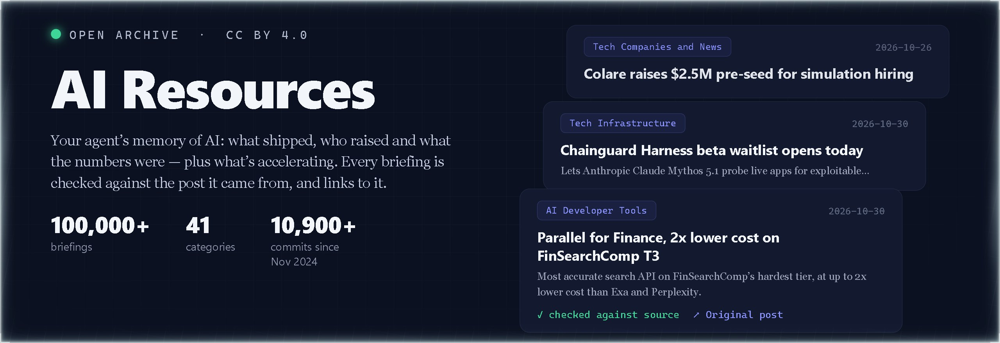
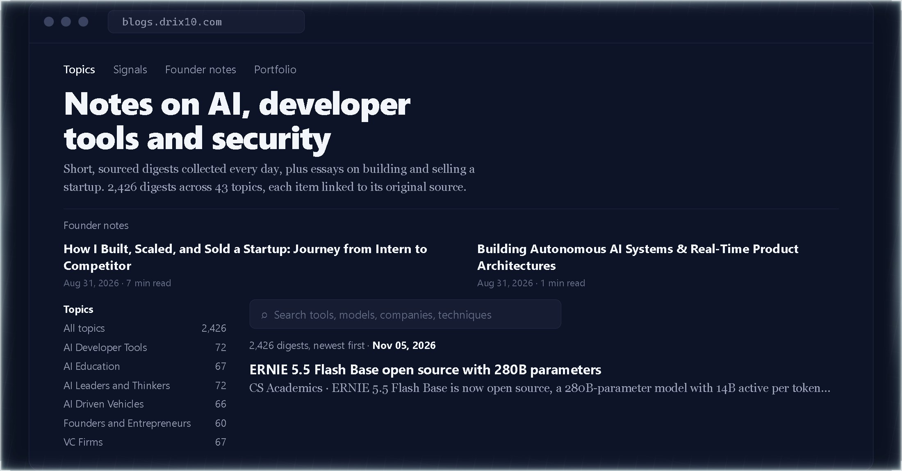
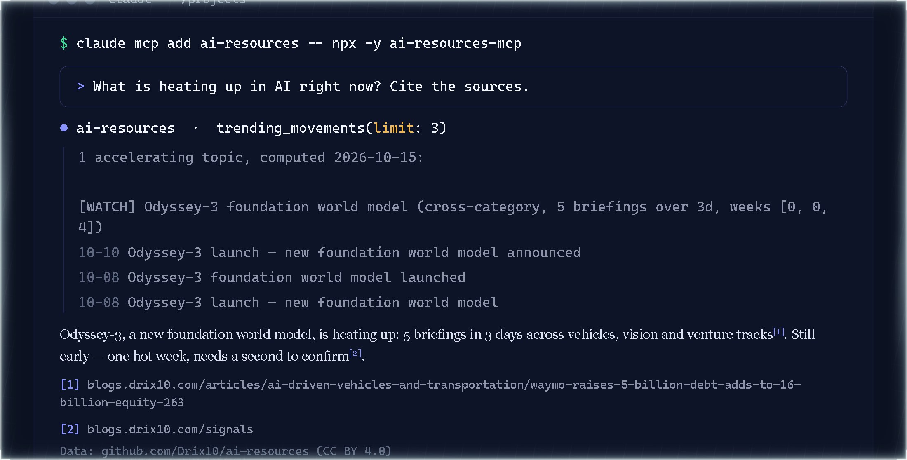
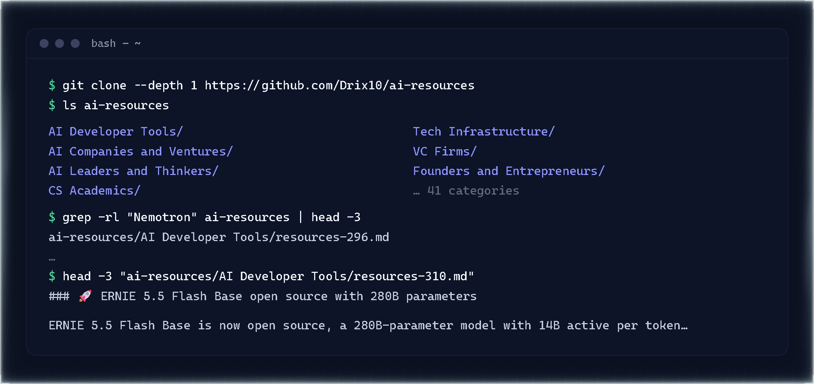
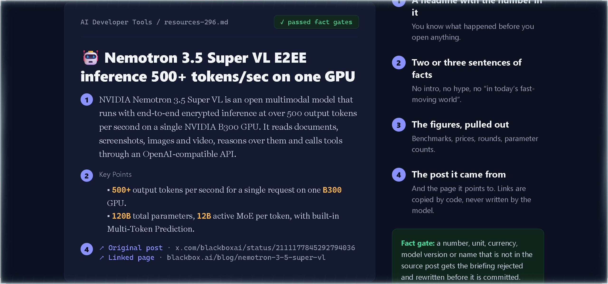
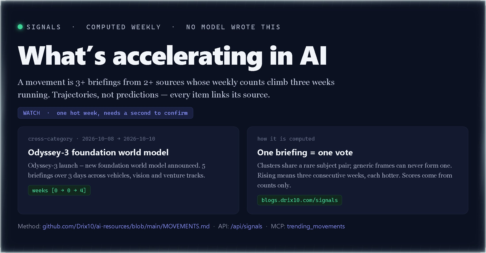
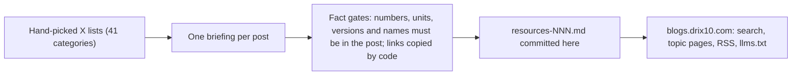

<div align="center">

<a href="https://blogs.drix10.com"></a>

<a href="https://github.com/Drix10/ai-resources/stargazers"></a>
<a href="https://github.com/Drix10/ai-resources/commits/main"></a>
<a href="https://www.npmjs.com/package/ai-resources-mcp"></a>
<a href="https://blogs.drix10.com/rss.xml"></a>
<a href="LICENSE"></a>

<b><a href="https://blogs.drix10.com">Read it</a></b> · <b><a href="#-resource-categories">Browse 41 categories</a></b> · <b><a href="#use-it-from-your-ai-agent">Plug it into your agent</a></b> · <b><a href="https://github.com/search?q=repo%3ADrix10%2Fai-resources+MCP&type=code">Search the archive</a></b>

</div>

<table>
<tr>
<td width="25%" valign="top"><b>Checked against the source</b><br><sub>A number, unit, model version or name that is not in the source post gets the briefing rejected and rewritten.</sub></td>
<td width="25%" valign="top"><b>Every claim has a link</b><br><sub>The original post and the page it points to, copied by code, never written by the model.</sub></td>
<td width="25%" valign="top"><b>41 categories</b><br><sub>Models, dev tools, research and funding, plus robotics, climate, quantum, security and crypto.</sub></td>
<td width="25%" valign="top"><b>Ready for your agent</b><br><sub>MCP server, Agent Skill, JSON API and llms.txt. Plain Markdown under CC BY 4.0.</sub></td>
</tr>
</table>

## Three ways in

<table>
<tr>
<td width="55%"><a href="https://blogs.drix10.com"></a></td>
<td width="45%" valign="top">
<h3><a href="https://blogs.drix10.com">Read it</a></h3>
The newest digests on <a href="https://blogs.drix10.com">blogs.drix10.com</a>, with search, topic pages and an <a href="https://blogs.drix10.com/rss.xml">RSS feed</a>. Or open any category <a href="#-resource-categories">below</a> and read its latest digest here on GitHub.
<br><br>
Star and watch the repo to get new digests as they land.
</td>
</tr>
<tr>
<td width="55%"><a href="USE-WITH-AI.md"></a></td>
<td width="45%" valign="top">
<h3><a href="#use-it-from-your-ai-agent">Ask it from your agent</a></h3>
Claude, Cursor, VS Code or Windsurf answer "what did Anthropic ship this week?" from the briefings, with dates and source links. No key, no account. <a href="#use-it-from-your-ai-agent">Setup for every client ↓</a>
<br><br>
<code>claude mcp add ai-resources -- npx -y ai-resources-mcp</code>
</td>
</tr>
<tr>
<td width="55%"></td>
<td width="45%" valign="top">
<h3>Clone it</h3>
100,000+ dated, sourced briefings in plain Markdown for RAG, evals or an offline index. Every <code>resources-NNN.md</code> holds 5 to 12 of them, like <a href="AI%20Developer%20Tools/resources-296.md">this one</a>.
<br><br>
<code>git clone --depth 1 https://github.com/Drix10/ai-resources</code>
</td>
</tr>
</table>

## What a briefing looks like

<a href="AI%20Developer%20Tools/resources-296.md"></a>
<p align="center"><sub>A real briefing from <a href="AI%20Developer%20Tools/resources-296.md">AI Developer Tools #296</a>. Every digest file holds 5 to 12 of these.</sub></p>


## Signals: what is accelerating in AI

<a href="https://blogs.drix10.com/signals"></a>
<p align="center"><sub><a href="https://blogs.drix10.com/signals">Signals</a>, computed weekly: topics whose coverage climbs three weeks running. Trajectories, not predictions — and nothing on it is written by a model.</sub></p>

Briefings tell you what happened. Signals tells you what it means: which topics are accelerating, with the sample headlines and source links behind every call. Computed from counts only (one briefing = one vote), in the open: [`MOVEMENTS.md`](MOVEMENTS.md) in this repo, [`/api/signals`](https://blogs.drix10.com/api/signals) for code, and the `trending_movements` MCP tool for agents.

## Who it is for

- **Engineers building with AI.** What changed in models, inference, agents, MCP and dev tools, with the benchmark number and the link, in [AI Developer Tools](#ai-developer-tools) and [Tech Infrastructure](#tech-infrastructure).
- **Founders and investors.** Rounds, launches and revenue figures as they are announced, in [AI Companies and Ventures](#ai-companies-and-ventures), [VC Firms](#vc-firms) and [Founders and Entrepreneurs](#founders-and-entrepreneurs).
- **Researchers and students.** What the people in the field are publishing and arguing about, in [CS Academics](#cs-academics) and [Neuroscience and AI](#neuroscience-and-ai).
- **Anyone building RAG, agents or evals.** A 100,000-item corpus of dated, sourced AI news under CC BY 4.0.

Awesome lists are still the better pick for a vetted shortlist, and a newsletter for five editor-picked minutes a day. [COMPARISONS.md](COMPARISONS.md) lays out where this fits.

## Use it from your AI agent

Five ways to plug the briefings into an agent or your own code. None needs a key or an account. Full reference: **[USE-WITH-AI.md](USE-WITH-AI.md)**.

| Path | Best for | Setup |
| --- | --- | --- |
| [MCP server](#mcp-server) | Claude Code, Claude Desktop, Cursor, VS Code, Windsurf | one command or one JSON block |
| [Agent Skill](#agent-skill) | Claude Code and other Skill-aware agents | copy one folder |
| [JSON API](#json-api) | your own code, custom GPT actions, scripts | none, CORS open |
| [llms.txt and RSS](#llmstxt-and-rss) | any LLM that reads a URL, feed readers, bots | none |
| [Raw Markdown](#three-ways-in) | RAG, evals, offline indexes, all 100,000+ briefings | `git clone` |

### MCP server

<a href="https://www.npmjs.com/package/ai-resources-mcp"></a>
<a href="https://registry.modelcontextprotocol.io/v0/servers?search=io.github.Drix10/ai-resources"></a>


Published on npm as [`ai-resources-mcp`](https://www.npmjs.com/package/ai-resources-mcp) (MIT, code in [`mcp/`](mcp/)). `npx` fetches it on first run, so there is nothing to install by hand.

| Tool | What it does |
| --- | --- |
| `search_briefings(query, category?, limit?, since?)` | Keyword search, newest first. All words must match. `since` is `YYYY-MM-DD`. |
| `latest(category?, limit?)` | The newest briefings, overall or for one category. |
| `get_briefing(id)` | Full Markdown of one briefing (URL or slug), with every source link. |
| `list_categories()` | Every category slug with its briefing count. |
| `trending_movements(limit?)` | Topics accelerating week over week (rising) or hot for one week (watch), with sample headlines and source links. |

Every result ends with its source link and `Data: github.com/Drix10/ai-resources (CC BY 4.0)`, so answers stay citable.

**Claude Code**

```bash
claude mcp add ai-resources -- npx -y ai-resources-mcp
```

<details>
<summary><b>Claude Desktop, Cursor, Windsurf</b></summary>

<br>

Add this to `claude_desktop_config.json` (Claude Desktop: Settings → Developer → Edit Config), `~/.cursor/mcp.json` or `.cursor/mcp.json` (Cursor), or `~/.codeium/windsurf/mcp_config.json` (Windsurf):

```json
{
  "mcpServers": {
    "ai-resources": { "command": "npx", "args": ["-y", "ai-resources-mcp"] }
  }
}
```

</details>

<details>
<summary><b>VS Code</b></summary>

<br>

In `.vscode/mcp.json`, or *MCP: Open User Configuration*:

```json
{
  "servers": {
    "ai-resources": { "type": "stdio", "command": "npx", "args": ["-y", "ai-resources-mcp"] }
  }
}
```

Or from a terminal:

```bash
code --add-mcp "{\"name\":\"ai-resources\",\"command\":\"npx\",\"args\":[\"-y\",\"ai-resources-mcp\"]}"
```

</details>

<details>
<summary><b>Windows, and other settings</b></summary>

<br>

If a client cannot start `npx` on Windows, use `"command": "cmd", "args": ["/c", "npx", "-y", "ai-resources-mcp"]`.

`AI_RESOURCES_API_URL` sets the API base URL (default `https://blogs.drix10.com`).

</details>

Then ask, for example:

- *"What did Anthropic announce this week? Cite the sources."*
- *"Latest five briefings in AI Developer Tools."*
- *"Who raised a Series A in AI this month, and how much?"*

### Agent Skill

[`skills/ai-news`](skills/ai-news/SKILL.md) teaches an agent when and how to answer "what's new in AI", "latest on &lt;model or company&gt;" and "who raised" questions from the briefings, with dates and citations. It uses the MCP tools when they are installed and falls back to the JSON API, then llms.txt, then raw Markdown on GitHub when they are not.

```bash
git clone --depth 1 https://github.com/Drix10/ai-resources
mkdir -p ~/.claude/skills
cp -r ai-resources/skills/ai-news ~/.claude/skills/
```

<details>
<summary><b>One project only, Windows, other agents</b></summary>

<br>

- **One project:** copy it to `.claude/skills/ai-news/` inside that project instead.
- **Windows (PowerShell):** `Copy-Item -Recurse ai-resources\skills\ai-news $HOME\.claude\skills\`
- **Other agents** that read `SKILL.md` folders work the same way. For chat apps without Skills, paste the body of `SKILL.md` into the custom instructions.

</details>

### JSON API

Base URL `https://blogs.drix10.com`. JSON, CORS open, no key. It covers the briefings published on the blog; the full archive is in this repository.

| Request | Returns |
| --- | --- |
| `GET /api/articles?q=&category=&since=&limit=&page=` | `{ items, total, page, limit, totalPages, license }`, newest first. All words in `q` must match; every parameter is optional. |
| `GET /api/articles?slug=<slug or URL>` | One item, plus `content` (the full Markdown). |
| `GET /api/categories` | `{ items: [{ name, slug, count, url, llms }] }` |

Each item has `title`, `url`, `slug`, `category`, `categorySlug`, `date`, `description`, `headlines` (every news item in the briefing) and `sources` (`[{ title, url }]`, the original posts).

```bash
curl "https://blogs.drix10.com/api/articles?q=anthropic&since=2026-10-01&limit=5"
curl "https://blogs.drix10.com/api/categories"
```

### llms.txt and RSS

- [`/llms.txt`](https://blogs.drix10.com/llms.txt): the index, linking every category.
- `/llms/<category-slug>.txt`: the 50 newest briefings of one category, for example [`/llms/ai-developer-tools.txt`](https://blogs.drix10.com/llms/ai-developer-tools.txt).
- [`/rss.xml`](https://blogs.drix10.com/rss.xml): for feed readers, Slack or Discord feed bots and email-digest services.

When you show the data anywhere, credit it as `Data: github.com/Drix10/ai-resources (CC BY 4.0)`. The MCP server and the Skill add that line for you.

## By the numbers

Counted from this repository on 29 October 2026. The archive only grows.

| | |
| ---: | --- |
| **100,000+** | briefings: a headline, two or three sentences and the key numbers, one per post |
| **10,800+** | digest files (`resources-NNN.md`) across **41 categories** |
| **10,900+** | commits since November 2024, all made by an automated pipeline |
| **14,000+** | briefings that link both the original post and the page it points to (every briefing since mid-2026) |
| **~2,000** | of them published as articles on [blogs.drix10.com](https://blogs.drix10.com) with search, topic pages, an [RSS feed](https://blogs.drix10.com/rss.xml) and [llms.txt](https://blogs.drix10.com/llms.txt) |

## How it is built

Nobody types these. A pipeline reads the hand-picked X lists for each category, writes one briefing per strong post, runs the fact gates, strips secrets, de-duplicates across categories and commits the batch here. The same run refreshes the category list below and publishes to the blog.



**Known limits:** briefings are machine-written from public posts and can still be wrong; check the linked source before you rely on a number. Part of the older archive (2024 to mid-2026) predates source links. Coverage follows the hand-picked lists, blind spots included. Inclusion is not endorsement.

## Contribute

A pipeline writes the briefings. People pick the sources and fix what it gets wrong. Ways in:

- **Pick up a [good first issue](https://github.com/Drix10/ai-resources/issues?q=is%3Aissue+is%3Aopen+label%3A%22good+first+issue%22)**: MCP server tools, Skill phrasings, guides, examples, translations.
- **[Suggest a source](https://github.com/Drix10/ai-resources/issues/new?template=suggest-source.yml)** (an X account, list or site) or **[report a wrong fact](https://github.com/Drix10/ai-resources/issues/new?template=wrong-fact.yml)** with the briefing link.
- **Ask, share what you built, or float an idea** in [Discussions](https://github.com/Drix10/ai-resources/discussions).

[CONTRIBUTING.md](CONTRIBUTING.md) has the details, including what not to edit by hand. Content is CC BY 4.0; the MCP server code is MIT. If you use the archive in research, [CITATION.cff](CITATION.cff) has the citation.

## Star history

<a href="https://star-history.com/#Drix10/ai-resources&Date"></a>

## About the curator

Built and maintained by **[Drishtant Ghosh (Drix10)](https://drix10.com)**, an AI systems engineer and 1x acquired founder (ReeF, acquired August 2024) based in Bengaluru. Founder of CosLynx.com, AI systems architect on Canopy @ Founders, Inc., Backdrop Build v4 and v6 finalist. More writing at [blogs.drix10.com](https://blogs.drix10.com).

<!-- drix10-footer -->
---

<div align="center">

**Built by [Drishtant Ghosh (Drix10)](https://drix10.com)** · AI systems engineer and 1x acquired founder, Bengaluru

[Portfolio](https://drix10.com) · [LinkedIn](https://www.linkedin.com/in/drix10) · [X](https://x.com/DrishtantGhosh) · [Blog](https://blogs.drix10.com) · [All projects](https://github.com/Drix10)

<sub>More from Drix10: [Agent Flow](https://github.com/Drix10/agent-flow) (guardrails for AI coding agents) · [MiroHedge](https://github.com/Drix10/hypothesis-arena) (AI-assisted systematic fund) · [Guardian](https://github.com/Drix10/guardian-gpt) (UPI scam interceptor) · [Sentinel](https://github.com/Drix10/sentinal) (AI security CLI) · [Keystroke-LLM](https://github.com/Drix10/keystroke-llm) (NumPy transformer on a keyboard)</sub>

</div>

---

## 📚 Resource Categories

**11,335 digests in 41 categories.** Each category shows its newest headlines; jump to one:

<sub>[AI Developer Tools](#ai-developer-tools) · [AI Leaders and Thinkers](#ai-leaders-and-thinkers) · [AI Companies and Ventures](#ai-companies-and-ventures) · [CS Academics](#cs-academics) · [Tech VIPs](#tech-vips) · [VC Firms](#vc-firms) · [Devs, Designers, DevRel](#devs-designers-devrel) · [Tech Infrastructure](#tech-infrastructure) · [Founders and Entrepreneurs](#founders-and-entrepreneurs) · [AI Organizations and Media](#ai-organizations-and-media) · [AI Powered Film and Media](#ai-powered-film-and-media) · [AI Holodeck and Virtual Worlds](#ai-holodeck-and-virtual-worlds) · [AI Artists and Creators](#ai-artists-and-creators) · [AI in Healthcare and Science](#ai-in-healthcare-and-science) · [AI Generated Music and Audio](#ai-generated-music-and-audio) · [AI Consulting and Expertise](#ai-consulting-and-expertise) · [AI Professionals and Community](#ai-professionals-and-community) · [AI Policy and Ethical Considerations](#ai-policy-and-ethical-considerations) · [AI in Real Estate and Property Tech](#ai-in-real-estate-and-property-tech) · [AI and Robotics Applications](#ai-and-robotics-applications) · [AI Driven Vehicles and Transportation](#ai-driven-vehicles-and-transportation) · [AI for Content Creation and Marketing](#ai-for-content-creation-and-marketing) · [AR VR Companies and Development](#ar-vr-companies-and-development) · [AR VR Professionals and Community](#ar-vr-professionals-and-community) · [Climate and Weather Technology](#climate-and-weather-technology) · [Computer Vision and AI Applications](#computer-vision-and-ai-applications) · [Crypto and Web3](#crypto-and-web3) · [Decentralized AI](#decentralized-ai) · [The Exponential Future](#the-exponential-future) · [AI Education](#ai-education) · [AI in Enterprise Applications](#ai-in-enterprise-applications) · [Interesting Finds](#interesting-finds) · [Investors and Venture Capital](#investors-and-venture-capital) · [Cybersecurity and Tech](#cybersecurity-and-tech) · [Neuroscience and AI](#neuroscience-and-ai) · [PR and Communications](#pr-and-communications) · [Quantum Computing](#quantum-computing) · [Spatial Computing](#spatial-computing) · [Tech Companies and News](#tech-companies-and-news) · [Tech Journalists and VIPs](#tech-journalists-and-vips) · [World News and Updates](#world-news-and-updates)</sub>

### AI Developer Tools

<sub>312 digests · [latest: #315](https://github.com/Drix10/ai-resources/blob/main/AI%20Developer%20Tools/resources-315.md) · [read on the blog](https://blogs.drix10.com/categories/ai-developer-tools)</sub>

*   Hy4 #3 on Analysis Cyber Index, #1 CWE-Bench-AA
*   zml/llmd 20261112.0 release adds DSpine and faster DeepSeek prefill
*   ClickHouse Cloud Self-Service Previews launch November 3

### AI Leaders and Thinkers

<sub>305 digests · [latest: #305](https://github.com/Drix10/ai-resources/blob/main/AI%20Leaders%20and%20Thinkers/resources-305.md) · [read on the blog](https://blogs.drix10.com/categories/ai-leaders-and-thinkers)</sub>

*   Postgres exclusion constraint stops double-booking
*   ElevenLabs Scribe V3 becomes top model in benchmark
*   10 News Monitoring Tools Compared for Newsletter Creators

### AI Companies and Ventures

<sub>303 digests · [latest: #303](https://github.com/Drix10/ai-resources/blob/main/AI%20Companies%20and%20Ventures/resources-303.md) · [read on the blog](https://blogs.drix10.com/categories/ai-companies-and-ventures)</sub>

*   Meshy 7 + Make Printable test prints 92% completeness
*   CoMind-Be My Eye robots team up on housework with vision gains
*   McClipFace – AI shopping assistant launch integrates with major AI platforms

### CS Academics

<sub>316 digests · [latest: #316](https://github.com/Drix10/ai-resources/blob/main/CS%20Academics/resources-316.md) · [read on the blog](https://blogs.drix10.com/categories/cs-academics)</sub>

*   Top Chinese Frontier AI Models Carry Blackwell GPU Fingerprint
*   Gemini 4 Hydrogen - Search gets faster, smarter, visual
*   Series A – $1B funding round led by Kleiner Perkins and ClearLake

### Tech VIPs

<sub>308 digests · [latest: #308](https://github.com/Drix10/ai-resources/blob/main/Tech%20VIPs/resources-308.md) · [read on the blog](https://blogs.drix10.com/categories/tech-vips)</sub>

*   Microsoft diagnostic AI solved 83% of 304 cases
*   Quixel island template released, half island budget usage
*   Anthropic IPO outlook – open source weakening and compute diversity claim

### VC Firms

<sub>306 digests · [latest: #306](https://github.com/Drix10/ai-resources/blob/main/VC%20Firms/resources-306.md) · [read on the blog](https://blogs.drix10.com/categories/vc-firms)</sub>

*   Startale Card launch, Tokenized IP sale sold out, JPYSC balances hit ¥30B
*   MSCI drops treasury firms, Strategy $1.6B MSTR sell
*   Collector Crypt coming to additional 10M active users soon

### Devs, Designers, DevRel

<sub>307 digests · [latest: #307](https://github.com/Drix10/ai-resources/blob/main/Devs%2C%20Designers%2C%20DevRel/resources-307.md) · [read on the blog](https://blogs.drix10.com/categories/devs-designers-devrel)</sub>

*   PrimeIntellect monthly tokens hit 1T+ on OpenRouter
*   Super Heavy V3 Booster 22 moved to launch pad for catch testing

### Tech Infrastructure

<sub>282 digests · [latest: #282](https://github.com/Drix10/ai-resources/blob/main/Tech%20Infrastructure/resources-282.md) · [read on the blog](https://blogs.drix10.com/categories/tech-infrastructure)</sub>

*   Dropbox acquires Tigris for $350M to launch DBX Agent Cloud
*   Tesla 4.0 ratio claim for SPCX acquisition deal
*   A2UI 1.0 – launch of delightful agentic UI framework

### Founders and Entrepreneurs

<sub>272 digests · [latest: #272](https://github.com/Drix10/ai-resources/blob/main/Founders%20and%20Entrepreneurs/resources-272.md) · [read on the blog](https://blogs.drix10.com/categories/founders-and-entrepreneurs)</sub>

*   Aside $2M ARR, 150K MAU, 33-day $1M-$2M growth
*   Atlas – access opened to everyone with apps and API
*   Atlas now available to everyone – open access launch

### AI Organizations and Media

<sub>299 digests · [latest: #299](https://github.com/Drix10/ai-resources/blob/main/AI%20Organizations%20and%20Media/resources-299.md) · [read on the blog](https://blogs.drix10.com/categories/ai-organizations-and-media)</sub>

*   ci-proto launches with 64× longer context window
*   Scaling public input on AI policy with pluralistic agents – study results
*   TEKEVER expands into Denmark with Odense base

### AI Powered Film and Media

<sub>279 digests · [latest: #279](https://github.com/Drix10/ai-resources/blob/main/AI%20Powered%20Film%20and%20Media/resources-279.md) · [read on the blog](https://blogs.drix10.com/categories/ai-powered-film-and-media)</sub>

*   Bitget Wallet USD/EUR Virtual Account adds payments
*   Fable 5.2 handles music, grading, motion graphics in one go
*   Claude Fable 5.2 used to create AAA-style game concept

### AI Holodeck and Virtual Worlds

<sub>288 digests · [latest: #288](https://github.com/Drix10/ai-resources/blob/main/AI%20Holodeck%20and%20Virtual%20Worlds/resources-288.md) · [read on the blog](https://blogs.drix10.com/categories/ai-holodeck-and-virtual-worlds)</sub>

*   MAI Image 2.6 pricing and Flash launch on Pixazo AI
*   Vivix W1 film cost under $20, 7 films, 12K subs in 3 weeks
*   Hy4 #3 on Artificial Analysis Cyber Index, #1 on CWE-Bench-AA

### AI Artists and Creators

<sub>280 digests · [latest: #280](https://github.com/Drix10/ai-resources/blob/main/AI%20Artists%20and%20Creators/resources-280.md) · [read on the blog](https://blogs.drix10.com/categories/ai-artists-and-creators)</sub>

*   MiniMax H3-Image benchmark comparison and 4K claim
*   Drama 3 ComfyUI nodes add v2, speech on 8GB VRAM
*   Carbon /swarm skill makes 3D office model in Three.js

### AI in Healthcare and Science

<sub>291 digests · [latest: #291](https://github.com/Drix10/ai-resources/blob/main/AI%20in%20Healthcare%20and%20Science/resources-291.md) · [read on the blog](https://blogs.drix10.com/categories/ai-in-healthcare-and-science)</sub>

*   Signet AI organoids speed discovery, SIGX1094 in clinic
*   Self-driving lab fleet 300+ workstations 40x efficiency
*   TROP2 NMR score not discriminative in EGFRm NSQ NSCLC

### AI Generated Music and Audio

<sub>288 digests · [latest: #288](https://github.com/Drix10/ai-resources/blob/main/AI%20Generated%20Music%20and%20Audio/resources-288.md) · [read on the blog](https://blogs.drix10.com/categories/ai-generated-music-and-audio)</sub>

*   Retell reaches $100M revenue run rate in 17 months
*   Stable Audio – new workspace, Generate and Sampler apps
*   ACE Music v1 hits #1 on ArtificialAnlys music leaderboard

### AI Consulting and Expertise

<sub>278 digests · [latest: #278](https://github.com/Drix10/ai-resources/blob/main/AI%20Consulting%20and%20Expertise/resources-278.md) · [read on the blog](https://blogs.drix10.com/categories/ai-consulting-and-expertise)</sub>

*   PearlQuant cuts KV cache storage 65% and boosts throughput
*   Retell revenue run rate reaches $100M after $10M start
*   Ignytlabs signs $3,500 client, targets $10K/month

### AI Professionals and Community

<sub>281 digests · [latest: #281](https://github.com/Drix10/ai-resources/blob/main/AI%20Professionals%20and%20Community/resources-281.md) · [read on the blog](https://blogs.drix10.com/categories/ai-professionals-and-community)</sub>

*   REWEAVE: Online Learning for Workload-Adaptive HNSW Indexes improves recall up to 23.3 pp
*   DeepSeek V4 Flash GPU thread count inference shows B200 usage
*   ReSID – Long-tail retrieval method released with production deployment

### AI Policy and Ethical Considerations

<sub>273 digests · [latest: #273](https://github.com/Drix10/ai-resources/blob/main/AI%20Policy%20and%20Ethical%20Considerations/resources-273.md) · [read on the blog](https://blogs.drix10.com/categories/ai-policy-and-ethical-considerations)</sub>

*   Paris Call for AI Safety commits to model shutdowns
*   Hard Cases for AI Behavioural Design paper released

### AI in Real Estate and Property Tech

<sub>269 digests · [latest: #269](https://github.com/Drix10/ai-resources/blob/main/AI%20in%20Real%20Estate%20and%20Property%20Tech/resources-269.md) · [read on the blog](https://blogs.drix10.com/categories/ai-in-real-estate-and-property-tech)</sub>

*   Diorama – 2.5D asset pipeline with TypeScript export to sprite sheets
*   Bureau des agents – pixel art office for Claude Code agents
*   AIRI digital companion announced with browser, desktop and mobile support

### AI and Robotics Applications

<sub>286 digests · [latest: #286](https://github.com/Drix10/ai-resources/blob/main/AI%20and%20Robotics%20Applications/resources-286.md) · [read on the blog](https://blogs.drix10.com/categories/ai-and-robotics-applications)</sub>

*   Simple Memory Evolution boosts GPT-6-Astra SR to 81.7%
*   Flash ALOHA learns fast precise manipulation with 50 demos
*   CoMind Be My Eye improves pen following and blind box metrics

### AI Driven Vehicles and Transportation

<sub>282 digests · [latest: #282](https://github.com/Drix10/ai-resources/blob/main/AI%20Driven%20Vehicles%20and%20Transportation/resources-282.md) · [read on the blog](https://blogs.drix10.com/categories/ai-driven-vehicles-and-transportation)</sub>

*   TIER IV and Komatsu develop autonomous dump trucks, target 2027
*   Komatsu and TIER IV develop autonomous dump trucks 2027
*   Tier IV at Edge Chiplet Forum open-source AI chip

### AI for Content Creation and Marketing

<sub>278 digests · [latest: #278](https://github.com/Drix10/ai-resources/blob/main/AI%20for%20Content%20Creation%20and%20Marketing/resources-278.md) · [read on the blog](https://blogs.drix10.com/categories/ai-for-content-creation-and-marketing)</sub>

*   Google email address targeting leads 700 in 2 days
*   Framer adds AI image generation and custom shaders to canvas
*   Gemini 4 Hydrogen performance demo, faster than Gemini 3.8 Flash

### AR VR Companies and Development

<sub>274 digests · [latest: #274](https://github.com/Drix10/ai-resources/blob/main/AR%20VR%20Companies%20and%20Development/resources-274.md) · [read on the blog](https://blogs.drix10.com/categories/ar-vr-companies-and-development)</sub>

*   Spatial-Spectral Coupling as Attention reduces memory to 5.67 GiB
*   Mighty VPS mode test shows 300km+ flight on $67 module
*   Overcoming Dynamic Range Limitations in Computational Hyperspectral Imaging

### AR VR Professionals and Community

<sub>272 digests · [latest: #272](https://github.com/Drix10/ai-resources/blob/main/AR%20VR%20Professionals%20and%20Community/resources-272.md) · [read on the blog](https://blogs.drix10.com/categories/ar-vr-professionals-and-community)</sub>

*   BlackMagic Ambisonic microphone $1695 launch December
*   Graspable – voice-driven XR development announced

### Climate and Weather Technology

<sub>270 digests · [latest: #270](https://github.com/Drix10/ai-resources/blob/main/Climate%20and%20Weather%20Technology/resources-270.md) · [read on the blog](https://blogs.drix10.com/categories/climate-and-weather-technology)</sub>

*   Daily Briefing: Electrification pledge ‘wins support’
*   Microsoft outage reaches Westminster MPs and GP practices in Grampian

### Computer Vision and AI Applications

<sub>275 digests · [latest: #275](https://github.com/Drix10/ai-resources/blob/main/Computer%20Vision%20and%20AI%20Applications/resources-275.md) · [read on the blog](https://blogs.drix10.com/categories/computer-vision-and-ai-applications)</sub>

*   OnlyAct – action encoder from video, zero labels, 640-dim embedding
*   Déjà View 117M model matches larger models on five benchmarks
*   Attention-Guided Sequence Fusion boosts R@1 by 3.37%

### Crypto and Web3

<sub>266 digests · [latest: #266](https://github.com/Drix10/ai-resources/blob/main/Crypto%20and%20Web3/resources-266.md) · [read on the blog](https://blogs.drix10.com/categories/crypto-and-web3)</sub>

*   Bitcoin upside liquidation $14B vs downside $660M
*   Aethir decentralized GPU cloud eliminates egress fees for checkpoint transfers
*   Binance SAFU Bitcoin address holds 7,500 BTC

### Decentralized AI

<sub>267 digests · [latest: #267](https://github.com/Drix10/ai-resources/blob/main/Decentralized%20AI/resources-267.md) · [read on the blog](https://blogs.drix10.com/categories/decentralized-ai)</sub>

*   AGIX Token Claim Portal Opens for Legacy Holders
*   Sogni Creative Agent adds 60 styles, $20/month plan
*   aelf Allocates 2,000,000 ELF to eBridge for Enhanced Cross-Chain Liquidity

### The Exponential Future

<sub>268 digests · [latest: #268](https://github.com/Drix10/ai-resources/blob/main/The%20Exponential%20Future/resources-268.md) · [read on the blog](https://blogs.drix10.com/categories/the-exponential-future)</sub>

*   L-39 Skyfox jets delivery schedule to Ukraine announced
*   Jane Street lifts Fidelity Bitcoin ETF stake nearly eightfold in Q3
*   IAEA concerned about undeclared Iranian enrichment plant

### AI Education

<sub>283 digests · [latest: #283](https://github.com/Drix10/ai-resources/blob/main/AI%20Education/resources-283.md) · [read on the blog](https://blogs.drix10.com/categories/ai-education)</sub>

*   Claude Meetings beta on Team and Enterprise plans
*   pplx-decider-v1.3 adds locate to models
*   Computer browser agent now shows what it’s working on

### AI in Enterprise Applications

<sub>273 digests · [latest: #273](https://github.com/Drix10/ai-resources/blob/main/AI%20in%20Enterprise%20Applications/resources-273.md) · [read on the blog](https://blogs.drix10.com/categories/ai-in-enterprise-applications)</sub>

*   NiCECognigy wins CX Awards 2026 Gold AI 15M journeys
*   PO Tracking That Catches Late Deliveries Early – Four early signals
*   Echos ships six on-device models all free

### Interesting Finds

<sub>261 digests · [latest: #261](https://github.com/Drix10/ai-resources/blob/main/Interesting%20Finds/resources-261.md) · [read on the blog](https://blogs.drix10.com/categories/interesting-finds)</sub>

*   SpaceX Anthropic OpenAI generate $4.2T liquidity
*   Health insurance cost increase 25% next year

### Investors and Venture Capital

<sub>262 digests · [latest: #262](https://github.com/Drix10/ai-resources/blob/main/Investors%20and%20Venture%20Capital/resources-262.md) · [read on the blog](https://blogs.drix10.com/categories/investors-and-venture-capital)</sub>

*   Outlook reports 130,000 outages as many platforms fail
*   U.S. housing market October sales drop 44% from peak
*   Opus 5.5 and Sonnet 5.5 stop after 5-15 minutes of usage

### Cybersecurity and Tech

<sub>245 digests · [latest: #245](https://github.com/Drix10/ai-resources/blob/main/Cybersecurity%20and%20Tech/resources-245.md) · [read on the blog](https://blogs.drix10.com/categories/cybersecurity-and-tech)</sub>

*   RatCTF White Label CTF service launch $20/month
*   U.S. soldier lieutenant colonel arrested in UK
*   Microsoft global outage affects Teams Outlook Copilot

### Neuroscience and AI

<sub>254 digests · [latest: #254](https://github.com/Drix10/ai-resources/blob/main/Neuroscience%20and%20AI/resources-254.md) · [read on the blog](https://blogs.drix10.com/categories/neuroscience-and-ai)</sub>

*   Gene therapy inserts receptors to dampen seizures in three patients
*   Cell-free starch synthesis from CO2 – method developed
*   Pink noise in conversation – research finds semantic fluctuation pattern

### PR and Communications

<sub>251 digests · [latest: #251](https://github.com/Drix10/ai-resources/blob/main/PR%20and%20Communications/resources-251.md) · [read on the blog](https://blogs.drix10.com/categories/pr-and-communications)</sub>

*   Mirendil receives $1 billion funding led by Kleiner Perkins
*   Gamma marketing team 10 people, 500 creators monthly
*   GITEX GLOBAL 2026 dates and exhibitor count announced

### Quantum Computing

<sub>252 digests · [latest: #252](https://github.com/Drix10/ai-resources/blob/main/Quantum%20Computing/resources-252.md) · [read on the blog](https://blogs.drix10.com/categories/quantum-computing)</sub>

*   IonQ introduces three fully funded partnerships at CHOGM
*   Q-CTRL Series C $290M Funding Announcement
*   IonQ hybrid quantum computing shown at SC26 booth 5238

### Spatial Computing

<sub>249 digests · [latest: #249](https://github.com/Drix10/ai-resources/blob/main/Spatial%20Computing/resources-249.md) · [read on the blog](https://blogs.drix10.com/categories/spatial-computing)</sub>

*   pangram $500 reward for pre-2020 text flagged as AI
*   Brocken Gigant Godzilla-0.0 (95731) production update
*   XR Tokyo meetup Immersive Web on 11/20 with ThreeJS

### Tech Companies and News

<sub>244 digests · [latest: #244](https://github.com/Drix10/ai-resources/blob/main/Tech%20Companies%20and%20News/resources-244.md) · [read on the blog](https://blogs.drix10.com/categories/tech-companies-and-news)</sub>

*   XERJ Reader-1 launches neurosymbolic model with 20-90× speed boost
*   Nvidia CEO Jensen Huang resigns, Kress interim CEO
*   Nvidia – interim CEO Colette Kress leads delivery of Blackwell, Rubin GPUs and Vera CPUs

### Tech Journalists and VIPs

<sub>247 digests · [latest: #247](https://github.com/Drix10/ai-resources/blob/main/Tech%20Journalists%20and%20VIPs/resources-247.md) · [read on the blog](https://blogs.drix10.com/categories/tech-journalists-and-vips)</sub>

*   Acyclic Labs open-sources infra for 10,000 agents
*   Acyclic Labs launch – 10,000-agent runtime and SwarmBench
*   Caveman Code released, costs $1.83 vs Claude Code $7.65

### World News and Updates

<sub>239 digests · [latest: #239](https://github.com/Drix10/ai-resources/blob/main/World%20News%20and%20Updates/resources-239.md) · [read on the blog](https://blogs.drix10.com/categories/world-news-and-updates)</sub>

*   Microsoft outage - global service disruption affecting Outlook and Teams
*   Nvidia shut out of China AI data-center market, $3B projects

---

<div align="center">

[Star the repo](https://github.com/Drix10/ai-resources) to keep it handy and help others find it, or [suggest a source](https://github.com/Drix10/ai-resources/issues/new/choose).

[Read on the blog](https://blogs.drix10.com) · [RSS feed](https://blogs.drix10.com/rss.xml) · [Use it from your AI agent](https://github.com/Drix10/ai-resources/blob/main/USE-WITH-AI.md)

<sub>Summaries © Drishtant Ghosh, licensed [CC BY 4.0](LICENSE). Every digest links to its original post where one exists; the posts and linked pages belong to their authors.</sub>

</div>
