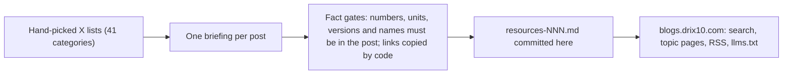

<div align="center">

<a href="https://blogs.drix10.com"></a>

<a href="https://github.com/Drix10/ai-resources/stargazers"></a>
<a href="https://github.com/Drix10/ai-resources/commits/main"></a>
<a href="https://www.npmjs.com/package/ai-resources-mcp"></a>
<a href="https://blogs.drix10.com/rss.xml"></a>
<a href="LICENSE"></a>

<b><a href="https://blogs.drix10.com">Read it</a></b> · <b><a href="#-resource-categories">Browse 41 categories</a></b> · <b><a href="#use-it-from-your-ai-agent">Plug it into your agent</a></b> · <b><a href="https://github.com/search?q=repo%3ADrix10%2Fai-resources+MCP&type=code">Search the archive</a></b>

</div>

<table>
<tr>
<td width="25%" valign="top"><b>Checked against the source</b><br><sub>A number, unit, model version or name that is not in the source post gets the briefing rejected and rewritten.</sub></td>
<td width="25%" valign="top"><b>Every claim has a link</b><br><sub>The original post and the page it points to, copied by code, never written by the model.</sub></td>
<td width="25%" valign="top"><b>41 categories</b><br><sub>Models, dev tools, research and funding, plus robotics, climate, quantum, security and crypto.</sub></td>
<td width="25%" valign="top"><b>Ready for your agent</b><br><sub>MCP server, Agent Skill, JSON API and llms.txt. Plain Markdown under CC BY 4.0.</sub></td>
</tr>
</table>

## Three ways in

<table>
<tr>
<td width="55%"><a href="https://blogs.drix10.com"></a></td>
<td width="45%" valign="top">
<h3><a href="https://blogs.drix10.com">Read it</a></h3>
The newest digests on <a href="https://blogs.drix10.com">blogs.drix10.com</a>, with search, topic pages and an <a href="https://blogs.drix10.com/rss.xml">RSS feed</a>. Or open any category <a href="#-resource-categories">below</a> and read its latest digest here on GitHub.
<br><br>
Star and watch the repo to get new digests as they land.
</td>
</tr>
<tr>
<td width="55%"><a href="USE-WITH-AI.md"></a></td>
<td width="45%" valign="top">
<h3><a href="#use-it-from-your-ai-agent">Ask it from your agent</a></h3>
Claude, Cursor, VS Code or Windsurf answer "what did Anthropic ship this week?" from the briefings, with dates and source links. No key, no account. <a href="#use-it-from-your-ai-agent">Setup for every client ↓</a>
<br><br>
<code>claude mcp add ai-resources -- npx -y ai-resources-mcp</code>
</td>
</tr>
<tr>
<td width="55%"></td>
<td width="45%" valign="top">
<h3>Clone it</h3>
100,000+ dated, sourced briefings in plain Markdown for RAG, evals or an offline index. Every <code>resources-NNN.md</code> holds 5 to 12 of them, like <a href="AI%20Developer%20Tools/resources-296.md">this one</a>.
<br><br>
<code>git clone --depth 1 https://github.com/Drix10/ai-resources</code>
</td>
</tr>
</table>

## What a briefing looks like

<a href="AI%20Developer%20Tools/resources-296.md"></a>
<p align="center"><sub>A real briefing from <a href="AI%20Developer%20Tools/resources-296.md">AI Developer Tools #296</a>. Every digest file holds 5 to 12 of these.</sub></p>

## Who it is for

- **Engineers building with AI.** What changed in models, inference, agents, MCP and dev tools, with the benchmark number and the link, in [AI Developer Tools](#ai-developer-tools) and [Tech Infrastructure](#tech-infrastructure).
- **Founders and investors.** Rounds, launches and revenue figures as they are announced, in [AI Companies and Ventures](#ai-companies-and-ventures), [VC Firms](#vc-firms) and [Founders and Entrepreneurs](#founders-and-entrepreneurs).
- **Researchers and students.** What the people in the field are publishing and arguing about, in [CS Academics](#cs-academics) and [Neuroscience and AI](#neuroscience-and-ai).
- **Anyone building RAG, agents or evals.** A 100,000-item corpus of dated, sourced AI news under CC BY 4.0.

Awesome lists are still the better pick for a vetted shortlist, and a newsletter for five editor-picked minutes a day. [COMPARISONS.md](COMPARISONS.md) lays out where this fits.

## Use it from your AI agent

Five ways to plug the briefings into an agent or your own code. None needs a key or an account. Full reference: **[USE-WITH-AI.md](USE-WITH-AI.md)**.

| Path | Best for | Setup |
| --- | --- | --- |
| [MCP server](#mcp-server) | Claude Code, Claude Desktop, Cursor, VS Code, Windsurf | one command or one JSON block |
| [Agent Skill](#agent-skill) | Claude Code and other Skill-aware agents | copy one folder |
| [JSON API](#json-api) | your own code, custom GPT actions, scripts | none, CORS open |
| [llms.txt and RSS](#llmstxt-and-rss) | any LLM that reads a URL, feed readers, bots | none |
| [Raw Markdown](#three-ways-in) | RAG, evals, offline indexes, all 100,000+ briefings | `git clone` |

### MCP server

<a href="https://www.npmjs.com/package/ai-resources-mcp"></a>
<a href="https://registry.modelcontextprotocol.io/v0/servers?search=io.github.Drix10/ai-resources"></a>


Published on npm as [`ai-resources-mcp`](https://www.npmjs.com/package/ai-resources-mcp) (MIT, code in [`mcp/`](mcp/)). `npx` fetches it on first run, so there is nothing to install by hand.

| Tool | What it does |
| --- | --- |
| `search_briefings(query, category?, limit?, since?)` | Keyword search, newest first. All words must match. `since` is `YYYY-MM-DD`. |
| `latest(category?, limit?)` | The newest briefings, overall or for one category. |
| `get_briefing(id)` | Full Markdown of one briefing (URL or slug), with every source link. |
| `list_categories()` | Every category slug with its briefing count. |

Every result ends with its source link and `Data: github.com/Drix10/ai-resources (CC BY 4.0)`, so answers stay citable.

**Claude Code**

```bash
claude mcp add ai-resources -- npx -y ai-resources-mcp
```

<details>
<summary><b>Claude Desktop, Cursor, Windsurf</b></summary>

<br>

Add this to `claude_desktop_config.json` (Claude Desktop: Settings → Developer → Edit Config), `~/.cursor/mcp.json` or `.cursor/mcp.json` (Cursor), or `~/.codeium/windsurf/mcp_config.json` (Windsurf):

```json
{
  "mcpServers": {
    "ai-resources": { "command": "npx", "args": ["-y", "ai-resources-mcp"] }
  }
}
```

</details>

<details>
<summary><b>VS Code</b></summary>

<br>

In `.vscode/mcp.json`, or *MCP: Open User Configuration*:

```json
{
  "servers": {
    "ai-resources": { "type": "stdio", "command": "npx", "args": ["-y", "ai-resources-mcp"] }
  }
}
```

Or from a terminal:

```bash
code --add-mcp "{\"name\":\"ai-resources\",\"command\":\"npx\",\"args\":[\"-y\",\"ai-resources-mcp\"]}"
```

</details>

<details>
<summary><b>Windows, and other settings</b></summary>

<br>

If a client cannot start `npx` on Windows, use `"command": "cmd", "args": ["/c", "npx", "-y", "ai-resources-mcp"]`.

`AI_RESOURCES_API_URL` sets the API base URL (default `https://blogs.drix10.com`).

</details>

Then ask, for example:

- *"What did Anthropic announce this week? Cite the sources."*
- *"Latest five briefings in AI Developer Tools."*
- *"Who raised a Series A in AI this month, and how much?"*

### Agent Skill

[`skills/ai-news`](skills/ai-news/SKILL.md) teaches an agent when and how to answer "what's new in AI", "latest on &lt;model or company&gt;" and "who raised" questions from the briefings, with dates and citations. It uses the MCP tools when they are installed and falls back to the JSON API, then llms.txt, then raw Markdown on GitHub when they are not.

```bash
git clone --depth 1 https://github.com/Drix10/ai-resources
mkdir -p ~/.claude/skills
cp -r ai-resources/skills/ai-news ~/.claude/skills/
```

<details>
<summary><b>One project only, Windows, other agents</b></summary>

<br>

- **One project:** copy it to `.claude/skills/ai-news/` inside that project instead.
- **Windows (PowerShell):** `Copy-Item -Recurse ai-resources\skills\ai-news $HOME\.claude\skills\`
- **Other agents** that read `SKILL.md` folders work the same way. For chat apps without Skills, paste the body of `SKILL.md` into the custom instructions.

</details>

### JSON API

Base URL `https://blogs.drix10.com`. JSON, CORS open, no key. It covers the briefings published on the blog; the full archive is in this repository.

| Request | Returns |
| --- | --- |
| `GET /api/articles?q=&category=&since=&limit=&page=` | `{ items, total, page, limit, totalPages, license }`, newest first. All words in `q` must match; every parameter is optional. |
| `GET /api/articles?slug=<slug or URL>` | One item, plus `content` (the full Markdown). |
| `GET /api/categories` | `{ items: [{ name, slug, count, url, llms }] }` |

Each item has `title`, `url`, `slug`, `category`, `categorySlug`, `date`, `description`, `headlines` (every news item in the briefing) and `sources` (`[{ title, url }]`, the original posts).

```bash
curl "https://blogs.drix10.com/api/articles?q=anthropic&since=2026-10-01&limit=5"
curl "https://blogs.drix10.com/api/categories"
```

### llms.txt and RSS

- [`/llms.txt`](https://blogs.drix10.com/llms.txt): the index, linking every category.
- `/llms/<category-slug>.txt`: the 50 newest briefings of one category, for example [`/llms/ai-developer-tools.txt`](https://blogs.drix10.com/llms/ai-developer-tools.txt).
- [`/rss.xml`](https://blogs.drix10.com/rss.xml): for feed readers, Slack or Discord feed bots and email-digest services.

When you show the data anywhere, credit it as `Data: github.com/Drix10/ai-resources (CC BY 4.0)`. The MCP server and the Skill add that line for you.

## By the numbers

Counted from this repository on 29 October 2026. The archive only grows.

| | |
| ---: | --- |
| **100,000+** | briefings: a headline, two or three sentences and the key numbers, one per post |
| **10,800+** | digest files (`resources-NNN.md`) across **41 categories** |
| **10,900+** | commits since November 2024, all made by an automated pipeline |
| **14,000+** | briefings that link both the original post and the page it points to (every briefing since mid-2026) |
| **~2,000** | of them published as articles on [blogs.drix10.com](https://blogs.drix10.com) with search, topic pages, an [RSS feed](https://blogs.drix10.com/rss.xml) and [llms.txt](https://blogs.drix10.com/llms.txt) |

## How it is built

Nobody types these. A pipeline reads the hand-picked X lists for each category, writes one briefing per strong post, runs the fact gates, strips secrets, de-duplicates across categories and commits the batch here. The same run refreshes the category list below and publishes to the blog.



**Known limits:** briefings are machine-written from public posts and can still be wrong; check the linked source before you rely on a number. Part of the older archive (2024 to mid-2026) predates source links. Coverage follows the hand-picked lists, blind spots included. Inclusion is not endorsement.

## Contribute

A pipeline writes the briefings. People pick the sources and fix what it gets wrong. Ways in:

- **Pick up a [good first issue](https://github.com/Drix10/ai-resources/issues?q=is%3Aissue+is%3Aopen+label%3A%22good+first+issue%22)**: MCP server tools, Skill phrasings, guides, examples, translations.
- **[Suggest a source](https://github.com/Drix10/ai-resources/issues/new?template=suggest-source.yml)** (an X account, list or site) or **[report a wrong fact](https://github.com/Drix10/ai-resources/issues/new?template=wrong-fact.yml)** with the briefing link.
- **Ask, share what you built, or float an idea** in [Discussions](https://github.com/Drix10/ai-resources/discussions).

[CONTRIBUTING.md](CONTRIBUTING.md) has the details, including what not to edit by hand. Content is CC BY 4.0; the MCP server code is MIT. If you use the archive in research, [CITATION.cff](CITATION.cff) has the citation.

## Star history

<a href="https://star-history.com/#Drix10/ai-resources&Date"></a>

## About the curator

Built and maintained by **[Drishtant Ghosh (Drix10)](https://drix10.com)**, an AI systems engineer and 1x acquired founder (ReeF, acquired August 2024) based in Bengaluru. Founder of CosLynx.com, AI systems architect on Canopy @ Founders, Inc., Backdrop Build v4 and v6 finalist. More writing at [blogs.drix10.com](https://blogs.drix10.com).

<!-- drix10-footer -->
---

<div align="center">

**Built by [Drishtant Ghosh (Drix10)](https://drix10.com)** · AI systems engineer and 1x acquired founder, Bengaluru

[Portfolio](https://drix10.com) · [LinkedIn](https://www.linkedin.com/in/drix10) · [X](https://x.com/DrishtantGhosh) · [Blog](https://blogs.drix10.com) · [All projects](https://github.com/Drix10)

<sub>More from Drix10: [Agent Flow](https://github.com/Drix10/agent-flow) (guardrails for AI coding agents) · [MiroHedge](https://github.com/Drix10/hypothesis-arena) (AI-assisted systematic fund) · [Guardian](https://github.com/Drix10/guardian-gpt) (UPI scam interceptor) · [Sentinel](https://github.com/Drix10/sentinal) (AI security CLI) · [Keystroke-LLM](https://github.com/Drix10/keystroke-llm) (NumPy transformer on a keyboard)</sub>

</div>

---

## 📚 Resource Categories

**11,043 digests in 41 categories.** Each category shows its newest headlines; jump to one:

<sub>[AI Developer Tools](#ai-developer-tools) · [AI Leaders and Thinkers](#ai-leaders-and-thinkers) · [AI Companies and Ventures](#ai-companies-and-ventures) · [CS Academics](#cs-academics) · [Tech VIPs](#tech-vips) · [VC Firms](#vc-firms) · [Devs, Designers, DevRel](#devs-designers-devrel) · [Tech Infrastructure](#tech-infrastructure) · [Founders and Entrepreneurs](#founders-and-entrepreneurs) · [AI Organizations and Media](#ai-organizations-and-media) · [AI Powered Film and Media](#ai-powered-film-and-media) · [AI Holodeck and Virtual Worlds](#ai-holodeck-and-virtual-worlds) · [AI Artists and Creators](#ai-artists-and-creators) · [AI in Healthcare and Science](#ai-in-healthcare-and-science) · [AI Generated Music and Audio](#ai-generated-music-and-audio) · [AI Consulting and Expertise](#ai-consulting-and-expertise) · [AI Professionals and Community](#ai-professionals-and-community) · [AI Policy and Ethical Considerations](#ai-policy-and-ethical-considerations) · [AI in Real Estate and Property Tech](#ai-in-real-estate-and-property-tech) · [AI and Robotics Applications](#ai-and-robotics-applications) · [AI Driven Vehicles and Transportation](#ai-driven-vehicles-and-transportation) · [AI for Content Creation and Marketing](#ai-for-content-creation-and-marketing) · [AR VR Companies and Development](#ar-vr-companies-and-development) · [AR VR Professionals and Community](#ar-vr-professionals-and-community) · [Climate and Weather Technology](#climate-and-weather-technology) · [Computer Vision and AI Applications](#computer-vision-and-ai-applications) · [Crypto and Web3](#crypto-and-web3) · [Decentralized AI](#decentralized-ai) · [The Exponential Future](#the-exponential-future) · [AI Education](#ai-education) · [AI in Enterprise Applications](#ai-in-enterprise-applications) · [Interesting Finds](#interesting-finds) · [Investors and Venture Capital](#investors-and-venture-capital) · [Cybersecurity and Tech](#cybersecurity-and-tech) · [Neuroscience and AI](#neuroscience-and-ai) · [PR and Communications](#pr-and-communications) · [Quantum Computing](#quantum-computing) · [Spatial Computing](#spatial-computing) · [Tech Companies and News](#tech-companies-and-news) · [Tech Journalists and VIPs](#tech-journalists-and-vips) · [World News and Updates](#world-news-and-updates)</sub>

### AI Developer Tools

<sub>304 digests · [latest: #307](https://github.com/Drix10/ai-resources/blob/main/AI%20Developer%20Tools/resources-307.md) · [read on the blog](https://blogs.drix10.com/categories/ai-developer-tools)</sub>

*   AssemblyAI TTS-1 on LiveKit Inference: 90ms latency, 4,000+ voices
*   Moderator on-device NSFW model launches with 87.8% recall
*   Playwright browser security reminder – no bundled browsers, pinned test builds

### AI Leaders and Thinkers

<sub>297 digests · [latest: #297](https://github.com/Drix10/ai-resources/blob/main/AI%20Leaders%20and%20Thinkers/resources-297.md) · [read on the blog](https://blogs.drix10.com/categories/ai-leaders-and-thinkers)</sub>

*   Revolut moves 2,000 engineers to self-hosted GLM, uses 56 Nvidia B200s
*   libghostty 1.4 speeds up IO up to 16x in benchmarks
*   P-H3-Image open-source release 5× faster 8-step image gen

### AI Companies and Ventures

<sub>295 digests · [latest: #295](https://github.com/Drix10/ai-resources/blob/main/AI%20Companies%20and%20Ventures/resources-295.md) · [read on the blog](https://blogs.drix10.com/categories/ai-companies-and-ventures)</sub>

*   Traversal Series B $120M funding and AI SRE rollout
*   8xMI300x GPU – $3.39/hr with 8-hour minimum
*   Surgeon model launch – first contract redline assessment tool

### CS Academics

<sub>308 digests · [latest: #308](https://github.com/Drix10/ai-resources/blob/main/CS%20Academics/resources-308.md) · [read on the blog](https://blogs.drix10.com/categories/cs-academics)</sub>

*   Latent Sparse Attention: 22.7× faster sparse, 72.4× faster full
*   Zyphra Hierarchical Attention launches with 35× speedup over dense attention
*   LeVJEPA 1.5 Large launches with 5.6x less compute

### Tech VIPs

<sub>300 digests · [latest: #300](https://github.com/Drix10/ai-resources/blob/main/Tech%20VIPs/resources-300.md) · [read on the blog](https://blogs.drix10.com/categories/tech-vips)</sub>

*   Palo Alto Networks $3.35B acquisition of Chronosphere
*   Texas Election Impact on Data Centers – 474 GW Queue, 90% Data Centers

### VC Firms

<sub>298 digests · [latest: #298](https://github.com/Drix10/ai-resources/blob/main/VC%20Firms/resources-298.md) · [read on the blog](https://blogs.drix10.com/categories/vc-firms)</sub>

*   AI economy becomes agent economy, enterprise AI spend $177B in 2026
*   The State of Longevity – toxin-cutting survey results
*   SEC token taxonomy FAQ clarifies governance, permission

### Devs, Designers, DevRel

<sub>300 digests · [latest: #300](https://github.com/Drix10/ai-resources/blob/main/Devs%2C%20Designers%2C%20DevRel/resources-300.md) · [read on the blog](https://blogs.drix10.com/categories/devs-designers-devrel)</sub>

*   Krea 3 diffusion transformer 6.9× faster on AMD Instinct MI355X
*   Anthropic zk proofs for AI inference uses rollup style
*   PowerSync core open source under Apache-2.0 license

### Tech Infrastructure

<sub>275 digests · [latest: #275](https://github.com/Drix10/ai-resources/blob/main/Tech%20Infrastructure/resources-275.md) · [read on the blog](https://blogs.drix10.com/categories/tech-infrastructure)</sub>

*   Revolut moves 2k engineers to self-hosted GLM
*   Zyxel GS1900 Pre-Auth RCE exploited, new CVE-2026-107441
*   vLLM platform layers added: tenant keys, routing, GPU scheduling

### Founders and Entrepreneurs

<sub>267 digests · [latest: #267](https://github.com/Drix10/ai-resources/blob/main/Founders%20and%20Entrepreneurs/resources-267.md) · [read on the blog](https://blogs.drix10.com/categories/founders-and-entrepreneurs)</sub>

*   CrowdStrike buys Fiddler AI for $400M, Dreadnode for $95M
*   MIT weight-space programming, Revolut GLM-5.3 cost
*   Buy with Opendoor launches beta program in Texas

### AI Organizations and Media

<sub>291 digests · [latest: #291](https://github.com/Drix10/ai-resources/blob/main/AI%20Organizations%20and%20Media/resources-291.md) · [read on the blog](https://blogs.drix10.com/categories/ai-organizations-and-media)</sub>

*   Gemini 4 Carbon – #1 on Artificial Analysis Index, 59 score
*   Starlink helps ZIPAIR grow passenger revenue 12.3% YoY
*   Locus automates molecular design and outperforms SOTA

### AI Powered Film and Media

<sub>275 digests · [latest: #275](https://github.com/Drix10/ai-resources/blob/main/AI%20Powered%20Film%20and%20Media/resources-275.md) · [read on the blog](https://blogs.drix10.com/categories/ai-powered-film-and-media)</sub>

*   cinaciguat reverses liver cell aging, cuts amyloid beta 50%
*   5.9 coming in Preview next week – improved AI workflows
*   DLSS 5 expands to new games in November

### AI Holodeck and Virtual Worlds

<sub>280 digests · [latest: #280](https://github.com/Drix10/ai-resources/blob/main/AI%20Holodeck%20and%20Virtual%20Worlds/resources-280.md) · [read on the blog](https://blogs.drix10.com/categories/ai-holodeck-and-virtual-worlds)</sub>

*   Clay Account Agent cuts tokens 6.4x, answers 2.6x faster
*   Don’t let the containment dashboard pick your Healthcare AI Agent – vendor scores 84 vs 44
*   Glassmorphism Folder Cards saved most on 21st in October – 3,535 saves

### AI Artists and Creators

<sub>274 digests · [latest: #274](https://github.com/Drix10/ai-resources/blob/main/AI%20Artists%20and%20Creators/resources-274.md) · [read on the blog](https://blogs.drix10.com/categories/ai-artists-and-creators)</sub>

*   MiniMax P-H3-Image open-sourced, 5× faster 8 steps 4 MP
*   Unwashed Bystanders free mint 30 wallets announced

### AI in Healthcare and Science

<sub>283 digests · [latest: #283](https://github.com/Drix10/ai-resources/blob/main/AI%20in%20Healthcare%20and%20Science/resources-283.md) · [read on the blog](https://blogs.drix10.com/categories/ai-in-healthcare-and-science)</sub>

*   Flexpa claims retrieval 93% under 60 seconds
*   Aristotle AI formal verification tool offers $500 free trial
*   Engineered probiotic reduced gut damage in mice

### AI Generated Music and Audio

<sub>280 digests · [latest: #280](https://github.com/Drix10/ai-resources/blob/main/AI%20Generated%20Music%20and%20Audio/resources-280.md) · [read on the blog](https://blogs.drix10.com/categories/ai-generated-music-and-audio)</sub>

*   InteractionBench measures timing, task accuracy, whisper
*   Zero-Shot Voice Cloning cuts children's ASR WER to 16.4%
*   SoundHound AI and LG Partner to Expand Commerce on 20M Smart TVs

### AI Consulting and Expertise

<sub>272 digests · [latest: #272](https://github.com/Drix10/ai-resources/blob/main/AI%20Consulting%20and%20Expertise/resources-272.md) · [read on the blog](https://blogs.drix10.com/categories/ai-consulting-and-expertise)</sub>

*   Competition closed - 18.5K entrants V3, 12K V2
*   Swarm Alignment Hackathon starts Nov 6, runs Nov 6–8
*   Gemini Argon used to build and edit video on vintage CRT TV

### AI Professionals and Community

<sub>274 digests · [latest: #274](https://github.com/Drix10/ai-resources/blob/main/AI%20Professionals%20and%20Community/resources-274.md) · [read on the blog](https://blogs.drix10.com/categories/ai-professionals-and-community)</sub>

*   GPT-6 Astra paper, Qwen 3.8 27B matches in 45 min
*   Kong Royale live playtest launch at 1 PM ET today

### AI Policy and Ethical Considerations

<sub>269 digests · [latest: #269](https://github.com/Drix10/ai-resources/blob/main/AI%20Policy%20and%20Ethical%20Considerations/resources-269.md) · [read on the blog](https://blogs.drix10.com/categories/ai-policy-and-ethical-considerations)</sub>

*   Anthropic Residency applications open for senior leaders, $350k-$500k pay
*   Skilling Africa – 15+ trainings, 3M Africans by 2030
*   LLM findings short shelf life, 50 claims tested 15 months

### AI in Real Estate and Property Tech

<sub>261 digests · [latest: #261](https://github.com/Drix10/ai-resources/blob/main/AI%20in%20Real%20Estate%20and%20Property%20Tech/resources-261.md) · [read on the blog](https://blogs.drix10.com/categories/ai-in-real-estate-and-property-tech)</sub>

*   GLM-5.3-Flash BIZ runs on DGX Spark with 1M token context
*   Pixelorama – open source pixel art editor with web version
*   Axolotl adds Mistral Large 4, QLoRA export to GGUF

### AI and Robotics Applications

<sub>278 digests · [latest: #278](https://github.com/Drix10/ai-resources/blob/main/AI%20and%20Robotics%20Applications/resources-278.md) · [read on the blog](https://blogs.drix10.com/categories/ai-and-robotics-applications)</sub>

*   Direct robot taught to move in 15 minutes
*   ParallACT benchmark shows 16% success for Opus 4.8 on multi-agent tasks
*   PanoTac dense three-axis tactile sensor demo tube insertion and stopper wiggle

### AI Driven Vehicles and Transportation

<sub>274 digests · [latest: #274](https://github.com/Drix10/ai-resources/blob/main/AI%20Driven%20Vehicles%20and%20Transportation/resources-274.md) · [read on the blog](https://blogs.drix10.com/categories/ai-driven-vehicles-and-transportation)</sub>

*   DynaSolver announced with 11.4% lower rollout error
*   National Defence Drone Headquarters creates drone unit
*   Zipline podcast on scaling autonomous drone delivery

### AI for Content Creation and Marketing

<sub>270 digests · [latest: #270](https://github.com/Drix10/ai-resources/blob/main/AI%20for%20Content%20Creation%20and%20Marketing/resources-270.md) · [read on the blog](https://blogs.drix10.com/categories/ai-for-content-creation-and-marketing)</sub>

*   Relate 105% organic clicks growth with Okara in 4 months
*   BedLedger wins 21-Day Startup Challenge, targets 5-50 bed paying-guest owners
*   Perplexity Computer automates e-commerce ads, email, Shopify

### AR VR Companies and Development

<sub>268 digests · [latest: #268](https://github.com/Drix10/ai-resources/blob/main/AR%20VR%20Companies%20and%20Development/resources-268.md) · [read on the blog](https://blogs.drix10.com/categories/ar-vr-companies-and-development)</sub>

*   Meta Quest 2 & Quest Pro final OS update March 2027
*   XREAL Aura launch with $200 discount, Quest sales decline
*   GPT-6 Astra edits Qwen3.5-0.8B weights, 0.016% change improves math 6x

### AR VR Professionals and Community

<sub>264 digests · [latest: #264](https://github.com/Drix10/ai-resources/blob/main/AR%20VR%20Professionals%20and%20Community/resources-264.md) · [read on the blog](https://blogs.drix10.com/categories/ar-vr-professionals-and-community)</sub>

*   e2e company rename and $8M seed round announced
*   Open October: 10 new open LLM architecture releases
*   Qwen Image 2.1 textured an entire street in Blender

### Climate and Weather Technology

<sub>263 digests · [latest: #263](https://github.com/Drix10/ai-resources/blob/main/Climate%20and%20Weather%20Technology/resources-263.md) · [read on the blog](https://blogs.drix10.com/categories/climate-and-weather-technology)</sub>

*   Kyle - 40% chance of tropical development in Atlantic
*   Recon Weather fundraiser exceeds daily goal, raises $2,150
*   NAM regional weather model ends after 21-year run

### Computer Vision and AI Applications

<sub>267 digests · [latest: #267](https://github.com/Drix10/ai-resources/blob/main/Computer%20Vision%20and%20AI%20Applications/resources-267.md) · [read on the blog](https://blogs.drix10.com/categories/computer-vision-and-ai-applications)</sub>

*   Qwen3.5-0.8B weight edit improves math 6x
*   ParallACT benchmark shows 16% success for Opus 4.8
*   Qwen3.5-0.8B Weight-Space Programming improves math 6×

### Crypto and Web3

<sub>259 digests · [latest: #259](https://github.com/Drix10/ai-resources/blob/main/Crypto%20and%20Web3/resources-259.md) · [read on the blog](https://blogs.drix10.com/categories/crypto-and-web3)</sub>

*   Binance Hack Timeline: Compromise of Three Engineers
*   Bitcoin Core Config Generator compatible with v32.1 release
*   Equity perps begin trading on CFTC registered exchanges

### Decentralized AI

<sub>259 digests · [latest: #259](https://github.com/Drix10/ai-resources/blob/main/Decentralized%20AI/resources-259.md) · [read on the blog](https://blogs.drix10.com/categories/decentralized-ai)</sub>

*   ionet pushed ~416B tokens in Oct, 13.4B daily on GPU network
*   Laurent Renard model wins Broad Institute Obesity ML
*   Hialeah Park Casino joins Helium Network, routes carrier traffic to Wi-Fi

### The Exponential Future

<sub>261 digests · [latest: #261](https://github.com/Drix10/ai-resources/blob/main/The%20Exponential%20Future/resources-261.md) · [read on the blog](https://blogs.drix10.com/categories/the-exponential-future)</sub>

*   Amazon Google Microsoft Meta CapEx Q3 $202B increase
*   US labor market JOLTS report shows vacancies at 7.5 milliom
*   Enhanced Radar API announced – new API for air traffic audio

### AI Education

<sub>276 digests · [latest: #276](https://github.com/Drix10/ai-resources/blob/main/AI%20Education/resources-276.md) · [read on the blog](https://blogs.drix10.com/categories/ai-education)</sub>

*   OriginTrail traces Binance hack funds in under an hour
*   OriginTrail traces Binance hack, 15,000 events in under an hour
*   ElevenLabs, Praktika.ai, lemlist profit runrates disclosed

### AI in Enterprise Applications

<sub>265 digests · [latest: #265](https://github.com/Drix10/ai-resources/blob/main/AI%20in%20Enterprise%20Applications/resources-265.md) · [read on the blog](https://blogs.drix10.com/categories/ai-in-enterprise-applications)</sub>

*   Enclave adds SSH and Tailscale integrations for on-prem servers
*   Enhanced Radar API announced, uses Y4 AI model
*   Pally Zapier MCP connector live, adds text integration

### Interesting Finds

<sub>258 digests · [latest: #258](https://github.com/Drix10/ai-resources/blob/main/Interesting%20Finds/resources-258.md) · [read on the blog](https://blogs.drix10.com/categories/interesting-finds)</sub>

*   FLIPR forecasts vs prediction markets show 3-point average difference
*   Salesforce Cresta acquisition reported for $2.7B
*   Cresta acquisition $2.7B by Salesforce announced

### Investors and Venture Capital

<sub>255 digests · [latest: #255](https://github.com/Drix10/ai-resources/blob/main/Investors%20and%20Venture%20Capital/resources-255.md) · [read on the blog](https://blogs.drix10.com/categories/investors-and-venture-capital)</sub>

*   daytonaio 37.5x growth to $100M run rate this year
*   Trajectory platform launch – new tool for post-training models
*   Tana Bring Your Own Agents launch adds live AI agents to meetings

### Cybersecurity and Tech

<sub>239 digests · [latest: #239](https://github.com/Drix10/ai-resources/blob/main/Cybersecurity%20and%20Tech/resources-239.md) · [read on the blog](https://blogs.drix10.com/categories/cybersecurity-and-tech)</sub>

*   Knock-Knock: 1.1 released with 620MB OVA
*   Falcon Guardian AI Kill Switch feature announced
*   LiteLLM Proxy - check fallback routes to avoid hidden

### Neuroscience and AI

<sub>246 digests · [latest: #246](https://github.com/Drix10/ai-resources/blob/main/Neuroscience%20and%20AI/resources-246.md) · [read on the blog](https://blogs.drix10.com/categories/neuroscience-and-ai)</sub>

*   Songbird genetic diversity loss in China study halves in 50 years across 62 species
*   Trump executive order creates women’s health task force
*   SciImmunology study identifies monoclonal antibodies for new Mpox antigen targets

### PR and Communications

<sub>244 digests · [latest: #244](https://github.com/Drix10/ai-resources/blob/main/PR%20and%20Communications/resources-244.md) · [read on the blog](https://blogs.drix10.com/categories/pr-and-communications)</sub>

*   Xbox Nano controller release November 4, $49.99 price
*   Affiliate marketing is the gateway to AI visibility
*   Also prioritizes autonomous vehicles over Kenya e-moto pilot

### Quantum Computing

<sub>244 digests · [latest: #244](https://github.com/Drix10/ai-resources/blob/main/Quantum%20Computing/resources-244.md) · [read on the blog](https://blogs.drix10.com/categories/quantum-computing)</sub>

*   A New Map of ‘Empty’ Space Challenges a Tranquil Picture – 4000 ly dust map
*   Xanadu and ASML collaboration announced to tackle optical loss
*   Europe-Asia Quantum Horizons week of talks announced Nov 4

### Spatial Computing

<sub>242 digests · [latest: #242](https://github.com/Drix10/ai-resources/blob/main/Spatial%20Computing/resources-242.md) · [read on the blog](https://blogs.drix10.com/categories/spatial-computing)</sub>

*   Phantom Blade Zero launch sells 4 million copies in 72 hours
*   Horizon+ adds Assassin's Creed Nexus VR and Payday: Aces High
*   Unreal Engine 5.9 preview adds web export target

### Tech Companies and News

<sub>237 digests · [latest: #237](https://github.com/Drix10/ai-resources/blob/main/Tech%20Companies%20and%20News/resources-237.md) · [read on the blog](https://blogs.drix10.com/categories/tech-companies-and-news)</sub>

*   Linux server MPTCP vulnerability leads to takeover
*   Julian Shapiro website redesign and new handbooks
*   Company $15.75B raises Series D with Accel without a pitch deck

### Tech Journalists and VIPs

<sub>239 digests · [latest: #239](https://github.com/Drix10/ai-resources/blob/main/Tech%20Journalists%20and%20VIPs/resources-239.md) · [read on the blog](https://blogs.drix10.com/categories/tech-journalists-and-vips)</sub>

*   Agent37 launches cheapest sandbox at $4.76/month
*   TesterArmy brand identity and $8M seed round
*   Sutrix launch cuts data preparation time by 80%

### World News and Updates

<sub>232 digests · [latest: #232](https://github.com/Drix10/ai-resources/blob/main/World%20News%20and%20Updates/resources-232.md) · [read on the blog](https://blogs.drix10.com/categories/world-news-and-updates)</sub>

*   Florida moves >20 polling places after flood
*   South African wine producers brace for tighter margins after duty-free benefits end

---

<div align="center">

[Star the repo](https://github.com/Drix10/ai-resources) to keep it handy and help others find it, or [suggest a source](https://github.com/Drix10/ai-resources/issues/new/choose).

[Read on the blog](https://blogs.drix10.com) · [RSS feed](https://blogs.drix10.com/rss.xml) · [Use it from your AI agent](https://github.com/Drix10/ai-resources/blob/main/USE-WITH-AI.md)

<sub>Summaries © Drishtant Ghosh, licensed [CC BY 4.0](LICENSE). Every digest links to its original post where one exists; the posts and linked pages belong to their authors.</sub>

</div>
